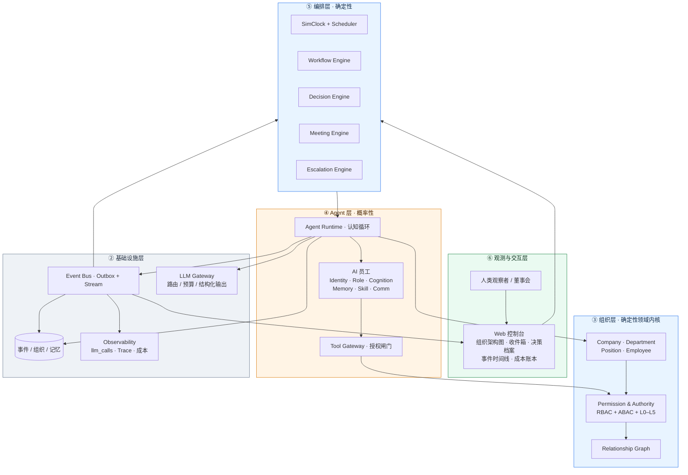
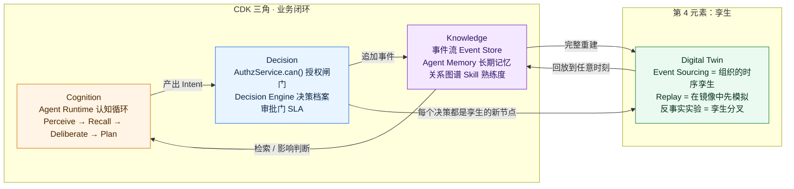

# MAOEH · Multi-Agent Organizational Emulation Hub

> **不是 Chatbot，不是单 Agent 助手，不是 Multi-Agent Task Pipeline，不是 Prompt Chain，不是自动化工作流工具。**
>
> 这是一个 **AI 组织仿真平台**，也是 **HAI（Human-Artificial Intelligence）的组织级实现**：
> 让一群长期存在的 AI 员工（NPC Agent）在一家虚拟科技公司里工作、沟通、协作、决策、积累经验，
> 并把整个过程暴露为**可回放的事件流**，供人类观察者观看、干预、甚至与 AI 同事并肩工作。

---

## 核心理念

判定一个设计是否"退化成普通 Agent Workflow"的试金石只有一条：

> **把所有任务删掉，这个系统还剩下什么？**
>
> 在 MAOEH 里，剩下的是一家**仍然活着的公司**——有组织架构、有上下级、有权限、有记忆、有关系、有议程、有日报。任务只是这家公司在某个时刻**产生**的东西。

### MAOEH 在 HAI 大图景中的位置

HAI（Human-Artificial Intelligence）关注的是"人智 × 机智"的双向反哺——知识数据化 / 数据知识化形成智能闭环。MAOEH 把这个命题从单 Agent 层面**上升到组织层面**：

| 维度 | 普通 Multi-Agent System | **MAOEH** |
|------|------------------------|-----------|
| 群智形态 | 无结构的自组织涌现 | **组织内嵌的群智主动协同**——有明确的汇报线、权限域、目标树、SoD 约束 |
| 知识形态 | 单一范式（规则 / 数据 / 生成式） | **知识工程 1.0 + 2.0 + 3.0 三层共存**——YAML 显式规则 → 事件流数据驱动 → LLM 生成式推理 |
| 人智 × 机智 | 人类在外面调参 | **双向反哺**——AI 的 Skill 从事件中成长（数据知识化）；人类的审批与干预被记录为新事件，反过来塑造 AI 的经验（知识数据化） |
| 人机关系 | HAI 1.0 工具型 或 HAI 2.0 辅助型 | **向 HAI 3.0 主动协作演进**——路线图 v0.5 起，人类可以作为 `kind: human` 的组织成员占据岗位，与 AI 同事同级协作 |

### 五条不可妥协的设计公理

| # | 公理 | 工程含义 |
|---|------|---------|
| **A1** | **组织先于任务** | 任何副作用操作必须携带 `ActorContext`（工号 + 岗位 + 权限域）。内核拒绝无主体的操作 |
| **A2** | **Agent 是长期实体，不是函数** | 独立于任务的生命周期与持久状态。没有任务时，系统仍能描述"每个员工此刻在做什么" |
| **A3** | **一切组织状态变更都是事件** | 唯一入口是 `append(event)`。状态变更不可绕过事件总线 → 可回放即可解释 |
| **A4** | **LLM 只能提议，内核才能执行** | LLM 输出被限制为结构化 `Intent`。权限校验、状态机跳转、审批判定 **100% 由确定性代码完成**。LLM 永不直接产生副作用 |
| **A5** | **员工之间不直接调用** | 没有 RPC，只有消息事件与订阅唤醒。耦合只发生在事件契约上 |

> **A4 与 A5 是本项目区别于"玩具 Demo"的工程底线。**
> 它们同时解决了多 Agent 系统最普遍的三种失败：越权操作、错误在调用链上复利放大、以及不可观测的隐式耦合。

---

## 它能做什么

一家典型的 MAOEH 公司有 **6–10 名 AI 员工**，每个员工拥有完整的"岗位人格"：

```
CEO Agent      —— 战略 · 资源分配 · 重大决策（L5 终裁）
CTO Agent      —— 技术方向 · 工程管理（L3 eng）
CPO Agent      —— 产品规划 · 用户需求（L3 product）

Engineering:  Backend · Frontend · QA（SoD 不能自测）
Product:       AI Research · Designer
Business:      Marketing · Growth · COO
```

每个 Agent 不是一个匿名 LLM 调用，而是一个有**独立身份**的实体：

| 维度 | 含义 |
|------|------|
| **Identity** | 工号、姓名、背景故事、价值观、说话风格 |
| **Role** | 岗位、部门、汇报线、职责范围、权限等级 |
| **Skill** | 能力清单、熟练度（**会成长、也会生疏**） |
| **Memory** | 工作经历、项目经验、历史决策、人际关系溯源 |
| **Relationship** | 汇报线、协作强度、信任度（**随事件演化**） |
| **Decision Authority** | L0–L5 决策等级与决策域 |

系统让它们像真实企业成员一样 **自动运转**：被事件唤醒、回忆经验、推理判断、规划行动、通过权限闸门、产出事件、写下记忆、更新关系。人类作为董事会观察者，**看见**这一切、**审批**重大决策、甚至**注入**外部事件（如竞品发布、用户投诉），观察组织如何响应。

---

## 架构速览



**分层要点：**

- 🔵 **蓝色 = 确定性**：组织层与编排层**不含任何 LLM 调用**，可被单元测试 100% 覆盖
- 🟠 **橙色 = 概率性**：只有 Agent 层会调用 LLM，且输出必须穿过授权闸门
- ⚪ **灰色 = 基础设施**：只提供机制，不承载业务判断
- 🟢 **绿色 = 观测**：人类看到的永远是**事件流的投影**

### 命令下行 · 事件上行（CQRS + Event Sourcing）

```
写入路径：Intent → Command → 内核裁决（权限 / 状态机 / 审批）→ append(OrgEvent)
读取路径：org_events → Projector（投影成读模型）+ Reactor（唤醒 / 推进流程）+ Streamer（推给人类）
```

**事件是唯一真相源。** 所有读模型都可以从 `org_events` 完整重建，每条事件携带 `causation_id`（直接原因）与 `correlation_id`（同一条业务链），任何 Agent 行为都能被追溯到最初触发它的那一条事件。

### CDK 三角 + 第 4 元素「孪生」

如果换一个视角看 MAOEH 的架构，它正好踩在 HAI 领域两个关键框架的交点上：



**CDK 三角**（Cognition–Decision–Knowledge）说的是"认知-决策-知识两两协同形成业务闭环"。MAOEH 的每一条核心路径都是这个三角的具体化：认知循环产出 Intent → 权限闸门做决策 → 事件流沉淀为知识 → 下次认知又从知识里检索。**三角缺一角就不是组织，而是流水线。**

**第 4 元素「孪生」** 在 CDK 之外引入"数字孪生"，形成四角架构，强调"在镜像中先模拟"。MAOEH 的 Event Sourcing + Replay 天然是组织的时序孪生——它不是事后归档，而是运行时就维护着一条可回溯的完整镜像。路线图 v1.0 的"时间旅行 + 反事实实验"就是孪生的高级形态：在镜像上分叉出一条新的世界线，对比不同决策下组织的长期演化。这也正是 MAOEH 区别于"一次性执行"的多 Agent 系统的根本不同——**MAOEH 不只是运行组织，MAOEH 让组织成为可被研究的对象。**

> 数字工程视角：MAOEH 当前处于 **数字工程 3.0（数智空间）**——知识与 AI 已融合，但还没有完全的数实融合。路线图 v1.x 的"数字孪生组织 + 多公司竞争"会把它推到 **4.0（数智生态）**。

---

## Agent 核心：一次认知循环

每个 AI 员工的每次行动都走同一条 10 阶段流水线：

```
① Wake 唤醒        事件 / 日程 / 发言权 → WakeRequest
② Load 载入        AgentState + 工作记忆 + 收件箱增量
③ Perceive 感知    原始输入 → 结构化 Perception          ← LLM
④ Recall 回忆      四因子检索 → RecallBundle             ← 记忆系统
⑤ Deliberate 推理  这件事对我意味着什么？我该做吗？        ← LLM
⑥ Plan 规划        产出 Plan（动作取自封闭 Action Space）  ← LLM
⑦ Authorize 授权   ★ 确定性代码，零 LLM —— 权限闸门
⑧ Act 行动         逐 Step 执行，每步前落检查点
⑨ Observe 观察     成功 / 失败 / 返工 / 拒绝
⑩ Reflect 更新     写记忆 · 更新关系 · 更新技能 · 自调度
```

**第 ⑦ 步是整个系统的安全核心：**

```
LLM：「我要发布 v1.0」
        ↓
   AuthzService.can(cto, 'workflow.approve', 'wf:product_dev#step:release')
        ├── allow ────────→ 执行
        ├── NEEDS_APPROVAL → 改写为 RequestApproval(escalateTo: 'ceo')
        └── NO_PERMISSION ─ → 改写为 Escalate(reason)
```

**LLM 的文本永远不会直接成为一个副作用。**

### 知识工程 1.0 / 2.0 / 3.0 — 三层共存

MAOEH 不押注单一知识范式，而是把三代知识工程融合进同一个架构：

| 代际 | 范式 | MAOEH 中的体现 | 例子 |
|------|------|---------------|------|
| **1.0** 经验 / 规则驱动 | 显式知识 | YAML 档案 + Zod Schema + Permissions | 岗位定义、权限规则、Action Space 枚举——不会因为 LLM 输出而改变 |
| **2.0** 仿真 / 数据驱动 | 从事件中沉淀的知识 | Event Store + Agent Memory + 关系图谱 + Skill 熟练度 | "Backend 工程师过去三次发布都被 QA 打回" → 下次发布前它会主动自检；信任度随协作事件提升 |
| **3.0** 生成式 AI 驱动 | LLM 实时推理 | Agent Cognition（Perceive / Deliberate / Plan）| 面对一个新任务，LLM 综合三因子（目标相关性 / 上下文相似性 / 重要性阈值）检索记忆后，产出这次的独特行动方案 |

1.0 是护栏（不变的规则），2.0 是沉淀（可变的经验），3.0 是当下的推理——**三层各司其职，又通过事件流紧密耦合**。如果一个系统只有 3.0，那它就是一个 Prompt Chain；如果只有 1.0，那它就是一个规则引擎。MAOEH 的价值在于三层同时存在。

### 人智 × 机智 · 双向反哺

每个 Agent 的 Reflect 步骤（⑩）和人类在控制台的干预，共同构成了 HAI "知识数据化 / 数据知识化"的闭环：

```
机智 → 人智（数据知识化）：
  Agent 从事件流中学习 → Skill 熟练度增长 → 下次做出更好的判断 → 产出更好的事件

人智 → 机智（知识数据化）：
  人类审批 / 拒绝 / 注入事件 → 这些被记录为新事件 → Agent 从中学到边界与偏好
```

这不是单向的"人指挥机"或"机辅助人"，而是**双向塑造**——30 天仿真后回看，你会看到：
- CTO Agent 的"技术保守"是第 8 天一次被人类驳回激进方案后形成的
- 后端工程师的"发布前加埋点"Skill 来自第 12 天被 QA 打回的那次经历
- 整个组织"做新手引导容易翻车"这个隐性规范，是三次失败复盘在记忆中留下的模式

---

## 技术栈

| 层 | 选择 | 核心理由 |
|----|------|---------|
| 语言 | **TypeScript (Node ≥ 22)** | 全栈同语言，Schema 跨层复用；领域模型复杂度决定强类型是必需品 |
| 仓库 | **pnpm workspaces + Turborepo** | 模块边界即目录边界，依赖方向可用工具强制 |
| 前端 | **React 19 + Vite 6** | 控制台是核心交付物（组织图 / 时间线 / 收件箱） |
| LLM 接入 | **自研 `llm-gateway`** | 必须能记录每次请求响应（重放）、预算记账、结构化输出强制、模型分级路由 |
| 结构化输出 | **Zod Schema → JSON Schema → provider tool/JSON mode** | 与权限、Action Space 枚举天然对齐 |
| 测试 | **Vitest + fast-check** | 属性测试是组织不变量的最佳工具 |

> MVP 规划的 PostgreSQL 16 + pgvector / Redis 7 尚未引入——当前实现采用 **文件事件存储 + 进程内状态**，确保确定性仿真可离线运行。

---

## 仓库结构

```
Multi-Agent-Organizational-Emulation-Hub/
│
├─ packages/                        # 28 包（权威清单见 docs/architecture/package-registry.md）
│  ├─ 组织内核
│  │   ├─ organization-model/       # 组织实体（Company/Department/Position/Employee）+ 图谱
│  │   ├─ organization-control/     # 控制平面：状态机 / 授权 / Agent 生命周期
│  │   ├─ permission-system/        # RBAC + ABAC + L0–L5 决策等级 + 审批门
│  │   └─ identity-system/          # User / Owner / Founder
│  ├─ 事件基础设施
│  │   ├─ event-system/             # 事件分类法 + 注册 + 创建
│  │   ├─ event-store/              # FileEventStore + InMemoryEventStore（可回放）
│  │   └─ persistence/              # 持久化层接口
│  ├─ Agent 层
│  │   ├─ agent-definition/         # YAML 档案加载 + Zod Schema 校验
│  │   ├─ agent-cognition/          # 认知档案 + 推理 + 规划 + 上下文构建
│  │   ├─ agent-runtime/            # 10 阶段认知循环 + 运行时决策 + Turn 校验
│  │   ├─ agent-memory/             # 记忆系统（规划中）
│  │   └─ agent-tools/              # Tool Gateway（规划中）
│  ├─ 编排层
│  │   ├─ workflow-engine/          # 流程模板 + 审批门 + 状态机 + 验证
│  │   ├─ task-system/              # Task 实体 + 派发 + 验收分离
│  │   ├─ runtime-scheduler/        # SimClock + Scheduler + 三路唤醒
│  │   ├─ decision-engine/          # 提案 / 评议 / 表决（规划中）
│  │   ├─ meeting-engine/           # 议程 / 发言权轮转（规划中）
│  │   ├─ escalation-engine/        # 卡死检测 / 升级阶梯（规划中）
│  │   └─ agent-communication/      # 频道 / 消息 / @提及 / 协作请求
│  ├─ 支撑
│  │   ├─ llm-gateway/              # OpenAI 兼容 + Mock provider + 预算 + 结构化输出
│  │   ├─ runtime-state/            # AgentState + StateStore
│  │   ├─ observability/            # llm_calls 账本
│  │   ├─ audit-system/             # 审计记录 + 审计服务
│  │   ├─ artifact-system/          # 产物存储
│  │   ├─ knowledge-system/         # 文档存储
│  │   ├─ authority-engine/         # 权威边界（规划中）
│  │   ├─ policy-engine/            # 组织政策（规划中）
│  │   ├─ config/                   # 配置加载
│  │   └─ shared-types/             # 跨包共享类型
│
├─ apps/
│  ├─ api/                           # HTTP API 服务（Node）
│  ├─ kernel/                        # 运行时内核（仿真 / 调度 / 快照）
│  ├─ projector/                     # 读模型投影
│  └─ web/                           # React 控制台（组织图 / Agent 档案 / 收件箱 / 时间线）
│
├─ agents/
│  └─ future-ai-lab/                 # ★ AI 员工档案（YAML，数据非代码）
│       ├─ company.yaml              # 公司配置
│       ├─ departments/              # 部门定义
│       ├─ positions/                # 岗位模板（CEO / CTO / 工程师 / QA …）
│       ├─ agent-definitions/        # Agent 定义（CEO-Alex / CTO-John / …）
│       ├─ employees/                # 具体员工实例
│       └─ cognition/                # 认知档案（exec-strategic / tech-task / …）
│
├─ tests/
│  ├─ architecture/                  # 架构守卫测试（强制依赖方向 / 结构边界）
│  ├─ unit/                          # 单元测试
│  ├─ integration/                   # 集成测试（Agent 生命周期 / 流程派发 / 协作请求 …）
│  ├─ simulation/                    # 仿真测试（确定性 / 恢复 / 控制回路）
│  ├─ acceptance/                    # 验收测试（运行时健康度 / 预览 / 协作 / 交付物）
│  ├─ e2e/                           # E2E（Playwright / 浏览器自动化）
│  └─ helpers/                       # Test fixtures
│
├─ database/migrations/              # SQL DDL（001–005，当前实现未用 PG）
├─ docs/                             # 架构文档（权威入口：docs/architecture/README.md）
├─ .github/workflows/ci.yml          # CI：typecheck → lint → architecture → unit → integration
└─ AGENTS.md                         # 开发规则（所有贡献者必读）
```

> **新增一个 AI 员工 = 新增一组 YAML 文件，不需要改任何 TypeScript。**
> 这是"Agent 独立性"落到工程上的具体形态，也是社区最容易贡献的入口。

---

## 当前实现状态

| 模块 | 状态 | 说明 |
|------|------|------|
| **Monorepo 骨架** | ✅ 完成 | 32 包 · 4 应用 · TypeScript 严格模式 · pnpm workspaces · Turborepo |
| **架构守卫** | ✅ 完成 | dependency-cruiser（9 条 forbidden 规则）+ ESLint + Vitest 结构守卫 |
| **LLM Gateway** | ✅ 可用 | Mock provider（确定性，供 CI 和仿真）+ OpenAI 兼容 provider + 预算 + Schema 校验 |
| **Organization Model** | ✅ 可用 | 公司 / 部门 / 岗位 / 员工 / 图谱 / 能力匹配 / YAML 加载 |
| **Permission System** | ✅ 可用 | ActorContext / AuthzService / Policy / ResourceRef / 拒绝原因分类 |
| **Event Store** | ✅ 可用 | FileEventStore（可持久化）+ InMemoryEventStore（测试友好）|
| **Agent Runtime** | ✅ 可用 | 10 阶段认知循环 + Turn 校验 + 运行时决策 + 事件产出 |
| **Agent Cognition** | ✅ 可用 | 认知档案加载 + 推理 + 规划 + 上下文构建 + Zod Schema 约束输出 |
| **Workflow Engine** | ✅ 可用 | 流程模板 + 审批门 + 状态机 + 验证 + 生成（含 Hiring 流程）|
| **Task System** | ✅ 可用 | Task 实体 + 派发 + 验收分离 + Store + 校验 |
| **Runtime Scheduler** | ✅ 可用 | SimClock + Scheduler + 唤醒策略 + 预算 |
| **Agent Communication** | ✅ 可用 | 频道 / 消息 / @提及 / 协作请求 / 投递 / 权限校验 |
| **Organization Control** | ✅ 可用 | 状态机 + 授权 + Agent 生命周期 + 事件定义 |
| **Ownership Store** | ✅ 可用 | Founder → Company → 激活切换，持久化到仓库外状态目录 |
| **Kernel（仿真）** | ✅ 可用 | Run-Tick / Plan-Executor / Snapshot / Work-Catalog |
| **API 服务** | ✅ 可用 | HTTP 入口（组织查询 / Agent 管理 / 流程 / 运行时控制） |
| **Web 控制台** | ✅ 可用 | Overview / **Network（协同网络画布）** / Agents / Events / Tasks / Workflows / **Canvas（暗色改派工作室）** / Runtime / Deliverables / Foundry / Communications / Approvals + 中英双语 |
| **交付物预览** | ✅ 可用 | **交付包**按工作流归组，游戏 / 文档 / 3D / 文件同屏；游戏在控制台内真实启动（含单文件 `index.html` 交付）；文档按 Markdown / HTML 纸面呈现；OBJ/STL 线框 3D 预览；一键下载 `.zip` |
| **Decision / Meeting / Escalation** | 📋 占位 | 有 index.ts 导出，领域逻辑待实现 |
| **Agent Memory / Tools / Knowledge** | 📋 占位 | MVP 规划的 Postgres + pgvector 方案暂未引入 |
| **数据库** | 📋 占位 | migrations 001–005 已写，当前实现用文件事件存储 |

---

## 协同网络画布（M2.0）

控制台的 **协同网络** 页把三个读模型放进同一张实时画布：

```
左侧：Agent（按部门）  ——  中央：3D 全息公司核心  ——  右侧：工作流分支
                              │
                        底部：最近交付物
```

- **不是新领域**：图上每个节点、每条边都来自 `snapshot` / `/api/workflows` / `/api/tasks`，
  不新增事件或持久化状态；被折叠的分支会明确显示数量。
- **3D 是视觉锚点，也是 Agent 的指针快捷方式**：CSS 3D 线框球（经线 + 纬线）、三条轨道环、
  投影底座与光锥，canvas 里是深度投影粒子和 6 个 Agent 信标；Agent / 工作流 / 交付节点分处
  不同 `translateZ` 深度，指针移动时是真实视差。鼠标移入全息体即暂停（球体、轨道、粒子一起
  冻结），点击环绕的信标，右侧检查器显示该员工的实时状态，与点左侧 Agent 卡片走同一条选择
  路径；信标只提供指针快捷方式，键盘/读屏用户仍走卡片。零依赖；关闭动效或
  `prefers-reduced-motion` 时全部静止，页面文字仍然完整可读。
- **交付剧场**：游戏卡在这里真的启动运行时分配的预览端口（支持单文件 `index.html` 交付）；
  文档卡按 Markdown / HTML 纸面渲染，HTML 运行在禁用脚本的 sandbox 帧。
- **全链路**：控制台 → 任务书 → 工作流 → 任务 → 交付物 → 预览，均走既有事件/权限/审计
  路径。设计细节见 [`docs/architecture/M2.0-network-canvas-delivery-preview.md`](docs/architecture/M2.0-network-canvas-delivery-preview.md)。

## 改派工作室与交付包（M2.1）

**改派画布**升级为暗色编排工作室，功能仍是 M1.8/M1.9 的那一条命令路径：

```
左侧团队（可拖 / 可点）  ——  中央纵向节点图 + 阶段轨道  ——  右侧节点检查
                              │
                    底部：改派理由 + 确认 / 放弃
```

- CEO 排好的流程直接以节点图呈现；草稿带“等待确认”横幅，确认后才开始执行。
- 把团队成员拖到待处理的 task 节点，或先点人再点节点；节点检查里也能直接选人。
- 节点显示能力、角色、权限、当前执行席位、已钉住 / 草稿 / SoD 标记；已进入的步骤锁定并说明原因。
- 内核仍在写入前复核雇佣状态、角色和权限；LLM 不参与这次改派。

**交付成果**现在是“一个交付包”，不再按任务各看各的：

- Deliverables 顶部按工作流归组，点开进入该包的交付页。
- 交付页的包视图把**游戏槽、文档纸面、3D 资产、全部文件**放在同一块暗色剧场里：
  - 游戏槽跳到唯一的实时预览（不重复启动服务器）；
  - 文档沿用安全 Markdown AST / sandbox HTML；
  - `.obj` / `.stl` 用零依赖线框 3D 预览，`.glb` / `.gltf` 如实标为“3D 资产可下载”；
  - 文件按步骤归组，支持逐个下载和**下载全部 `.zip`**（浏览器内 store-only ZIP）。
- 设计细节见 [`docs/architecture/M2.1-assignment-studio-delivery-package.md`](docs/architecture/M2.1-assignment-studio-delivery-package.md)。

---

## 快速开始

### 前置要求

- **Node.js ≥ 22**
- **pnpm 9.15.9**（项目锁定版本）

### 安装与启动

```bash
# 安装依赖（首次）
pnpm install

# 开发模式（watch build + dev server 并发）
pnpm dev

# 分别启动
pnpm build              # 先构建所有包
pnpm --filter @maoeh/api dev    # API 服务
pnpm --filter @maoeh/web dev   # Web 控制台

# 默认地址
# Web: http://localhost:5173
# API: http://localhost:3001
```

### 运行测试

```bash
pnpm typecheck          # 全部 32 个项目的 tsc --noEmit
pnpm lint               # ESLint 全仓
pnpm architecture:check # 架构守卫 + dependency-cruiser 全仓巡航
pnpm test               # 全部测试（unit + integration + simulation + acceptance）
pnpm test:unit          # 仅单元测试
pnpm test:integration   # 仅集成测试
```

### LLM 配置

项目默认运行在 **Mock 模式**（确定性 in-process provider，无需 API key）。

如需启用真实 LLM 调用：

```bash
cp .env.example .env
# 编辑 .env，设置：
#   MAOEH_LLM_MODE=live
#   MAOEH_LLM_API_KEY=sk-xxx
#   MAOEH_LLM_BASE_URL=https://api.deepseek.com
#   MAOEH_LLM_MODEL=deepseek-flash
```

> `.env` 已在 `.gitignore` 中，不会被提交。Mock 模式是 CI 和仿真的默认配置。

### 创建公司

首次启动时系统自带一个种子公司 **Future AI Lab**（Guest Founder 所有）。
你也可以在 Web 控制台的 **Foundry** 页面创建自己的 AI 公司：输入创始人姓名 + 公司名，系统自动生成完整的 Starter Organization（CEO / CTO / CPO / Backend / Frontend / QA 六位员工）。

---

## 架构强制执行

架构约束由三层独立机制机器强制：

| 层 | 工具 | 强制内容 |
|----|------|----------|
| 依赖方向 | **dependency-cruiser**（[`.dependency-cruiser.mjs`](.dependency-cruiser.mjs)）| F1–F12 禁令 + 环禁令 |
| 导入边界 | **ESLint**（[`eslint.config.mjs`](eslint.config.mjs)）| provider SDK 单出口、`@maoeh/persistence` 白名单、`apps/web` 禁后端包 |
| 结构守卫 | **Vitest**（[`tests/architecture/`](tests/architecture/)）| Registry↔目录双向一致、迁移冻结、A4 源码扫描、A5 结构启发式 |

CI 顺序固定为 **typecheck → lint → architecture → unit → integration**，见 [`.github/workflows/ci.yml`](.github/workflows/ci.yml)。

---

## 反退化检查清单

每个里程碑结束时逐条核对。任一条不通过即为**架构回退**：

- [ ] **无任务存活测试** —— 清空所有 Task 后，系统仍能输出组织架构、员工状态、日报与关系网
- [ ] **无匿名 LLM** —— 不存在可绕过 `ActorContext` 调用 LLM 的公开 API
- [ ] **无越权副作用** —— 所有副作用经过 `AuthzService.can()`，单测覆盖拒绝路径
- [ ] **无 Agent 间 RPC** —— `Agent` 类型上不存在指向另一个 `Agent` 的方法
- [ ] **可回放** —— `replay(0, now)` 能重建出与当前一致的读模型
- [ ] **工作流可偏离** —— Agent 能提出改步 / 退回 / 升级请求，且被内核记录而非静默忽略
- [ ] **记忆可追溯** —— 每条长期记忆都能回答"我在哪条事件上学到的"
- [ ] **人类可解释** —— 界面上任意组织状态都能一键跳到导致它的事件链

---

## 黄金演示路径

```
人类：「用户流失严重，建议做新手引导」
  ↓ 系统注入事件
CPO Agent 被唤醒 → 回忆"上次引导改版失败" → 产出 PRD → 启动产品开发流程
  ↓ 事件推流
CEO Agent 审批（人类可介入）→ 批准
  ↓
CTO Agent 技术评审 → 发起流程偏离：新增"设计评审"步骤 → ★ 等人类裁定
  ↓ 人类同意
后端 / 前端并行开发 → QA 测试 → 发现缺陷打回
  ↓
后端工程师二次提交（记忆里记下"这次要加埋点"）
  ↓
QA 通过 → 发布 → 产出《项目复盘》+ 关系变化 + 技能成长 + 成本账单
```

这条路径一次性验证了：事件驱动、Agent 自主性、记忆影响决策、组织权限、流程可偏离、人在环路、失败与返工、以及成本核算。

---

## 路线图 · 向 HAI 3.0 主动协作演进

```
HAI 1.0 被动响应 · 工具型智能体
─────────────────────────────────
v0.1 · 活着的公司   ← 当前
  6 员工 · 组织内核 + Agent 运行时 + 记忆 + 权限 + 流程 + 决策 + 观测
  人类作为"董事会"——看见、审批、注入事件
        ↓

HAI 2.0 辅助决策 · 辅助型智能体
─────────────────────────────────
v0.2 · 会长大的公司
  招聘 / 晋升 / 转岗 · 组织变革决策 · 完整会议引擎 · 组织健康度仪表盘
v0.3 · 有压力的公司
  预算硬约束 · 内部计价 · 文化偏置 · 成本-绩效闭环
v0.4 · 会干活的公司
  代码沙箱 · CI 集成 · 文档产出 · sideEffect/idempotent 契约
        ↓

HAI 3.0 主动协作 · 协同型智能体
─────────────────────────────────
v0.5 · 有人的公司
  冲突 · 联盟 · 谈判 · 调解（全透明观察）
  ★ 人类可作为 kind: human 的组织成员占据岗位，与 AI 同事同级协作
v1.0 · 可实验的平台
  时间旅行 + 反事实实验 · 插件生态 · SDK
  ★ 数字孪生成熟：在镜像上分叉世界线，对比不同决策下组织演化
        ↓

v1.x · 有市场的生态
  多公司竞争 · 数字孪生组织 · 开放数据集
  ★ 组织间群智主动协同（不是一个大公司，是多个公司在市场中互动）
```

### 项目红线（永远不做）

| 不做 | 理由 |
|------|------|
| 变成通用工作流编排引擎（对标 n8n / Zapier） | 那会把"组织"降格成"流程图"，正是本项目要反对的 |
| 让 LLM 直接产生副作用（不加授权闸门） | 摧毁 A4 公理与全部审计价值 |
| 用隐藏状态驱动行为 | 违反 Human Observation 原则 |
| 自动扩编 / 自动优化组织结构 | 组织变革必须是"被决策的"，否则退化为调度器 |
| 语音 / 多模态 | 与"组织仿真"核心命题无关 |

> 一个会自己优化自己的组织结构、不需要任何人拍板的系统，就不再是"公司仿真"，而是一个优化器——它可能很高效，但**不再能回答"组织是如何运作的"**。本项目的价值在于**理解**，不在于**最优**。

---

## 架构文档

完整设计见 [`docs/architecture/`](docs/architecture/)。文档本身即**开发契约**。

| 文档 | 内容 |
|------|------|
| [ARCHITECTURE-BASELINE](docs/architecture/ARCHITECTURE-BASELINE.md) | **冻结基线（最高权威）**：17 节架构契约 + Architecture Change Process |
| [Package Registry](docs/architecture/package-registry.md) | 28 包命名裁定、职责、公共 API、允许/禁止依赖、层归属 |
| [Dependency Graph](docs/architecture/dependency-graph.md) | 六层依赖方向、F1–F13 禁令、机器强制配置设计 |
| [01-overview](docs/architecture/01-overview.md) | 五条公理、分层架构、命令/事件双通路、部署拓扑 |
| [02-modules](docs/architecture/02-modules.md) | 核心模块职责边界、依赖方向硬规则、TypeScript 接口契约 |
| [03-data-model](docs/architecture/03-data-model.md) | 组织实体、关系模型、权限模型、记忆模型、事件模型 |
| [04-agent-lifecycle](docs/architecture/04-agent-lifecycle.md) | 两层状态模型、六阶段装配流水线、封闭 Action Space |
| [05-runtime](docs/architecture/05-runtime.md) | 10 阶段认知循环、授权闸门、检查点与幂等恢复 |
| [06-mvp-scope](docs/architecture/06-mvp-scope.md) | 范围/不做清单、技术选型、8 周里程碑、12 条验收标准 |
| [07-roadmap](docs/architecture/07-roadmap.md) | 组织演化、文化、多公司市场、工具生态、项目红线 |
| [08-adr](docs/architecture/08-adr.md) | 关键架构决策 + 理由 + 备选方案 + 复审触发条件 |
| [M2.0-network-canvas-delivery-preview](docs/architecture/M2.0-network-canvas-delivery-preview.md) | 协同网络画布、3D 点缀、游戏/文档交付物预览的实现契约与验收 |
| [M2.1-assignment-studio-delivery-package](docs/architecture/M2.1-assignment-studio-delivery-package.md) | 暗色改派工作室、交付包（游戏 / 文档 / 3D / 文件 / ZIP）的实现契约与验收 |

---

## 贡献指南

MAOEH 的架构约束比一般项目严格——这不是坏事，是**让贡献有明确边界**。
请先读一遍 [`AGENTS.md`](AGENTS.md) 和 [`docs/architecture/ARCHITECTURE-BASELINE.md`](docs/architecture/ARCHITECTURE-BASELINE.md)，再动手。

### 贡献前必读

| 必读 | 为什么 |
|------|--------|
| **五条设计公理**（A1–A5） | 任何 PR 都不能违反——违反即拒 |
| **Package Registry** | 每个包的职责边界、允许/禁止依赖、层归属 |
| **Architecture Baseline** | 冻结的架构契约 + Architecture Change Process |
| **反退化检查清单** | 每个 PR 过一遍自己有没有踩线 |

### 贡献入口（从易到难）

#### 🟢 Level 1 · 零代码贡献（最容易）

新增 AI 员工档案或流程模板——这是 MAOEH 最独特的贡献方式。

```
新增一个 CTO 人设：
  agents/<company>/agent-definitions/cto-xxx.yaml
  agents/<company>/employees/cto-xxx.yaml
  agents/<company>/cognition/cto-xxx.yaml

新增一个流程模板：
  workflows/<workflow>.yaml
```

**不需要改任何 TypeScript。** 写 YAML → Zod 校验通过 → Agent 自动获得新岗位。

#### 🟡 Level 2 · 实现占位包

以下包有 `index.ts` 导出但领域逻辑待实现，**有现成的接口契约和测试夹具**：

| 包 | 说明 | 参照 |
|----|------|------|
| `decision-engine/` | 提案 → 评议 → 表决 → 决策档案 | `workflow-engine/` 的审批门实现 |
| `meeting-engine/` | 议程 + 发言权轮转 + 纪要 | `agent-communication/` 的频道实现 |
| `escalation-engine/` | 卡死检测 + SLA 超时 + 熔断升级 | `runtime-scheduler/` 的唤醒策略 |
| `agent-memory/` | 三因子检索 + importance 门控 + 反思触发 | `event-store/` 的回放 + `agent-runtime/` 的 Recall 步骤 |
| `agent-tools/` | Tool Gateway + sideEffect/idempotent 契约 | `llm-gateway/` 的结构化输出模式 |
| `knowledge-system/` | 文档存储 + 语义检索 | `artifact-system/` 的 Store 模式 |

#### 🔴 Level 3 · 架构性改动

改动跨包边界、调整分层、新增基础设施——**必须先提 RFC**：

1. 在 Issue 里用 RFC 模板说明：动机、方案、备选方案、对五条公理的影响
2. 指定 Architecture Baseline 的哪些节需要修改、走 Architecture Change Process
3. 明确测试策略（哪些属性测试需要更新）

### 提交前自检

```bash
pnpm typecheck          # 全部 32 包 typecheck 必须通过
pnpm lint               # ESLint 全仓
pnpm architecture:check # 架构守卫（dependency-cruiser + Vitest 结构测试）
pnpm test               # 全量测试通过
```

**CI 按 typecheck → lint → architecture → unit → integration 顺序跑。**
任何一步红 → 合并请求被自动拒绝。

### 不能做的事（PR 红线）

| ❌ | 理由 |
|----|------|
| 绕过 AuthzService 产生副作用 | 违反 A4 公理 |
| 在 Agent 之间加同步 RPC | 违反 A5 公理 |
| 用 LLM 输出直接写数据库 / 调外部 API | 违反 A4 公理 |
| 在 agents/ YAML 里写业务逻辑代码 | YAML 是数据，不是代码 |
| 新增包不注册到 package-registry | 架构守卫会拦截 |
| 让 `.env` 进入 Git | API key 泄漏 |

---

## License

[MIT License](LICENSE) © 2025–2026 MAOEH Contributors.

这是最宽松也最主流的开源许可之一（Vite、Turborepo、Vitest 均使用 MIT），
允许任何人自由使用、复制、修改、发布、分发，无需担心专利或 Copyleft 条款。
