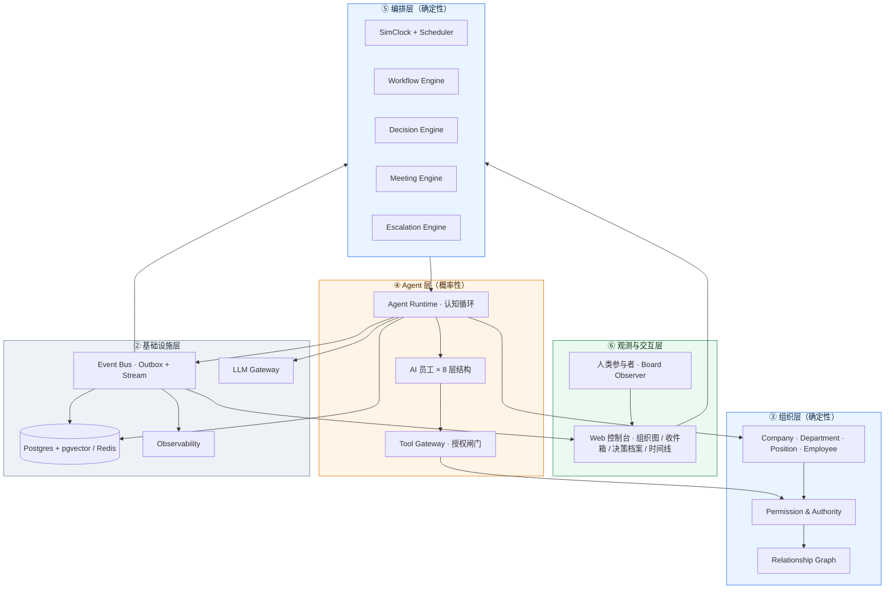

# Multi-Agent Organizational Emulation Hub

> **不是 Chatbot，不是单 Agent 助手，不是 Multi-Agent Task Pipeline，不是 Prompt Chain，不是自动化工作流工具。**
>
> 这是一个 **AI 组织仿真平台**：一家虚拟科技公司里，每个 NPC 都是一名**长期存在的 AI 岗位员工**。

---

## 这个项目在做什么

我们模拟一家 AI 科技公司（`Future AI Lab`）的完整运行。公司里有：

```
CEO Agent      —— 公司战略 · 资源分配 · 重大决策
CTO Agent      —— 技术方向 · 工程团队管理
CPO Agent      —— 产品规划 · 用户需求
COO Agent      —— 公司运营 · 流程协调

Engineering:  Backend · Frontend · AI Research · QA
Marketing:    Marketing · Growth
```

**这些 Agent 不是一次性任务执行器，而是长期存在于组织中的数字员工。** 每个员工拥有：

| 维度 | 含义 |
|------|------|
| **Identity** | 工号、姓名、背景故事、价值观、说话风格 |
| **Role** | 岗位、部门、汇报线、职责范围 |
| **Responsibility** | 我负责什么、我不负责什么 |
| **Goal** | 我的当前目标与优先级 |
| **Skill** | 能力清单、熟练度（**会成长、也会生疏**） |
| **Memory** | 工作经历、项目经验、历史决策、人际关系 |
| **Personality** | 风险偏好、沟通风格、协作倾向 |
| **Relationship** | 汇报线、协作强度、信任度（**会随时间演化**） |
| **Permission** | 由岗位推导的权限与作用域 |
| **Decision Authority** | L0–L5 决策等级与决策域 |

系统让它们像真实企业成员一样**工作、沟通、汇报、协作、决策、解决冲突、积累经验、推动组织发展**。

---

## 一句话架构

> **以「组织」为第一性抽象的事件驱动内核**：
> 它维护组织实体、权限体系与长期记忆，驱动一群长期存在的 AI 员工在其中工作，
> 并把整个过程暴露为**可回放的事件流**。

判定一个设计是否"退化成普通 Agent Workflow"的试金石只有一条：

> **把任务全部删掉，这个系统还剩下什么？**
> 在 MAOEH 里，剩下的是一家**仍然活着的公司**——有组织架构、有上下级、有权限、
> 有记忆、有关系、有议程、有日报。任务只是这家公司在某个时刻**产生**的东西。

---

## 五条设计公理

| # | 公理 | 工程含义 |
|---|------|---------|
| **A1** | **组织先于任务** | 任何副作用操作必须携带 `ActorContext`（工号 + 岗位 + 权限域） |
| **A2** | **Agent 是长期实体，不是函数** | 独立于任务的生命周期与持久状态 |
| **A3** | **一切组织状态变更都是事件** | 唯一入口是 `append(event)`，可回放即可解释 |
| **A4** | **LLM 只能提议，内核才能执行** | LLM 输出是结构化 `Intent`；权限与状态机 100% 由确定性代码裁决 |
| **A5** | **员工之间不直接调用** | 没有 RPC，只有事件与订阅；耦合只发生在事件契约上 |

> **A4 与 A5 是本项目区别于"玩具 Demo"的工程底线。**

---

## 架构速览



---

## 架构文档

完整设计见 [`docs/architecture/`](docs/architecture/)。文档本身即**开发契约**。

| 阶段 | 文档 | 内容 |
|------|------|------|
| **基线** | [ARCHITECTURE-BASELINE](docs/architecture/ARCHITECTURE-BASELINE.md) | **冻结基线（最高权威）**：17 节架构契约 + Architecture Change Process |
| **基线** | [Package Registry](docs/architecture/package-registry.md) | 28+4 包命名裁定、职责、公共 API、允许/禁止依赖、层归属 |
| **基线** | [Dependency Graph](docs/architecture/dependency-graph.md) | 六层依赖方向、F1–F13 禁令、环禁令、机器强制配置设计 |
| **索引** | [文档索引与废弃名对照](docs/architecture/README.md) | 全部文档的 Purpose/Authority/Status + 废弃名称表 |
| **Phase 1** | [项目整体架构](docs/architecture/01-overview.md) | 五条公理、分层架构、命令/事件双通路、部署拓扑、反退化检查清单 |
| **Phase 2** | [核心模块拆分](docs/architecture/02-modules.md) | 20 个模块的职责边界、依赖方向硬规则、**TypeScript 接口契约**、测试策略 |
| **Phase 3** | [数据模型设计](docs/architecture/03-data-model.md) | 组织实体、关系模型、**权限模型（RBAC+ABAC+L0–L5）**、记忆模型、事件模型、工作流/决策表、SQL DDL |
| **Phase 4** | [Agent 生命周期](docs/architecture/04-agent-lifecycle.md) | 两层状态模型、**六阶段装配流水线**、封闭 Action Space、学习闭环、组织演化 |
| **Phase 5** | [Runtime 运行流程](docs/architecture/05-runtime.md) | **10 阶段认知循环**、授权闸门、检查点与幂等恢复、调度与三路唤醒、MAST 失败模式防线、成本模型 |
| **Phase 6** | [MVP 实现范围](docs/architecture/06-mvp-scope.md) | 范围/不做清单、技术选型、8 周里程碑（Gantt）、**12 条验收标准**、黄金演示路径 |
| **Phase 7** | [未来扩展方向](docs/architecture/07-roadmap.md) | 组织演化、文化、多公司市场、经济系统、工具生态、反事实实验、项目红线 |
| **附录 A** | [架构决策记录 ADR](docs/architecture/08-adr.md) | 12 条关键决策 + 理由 + 备选方案 + **复审触发条件** |
| **附录 B** | [参考研究简报](docs/research/research-brief.md) | 同类项目对照、记忆架构、持久化执行、多 Agent 失败模式、可观测性（**全部带引用**） |
| **附录 C** | [对抗性评审报告](docs/review/architecture-review.md) | 独立评审：4 阻断 / 14 重要 / 9 内部矛盾 / 12 遗漏项，逐条带文件与行号证据 |
| **附录 D** | [修订记录](docs/review/revision-log.md) | 对评审的逐条处置 + **已知遗留清单**（明确哪些是有意延后） |

---

## 架构强制执行（M0.1）

架构约束由**三层相互独立**的机制机器强制（规则权威是 [dependency-graph.md §5](docs/architecture/dependency-graph.md) 与 [package-registry.md](docs/architecture/package-registry.md)，本节只记录如何运行）：

| 层 | 工具 | 配置 | 强制内容 |
|----|------|------|----------|
| 依赖图 | dependency-cruiser | [`.dependency-cruiser.mjs`](.dependency-cruiser.mjs) | F1–F12 禁令 + 环禁令（9 条 forbidden 规则，全仓巡航） |
| 导入边界 | ESLint | [`eslint.config.mjs`](eslint.config.mjs) | provider SDK 单出口、`@maoeh/persistence` 白名单、`apps/web` 禁后端包 |
| 结构守卫 | Vitest | [`tests/architecture/`](tests/architecture/) | Registry↔目录双向一致、迁移 0 字节冻结、A4 源码扫描、A5 结构启发式 |

| 命令 | 作用 |
|------|------|
| `pnpm typecheck` | 全部 32 个项目的 `tsc --noEmit`（turbo 任务） |
| `pnpm lint` | ESLint 全仓 |
| `pnpm architecture:check` | 架构测试（内含 dependency-cruiser 全仓巡航） |
| `pnpm test` / `pnpm test:unit` / `pnpm test:integration` | Vitest |
| `pnpm build` | Turbo 构建 |

CI 顺序固定为 **typecheck → lint → architecture → unit → integration**（§5.3），见 [`.github/workflows/ci.yml`](.github/workflows/ci.yml)。

> A5 层是**结构启发式守卫**（`sendTo(` / `interface Agent` 内 Agent 类型成员 / `agentToAgent` 标识符），只能拦截已知反模式的文本形态，**不构成**「Agent 之间无 RPC」的语义证明。

---

## Runtime 核心：一次认知循环

```
① Wake 唤醒        事件 / 日程 / 发言权 → WakeRequest
② Load 载入        AgentState + 工作记忆 + 收件箱增量
③ Perceive 感知    原始输入 → 结构化 Perception          ← LLM
④ Recall 回忆      四因子检索 → RecallBundle             ← 记忆系统
⑤ Deliberate 推理  这件事对我意味着什么？我该做吗？        ← LLM
⑥ Plan 规划        产出 Plan（动作取自封闭 Action Space）  ← LLM
⑦ Authorize 授权   ★ 确定性代码，零 LLM —— 权限闸门
⑧ Act 行动         逐 Step 执行，每步前落检查点
⑨ Observe 观察     成功 / 失败 / 返工 / 拒绝
⑩ Reflect 更新     写记忆 · 更新关系 · 更新技能 · 自调度
```

**第 ⑦ 步是整个系统的安全核心：**

```
LLM：「我要发布 v1.0」
        ↓
   AuthzService.can(cto, 'workflow.approve', 'wf:product_dev#step:release')
        ├── allow ────────→ 执行
        ├── NEEDS_APPROVAL → 改写为 RequestApproval(escalateTo: 'ceo')
        └── NO_PERMISSION ─ → 改写为 Escalate(reason)
```

**LLM 的文本永远不会直接成为一个副作用。**

---

## 仓库结构（已按 Architecture Baseline 冻结）

```
Multi-Agent-Organizational-Emulation-Hub/
├─ packages/                 # 28 包 — 权威清单见 docs/architecture/package-registry.md
│  ├─ shared-types/  organization-model/  identity-system/
│  ├─ permission-system/  authority-engine/  policy-engine/
│  ├─ event-system/  event-store/  persistence/  config/
│  ├─ agent-memory/  llm-gateway/  agent-tools/
│  ├─ observability/  audit-system/  knowledge-system/  artifact-system/
│  ├─ agent-definition/  agent-cognition/
│  ├─ agent-runtime/  runtime-state/  runtime-scheduler/
│  └─ workflow-engine/  task-system/  decision-engine/
│      meeting-engine/  agent-communication/  escalation-engine/
├─ apps/                    # kernel · api · projector · web（React + Vite）
├─ agents/future-ai-lab/    # ★ AI 员工档案（YAML，数据非代码）
├─ workflows/               # ★ 流程模板（YAML，数据非代码）
├─ database/migrations/     # 001–005（SCHEMA GAP 待补 · BASELINE §15）
├─ tests/                   # unit · integration · e2e · simulation
└─ docs/                    # 权威入口：docs/architecture/README.md
```

> **新增一个 AI 员工 = 新增一个 YAML 文件，不需要改任何 TypeScript。**
> 这是"Agent 独立性"落到工程上的具体形态，也是社区最容易贡献的入口。

---

## 技术选型（MVP）

| 层 | 选择 | 核心理由 |
|----|------|---------|
| 语言 | TypeScript (Node 22) + pnpm monorepo | 全栈同语言，Schema 跨层复用；保留 Python 认知层逃生通道 |
| 存储 | **PostgreSQL 16 + pgvector** | 事件 / 组织 / 记忆 / 队列 / 向量**同库同事务** → 无分布式事务 |
| 缓存 | Redis 7 | 工作记忆 TTL + 唤醒优先队列（可丢失数据） |
| 运行时 | Postgres-first（outbox + 作业队列） | 部署极简；已预设 Temporal/Restate 升级触发条件 |
| 前端 | React + Vite + React Flow | 组织图与时间线都是图结构 |
| 可观测 | OTel 采集 + **自建 `llm_calls` 表为真相源** | 重放模式要求 LLM 请求响应可复现 |
| 测试 | Vitest + fast-check + Playwright | 属性测试是组织不变量的最佳工具 |

---

## 反退化检查清单

在每个里程碑结束时逐条核对。任一条不通过即为**架构回退**。

- [ ] **无任务存活测试** —— 清空所有 Task 后，系统仍能输出组织架构、员工状态、日报与关系网
- [ ] **无匿名 LLM** —— 不存在可绕过 `ActorContext` 调用 LLM 的公开 API
- [ ] **无越权副作用** —— 所有副作用经过 `AuthzService.can()`，单测覆盖拒绝路径
- [ ] **无 Agent 间 RPC** —— `Agent` 类型上不存在指向另一个 `Agent` 的方法
- [ ] **可回放** —— `replay(0, now)` 能重建出与当前一致的读模型
- [ ] **工作流可偏离** —— Agent 能提出改步/退回/升级请求，且被内核记录而非静默忽略
- [ ] **记忆可追溯** —— 每条长期记忆都能回答"我在哪条事件上学到的"
- [ ] **人类可解释** —— 界面上任意组织状态都能一键跳到导致它的事件链

---

## 项目状态

| 项 | 状态 |
|----|------|
| 架构设计 | ✅ 完成（Phase 1–7 + ADR） |
| Architecture Baseline | ✅ **FROZEN v1.0**（2026-09-30 · [ARCHITECTURE-BASELINE.md](docs/architecture/ARCHITECTURE-BASELINE.md)） |
| 代码实现 | ⬜ 未开始（scaffold 可编译，0 个模块实现） |
| MVP 目标 | 6 名 AI 员工 · 1 条产品开发流程 · 完整记忆与权限 · 人类可观测可干预 |
| 预计工期 | 70–87 人日（约 8 周，单人全职） |

---

## 贡献方向

暂未开放代码贡献，但以下方向门槛极低、价值极高：

1. **新增一个 AI 员工档案**（`agents/**/*.yaml`）—— 一个有趣的人设就是一个新 NPC
2. **新增一个流程模板**（`workflows/*.yaml`）—— 例如"招聘流程""事故复盘流程"
3. **补充研究对照**（`docs/research/`）—— 尤其是同类开源项目的架构分析
4. **评审架构文档** —— 对 ADR 提出反例或复审触发条件

---

## 项目规则

本项目的开发规则见根目录 [`AGENTS.md`](AGENTS.md)。
所有设计必须服从其中的 **Organization First / Agent Independence / Event Driven / Human Observation** 原则，
以及 **Agent Layer / Runtime Layer / Infrastructure Layer 不得互相污染** 的分层约束。

---

## License

待定（建议 Apache-2.0，与生态友好的开源定位匹配）。
