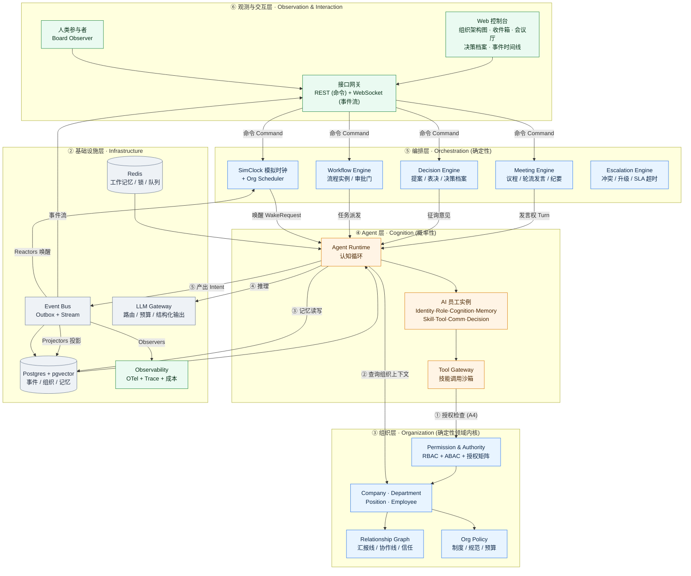
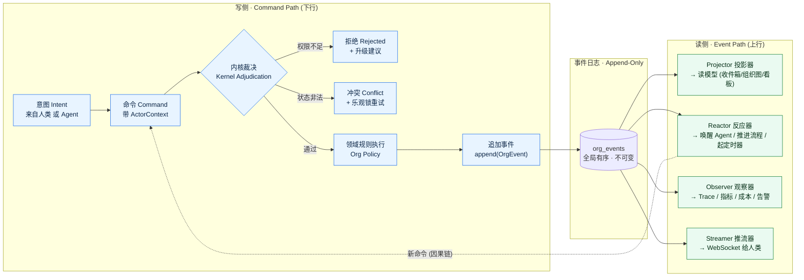
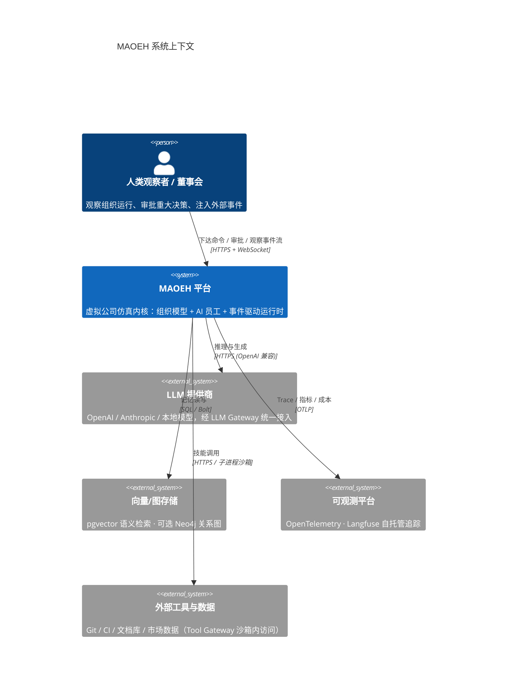
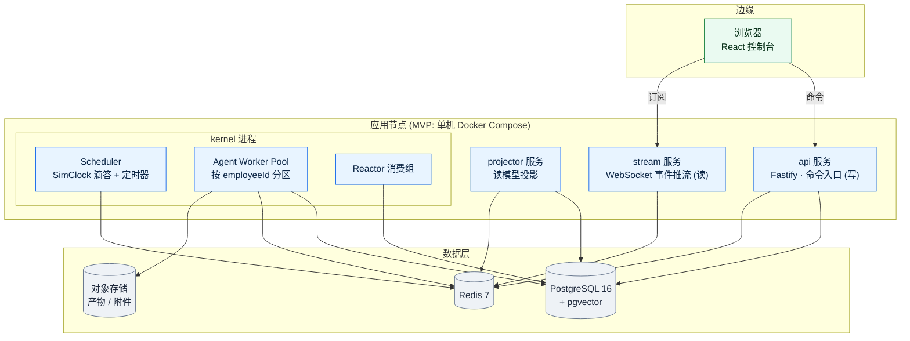

# Phase 1 · 项目整体架构

> Multi-Agent Organizational Emulation Hub (MAOEH)
> 一个模拟真实科技公司运行的 **AI 组织仿真平台**

---

## 1.1 一句话定义

> MAOEH 是一个 **以「组织」为第一性抽象** 的仿真内核：
> 它维护一家虚拟公司的组织实体、权限体系与长期记忆，
> 让一群 **长期存在的 AI 员工（NPC Agent）** 在其中工作、沟通、协作、
> 决策、冲突与成长，并把整个过程以 **可回放的事件流** 暴露给人类观察者。

**它不是**：Chatbot / 单 Agent 助手 / Multi-Agent Task Pipeline / Prompt Chain / 自动化工作流工具。

判定一个设计是否"退化成普通 Agent Workflow"的**试金石**只有一条：

> **把任务全部删掉，这个系统还剩下什么？**
> 如果剩下的只是空壳，那它就是 workflow。
> 在 MAOEH 里，删掉所有 Task 之后，剩下的是一家**仍然活着**的公司：
> 有组织架构、有上下级、有权限、有记忆、有关系、有议程、有日报。
> 任务只是这家公司在某个时刻**产生**的东西。

---

## 1.2 五条设计公理

这五条公理是后续所有模块设计、评审和 Code Review 的**硬约束**。违反其中任何一条的设计都不予合入。

| # | 公理 | 工程含义（可检验） |
|---|------|------------------|
| **A1** | **组织先于任务** *Organization First* | 任何副作用操作都必须携带 `ActorContext`（`employeeId` + `positionId` + `authorityScope`）。内核拒绝无主体的操作。 |
| **A2** | **Agent 是长期实体，不是函数** | Agent 拥有独立于任务的生命周期与持久状态。系统在没有任何任务时也必须能描述"每个员工此刻在做什么"。 |
| **A3** | **一切组织状态变更都是事件** | 状态变更的唯一入口是 `append(event)`。不存在"直接 UPDATE 组织表"的业务路径。事件可回放 → 可解释。 |
| **A4** | **LLM 只能提议，内核才能执行** | LLM 输出被限制为结构化 `Intent`。权限校验、状态机跳转、审批判定 100% 由确定性代码完成。LLM 永不直接产生副作用。 |
| **A5** | **员工之间不直接调用** | Agent 之间没有 RPC。通信 = 发消息事件；协作 = 工作流事件；影响 = 订阅 + 唤醒。耦合只允许发生在事件契约上。 |

> **A4 与 A5 是本项目区别于"玩具 Demo"的工程底线。**
> 它们同时解决了多 Agent 系统最普遍的三种失败：越权操作、错误在调用链上复利放大、以及不可观测的隐式耦合。

---

## 1.3 分层架构图

严格对应 `AGENTS.md` 的 *Architecture Rules*：**Agent Layer / Runtime Layer / Infrastructure Layer 不得互相污染**。

**读图要点：**

- 🔵 **蓝色 = 确定性**。组织层与编排层**不含任何 LLM 调用**，可以被单元测试 100% 覆盖。
- 🟠 **橙色 = 概率性**。只有 Agent 层会调用 LLM，且其输出必须穿过 Tool Gateway 的授权闸门。
- ⚪ **灰色 = 基础设施**。基础设施只提供机制，不承载业务判断。
- 🟢 **绿色 = 观测**。人类看到的永远是**事件流的投影**，不是 Agent 的内部思想（但思考过程被单独存为 `agent_runs`，可审计）。

---

## 1.4 两条主干通路：命令下行，事件上行

MAOEH 采用 **CQRS + Event Sourcing**。这是让 A3（可回放）、A5（不直接调用）与「人类可观测」同时成立的唯一实用结构。

**不可协商的规则：**

1. **读侧永远不能写。** 任何 Projector 试图修改领域状态都是架构违规。
2. **写侧永远不读投影。** 内核裁决只依赖领域状态与事件流，不依赖只读视图（避免读写竞态）。
3. **事件是唯一真相源。** 所有读模型都可以从 `org_events` 完整重建（`replay(from_seq)`）。
4. **因果可追溯。** 每个事件都携带 `causation_id`（直接原因）与 `correlation_id`（同一条业务链）。**任何 Agent 行为都能被追溯到最初触发它的那一条事件**——这是"可解释性"的工程实现，而不是事后写文档。

---

## 1.5 系统上下文全景（C4 Context）

---

## 1.6 运行时拓扑与部署视图

MVP 是**单进程内多 Worker**，但接口按分布式设计，保证后续可水平扩展而无需重写领域逻辑。

**扩展路径（接口已预留，MVP 不实现）：**

| 维度 | MVP | 扩展 |
|------|-----|------|
| 并发单元 | `employeeId` 哈希分区到进程内 Worker | 同一分区键路由到独立 worker 容器 |
| 事件总线 | Postgres outbox + 进程内 dispatcher（单机） | Redis Streams / NATS JetStream Consumer Group |
| 多租户 | 单 `company_id` | 每公司独立事件流 + 行级安全策略 |
| 模拟时间 | 单 `SimClock` | 每公司独立时钟，可快进/暂停/回溯 |

---

## 1.7 分层职责与边界（一句话版）

| 层 | 职责 | **明确不做** |
|----|------|------------|
| **组织层** | 定义"谁是谁、谁管谁、谁能做什么、制度是什么" | ❌ 不调用 LLM ❌ 不排期 ❌ 不生成文本 |
| **编排层** | 定义"事情按什么节奏、什么顺序推进" | ❌ 不做内容判断（不做"这个方案好不好"） ❌ 不直接改 Agent 内部状态 |
| **Agent 层** | 定义"某个员工此刻怎么想、想做什么" | ❌ 不做权限判定 ❌ 不直接写数据库 ❌ 不直接调用其他 Agent |
| **基础设施层** | 提供事件、存储、模型、观测**机制** | ❌ 不含任何业务规则 ❌ 不含 Prompt |
| **观测层** | 把事件投影成人类可读的界面 | ❌ 不产生副作用 ❌ 不绕过内核 |

> 这条边界表就是本项目的 **Architecture Contract**。
> 后续每一个 PR 都必须能回答："这个改动落在哪一层？越界了吗？"

---

## 1.8 反退化检查清单（Anti-Degradation Checklist）

在每个里程碑结束时由架构负责人逐条核对。任一条不通过即为**架构回退**。

| # | 检查项 | 通过标准 |
|---|--------|---------|
| 1 | **无任务存活测试** | 清空所有 Task/Workflow 后，系统仍能输出组织架构、员工状态、日报与关系网 |
| 2 | **无匿名 LLM** | 代码中不存在可绕过 `ActorContext` 调用 LLM 的公开 API（静态检查 + 类型约束保证） |
| 3 | **无越权副作用** | 所有副作用都经过 `AuthzService.can()`，且有单测覆盖拒绝路径 |
| 4 | **无 Agent 间 RPC** | `Agent` 类型上不存在指向另一个 `Agent` 的方法签名，只有 `MessageSent` 等事件产出 |
| 5 | **可回放** | `replay(0, now)` 能重建出与当前一致的读模型（属性测试保证） |
| 6 | **工作流可偏离** | Agent 能对流程模板提出改步、退回、升级请求，且被内核记录而非静默忽略 |
| 7 | **记忆可追溯** | 每条长期记忆都能回答"我在哪条事件上学到的" |
| 8 | **人类可解释** | 界面上任意一个组织状态，都能一键跳到导致它的事件链 |

---

## 1.9 本文档集导航

| 阶段 | 文档 | 内容 |
|------|------|------|
| Phase 1 | `01-overview.md`（本文） | 整体架构、公理、分层、通路 |
| Phase 2 | `02-modules.md` | 核心模块拆分、职责边界、包结构 |
| Phase 3 | `03-data-model.md` | 组织实体、关系模型、权限模型、记忆模型、事件模型 |
| Phase 4 | `04-agent-lifecycle.md` | AI 员工生命周期、初始化、状态机、行动、学习 |
| Phase 5 | `05-runtime.md` | Runtime Loop、状态管理、执行模型、并发与容错 |
| Phase 6 | `06-mvp-scope.md` | MVP 范围、里程碑、验收标准、不做清单 |
| Phase 7 | `07-roadmap.md` | 未来扩展方向与演化路线 |
| 附录 | `08-adr.md` | 关键架构决策记录（ADR） |

**质量保障文档（不属于 Phase 1–7，但同样重要）：**

| 文档 | 内容 |
|------|------|
| [`../review/architecture-review.md`](../review/architecture-review.md) | 独立对抗性评审：4 阻断 / 14 重要 / 9 内部矛盾 / 12 遗漏项，逐条带证据 |
| [`../review/revision-log.md`](../review/revision-log.md) | 对评审的逐条处置结果 + 已知遗留清单 |
| [`../research/research-brief.md`](../research/research-brief.md) | 带引用的研究简报（同类项目、记忆、持久化执行、MAST 失败模式、可观测性） |
