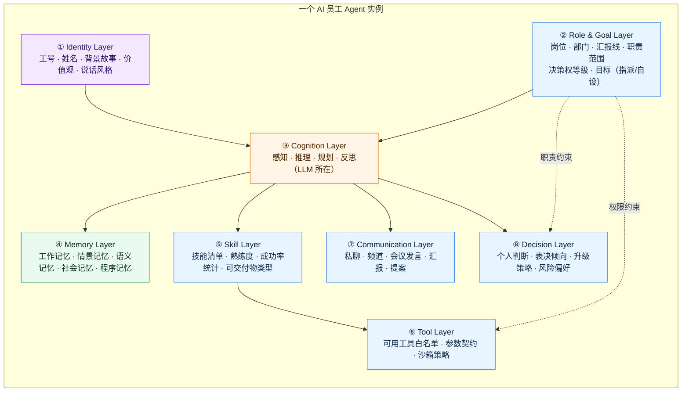
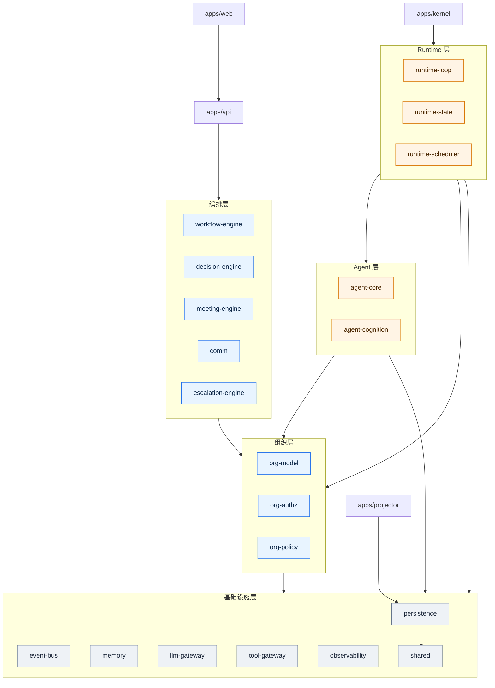

# Phase 2 · 核心模块拆分

> 目标：把 Phase 1 的分层架构**翻译成可以立刻开工的仓库结构**。
> 每个模块都必须能独立回答三个问题：**我负责什么 / 我绝不做什么 / 别人怎么用我**。

> **⚠️ 2026-09-30 勘误（Architecture Reconciliation · FROZEN）**
> - **包命名与逐包依赖边界的唯一权威** → [`package-registry.md`](package-registry.md)（28 packages + 4 apps，含旧名映射表 §0）
> - **依赖方向与禁令的唯一权威** → [`dependency-graph.md`](dependency-graph.md)
> - **总基线（最高权威）** → [`ARCHITECTURE-BASELINE.md`](ARCHITECTURE-BASELINE.md)
> - 本文 §2.1 已同步为现行结构；**§2.2 沿用初版命名**（`shared`/`org-model`/`org-authz`/`event-bus`/`memory`/`comm`/`agent-core`/`runtime-loop`/`tool-gateway`/`org-policy`），按 registry §0 映射换读；**§2.3 前缀式规则已废弃**，以 dependency-graph.md 为准；§2.4 接口契约与 §2.5 测试策略仍为现行权威。

---

## 2.1 仓库结构（pnpm monorepo）

```
Multi-Agent-Organizational-Emulation-Hub/
├─ packages/                      # 28 包（规范命名 · 权威 = package-registry.md）
│  ├─ shared-types/               # ① 基础类型：ID / Result / SimTime / ActorContext / OrgEvent
│  ├─ organization-model/         # ② 组织实体与关系（纯函数领域模型）〔原 org-model〕
│  ├─ identity-system/            # ③ 身份：Who are you · ActorContext 主体来源 ★新
│  ├─ permission-system/          # ④ 有效权限与授权裁决 AuthzService〔原 org-authz·裁决半边〕
│  ├─ authority-engine/           # ⑤ L0–L5 决策权（按决策域）〔原 org-authz·决策权半边〕
│  ├─ policy-engine/              # ⑥ 制度、预算、SLA、行为红线〔原 org-policy〕
│  ├─ event-system/               # ⑦ 事件信封 / 类型注册 / 订阅匹配（零 I/O）〔原 event-bus·纯机制半边〕
│  ├─ event-store/                # ⑧ append / Outbox / replay（持久化）〔原 event-bus·持久化半边〕
│  ├─ persistence/                # ⑨ Schema / 迁移 / 仓储 / 事务 / 快照
│  ├─ agent-memory/               # ⑩ 记忆机制：存储 / 检索 / 衰减 / 反思调度（Infra 层）〔原 memory〕
│  ├─ llm-gateway/                # ⑪ A4 唯一 LLM Egress：路由 / 预算 / 结构化输出 / 成本
│  ├─ agent-tools/                # ⑫ 工具沙箱 + 授权闸门〔原 tool-gateway〕
│  ├─ observability/              # ⑬ Trace / 指标 / cost / llm_calls（真相源）
│  ├─ audit-system/               # ⑭ 审计：谁做了什么 / 是否允许 / 结果 ★新（自 observability 切分）
│  ├─ knowledge-system/           # ⑮ 组织级知识与文档（documents）★新
│  ├─ artifact-system/            # ⑯ 可交付物登记与溯源（ProduceArtifact）★新
│  ├─ agent-definition/           # ⑰ Agent 8 层定义与 YAML 装配〔原 agent-core〕
│  ├─ agent-cognition/            # ⑱ 认知层：感知 / 回忆 / 推理 / 规划（Prompt 唯一归属地）
│  ├─ agent-runtime/              # ⑲ 认知循环执行器（Runtime 层）〔原 runtime-loop〕
│  ├─ runtime-state/              # ⑳ 状态机 / 检查点 / 单写者并发
│  ├─ runtime-scheduler/          # ㉑ SimClock + 唤醒队列
│  ├─ workflow-engine/            # ㉒ 流程模板 / 实例 / 审批门 / 偏离请求
│  ├─ task-system/                # ㉓ 任务生命周期（独立于流程的工作单元）★新
│  ├─ decision-engine/            # ㉔ 提案 / 评议 / 加权计票 / 决策档案
│  ├─ meeting-engine/             # ㉕ 议程 / 发言权 / 纪要编排
│  ├─ agent-communication/        # ㉖ 消息 / 频道 / 汇报 / 正式文书〔原 comm〕
│  ├─ escalation-engine/          # ㉗ 冲突检测 / 升级阶梯 / 超时
│  └─ config/                     # ㉘ 工作区配置 ★新
│
├─ apps/
│  ├─ kernel/                     # 调度进程：Scheduler + Worker Pool + Reactors
│  ├─ api/                        # 命令入口（写侧）+ 查询 API
│  ├─ projector/                  # 投影进程：事件 → 读模型
│  └─ web/                        # 人类观测控制台（React + Vite，零后端包依赖）
│
├─ agents/                        # ★ AI 员工「档案」（数据，非代码）
│  └─ future-ai-lab/
│     ├─ company.yaml
│     ├─ departments/*.yaml
│     ├─ positions/*.yaml
│     └─ employees/*.yaml
│
├─ workflows/                     # ★ 流程模板（数据，非代码）
│  └─ {product-development,hiring,decision-making}/workflow.yaml
│
├─ database/migrations/           # 001–005（当前 0 字节 · SCHEMA GAP 见 BASELINE §15）
│
└─ tests/                         # unit / integration / e2e / simulation（architecture 组 M0 建）
```

**关键设计：`agents/` 与 `workflows/` 是数据，不是代码。**

新增一个 AI 员工 = 新增一个 YAML 文件，**不需要改任何 TypeScript**。这是"Agent 独立性"（AGENTS.md 原则 2）落到工程上的具体形态，也是开源社区最容易贡献的入口。

---

## 2.2 模块总表：职责 / 边界 / 接口

### 🧱 基础与组织层（100% 确定性，零 LLM）

| 模块 | 负责 | **绝不负责** | 核心接口 | 依赖 |
|------|------|-------------|---------|------|
| `shared` | ID 类型、`Result<T,E>`、`SimTime`、Zod Schema、错误码 | 任何业务规则 | — | 无 |
| `org-model` | Company / Department / Position / Employee / ReportingLine / Relationship 的**纯函数**领域逻辑 | ❌ 不落库 ❌ 不产事件 ❌ 不调用 LLM | `OrgGraph.getManagerOf(id)`<br/>`OrgGraph.getReports(id)`<br/>`OrgGraph.getPeers(id)`<br/>`OrgGraph.resolveByPosition(posId)` | `shared` |
| `org-authz` | 计算**有效权限**、裁决命令是否可执行、判定决策权归属 | ❌ 不执行命令 ❌ 不做业务判断 | `AuthzService.can(actor, action, resource, ctx?): AuthzDecision`<br/>`AuthzService.effective(empId): PermissionSet`<br/>`AuthzService.levelFor(empId, domain): AuthorityLevel` | `org-model` |
| `org-policy` | 制度约束：预算上限、SLA、审批阈值、行为红线 | ❌ 不做推理 ❌ 不生成文本 | `PolicyService.evaluate(cmd, actor): PolicyVerdict`<br/>`PolicyService.slaFor(kind): Duration` | `org-model` |

> **为什么 `org-model` 是纯函数？**
> 因为组织关系是整个系统里最需要被测试、最不该出错的逻辑。纯函数 + 属性测试可以在毫秒级验证
> "汇报线无环""每个员工恰好一个直属上级""权限可传递闭包收敛"等不变量。

---

### ⚙️ 基础设施层（机制，无业务规则）

| 模块 | 负责 | **绝不负责** | 核心接口 | 依赖 |
|------|------|-------------|---------|------|
| `event-bus` | 事件信封、追加、事务性 Outbox、消费组、订阅匹配、重放 | ❌ 不懂事件语义 ❌ 不含业务分支 | `append(events, tx): Promise<Seq>`<br/>`subscribe(pattern, handler, opts): Subscription`<br/>`replay(from, to, filter): AsyncIterable<OrgEvent>` | `shared` |
| `persistence` | 表结构、迁移、仓储、乐观锁、快照、事务封装 | ❌ 不含领域规则 | `withTx(fn)`<br/>`EventStore.append/read`<br/>`SnapshotStore.save/load` | `shared` |
| `memory` | **记忆机制**：写入、向量检索、打分与排序、衰减、归档、反思任务的**调度与落库** | ❌ 不决定"该记什么"（那是 Agent 的策略）❌ **不自己调 LLM 生成反思文本**（由 `agent-cognition` 生成后交给它持久化） | `MemoryStore.write(record): MemoryId`<br/>`MemoryStore.recall(q: RecallQuery): ScoredMemory[]`<br/>`MemoryStore.strengthen(id, δ)`<br/>`MemoryStore.scheduleReflection(scope)` | `persistence` |
| `llm-gateway` | 多提供商路由、重试、结构化输出强制、Token 预算、语义缓存、成本记账 | ❌ 不含业务 Prompt ❌ 不决定用哪个模型（由调用方声明 `tier`）❌ **不接受无主体的调用** | `LlmGateway.invoke(actor: ActorContext, req: LlmRequest): LlmResponse`<br/>`LlmGateway.estimate(req)` | `observability` |
| `tool-gateway` | 工具注册表、入参 Schema 校验、**授权闸门**、沙箱执行、幂等键 | ❌ 不实现具体工具 ❌ 不绕过 `org-authz` | `ToolRegistry.register(def)`<br/>`ToolGateway.invoke(actor, toolId, args): ToolResult` | `org-authz`, `observability` |
| `observability` | OTel Span、Trace 树、成本指标、审计日志、告警 | ❌ 不影响主流程控制流 | `traceCycle(ctx)`<br/>`recordLlmCall(...)`<br/>`audit(actor, action, target)` | `shared` |

> **`tool-gateway` 是 A4 公理的物理实现点。**
> LLM 说"我要发布 v1.0" → 产出 `Intent{ tool:'release.publish' }` → Gateway 用 `ActorContext` 调
> `AuthzService.can()` → 拒绝或执行。**LLM 的文本永远不直接成为一个副作用。**

---

### 🧠 Agent 层（概率性，唯一允许出现 Prompt 的地方）

| 模块 | 负责 | **绝不负责** | 核心接口 | 依赖 |
|------|------|-------------|---------|------|
| `agent-core` | Agent 的 8 层结构定义、从 `agents/*.yaml` 装配实例、生命周期状态承载 | ❌ 不做推理 ❌ 不碰数据库 | `AgentFactory.build(employeeId, orgSnapshot): Agent`<br/>`Agent.identity/role/memory/skills/permissions` | `org-model`, `org-authz` |
| `agent-cognition` | 感知解读、记忆检索策略、推理、规划、沟通措辞、反思提示 | ❌ 不直接产生副作用 ❌ 不判定自己有没有权限 | `Cognition.perceive(input): Perception`<br/>`Cognition.recall(p): RecallBundle`<br/>`Cognition.plan(p, r): Plan`<br/>`Cognition.reflect(result): Reflection` | `agent-core`, `memory`, `llm-gateway` |

**Agent 的 8 层结构**（严格对应任务书的 Agent Architecture 要求）：



---

### 🔄 Runtime 层（执行 / 调度 / 状态管理）

| 模块 | 负责 | **绝不负责** | 核心接口 | 依赖 |
|------|------|-------------|---------|------|
| `runtime-loop` | 执行一次**认知循环**（Cycle）的 10 个阶段、超时、预算护栏、卡死检测 | ❌ 不含任何 Prompt ❌ 不做业务判断 | `Runtime.runCycle(wake: WakeRequest): CycleResult` | `agent-core`, `agent-cognition`, `tool-gateway`, `event-bus`, `runtime-state` |
| `runtime-state` | `AgentState` 状态机、检查点、按 `employeeId` 的单写者并发控制、恢复 | ❌ 不决定状态语义（转移表由定义提供） | `StateStore.load(empId): AgentState`<br/>`StateStore.commit(state, expectedVersion)`<br/>`StateStore.checkpoint(cycleId, step)` | `persistence` |
| `runtime-scheduler` | `SimClock` 前进、 Agenda 生成、唤醒队列、优先级与防饿死、并发闸 | ❌ 不决定"谁该被唤醒"的业务规则（由订阅规则提供） | `Scheduler.tick()`<br/>`Scheduler.enqueue(WakeRequest, priority)`<br/>`Scheduler.pause()/resume()/seek(simTime)` | `persistence`, `event-bus` |

> **Runtime 与 Agent 的分界线 = "Prompt 在哪"。**
> `runtime-loop` 可以读 `Plan`、校验 `Plan`、执行 `Plan`，但**不知道任何一句 Prompt 的内容**。
> 这条线让 Runtime 可以像普通后端服务一样被测试与压测。

---

### 🏢 编排层（确定性，业务流程的"骨架"）

| 模块 | 负责 | **绝不负责** | 核心接口 | 依赖 |
|------|------|-------------|---------|------|
| `workflow-engine` | 流程模板注册、实例创建、步骤推进、任务派发、审批门判定、SLA 计时 | ❌ 不做内容质量判断 ❌ 不生成文本 ❌ 不硬编码任何具体流程 | `WorkflowEngine.start(templateId, ctx): InstanceId`<br/>`WorkflowEngine.advance(instId, event)`<br/>`WorkflowEngine.requestDeviation(instId, actor, req)`<br/>`WorkflowEngine.gate(instId, stepId): GateVerdict` | `org-model`, `org-authz`, `event-bus` |
| `decision-engine` | 提案生命周期、评议征询、表决计票（按权限加权）、决策档案（ADR 式）、执行追踪 | ❌ 不替 Agent 生成观点 ❌ 不做技术判断 | `DecisionEngine.propose(p): ProposalId`<br/>`DecisionEngine.requestReview(id, roles)`<br/>`DecisionEngine.castVote(id, actor, vote)`<br/>`DecisionEngine.finalize(id): DecisionRecord` | `org-authz`, `org-policy`, `event-bus` |
| `meeting-engine` | 议程、参与者、发言权轮转、轮次上限、终止检测、纪要生成编排 | ❌ 不生成发言内容（那是 Agent 的） | `MeetingEngine.open(cfg): MeetingId`<br/>`MeetingEngine.grantTurn(id): EmployeeId \| null`<br/>`MeetingEngine.close(id): Minutes` | `comm`, `event-bus` |
| `comm` | 频道（私聊/群聊/公告）、消息、线程、@提及、已读回执、正式文书（汇报/提案/纪要） | ❌ 不做语义理解 ❌ 不做路由决策 ❌ **不自行决定可见性**（读权限由 `AuthzService` 裁决） | `Comm.send(actor, msg: OutboundMessage): Result<MessageId>`<br/>`Comm.inbox(actor: ActorContext, opts): InboxItem[]`<br/>`Comm.readChannel(actor, channelId, opts): Message[]`<br/>`Comm.openChannel(actor, kind, members)` | `org-model`, `org-authz`, `event-bus` |
| `escalation-engine` | 无响应检测、冲突识别、升级阶梯（Agent → 主管 → C-level → 人类）、超时熔断 | ❌ 不裁决对错 ❌ 不替主管做决定 | `Escalation.watch(subject, sla)`<br/>`Escalation.raise(issue, from, to, reason)`<br/>`Escalation.ladder(empId): EmployeeId[]` | `org-model`, `org-policy`, `event-bus` |

> **工作流是"骨架"而不是"驱动者"。**
> 引擎只回答"下一步可以是什么、需要谁的签字"；
> **"这一步该不该过、这个方案好不好"永远由 Agent（或人类）回答。**
> 而且 Agent 可以发起 `requestDeviation`（改步/退回/跳过/加签），引擎记录并交由权威方裁定——
> 这正是"Workflow 是组织运行的结果"而非"Workflow 驱动组织"的工程体现。

---

## 2.3 依赖方向：只允许单向，禁止回环



**硬性依赖规则（现行权威：[`dependency-graph.md`](dependency-graph.md)，F1–F13 禁令；用 ESLint `no-restricted-imports` + `dependency-cruiser` 在 CI 强制 — 配置规格已定稿于 dependency-graph §5，落地为 M0 首项）：**

| 规则 | 理由 |
|------|------|
| Domain 层（`organization-model` `identity-system` `permission-system` `authority-engine` `policy-engine` `shared-types`）⇒ 不得 import `agent-*` / `runtime-*` / `*-engine` / `persistence` / `event-*` | 组织层必须可被纯单元测试覆盖，且永远不知道"AI 存在" |
| `agent-definition` / `agent-cognition` ⇒ 不得 import `persistence` / `event-system` / `event-store`（只能经由 Runtime 注入的端口） | 保证 Agent 不能在无授权情况下写数据 |
| 编排层（`workflow-engine` `task-system` `decision-engine` `meeting-engine` `escalation-engine` `agent-communication`）⇒ 不得 import `llm-gateway` | 编排层零 LLM，防止"判断被外包给模型" |
| `agent-runtime` ⇒ 不得 import `agent-cognition` 的 Prompt 常量，不得直连 LLM Provider | Runtime 不知道 Prompt 内容 |
| 任何 `packages/*` ⇒ 不得 import `apps/*` | 依赖只能向内 |
| `apps/web` ⇒ 不得 import 任何后端包（只走 HTTP/WS 契约） | 前后端契约化 |
| 除 `llm-gateway` 外任何包 ⇒ 不得 import LLM Provider SDK（A4 唯一 Egress） | 全局禁令，机器扫描 |
| 任何包 ⇒ 不得持有另一 Agent 实例并直接调用（A5 无 RPC） | 耦合只发生在事件契约上 |

> ⚠️ 初版前缀式规则（`org-*` / `agent-*` / `*-engine`）**已废弃**：`agent-memory` / `agent-tools` / `agent-communication` 名含 `agent-` 但分别属于 Infrastructure / Infrastructure / Orchestration 层，前缀判断会误伤 — 一律按 `package-registry.md` 逐包 Allow/Forbidden 清单执行。

---

## 2.4 关键接口契约（TypeScript）

这些签名是**编码阶段的起点**，直接照抄即可开工。

```ts
// ---------- shared ----------
export type EmployeeId = Brand<string, 'EmployeeId'>;
export type PositionId = Brand<string, 'PositionId'>;
export type SimTime    = Brand<number, 'SimTime'>;   // 模拟时间（分钟精度）

export type Result<T, E = KernelError> =
  | { ok: true;  value: T }
  | { ok: false; error: E };

/** 公理 A1：任何副作用都必须携带主体上下文 */
export interface ActorContext {
  employeeId: EmployeeId;
  positionId: PositionId;
  departmentId: DepartmentId;
  /** ★ 权限等级按决策域取值，不是单一标量（见 Phase 3 §3.4.4） */
  authorityByDomain: Readonly<Record<DecisionDomain, AuthorityLevel>>;
  onBehalfOf?: EmployeeId;       // 仅命令入口的瞬时字段，不落库
  correlationId: CorrelationId;  // 贯穿一条业务链
}

/** 事件信封（与 Phase 3 §3.6.1 的 org_events 一一对应） */
export interface OrgEvent<T = unknown> {
  seq: number;
  eventId: string;
  companyId: CompanyId;
  type: EventType;               // 必须来自事件注册表
  version: number;
  occurredAtSim: SimTime;        // ★ 单位：分钟
  occurredAtWall: string;
  actorKind: 'employee' | 'human' | 'system';
  actorId: string | null;
  subjectType: string | null;
  subjectId: string | null;
  payload: T;
  causationId: string | null;    // 直接原因
  correlationId: string;         // 业务链
  traceId: string | null;
}

/** ★ Agent 装配的输入契约（此前被遗漏） */
export interface OrgSnapshot {
  company: Company;
  department: Department;
  position: Position;
  employee: Employee;
  manager: Employee | null;             // 直属上级
  reports: Employee[];                  // 直接下属
  peers: Employee[];                    // 同岗位同层
  colleagues: Employee[];               // 同部门
  relationships: Relationship[];        // 双时态关系边（取"当前有效"版本）
  effectivePermissions: PermissionSet;  // 由 AuthzService 计算，非档案声明
  policyView: PolicyView;               // 适用该员工的组织制度
  seededFacts: MemoryFactInput[];       // 种子记忆
  simTime: SimTime;
}

// ── 认知循环的类型契约（此前只用散文描述）──
export type Action =
  | 'SendMessage' | 'Reply' | 'Mention' | 'Announce' | 'SubmitReport'
  | 'AcceptTask' | 'RejectTask' | 'StartTask' | 'ProgressReport' | 'CompleteTask' | 'BlockTask'
  | 'ProduceArtifact'
  | 'CreateProposal' | 'ReviewProposal' | 'CastVote' | 'FinalizeDecision'
  | 'ApproveStep' | 'RejectStep' | 'DelegateApproval'
  | 'RequestMeeting' | 'Speak'
  | 'RequestDeviation' | 'Escalate'
  | 'RecommendHire' | 'RequestTransfer' | 'RequestPromotion'
  | 'RequestBudget'
  | 'ReadDocument' | 'Reflect' | 'PracticeSkill'
  | 'ScheduleSelf' | 'SetReminder' | 'DeferTask'
  | 'UpdatePresence'
  | 'InvokeTool';                       // ★ 封闭枚举，ADR-011

export interface Perception {
  intent: string;
  urgency: 'low' | 'normal' | 'high' | 'critical';
  refs: Ref[];                          // 涉及的任务/消息/流程/文档
  openQuestions: string[];              // ★ 非空则必须澄清，不许猜（防 FM-2.2）
  salientFacts: string[];
}

export interface Judgement {
  stance: 'accept' | 'decline' | 'delegate' | 'defer' | 'escalate';
  priority: number;
  needsHelp: boolean;
  risks: string[];
  reasons: string[];                    // ★ Plan 每步必须追溯到其中一条（防 FM-2.6）
  goalContributions: { goalId: string; weight: number }[];
}

export interface Step {
  index: number;
  action: Action;
  args: Record<string, unknown>;
  reasonRef: number;                    // 指向 Judgement.reasons 的下标
  doneWhen?: string;
  idempotencyKey?: string;              // 由 Runtime 在 Authorize 后填充
}
export interface Plan {
  goal: string;
  steps: Step[];
  doneWhen: string;                     // ★ 必填：终止条件（防 FM-1.5）
}
```

```ts
// ---------- org-authz：内核裁决（A4 的执行点）----------
export interface AuthzService {
  can(actor: ActorContext, action: Action, resource: ResourceRef): AuthzDecision;
  effective(employeeId: EmployeeId): PermissionSet;
  decide(employeeId: EmployeeId, domain: DecisionDomain): AuthorityLevel;
}
export type AuthzDecision =
  | { allow: true }
  | { allow: false; reason: 'NO_PERMISSION' | 'OUT_OF_SCOPE' | 'NEEDS_APPROVAL';
      requiredAuthority?: AuthorityLevel; escalateTo?: EmployeeId };
```

```ts
// ---------- agent-core：Agent 是实体，不是函数（A2）----------
export interface Agent {
  readonly employeeId: EmployeeId;
  readonly identity: Identity;       // 8 层之 ①
  readonly role: RoleSpec;           // ②
  readonly cognition: Cognition;     // ③
  readonly memory: MemoryPort;       // ④
  readonly skills: SkillSet;         // ⑤
  readonly tools: ToolPort;          // ⑥
  readonly comm: CommPort;           // ⑦
  readonly decision: DecisionPolicy; // ⑧
  readonly state: AgentState;        // 生命周期状态（来自 runtime-state）
}
// ❗ 注意：Agent 上没有 sendTo(otherAgent) 这类方法。
//    对外影响只能通过 comm/tool/engine 端口产出事件（A5）。
```

```ts
// ---------- runtime-loop：一次认知循环 ----------
export interface AgentRuntime {
  runCycle(wake: WakeRequest): Promise<CycleResult>;
}
export interface WakeRequest {
  employeeId: EmployeeId;
  reason: 'EVENT' | 'SCHEDULE' | 'AGENDA' | 'TURN' | 'RETRY' | 'MANUAL';
  triggerEventId?: EventId;
  simTime: SimTime;
  priority: number;              // 0..9，调度用
  budget: CycleBudget;           // 本轮 LLM 调用/Token/时长上限
}
export interface CycleResult {
  cycleId: string;
  outcome: 'ACTED' | 'NO_OP' | 'DEFERRED' | 'ESCALATED' | 'FAILED' | 'BUDGET_EXCEEDED';
  emitted: EventId[];            // 本轮产出的事件（因果链）
  plan?: Plan;
  cost: { tokensIn: number; tokensOut: number; usd: number; ms: number };
}
```

```ts
// ---------- workflow-engine：流程是骨架，判断归 Agent ----------
export interface WorkflowEngine {
  /** 规格伪码；现实签名为 start(WorkflowStartInput{workflowId?|capabilities?})，见 M1.6 §6 */
  start(templateId: TemplateId, ctx: StartContext): Promise<InstanceId>;
  advance(instId: InstanceId, ev: OrgEvent): Promise<TransitionResult>;
  gate(instId: InstanceId, stepId: StepId): Promise<GateVerdict>;
  /** ★ 允许 Agent 偏离流程，而不是把流程藏进 Prompt */
  requestDeviation(instId: InstanceId, actor: ActorContext, req: DeviationRequest): Promise<Result<DeviationDecision>>;
}
export type DeviationRequest =
  | { kind: 'ADD_STEP';       after: StepId; step: StepSpec; why: string }
  | { kind: 'SKIP_STEP';      stepId: StepId; why: string }
  | { kind: 'SEND_BACK';      stepId: StepId; to: StepId; why: string }
  | { kind: 'REASSIGN';       stepId: StepId; to: EmployeeId; why: string }
  | { kind: 'REQUEST_EXTRA_APPROVER'; stepId: StepId; approver: EmployeeId; why: string };
```

---

## 2.5 每个模块的测试策略（对应 `AGENTS.md` Testing Rules）

| 模块 | 测试类型 | 关键用例 |
|------|---------|---------|
| `org-model` | 属性测试 (fast-check) | 汇报线无环；每人唯一上级；部门树连通；`getReports` 与 `getManagerOf` 互逆 |
| `org-authz` | 表格驱动 + 属性测试 | 越权必拒；代理授权可传递但有界；权限闭包收敛；停职即失效 |
| `event-bus` | 集成测试 | 追加有序；outbox 恰好一次投递；消费幂等；重放与实况一致 |
| `memory` | 单元 + 集成 | 检索排序符合 `recency/importance/relevance/affinity`；衰减单调；反思可溯源 |
| `agent-core` | 契约测试 | 每个 `agents/*.yaml` 都能被装配；8 层必填字段校验 |
| `agent-cognition` | 录制回放 (VCR) | 固定输入 + 录制 LLM 响应 → 断言 Plan 结构；**不做真实性断言** |
| `runtime-loop` | 单元 + 仿真 | 预算超限即停；卡死检测触发升级；检查点后可恢复；无副作用泄漏 |
| `runtime-state` | 并发测试 | 同一 `employeeId` 并发提交仅一个胜出；版本冲突返回可重试错误 |
| `workflow-engine` | 状态机测试 | 模板全部路径可达；审批门配额正确；偏离请求被正确裁定 |
| `decision-engine` | 集成 | 计票加权正确；未达法定人数不通过；决策档案不可变 |
| `meeting-engine` | 单元 | 发言权轮转公平；轮次上限生效；无终止条件时强制收敛 |
| `escalation-engine` | 时间推进测试 | SLA 超时必升级；升级链末端到人类；重复升级去重 |
| `apps/*` | E2E (Playwright) | 人类审批一条提案后组织状态与时间线一致更新 |
| **全局** | **仿真测试** | 用 `FakeLlm` + 固定随机种子跑 30 个模拟日，断言组织不变量与零越权事件 |

> **`FakeLlm` 是本项目可测试性的基石。**
> 所有仿真与 CI 测试都使用确定性假模型（脚本化响应 + 固定 seed），
> 只有 `tests/simulation-live/` 下的用例才允许打真实模型，且默认不在 CI 中运行。

---

## 2.6 模块边界速查（评审用）

```
┌──────────────────────────────────────────────────────────────────────┐
│ 问：这个改动属于哪一层？                                              │
├──────────────────────────────────────────────────────────────────────┤
│  • 涉及"谁是谁/谁能做什么"           → org-*        （确定性）        │
│  • 涉及"什么时候/按什么顺序"         → *-engine / runtime-scheduler   │
│  • 涉及"怎么想/怎么说"               → agent-cognition（含 Prompt）   │
│  • 涉及"怎么存/怎么送/怎么调模型"     → infra        （无业务规则）    │
│  • 涉及"人怎么看"                    → apps/projector + apps/web      │
└──────────────────────────────────────────────────────────────────────┘
```

**三个最常见的越界错误（Code Review 红线）：**

1. ❌ 在 `workflow-engine` 里写 `if (step === 'TECH_REVIEW') llm.judge(...)` → 判断必须回到 Agent。
2. ❌ 在 `agent-cognition` 里写 `await db.tasks.update(...)` → Agent 只能产出 Intent，由 Runtime + Gateway 执行。
3. ❌ 在 `apps/web` 里直接读数据库 → 必须经 API 契约，否则读模型演进会击穿前端。
