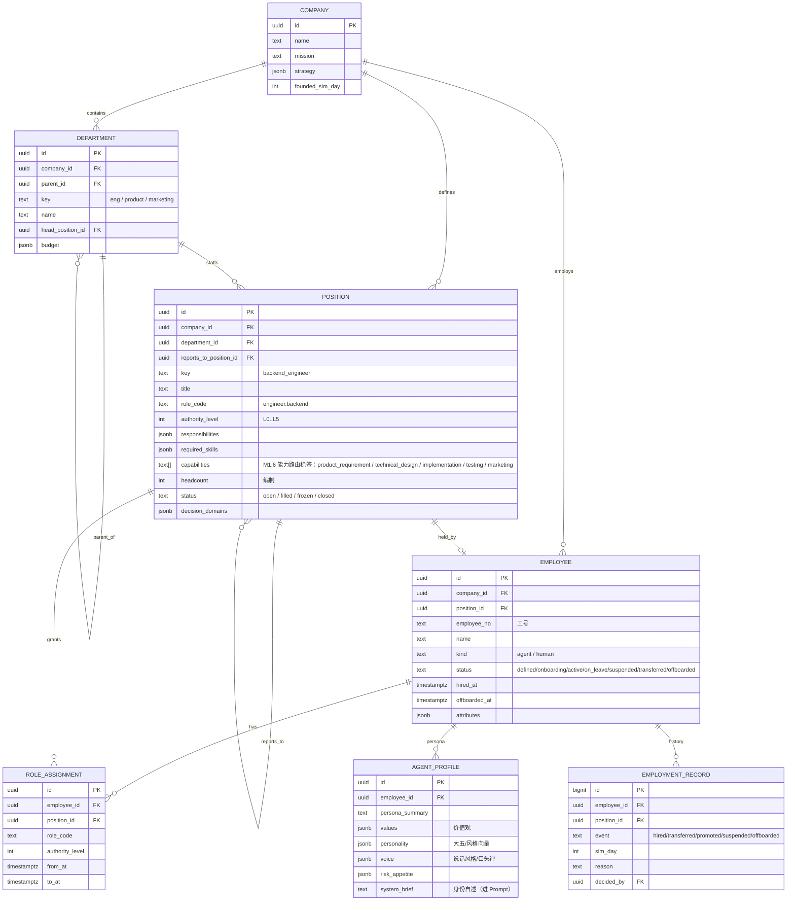
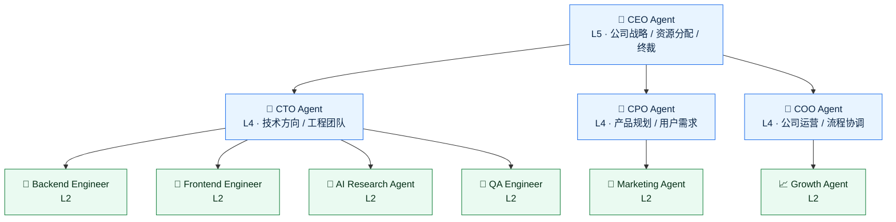
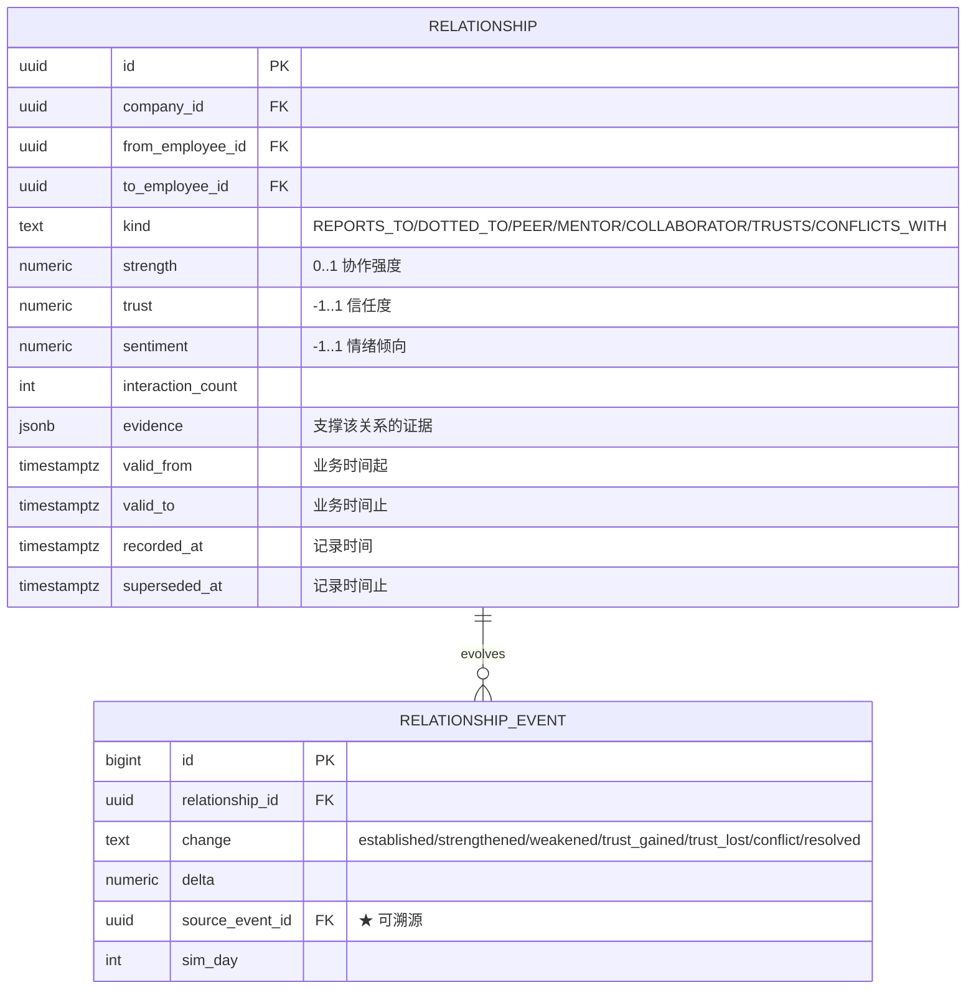
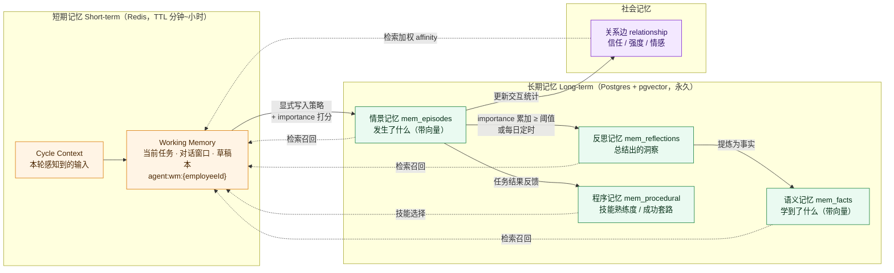

# Phase 3 · 数据模型设计

> 本章是后续所有编码工作的**权威契约**。所有表结构、事件命名、评分公式以本章为准。

---

## 3.1 建模三原则

MAOEH 的数据分为三类，**必须严格区分**，混用是架构事故的根源：

| 类别 | 性质 | 存放 | 举例 |
|------|------|------|------|
| **① 领域状态 (State)** | 当前真相，可变更，带乐观锁 | 规范化表 | `employees`, `positions`, `workflow_instances` |
| **② 领域事件 (Event)** | 不可变事实，append-only，唯一真相源 | `org_events` | `Task.Assigned`, `Decision.Finalized` |
| **③ 读模型 (Projection)** | 可随时重建的查询加速视图 | 投影表 / 物化视图 | `v_org_chart`, `rm_inbox`, `rm_board` |

**铁律：**
1. 状态变更**必须**先追加事件，再由同一事务内的 Projector 更新读模型；**不允许**绕过事件直接改状态。
2. 读模型可以**随时 DROP 并重建**。任何"只在读模型里存在"的数据 = 数据丢失。
3. 投影表统一加前缀 `rm_`，视图加 `v_`，便于识别与重建。

---

## 3.2 组织实体设计（Organization Entity Design）

### 3.2.1 核心洞察：**岗位（Position）与员工（Employee）必须分离**

这是本项目组织模型最重要的一个结构决策：

> **岗位是组织架构上的一个"坑"，员工是"占据坑的人"。**

理由：
- 真实公司里，人走了坑还在，招人补上即可 → 支持 `Employee.Offboarded` 后工作流不崩。
- 任务派发的正确目标是**岗位**（"需要一名后端工程师"），由 `resolveByPosition()` 解析到当前在岗员工。
- 岗位不在岗时（空缺/休假），可以自动**代理**给上级或同级，而不是让流程卡死。
- 组织重构 = 改岗位树，不是改人头。



**关键字段说明：**

| 字段 | 为什么这样设计 |
|------|--------------|
| `POSITION.key` | 稳定标识（`backend_engineer`），流程模板引用岗位 key 而非具体人，人员流动不影响流程 |
| `POSITION.authority_level` | 决策权挂在**岗位**上，不挂在 Agent 上 → 换人即换权限，天然满足"权限随岗位" |
| `POSITION.headcount` | 支持一岗多人（3 个后端工程师），也支持空缺检测与招聘触发器 |
| `POSITION.decision_domains` | 声明该岗位在哪些决策域有权（`{engineering: L3, finance: L0}`），是 Decision Engine 的核心输入 |
| `POSITION.capabilities` | **M1.6 能力路由的唯一依据**：任务按 `capabilities` 精确匹配到坑，永不按岗位名字（`title`/`key`）匹配；与自由文本 `required_skills` 并存且分工不同——前者是路由标签（词表见 M1.6 §2），后者仍是自由描述 |
| `EMPLOYEE.kind` | `agent` 与 `human` 共用一张表 → **人类也是组织成员**，可以审批、可以被汇报、可以参加会议。这让 HITL 不是外挂而是内建 |
| `EMPLOYMENT_RECORD` | 任职历史是**事件派生**的物化表，支撑"员工成长轨迹"与审计（谁在什么时候批的，以当时岗位权限为准） |

### 3.2.2 目标（Goal）

**Goal 是任务书明确要求的员工属性之一，必须有实体承载**：目标从哪来、归谁、完成没有、变了要不要走决策。

```sql
CREATE TABLE goals (
  id             uuid PRIMARY KEY,
  company_id     uuid NOT NULL,
  key            text,                    -- 稳定标识（岗位目标用），自设目标可为空
  statement      text NOT NULL,           -- "把核心服务 P99 延迟压到 200ms 以内"
  rationale      text,                    -- 为什么定这个目标
  -- ★ 目标可以属于组织 / 部门 / 岗位 / 个人 —— 四级目标树
  owner_kind     text NOT NULL,           -- company | department | position | employee
  owner_id       uuid NOT NULL,
  parent_goal_id uuid REFERENCES goals(id),      -- ★ 目标分解：上级目标 → 下级目标
  origin         text NOT NULL,           -- assigned（上级/岗位指派） | self_directed（Agent 自设）
  horizon        text NOT NULL,           -- week | month | quarter | year
  success_metric text NOT NULL,           -- 可判定的完成标准
  status         text NOT NULL DEFAULT 'active', -- active | achieved | abandoned | superseded
  priority       smallint NOT NULL DEFAULT 5,
  created_by     uuid NOT NULL,
  created_at_sim bigint NOT NULL,
  due_at_sim     bigint,
  closed_at_sim  bigint,
  source_event_id uuid NOT NULL
);

-- 目标 ↔ 任务/流程 的贡献关系（回答"我这周做的事对哪个目标有贡献"）
CREATE TABLE goal_contributions (
  goal_id        uuid NOT NULL REFERENCES goals(id),
  ref_type       text NOT NULL,           -- task | workflow_instance | decision | document
  ref_id         uuid NOT NULL,
  contribution   numeric NOT NULL DEFAULT 1.0,  -- 权重，用于绩效聚合
  recorded_at_sim bigint NOT NULL,
  PRIMARY KEY (goal_id, ref_type, ref_id)
);
```

| 设计点 | 为什么 |
|--------|--------|
| `owner_kind` 四级 | 支持"公司战略 → 部门目标 → 岗位目标 → 个人目标"的分解，这是**组织目标对齐**的数据基础 |
| `origin = self_directed` | Agent 可以有自己的目标——这是"独立实体"而非"任务执行器"的关键标志 |
| 自设目标**公开可见** | 遵守 `AGENTS.md` 的 Human Observation 原则：不允许隐藏动机（见 Phase 7 §7.14 红线） |
| `success_metric` 必填 | 防止"目标"退化成口号；也是判定"过早宣布完成"（FM-3.1）的依据 |
| 目标变更走决策 | 组织级目标的变更属于 `org` 决策域，需 L4+ 拍板并留 `Decision.*` 记录 |

> **目标与任务的关系：** 任务是"做什么"，目标是"为什么做"。
> 一个 Agent 可以拒绝一个与自己目标冲突的任务（`Task.Rejected`），
> 但必须给出理由并走拒绝收敛路径（见 §3.8.1 的状态机与 Phase 5 §5.7.1）。

### 3.2.3 `Future AI Lab` 岗位树（种子数据）



> 注意图中 **CPO → Marketing**、**COO → Growth** 是刻意的跨部门汇报线，
> 用来验证 `ReportingLine` 与 `Department` 是**两个正交维度**——
> 真实公司里"你属于哪个部门"和"你向谁汇报"经常不一致，模型必须支持。

---

## 3.3 关系模型（Relationship Model）

关系分四类，**全部双时态（bi-temporal）**：既要能回答"现在谁是谁的上级"，也要能回答"项目启动那天谁是谁的上级"。



| 关系种类 | 语义 | 谁写入 | 用途 |
|---------|------|--------|------|
| `REPORTS_TO` | 硬汇报线（唯一上级） | 组织内核（HR 事件） | 升级路径、审批权、绩效 |
| `DOTTED_TO` | 虚线汇报（项目/矩阵） | 组织内核 | 跨部门协作授权 |
| `PEER` | 同层级同岗 | 派生（非存储） | 同级协商、互评 |
| `MENTOR` | 师徒 | 组织内核 / 员工主动 | 学习、经验传递 |
| `COLLABORATOR` | 合作过（强度自动累积） | 记忆系统 | 检索加权、组队推荐 |
| `TRUSTS` | 信任（-1..1） | 记忆系统（反思产出） | 影响信息分享意愿、表决倾向 |
| `CONFLICTS_WITH` | 存在冲突 | 冲突引擎 | 避免同组、触发调解 |

**为什么 `trust` / `sentiment` 是数值而不是枚举？**
因为它们必须能**缓慢变化**。一个 Agent 在 20 次协作后对 QA 的信任从 0.2 升到 0.7，这个轨迹本身就是"组织演化"的可观测证据，也是"积累经验"的量化表达。

**为什么双时态？**
> 场景：第 30 天 CTO 说"我早就支持这个技术方案了"。系统可以查
> `valid_from <= day30 AND (valid_to IS NULL OR valid_to > day30)` 的 `TRUSTS` 边，
> 用当时的真实数据回答"你当时对提出者只有 0.1 的信任"。**没有双时态，历史就是任人打扮的。**

---

## 3.4 权限模型（Permission Model）

MAOEH 采用 **RBAC + ABAC + 权限等级（Authority Level）** 三层混合模型。
一句话概括：**角色决定"能做什么"，属性决定"在什么条件下能做"，等级决定"能做多大的决定"。**

### 3.4.1 四类主体与三类客体

```
主体 Subject  = Employee (经 RoleAssignment)  |  Position  |  Department  |  Human
动作 Action   = <resource>.<verb>   例: workflow.approve / decision.vote / tool.invoke
客体 Resource = 带作用域路径的资源   例: company:fal/dept:eng/wf:product_dev#step:tech_review
```

### 3.4.2 权限等级（Authority Level）

| 等级 | 名称 | 能做什么 | 对应岗位示例 |
|------|------|---------|-------------|
| **L0** | 执行 Execute | 只能做被指派的原子工作 | 新入职工程师 |
| **L1** | 建议 Advise | 可提交意见与提案，无决定权 | 工程师、研究员 |
| **L2** | 小组决策 Team Decide | 可在本小组范围内拍板（如测试通过与否） | QA、Tech Lead |
| **L3** | 部门决策 Dept Decide | 部门级资源与方案终裁 | CTO 在 engineering 域 |
| **L4** | 公司执行 Company Execute | 跨部门资源调配、流程定义 | COO |
| **L5** | 公司终裁 Company Final | 战略、预算、人事、否决权 | CEO |

### 3.4.3 数据库表

```sql
-- 角色（由岗位派生，但可被组织重定义）
CREATE TABLE roles (
  id            uuid PRIMARY KEY,
  company_id    uuid NOT NULL,
  code          text NOT NULL,              -- 'engineer.backend'
  name          text NOT NULL,
  default_level smallint NOT NULL,          -- 0..5
  UNIQUE (company_id, code)
);

-- 角色 → 权限（模板层）
CREATE TABLE role_permissions (
  role_id       uuid NOT NULL REFERENCES roles(id),
  action        text NOT NULL,              -- 'task.accept'
  resource_pattern text NOT NULL,           -- 'dept:self/**'
  effect        text NOT NULL,              -- 'allow' | 'deny'
  conditions    jsonb NOT NULL DEFAULT '{}',-- ABAC 条件
  PRIMARY KEY (role_id, action, resource_pattern)
);

-- 直接授予 / 撤销（实例层，优先于角色层）
CREATE TABLE permission_grants (
  id            uuid PRIMARY KEY,
  company_id    uuid NOT NULL,
  subject_kind  text NOT NULL,              -- 'employee' | 'position' | 'department'
  subject_id    uuid NOT NULL,
  action        text NOT NULL,
  resource_pattern text NOT NULL,
  effect        text NOT NULL,
  conditions    jsonb NOT NULL DEFAULT '{}',
  granted_by    uuid REFERENCES employees(id),
  granted_at    timestamptz NOT NULL DEFAULT now(),
  expires_at    timestamptz,
  revoked_at    timestamptz,
  reason        text NOT NULL,              -- ★ 授权必须说明理由
  -- ★ 不得自授：员工不能给自己发权限
  CHECK (subject_kind <> 'employee' OR granted_by IS NULL OR granted_by <> subject_id)
);

-- 委托（休假代理 / 临时授权）
CREATE TABLE delegations (
  id            uuid PRIMARY KEY,
  company_id    uuid NOT NULL,
  from_employee_id uuid NOT NULL REFERENCES employees(id),
  to_employee_id   uuid NOT NULL REFERENCES employees(id),
  scope         jsonb NOT NULL,             -- {actions:[...], resources:[...]}
  max_level     smallint NOT NULL,          -- ★ 委托不得提权
  valid_from    timestamptz NOT NULL,
  valid_to      timestamptz NOT NULL,
  approved_by   uuid REFERENCES employees(id),
  CHECK (max_level BETWEEN 0 AND 5),
  -- ★ 不能委托给自己
  CHECK (from_employee_id <> to_employee_id),
  -- ★ 委托区间必须有效
  CHECK (valid_to > valid_from)
);
-- ★ "委托不得提权"不能只靠调用方自觉：max_level 由委托人填写，
--   因此写入路径（AuthzService / 内核命令）必须强制
--   max_level <= min(from.position.authority_level, policy.maxDelegableLevel)。
--   这条规则在 §3.4.4「四条必须遵守的规则」中列为可测用例。

-- 决策权矩阵（RACI 的工程化）
CREATE TABLE decision_rights (
  id            uuid PRIMARY KEY,
  company_id    uuid NOT NULL,
  domain        text NOT NULL,              -- 'engineering'|'product'|'ops'|'marketing'|'finance'|'org'
  min_level     smallint NOT NULL,          -- 该域拍板所需最低等级
  approver_roles text[] NOT NULL,           -- 有资格审批的角色
  quorum        smallint NOT NULL DEFAULT 1,
  requires_ceo  boolean NOT NULL DEFAULT false,
  threshold_amount numeric,                 -- 预算阈值（超过则升级）
  escalation    jsonb NOT NULL DEFAULT '[]'-- 升级链
);

-- 职责分离（Separation of Duties）——真实公司的合规要求
CREATE TABLE sod_rules (
  id            uuid PRIMARY KEY,
  company_id    uuid NOT NULL,
  action        text NOT NULL,              -- 'artifact.accept'
  forbidden_if  jsonb NOT NULL              -- {sameActorDid: 'artifact.author'}
);
```

### 3.4.4 有效权限计算算法

```
effective(emp) =
    closure( rolePermissions(emp.roles)
           ∪ directGrants(emp)
           ∪ delegatedGrants(emp, now) )        -- 受 max_level 截断
  minus revocations(emp)
  minus expired(now)
  filter( conditions match ResourceContext )    -- ABAC：部门/时间/金额/项目
  filter( sod_rules )
  with  level = min( position.authority_level, delegation.max_level )

can(actor, action, resource, ctx) :=
     exists allow matching (action, resource)                       -- 默认拒绝 (default-deny)
  && !exists deny matching (action, resource)                       -- deny 优先
  && ( NOT isDecisionAction(action)
       OR levelFor(actor, domainOf(resource)) >= decision_rights(domainOf(resource)).min_level )
  && ( ctx.requiredRoles IS NULL OR roleOf(actor) = ANY(ctx.requiredRoles) )   -- ★ 角色必须参与判定
  && !violatesSoD(actor, action, resource)

domainOf(resource) 的显式映射（不允许实现者从字符串里猜）：
  company:*/dept:*/wf:product_*        → product
  company:*/dept:eng/**                → engineering
  company:*/dept:ops/**                 → ops
  company:*/dept:marketing/**           → marketing
  company:*/finance/**                  → finance
  company:*/employee/**                 → org        （人事）
默认：无法匹配 → org（最严），而不是放开。
```

**`AuthorityLevel` 必须按域取值，而不是单一标量：**

```ts
// ❌ 错误：CTO 的 authority 是一个数字，无法表达 {engineering: L3, finance: L0}
interface ActorContext { authority: AuthorityLevel }

// ✅ 正确：权限等级是"域 → 等级"的映射
interface ActorContext {
  employeeId: EmployeeId;
  positionId: PositionId;
  departmentId: DepartmentId;
  authorityByDomain: Readonly<Record<DecisionDomain, AuthorityLevel>>;  // ★
  onBehalfOf?: EmployeeId;      // 仅命令入口的瞬时字段，不落库
  correlationId: CorrelationId;
}

interface AuthzService {
  can(actor: ActorContext, action: Action, resource: ResourceRef,
      ctx?: { domain?: DecisionDomain; requiredRoles?: string[]; amount?: number }): AuthzDecision;
  levelFor(employeeId: EmployeeId, domain: DecisionDomain): AuthorityLevel;
  effective(employeeId: EmployeeId): PermissionSet;   // ★ 按 cycle 缓存，见 Phase 5 §5.4.4
}
```

**四个必须遵守的规则（每条都必须有对应的自动化测试）：**

1. **默认拒绝（Default Deny）**。没有显式 allow 就是拒绝。绝不写"除了 X 之外都能做"。
2. **Deny 优先于 Allow**。撤销总能力压授予。
3. **委托不得提权**（`max_level` 截断）。COO 休假委托给 Growth Agent，只得到 `min(COO.level, 委托上限)`。
4. **职责分离**。提案人不得审批自己的提案；代码作者不得担任自己代码的 QA；不得给自己发授权。

> **人类（`kind = 'human'`）如何获得权限？**
> 人类也是组织成员，但**不能靠"特殊照顾"绕过内核**——否则审计与可解释性都会破功。
> 规则：**人类同样必须占据一个 `Position`**（例如虚拟岗位 `board_observer`，`authority_level = 5`，
> `decision_domains = {org: L5, finance: L5}`），`employees.position_id` 对 human 同样 `NOT NULL`。
> 因此人类走的是与其他员工**完全相同**的 `effective()` / `can()` 路径：
> 不占岗位的人类不是一个"能审批的人"，而是一个**没有权限的观察者**（只有 `*.read` 权限）。
> 这条规则同时解决了"Board Observer 被自己的内核挡住"的问题，且不需要任何特例分支。


> **这是本项目最不能被"AI 化"的部分。**
> 权限计算是纯函数、可穷举测试、零 LLM。任何"让模型判断这个人该不该有这个权限"的设计都是安全事故。

---

## 3.5 记忆系统数据模型（Memory System）

对应 `AGENTS.md` 的 *Memory Rules*：短期 / 长期严格分离，且**每次更新必须显式且可追溯**。



### 3.5.1 表结构

```sql
CREATE EXTENSION IF NOT EXISTS vector;

-- ① 情景记忆：按时间记录"我经历过什么"
CREATE TABLE mem_episodes (
  id               bigserial PRIMARY KEY,
  company_id       uuid NOT NULL,
  employee_id      uuid NOT NULL REFERENCES employees(id),
  kind             text NOT NULL,   -- observation|conversation|action|decision|outcome|feedback
  content          text NOT NULL,   -- 原始内容
  summary          text,            -- 压缩摘要（长内容时）
  embedding        vector(1536),
  importance       smallint NOT NULL CHECK (importance BETWEEN 1 AND 10),
  participants     uuid[] NOT NULL DEFAULT '{}',
  refs             jsonb NOT NULL DEFAULT '[]',  -- 指向 task/workflow/message/decision
  occurred_at_sim  bigint NOT NULL,
  occurred_at_wall timestamptz NOT NULL,
  source_event_id  uuid NOT NULL,   -- ★ 溯源：我在哪条事件上学到的
  last_accessed_at timestamptz,
  access_count     int NOT NULL DEFAULT 0,
  decay_score      numeric NOT NULL DEFAULT 1.0,
  archived_at      timestamptz
);
CREATE INDEX ON mem_episodes USING hnsw (embedding vector_cosine_ops);
CREATE INDEX ON mem_episodes (employee_id, occurred_at_sim DESC);

-- ② 语义记忆：提炼后的稳定知识
CREATE TABLE mem_facts (
  id               bigserial PRIMARY KEY,
  company_id       uuid NOT NULL,
  owner_employee_id uuid REFERENCES employees(id),  -- NULL = 组织级共享知识
  subject          text NOT NULL,
  predicate        text NOT NULL,
  object           text NOT NULL,
  content          text NOT NULL,
  embedding        vector(1536),
  confidence       numeric NOT NULL DEFAULT 0.5,
  source_episode_ids bigint[] NOT NULL,
  -- ★ 抗记忆投毒：组织级事实需要多来源确认
  source_count     int NOT NULL DEFAULT 1,
  corroborated_by  uuid[] NOT NULL DEFAULT '{}',   -- 确认过该事实的员工
  confirmed_by_human boolean NOT NULL DEFAULT false,
  valid_from_sim   bigint NOT NULL,
  valid_to_sim     bigint,          -- 双时态：知识会过时
  superseded_by    bigint REFERENCES mem_facts(id)
);

-- ★ 同一条事实只允许一行"当前有效"版本，否则检索会返回互相矛盾的事实
CREATE UNIQUE INDEX mem_facts_current_key ON mem_facts (
  company_id,
  COALESCE(owner_employee_id, '00000000-0000-0000-0000-000000000000'::uuid),
  subject, predicate
) WHERE valid_to_sim IS NULL;

-- ★ 组织级事实（owner_employee_id IS NULL）必须多来源或人工确认 —— 把 §3.5.3 的规则变成数据库约束
CREATE FUNCTION assert_org_fact_corroborated() RETURNS trigger AS $$
BEGIN
  -- ⚠️ 必须写成 COALESCE(array_length(...), 0) < 2，而不是 array_length(...) IS NULL。
  --    后者只对**空数组**成立，恰好 1 个来源会被静默放行 ——
  --    于是"单 Agent 不能改写组织级事实"这条防线形同虚设，且不报任何错。
  IF NEW.owner_employee_id IS NULL
     AND COALESCE(array_length(NEW.corroborated_by, 1), 0) < 2
     AND NOT NEW.confirmed_by_human THEN
    RAISE EXCEPTION '组织级事实需 >=2 来源或人工确认 (mem_facts.id=%, 实际来源数=%)',
      NEW.id, COALESCE(array_length(NEW.corroborated_by, 1), 0);
  END IF;
  RETURN NEW;
END $$ LANGUAGE plpgsql;
CREATE TRIGGER mem_facts_corroboration BEFORE INSERT OR UPDATE ON mem_facts
  FOR EACH ROW EXECUTE FUNCTION assert_org_fact_corroborated();
```

**必测用例（只测空数组是测不出上面这个 bug 的）：**

| 输入 | 期望 |
|------|------|
| `owner = NULL`, `corroborated_by = {}`, `confirmed_by_human = false` | ❌ 拒绝 |
| `owner = NULL`, `corroborated_by = {A}`, `confirmed_by_human = false` | ❌ **拒绝**（★ 边界用例） |
| `owner = NULL`, `corroborated_by = {A,B}`, `confirmed_by_human = false` | ✅ 允许 |
| `owner = NULL`, `corroborated_by = {}`, `confirmed_by_human = true` | ✅ 允许 |
| `owner = <某员工>`, 任意来源数 | ✅ 允许（个人记忆不受组织级约束） |

```sql
-- ③ 反思记忆
CREATE TABLE mem_reflections (
  id               bigserial PRIMARY KEY,
  company_id       uuid NOT NULL,
  employee_id      uuid NOT NULL,
  scope            text NOT NULL,   -- daily|project|relationship|self
  insight          text NOT NULL,
  implications     text,
  source_episode_ids bigint[] NOT NULL,
  importance       smallint NOT NULL,
  created_at_sim   bigint NOT NULL
);

-- ④ 程序记忆：技能是怎么长出来的
CREATE TABLE mem_procedural (
  id               bigserial PRIMARY KEY,
  employee_id      uuid NOT NULL,
  skill_code       text NOT NULL,
  playbook         text NOT NULL,   -- "遇到 X 先做 Y"
  success_count    int NOT NULL DEFAULT 0,
  failure_count    int NOT NULL DEFAULT 0,
  avg_cycles       numeric,
  last_used_sim    bigint,
  UNIQUE (employee_id, skill_code)
);

-- ④b 技能字典：`skill_code` 的权威定义（解决"skill_code 无字典"的问题）
CREATE TABLE skill_definitions (
  code           text PRIMARY KEY,          -- 'system_design'
  company_id     uuid NOT NULL,
  name           text NOT NULL,
  category       text NOT NULL,             -- engineering | product | ops | marketing | meta
  deliverable_kinds text[] NOT NULL DEFAULT '{}',  -- 该技能产出什么（spec / code / report）
  description    text
);

-- ④c 员工技能与熟练度：★ Phase 4 学习闭环的持久化载体
--     与 mem_procedural 的分工：mem_procedural 存"怎么做"(playbook)，
--     employee_skills 存"我有多擅长"(proficiency)。二者通过 skill_code 关联。
CREATE TABLE employee_skills (
  employee_id      uuid NOT NULL REFERENCES employees(id),
  skill_code       text NOT NULL REFERENCES skill_definitions(code),
  proficiency      numeric NOT NULL CHECK (proficiency BETWEEN 0 AND 1),
  success_count    int NOT NULL DEFAULT 0,
  failure_count    int NOT NULL DEFAULT 0,
  last_used_sim    bigint,
  -- ★ 每次变化都必须可溯源（AGENTS.md 的 Memory Rules）
  source_event_id  uuid NOT NULL,
  updated_at_sim   bigint NOT NULL,
  PRIMARY KEY (employee_id, skill_code)
);
CREATE INDEX ON employee_skills (skill_code, proficiency DESC);  -- 支持"找最擅长的人"

-- ⑤ 记忆写入日志：★ AGENTS.md 要求 "explicit and traceable"
CREATE TABLE mem_write_log (
  id               bigserial PRIMARY KEY,
  memory_kind      text NOT NULL,   -- episode|fact|reflection|procedural|skill
  memory_id        bigint NOT NULL,
  employee_id      uuid NOT NULL,
  -- ★ 合法写入者：Runtime 拥有执行权，因此 runtime-loop 也在列
  written_by       text NOT NULL,   -- agent-cognition | runtime-loop | reflection-job | seeding | human | migration
  policy           text NOT NULL,   -- ALWAYS | IMPORTANCE_GATE | REFLECTION | MANUAL
  reason           text NOT NULL,
  importance       smallint,
  -- ★ 来源三分：种子与定时反思没有天然的前置事件，不能强行 NOT NULL
  source_kind      text NOT NULL,   -- event | seed | reflection_job | human
  source_event_id  uuid,
  source_ref       jsonb NOT NULL DEFAULT '{}',  -- seed 的来源文件 / reflection_job 的触发条件
  cycle_id         uuid,
  written_at       timestamptz NOT NULL DEFAULT now(),
  -- 事件来源必须带事件；其余来源必须有 source_ref，保证"永远可追溯"
  CONSTRAINT mem_write_log_traceable CHECK (
    (source_kind = 'event' AND source_event_id IS NOT NULL)
    OR (source_kind <> 'event' AND source_ref <> '{}'::jsonb)
  )
);
```

### 3.5.2 检索评分公式（Retrieval）

复刻并扩展 Generative Agents 的三因子打分，**增加组织感知的第四因子**：

```
score(m) = w_r · recency(m) + w_i · importance(m) + w_v · relevance(m, q) + w_a · affinity(m)

  recency(m)      = 0.995 ^ Δt          其中 Δt = (now_sim - m.occurred_at_sim)，单位为「模拟小时」
  importance(m)   = m.importance / 10
  relevance(m,q)  = cosine(embedding(m), embedding(q))
  affinity(m)     = 关系加权：
                      同部门              +0.10
                      直属上下级           +0.15
                      关系边 trust > 0.6    + trust · 0.10
                      与本人相关（participants 含自己）  +0.05

默认权重：w_r = 0.35, w_i = 0.25, w_v = 0.30, w_a = 0.10   （可 per-role 配置）
```

**组织感知的 `affinity` 项是本项目与通用 Agent 记忆系统的关键区别。**
真实员工回忆事情时天然带立场偏向：老板说的话、同组同事的提醒、自己参与过的项目，会更优先浮现在脑子里。这让 Agent 的行为具备**组织嵌入性**，而不是一个无立场的检索器。

**检索输出必须包含结构化召回包（RecallBundle），而不只是文本片段：**

```ts
interface RecallBundle {
  episodes: ScoredMemory[];      // 相关经历
  facts: ScoredFact[];           // 相关事实（含置信度与时效）
  reflections: Reflection[];     // 相关洞察
  relationships: RelationshipSnapshot[]; // 涉及的人现在与当时的关系
  skills: SkillSnapshot[];       // 我相关技能的历史成功率
  budgetUsed: { retrieved: number; tokens: number };
}
```

### 3.5.3 写入策略（Update Policy）

| 触发 | 写入什么 | 策略 | 门槛 |
|------|---------|------|------|
| 每次认知循环结束 | 1 条 `action` / `observation` episode | `ALWAYS` | 无 |
| 收到消息且被 @ | 1 条 `conversation` episode | `IMPORTANCE_GATE` | importance ≥ 3 |
| 任务完成 / 失败 | 1 条 `outcome` episode + 更新 `mem_procedural` | `ALWAYS` | 无 |
| 决策产生 | 1 条 `decision` episode（含理由与分歧） | `ALWAYS` | 无 |
| 收到他人反馈 | 1 条 `feedback` episode + 更新关系边 | `ALWAYS` | 无 |
| 累计 importance ≥ **150** 或每模拟日结束 | 1 条 `reflection`，并提炼 `facts` | `REFLECTION` | 见左 |
| 事实被推翻 | 旧 fact 设 `valid_to_sim` + `superseded_by` | `ALWAYS` | 无 |

**遗忘（Forgetting）策略：**

```
decay_score = (importance / 10) · 0.995 ^ Δt_hours          ← ★ 归一化到 0..1，与阈值同量纲
  decay_score < 0.15  →  archived_at 置位（冷归档，不再参与默认检索）
  被决策/审计引用过的记忆 → 永不物理删除（只降权）
  组织级 fact 与 relationship 边 → 不衰减（它们代表"制度性知识"）
```

> ⚠️ **量纲陷阱（务必写进代码注释）：** `importance ∈ [1,10]`，若直接乘 `0.995^Δt`，
> 则 30 个模拟日（720 小时）后 `decay_score ≈ 0.27`，**永远不会低于 0.15，遗忘机制变成死代码**。
> 因此必须先归一化到 `[0,1]`。另外 `occurred_at_sim` 的单位是**分钟**，
> 而 `recency` 指数用的是**小时**，实现时必须 `Δt_hours = (now_sim - occurred_at_sim) / 60`——
> 这一处写错会让衰减快 60 倍或慢 60 倍。
>
> **必测用例（不测就等着"Agent 变傻"）：**
> - `Δt_hours = 1` → `recency = 0.995`
> - `Δt_hours = 0` → `recency = 1`
> - `Δt_hours = 720`（30 模拟日）→ `recency ≈ 0.0272`，且 `decay_score = (10/10)·0.0272 = 0.0272 < 0.15`
>   → **归档被触发**（若忘了除 60，此处会得到 0.995^43200 ≈ 0，属于"过快"；
>   若忘了归一化 importance，会得到 0.272 > 0.15，属于"永不归档"。两种都不报错。）

> 阈值 `150` 与 `0.995` 直接取自 Generative Agents 的实证参数，好处是**有据可依、可对照**，
> 而不是拍脑袋调参。所有权重都在 `config/memory.yaml` 中，可按角色覆盖。

---

## 3.6 事件模型（Event Model）

### 3.6.1 事件信封

```sql
CREATE TABLE org_events (
  seq             bigserial,
  event_id        uuid NOT NULL DEFAULT gen_random_uuid(),
  company_id      uuid NOT NULL,
  type            text NOT NULL,          -- 'Workflow.StepCompleted'
  version         smallint NOT NULL DEFAULT 1,
  occurred_at_sim bigint NOT NULL,        -- 模拟时间（分钟）
  occurred_at_wall timestamptz NOT NULL DEFAULT now(),
  actor_kind      text NOT NULL,          -- 'employee' | 'human' | 'system'
  actor_id        uuid,
  subject_type    text,                   -- 'task' | 'workflow_instance' | 'employee' ...
  subject_id      uuid,
  payload         jsonb NOT NULL,
  causation_id    uuid,                   -- 直接原因（父事件）
  correlation_id  uuid NOT NULL,          -- 业务链（一次请求贯穿始终）
  trace_id        text,
  -- ★ 分区键必须包含在所有唯一约束中，否则 PostgreSQL 拒绝建表。
  --   全局有序由单序列 seq 保证；occurred_at_wall 仅用于分区裁剪与归档。
  PRIMARY KEY (company_id, occurred_at_wall, seq),
  UNIQUE (company_id, event_id)          -- ★ 防止重放/重试重复写入同一条事件
) PARTITION BY RANGE (occurred_at_wall);
CREATE INDEX ON org_events (company_id, seq);
CREATE INDEX ON org_events (correlation_id);

-- 事务性 Outbox：与业务写在同一事务，保证"要么都成，要么都不成"
CREATE TABLE event_outbox (
  id              bigserial PRIMARY KEY,
  event_id        uuid NOT NULL UNIQUE,
  topic           text NOT NULL,
  payload         jsonb NOT NULL,
  available_at    timestamptz NOT NULL DEFAULT now(),
  dispatched_at   timestamptz,
  attempts        smallint NOT NULL DEFAULT 0,
  last_error      text
);
CREATE INDEX ON event_outbox (available_at) WHERE dispatched_at IS NULL;

-- 消费幂等
CREATE TABLE consumer_offsets (
  consumer_group  text NOT NULL,
  company_id      uuid NOT NULL,
  last_seq        bigint NOT NULL DEFAULT 0,
  updated_at      timestamptz NOT NULL DEFAULT now(),
  PRIMARY KEY (consumer_group, company_id)
);
CREATE TABLE processed_events (
  consumer_group  text NOT NULL,
  event_id        uuid NOT NULL,
  -- ★ 关键：一对多事件（Mentioned / AnnouncementPublished）会唤醒 N 个接收者。
  --   若只用 (consumer_group, event_id) 去重，N 个接收者会被误判为重复，只有 1 个被唤醒
  --   —— 这正是 MAST FM-2.5「忽略他人输入」的实现漏洞。
  --   consumer_key = employeeId / positionKey / 'projector'（单实例消费者用常量）
  consumer_key    text NOT NULL,
  processed_at    timestamptz NOT NULL DEFAULT now(),
  PRIMARY KEY (consumer_group, event_id, consumer_key)
);
```

### 3.6.2 事件命名规范（Taxonomy）

**规范：`<聚合根>.<过去式动词>`。事件一旦发布，`type` 与 `payload` 的既有字段永不修改**（只能新增字段 + 提升 `version`）。

| 聚合 | 事件 |
|------|------|
| `Organization` | `CompanyFounded` `DepartmentCreated` `PositionCreated` `PositionFilled` `PositionVacated` `ReorgApplied` |
| `Employee` | `Hired` `Onboarded` `RoleChanged` `Transferred` `Promoted` `OnLeave` `Returned` `Offboarded` |
| `Relationship` | `Established` `Strengthened` `Weakened` `TrustChanged` `ConflictRecorded` `ConflictResolved` |
| `Communication` | `ChannelOpened` `MessageSent` `Mentioned` `ReportSubmitted` `AnnouncementPublished` |
| `Meeting` | `Scheduled` `Started` `TurnGranted` `SpeechGiven` `Ended` `MinutesPublished` |
| `Task` | `Created` `Assigned` `Accepted` `Rejected` `Started` `Blocked` `ProgressReported` `Completed` `Failed` |
| `Workflow` | `InstanceStarted` `StepEntered` `StepCompleted` `ApprovalRequested` `ApprovalGranted` `ApprovalDenied` `DeviationRequested` `DeviationDecided` `SlaBreached` `InstanceCompleted` `InstanceAborted` |
| `Decision` | `ProposalCreated` `ReviewRequested` `ReviewSubmitted` `DiscussionOpened` `VoteCast` `Finalized` `Rejected` `Superseded` |
| `Memory` | `EpisodeWritten` `FactLearned` `ReflectionCreated` `SkillImproved` `Forgotten` |
| `Document` | `Created` `Versioned` `SubmittedForReview` `Approved` `Rejected` `Archived` |
| `Tool` | `Registered` `Invoked` `Denied` `Failed` |
| `Runtime` | `CycleStarted` `CycleFinished` **`PresenceChanged`** `AgentBlocked` `AgentStuck` `BudgetExceeded` `Escalated` |
| `System` | `SimClockTicked` `DailyReportGenerated` `PolicyViolated` |
| `Control` | `SimulationStarted` `SimulationPaused` `SimulationResumed` `SimulationStepped` `SimulationSought` `AgentCreated` `AgentArchived` `AgentPaused` `AgentResumed` `AgentInstructed` `AgentTaskCancelled` `AgentReviewRequested` `WorkflowCancelled` `WorkflowApprovalDecided` `TaskCancelled` `TaskReassigned` `TaskReviewRequested` `TaskInjected` `EventInjected` `CommandRejected` |

> **`Control` 聚合（ADR-013，M1.0）**：人类操作者控制动作的**事实**记录。
> 对应的**命令**（`Simulation.Pause` / `Agent.Pause` / `Workflow.Cancel` / `Task.Reassign` …）走 `Command` 通路，**不落事件**；
> 只有命令被接受并产生领域效果后，才追加 `Control.*` 过去式事件。命令与事件的关联键为 `commandId`（写入 payload）。

**为什么用过去式？** 因为事件是**已发生的事实**，不是意图。意图叫 `Command`，走另一条通路（见 Phase 5）。这个命名习惯能在 Code Review 中立刻暴露"把命令当事件发"的错误。

---

## 3.7 通信模型（Communication Model）

```sql
CREATE TABLE channels (
  id           uuid PRIMARY KEY,
  company_id   uuid NOT NULL,
  kind         text NOT NULL,   -- dm | group | department | meeting | announcement
  name         text,
  topic        text,
  department_id uuid,
  created_by   uuid NOT NULL,
  visibility   text NOT NULL DEFAULT 'members',  -- members | department | company | private
  created_at_sim bigint NOT NULL
);

CREATE TABLE channel_members (
  channel_id   uuid NOT NULL REFERENCES channels(id),
  employee_id  uuid NOT NULL REFERENCES employees(id),
  member_role  text NOT NULL DEFAULT 'member',  -- owner | member | observer
  joined_at_sim bigint NOT NULL,
  muted        boolean NOT NULL DEFAULT false,
  last_read_seq bigint NOT NULL DEFAULT 0,
  PRIMARY KEY (channel_id, employee_id)
);

CREATE TABLE messages (
  id            bigserial PRIMARY KEY,
  company_id    uuid NOT NULL,
  channel_id    uuid NOT NULL REFERENCES channels(id),
  sender_kind   text NOT NULL,        -- employee | human | system
  sender_id     uuid,
  body          text NOT NULL,
  body_format   text NOT NULL DEFAULT 'markdown',
  thread_root_id bigint REFERENCES messages(id),
  reply_to_id   bigint REFERENCES messages(id),
  mentions      uuid[] NOT NULL DEFAULT '{}',   -- ★ 触发定向唤醒
  attachments   jsonb NOT NULL DEFAULT '[]',    -- 指向 documents
  importance    smallint,             -- 由发送者认知层给出，影响接收者记忆写入
  sim_time      bigint NOT NULL,
  wall_time     timestamptz NOT NULL DEFAULT now()
);

-- 正式文书：汇报 / 提案 / 纪要 / 决策 / 规格 / 产物
CREATE TABLE documents (
  id            uuid PRIMARY KEY,
  company_id    uuid NOT NULL,
  kind          text NOT NULL,   -- report | proposal | minutes | decision | spec | artifact
  title         text NOT NULL,
  body          text NOT NULL,
  author_kind   text NOT NULL,
  author_id     uuid NOT NULL,
  status        text NOT NULL DEFAULT 'draft', -- draft | in_review | approved | rejected | archived
  version       int NOT NULL DEFAULT 1,
  refs          jsonb NOT NULL DEFAULT '[]',
  created_at_sim bigint NOT NULL
);

-- 会议：议程 / 参与者 / 发言权轮转（Phase 2 的 meeting-engine 的数据落点）
CREATE TABLE meetings (
  id            uuid PRIMARY KEY,
  company_id    uuid NOT NULL,
  title         text NOT NULL,
  kind          text NOT NULL,          -- standup | review | decision | conflict | adhoc
  channel_id    uuid REFERENCES channels(id),   -- 会议厅对应的群聊频道
  convener_id   uuid NOT NULL,
  agenda        jsonb NOT NULL,         -- [{seq, topic, refType, refId, targetOutcome}]
  status        text NOT NULL DEFAULT 'scheduled', -- scheduled|running|ended|cancelled
  turn_policy   text NOT NULL DEFAULT 'round_robin', -- round_robin | moderator | free
  max_turns     smallint NOT NULL DEFAULT 24,
  speak_budget  smallint NOT NULL DEFAULT 6,        -- 每人最多发言次数（防霸场）
  scheduled_sim bigint NOT NULL,
  started_sim   bigint,
  ended_sim     bigint,
  outcome       text,                   -- 会议结论；有决议时指向 decisions
  decision_id   uuid REFERENCES decisions(id)
);

CREATE TABLE meeting_participants (
  meeting_id    uuid NOT NULL REFERENCES meetings(id),
  employee_id   uuid NOT NULL REFERENCES employees(id),
  role          text NOT NULL DEFAULT 'participant', -- convener|participant|observer
  speak_count   smallint NOT NULL DEFAULT 0,
  attended      boolean NOT NULL DEFAULT false,
  PRIMARY KEY (meeting_id, employee_id)
);

-- ★ 发言权令牌与逐轮发言记录：让"谁在什么时候说了什么"可回放
CREATE TABLE meeting_turns (
  id            bigserial PRIMARY KEY,
  meeting_id    uuid NOT NULL REFERENCES meetings(id),
  turn_index    smallint NOT NULL,
  agent_speech_id uuid,                 -- 指向 messages.id（发言同时是一条会议消息）
  granted_to    uuid NOT NULL,
  granted_at_sim bigint NOT NULL,
  spoke_at_sim  bigint,
  skipped       boolean NOT NULL DEFAULT false,   -- 拿到发言权但选择不发言（合法的沉默）
  UNIQUE (meeting_id, turn_index)
);
```

**通信协议要点：**

1. **发送即事件**：`Comm.send()` 只产生 `Communication.MessageSent`，**永不直接调用接收方**。
2. **唤醒由订阅决定**：接收者是否被唤醒，取决于 `subscription_rules`（见 Phase 5），而非发送者的意愿 → 避免 Agent 之间形成隐式调用图。
3. **正式文书与闲聊分离**：`messages` 是过程，`documents` 是交付物。汇报、提案、纪要必须落为 `documents`，才能被引用、被审批、被归档。
4. **重要性由发送者声明**：`messages.importance` 影响接收者的记忆写入门槛，模拟"重要的话会被记住，闲聊会被淡忘"。
5. **读侧同样受权限管辖（此前遗漏）**：频道可见性**不是约定，而是权限**。必须定义以下动作：

```ts
// Action Space 的读侧子集（此前缺失，导致私聊/部门频道边界靠约定）
'channel.read'    // 资源：channel:<id>，条件：channel.visibility 与成员关系
'message.read'    // 资源：channel:<id>/message:<id>
'document.read'   // 资源：document:<id>，条件：kind 与 author 部门
'memory.read'     // 资源：employee:<id>/memory:<ns>，条件：本人 or 直属上级 or L4+
```

| `channels.visibility` | 谁可读（由 `AuthzService.can(actor,'channel.read',...)` 判定） |
|----------------------|---------------------------------------------------|
| `members` | 仅 `channel_members` 中的成员 |
| `department` | 成员 + 该部门全体在岗员工 + 部门负责人 |
| `company` | 全公司在岗员工（不含 `offboarded`） |
| `private` | 仅 `channel_members`，且**即使是 L5 也不可读**（私聊的隐私边界对 CEO 同样成立） |

> ⚠️ `private` 这一行是刻意的：如果 CEO 能读所有私聊，"Agent 之间会私下商议"这个真实现象就不存在了，
> 而且会让"信息不对称"的建模失去意义。**观察者可见 ≠ 组织成员可见**（见 Phase 7 §7.14 红线）。

---

## 3.8 工作流、任务与决策数据模型

### 3.8.1 任务（Task）—— 独立于流程的工作单元

**为什么 `tasks` 必须独立于 `workflow_steps`：** `workflow_steps` 描述"流程走到哪一步"，
`tasks` 描述"某个人被派了一件事"。二者是**一对多**关系——一个"开发"步骤可以派给两个工程师，
派生两条任务；而"把这份文档翻译一下"是**流程外**的任务，根本不属于任何实例。

```sql
CREATE TABLE tasks (
  id                   uuid PRIMARY KEY,
  company_id           uuid NOT NULL,
  title                text NOT NULL,
  goal                 text NOT NULL,          -- 完成标准（Agent 用它判断 doneWhen）
  detail               text,
  -- ★ 可空：为空即"流程外任务"（日常派活），非空即某流程步骤派生的执行单元
  workflow_instance_id uuid REFERENCES workflow_instances(id),
  workflow_step_id     bigint REFERENCES workflow_steps(id),
  -- ★ 派给岗位，不是派给人（ADR-002）
  assignee_position_key text NOT NULL,
  assignee_employee_id uuid REFERENCES employees(id),   -- 解析结果，可为空 = 岗位空缺
  acting_employee_id   uuid REFERENCES employees(id),   -- 代理/委托时的实际执行者
  created_by_kind      text NOT NULL,          -- employee | human | system
  created_by           uuid,
  status               text NOT NULL DEFAULT 'created',
  -- created | assigned | accepted | started | blocked | submitted | completed | rejected | cancelled
  priority             smallint NOT NULL DEFAULT 5,
  attempt              smallint NOT NULL DEFAULT 1,
  reject_reason        text,
  blocked_reason       text,                   -- 非空则进入 Blocked 并启动 SLA 升级
  required_skills      text[] NOT NULL DEFAULT '{}',
  outputs              jsonb NOT NULL DEFAULT '[]',   -- 产出物（指向 documents）
  verification         jsonb,                  -- 验收方式：{kind:'test'|'review'|'schema', ref}
  correlation_id       uuid NOT NULL,
  created_at_sim       bigint NOT NULL,
  due_at_sim           bigint,
  started_at_sim       bigint,
  submitted_at_sim     bigint,
  completed_at_sim     bigint,
  source_event_id      uuid NOT NULL
);
CREATE INDEX ON tasks (company_id, assignee_employee_id, status);
CREATE INDEX ON tasks (workflow_instance_id);
```

**任务状态机（唯一权威定义）：**

```
created ──assign──> assigned ──accept──> accepted ──start──> started
   │                    │                                       │
   │                    └──reject──> rejected ──reassign──> assigned   (受 on_reject 策略约束)
   │                                                                │
   └──────────────────────cancel──> cancelled        started ──block──> blocked
                                                          │                │
                                                    submit              unblock
                                                          ↓                ↓
                                                     submitted <────── started
                                                          │
                                            verify ✅ ──> completed
                                            verify ❌ ──> rejected (attempt+1) 或 打回
```

> **`submitted ≠ completed`。** 提交验收与验收通过是两个状态——
> 这是对 MAST **FM-3.1（Premature termination）** 与 **FM-3.2（No or incomplete verification）**
> 的结构性防线：**Agent 无法自己宣布任务完成。**

### 3.8.2 工作流

```sql
-- 流程模板：★ 数据驱动，不是硬编码
CREATE TABLE workflow_templates (
  id            uuid PRIMARY KEY,
  company_id    uuid NOT NULL,
  key           text NOT NULL,          -- 'product_development'
  version       int NOT NULL,
  name          text NOT NULL,
  owner_position_id uuid,               -- 谁有权改这个模板
  definition    jsonb NOT NULL,         -- 状态机定义（见下）
  status        text NOT NULL DEFAULT 'draft',
  UNIQUE (company_id, key, version)
);

CREATE TABLE workflow_instances (
  id            uuid PRIMARY KEY,
  company_id    uuid NOT NULL,
  template_key  text NOT NULL,
  template_version int NOT NULL,
  title         text NOT NULL,
  goal          text NOT NULL,
  state         text NOT NULL,          -- 当前步骤 key
  context       jsonb NOT NULL DEFAULT '{}',
  initiated_by  uuid NOT NULL,
  correlation_id uuid NOT NULL,
  started_at_sim bigint NOT NULL,
  due_at_sim    bigint,
  completed_at_sim bigint,
  status        text NOT NULL DEFAULT 'running'  -- running|blocked|completed|aborted
);

CREATE TABLE workflow_steps (
  id            bigserial PRIMARY KEY,
  instance_id   uuid NOT NULL REFERENCES workflow_instances(id),
  step_key      text NOT NULL,
  kind          text NOT NULL,   -- task | approval | review | meeting | automated
  status        text NOT NULL,   -- pending|active|done|rejected|skipped
  assignee_position_key text,    -- ★ 派给岗位，不是派给人
  assignee_employee_id uuid,     -- 解析结果（可为空 = 岗位空缺）
  acting_employee_id uuid,       -- 代理/委托时的实际执行者
  entered_at_sim bigint,
  due_at_sim    bigint,
  completed_at_sim bigint,
  outcome       text,
  attempt       smallint NOT NULL DEFAULT 1
);

CREATE TABLE approvals (
  id            uuid PRIMARY KEY,
  -- ★ 幂等键：审批事件由人类命令入口或 SLA 定时器产生，不经过 Agent 认知循环，
  --   因此 sha256(cycleId, stepIndex, ...) 形式的幂等键保护不到它。
  approval_key  text NOT NULL UNIQUE,   -- 由 instance_id + step_id + attempt 派生
  instance_id   uuid NOT NULL,
  step_id       bigint NOT NULL,
  requested_by  uuid NOT NULL,
  action_payload jsonb NOT NULL DEFAULT '{}',   -- 审批的具体动作（重放时可复现）
  risk_level    smallint NOT NULL DEFAULT 1,
  policy        text NOT NULL,          -- single | any | all | quorum
  required_count smallint NOT NULL DEFAULT 1,
  required_level smallint NOT NULL,     -- 最低权限等级
  required_roles text[] NOT NULL,       -- ★ 必须参与判定，见 §3.4.4 的 can()
  status        text NOT NULL DEFAULT 'open',  -- open | granted | denied | expired | escalated
  deadline_sim  bigint,
  expires_at_sim bigint,
  -- ★ 审批超时的默认行为是"拒绝或升级"，绝不默认通过
  on_timeout    text NOT NULL DEFAULT 'escalate'  -- reject | escalate
);

CREATE TABLE approval_decisions (
  id            bigserial PRIMARY KEY,
  approval_id   uuid NOT NULL REFERENCES approvals(id),
  approver_employee_id uuid NOT NULL,
  on_behalf_of  uuid,
  decision      text NOT NULL,          -- approve | reject | abstain
  comment       text,
  authority_snapshot jsonb NOT NULL,    -- ★ 记录作出决定时的权限状态
  decided_at_sim bigint NOT NULL,
  UNIQUE (approval_id, approver_employee_id)
);

-- 流程偏离：让 Agent 能改流程，而不是把流程藏进 Prompt
CREATE TABLE workflow_deviations (
  id            bigserial PRIMARY KEY,
  instance_id   uuid NOT NULL,
  step_id       bigint,
  requested_by  uuid NOT NULL,
  kind          text NOT NULL,  -- add_step|skip_step|send_back|reassign|extra_approver
  payload       jsonb NOT NULL,
  reason        text NOT NULL,  -- ★ 必须说明理由
  status        text NOT NULL DEFAULT 'pending',
  decided_by    uuid,
  decided_at_sim bigint
);

-- 决策系统
CREATE TABLE proposals (
  id            uuid PRIMARY KEY,
  company_id    uuid NOT NULL,
  title         text NOT NULL,
  domain        text NOT NULL,
  author_id     uuid NOT NULL,
  summary       text NOT NULL,
  options       jsonb NOT NULL,     -- [{key, desc, pros, cons, cost, risk}]
  recommendation text,
  impact        jsonb NOT NULL,
  deadline_sim  bigint,
  status        text NOT NULL DEFAULT 'open'
);

CREATE TABLE proposal_reviews (
  id            bigserial PRIMARY KEY,
  proposal_id   uuid NOT NULL REFERENCES proposals(id),
  reviewer_id   uuid NOT NULL,
  verdict       text NOT NULL,   -- support | oppose | conditional | abstain
  rationale     text NOT NULL,
  conditions    text,
  authority_snapshot jsonb NOT NULL,
  submitted_at_sim bigint NOT NULL
);

-- 讨论（Decision System 的 Discussion 环节）：承载"评议前的自由讨论 / 会议讨论"
-- 与 proposal_reviews 的边界：discussions 是**过程**，proposal_reviews 是**立场表态**（有 verdict）。
CREATE TABLE discussions (
  id            uuid PRIMARY KEY,
  company_id    uuid NOT NULL,
  topic         text NOT NULL,
  kind          text NOT NULL,          -- thread | meeting
  ref_type      text NOT NULL,          -- proposal | workflow_instance | task | decision | none
  ref_id        uuid,
  channel_id    uuid REFERENCES channels(id),   -- kind=thread 时的载体
  meeting_id    uuid REFERENCES meetings(id),   -- kind=meeting 时的载体
  opened_by     uuid NOT NULL,
  status        text NOT NULL DEFAULT 'open',   -- open | closed
  opened_at_sim bigint NOT NULL,
  closed_at_sim bigint,
  CHECK ( (kind = 'thread'  AND channel_id IS NOT NULL)
       OR (kind = 'meeting' AND meeting_id IS NOT NULL) )
);
-- 讨论中的发言复用 messages（discussion 通过 channel 承载），
-- 会议形式则由 meetings + meeting_turns 承载。二者都不新造消息表。

CREATE TABLE votes (
  id            bigserial PRIMARY KEY,
  proposal_id   uuid NOT NULL,
  voter_id      uuid NOT NULL,
  weight        numeric NOT NULL,   -- 由权限等级推导
  choice        text NOT NULL,
  rationale     text,
  cast_at_sim   bigint NOT NULL,
  on_behalf_of  uuid,
  UNIQUE (proposal_id, voter_id)
);

-- ★ 决策档案：ADR 式，不可变（追加式取代，不原地修改）
CREATE TABLE decisions (
  id            uuid PRIMARY KEY,
  company_id    uuid NOT NULL,
  proposal_id   uuid REFERENCES proposals(id),
  title         text NOT NULL,
  outcome       text NOT NULL,
  decided_by    uuid NOT NULL,
  authority_level smallint NOT NULL,
  rationale     text NOT NULL,
  options_considered jsonb NOT NULL,
  dissent       jsonb NOT NULL DEFAULT '[]',   -- ★ 保留反对意见
  consequences  text,
  superseded_by uuid REFERENCES decisions(id), -- 由 decision_supersessions 维护
  decided_at_sim bigint NOT NULL
);

-- ★ 取代关系是"追加"的，不是"改字段"——否则与"不可变"矛盾
CREATE TABLE decision_supersessions (
  id            bigserial PRIMARY KEY,
  decision_id   uuid NOT NULL REFERENCES decisions(id),
  superseded_by uuid NOT NULL REFERENCES decisions(id),
  reason        text NOT NULL,
  at_sim        bigint NOT NULL,
  UNIQUE (decision_id)
);

-- 当前状态由视图派生，而不是存在 decisions 行上
CREATE VIEW v_decisions_current AS
SELECT d.*,
       COALESCE(s.superseded_by, d.superseded_by) AS current_superseded_by,
       CASE WHEN s.decision_id IS NULL THEN 'active' ELSE 'superseded' END AS current_status
FROM decisions d LEFT JOIN decision_supersessions s ON s.decision_id = d.id;

-- ★ 不可变：同时拦截 UPDATE 与 DELETE
CREATE RULE decisions_no_update AS ON UPDATE TO decisions DO INSTEAD NOTHING;
CREATE RULE decisions_no_delete AS ON DELETE TO decisions DO INSTEAD NOTHING;
```

### 产品开发流程模板（`workflows/product-development.v1.yaml`）

```yaml
key: product_development
version: 1
name: 产品开发流程
owner_position_key: cpo
states:
  - key: idea
    kind: task
    assignee_position_key: cpo
    outputs: [idea_brief]
  - key: pm_analysis
    kind: task
    assignee_position_key: cpo
    requires: [idea_brief]
    outputs: [prd]
  - key: ceo_approval
    kind: approval
    policy: single
    required_level: 5              # 只有 L5 能批
    required_roles: [ceo]
    on_deny: pm_analysis           # 打回重做
  - key: tech_review
    kind: review
    assignee_position_key: cto
    required_level: 3
    outputs: [tech_design]
  - key: development
    kind: task
    assignee_position_key: backend_engineer
    can_parallel_with: [frontend_engineer]
    outputs: [code, build]
    # ★ 模板必须声明"怎么算通过" —— 否则 FM-3.2（缺少或不完整验证）防线只有一半
    verification:
      kind: deterministic            # deterministic | review | approval
      checks: [ci_build, unit_tests, lint]
      must_pass: true
  - key: qa_testing
    kind: task
    assignee_position_key: qa_engineer
    sod: not_author_of: [code]      # ★ 不能测自己写的代码
    outputs: [test_report]
    verification:
      kind: review                   # 由独立验证者判定，禁止自我宣布完成（FM-3.1）
      checks: [test_report_completeness, repro_steps_present]
      evidence_required: true        # 必须给出可复现的证据，而非自然语言断言
  - key: release
    kind: approval
    policy: quorum
    required_count: 2
    required_roles: [cto, coo]
    requires: [test_report]
transitions:
  idea: [pm_analysis]
  pm_analysis: [ceo_approval]
  ceo_approval: [tech_review, pm_analysis]
  tech_review: [development, pm_analysis]
  development: [qa_testing]
  qa_testing: [release, development]   # ★ 测试失败可回流
  release: []
sla:
  ceo_approval: 24h
  qa_testing: 72h
escalation:
  ceo_approval: cto        # CEO 超时未批 → 先提醒 CTO 催办
  qa_testing: cto
# ★ 拒绝收敛：Agent 可以拒绝派活，但拒绝必须有出路，不能让流程静默卡死
on_reject:
  development:
    max_retries: 1                 # 最多重派一次
    reassign_strategy: peer_or_manager   # 先找同岗位同级，再找直属上级
    escalate_to: cto               # 重派仍被拒 → 升级
    escalation_sla: 12h
    record_reason: required        # 拒绝理由必填，进入 Task.reject_reason 与组织健康度统计
  qa_testing:
    max_retries: 0
    escalate_to: cto               # QA 拒绝测试 = 直接升级（可能是流程问题而非人的问题）
```

> **注意 `qa_testing.sod` 与 `escalation`。**
> 这些不是 Prompt 里的"请你不要测自己的代码"——它们是**引擎里的硬约束**。
> 这就是 AGENTS.md「Workflow Rules: Do not hide workflows inside agent prompts」的落实方式。

**★ 产出物与验收的权威归属（消除"模板声明了但表里没有"的空档）：**

| 概念 | 权威存储 | 说明 |
|------|---------|------|
| `definition.states[].outputs` | `workflow_templates.definition`（JSONB） | 模板只声明**契约**："这一步应该产出什么类型的东西" |
| **实际产出物** | `tasks.outputs`（JSONB，指向 `documents`） | 一个步骤可派生**多个** `tasks`（并行开发），因此产出物属于**任务级**而非步骤级 |
| `definition.states[].verification` | `workflow_templates.definition` | 声明"怎么算通过" |
| **实际验收结果** | `tasks.verification` + `approvals` / `proposal_reviews` | 确定性检查结果与人工裁决分别落库 |

> **因此 `workflow_steps` 不需要 `outputs` / `verification` 列**——它承载的是"流程走到哪一步"，
> 而产出物与验收属于执行单元（`tasks`）。校验规则写在 `WorkflowEngine.advance()` 里：
> **步骤进入 `done` 之前，必须存在至少一个 `tasks` 行满足模板声明的 `outputs` 与 `verification`。**
>
> `definition` 必须由 JSON Schema 校验（M1 落地），Schema 与 `StepKind` / `ApprovalPolicy` /
> `on_reject` 的枚举同源，避免模板写错枚举值却在运行时才炸。

---

## 3.9 读模型（Projection）清单

| 读模型 | 消费的事件 | 服务界面 |
|--------|-----------|---------|
| `v_org_chart` | Organization.* / Employee.* | 组织架构图 |
| `rm_employee_status` | **`Runtime.PresenceChanged`（唯一来源）** | "此刻谁在干什么" |
| `rm_inbox` | Communication.Mentioned / Task.Assigned / Workflow.ApprovalRequested | 个人收件箱 |
| `rm_board` | Task.* / Workflow.* | 任务看板 |
| `rm_decision_log` | Decision.* | 决策档案（ADR 列表） |
| `rm_timeline` | 全部事件 | 全局时间线 / 回放 |
| `rm_agent_profile` | Memory.* / Relationship.* / Task.Completed | 员工画像与成长曲线 |
| `rm_org_health` | Runtime.AgentBlocked / SlaBreached / BudgetExceeded | 组织健康度仪表盘 |
| `rm_cost_ledger` | Runtime.CycleFinished | Token/成本账本（= "人力成本"） |

### 3.9.1 运行时与审计表（补充）

这些表由 Runtime 层拥有与写入，但与领域数据同库同事务（ADR-001），因此在此统一登记。

```sql
-- 认知循环执行轨迹：★ 让"Agent 当时到底怎么想的"可审计
CREATE TABLE agent_runs (
  cycle_id      uuid PRIMARY KEY,
  company_id    uuid NOT NULL,
  employee_id   uuid NOT NULL REFERENCES employees(id),
  wake_reason   text NOT NULL,          -- EVENT | SCHEDULE | AGENDA | TURN | RETRY | MANUAL
  trigger_event_id uuid,
  outcome       text NOT NULL,          -- ACTED | NO_OP | DEFERRED | ESCALATED | FAILED | BUDGET_EXCEEDED
  perception    jsonb,                  -- ③ Perceive 的结构化产出
  recall_bundle jsonb,                  -- ④ Recall 召回了什么（★ 解释"他为什么这么想"）
  judgement     jsonb,                  -- ⑤ Deliberate 的判断
  plan          jsonb,                  -- ⑥ Plan 原始产出（未授权前）
  authorized_plan jsonb,                -- ⑦ 授权后的计划（★ 越权步骤被改写的证据）
  emitted_events uuid[] NOT NULL DEFAULT '{}',
  cost          jsonb NOT NULL,         -- {tokensIn, tokensOut, usd, ms}
  started_at_sim bigint NOT NULL,
  finished_at_sim bigint
);
CREATE INDEX ON agent_runs (employee_id, started_at_sim DESC);
-- ★ agent_runs 只记录"思考"，不记录"副作用"；副作用一律以 org_events 为准

-- 工具调用记录：重放模式下用于返回历史结果，且是幂等键的落地凭证
CREATE TABLE tool_invocations (
  id             bigserial PRIMARY KEY,
  company_id     uuid NOT NULL,
  employee_id    uuid NOT NULL,
  cycle_id       uuid NOT NULL,
  tool_id        text NOT NULL,         -- 'repo.commit'
  args           jsonb NOT NULL,
  args_hash      text NOT NULL,         -- ★ 幂等键的组成部分
  idempotency_key text NOT NULL UNIQUE,
  result         jsonb,
  status         text NOT NULL,         -- ok | denied | failed | replayed
  denial_reason  text,                  -- 被 AuthzService 拒绝时记录
  replayed       boolean NOT NULL DEFAULT false,
  started_at     timestamptz NOT NULL DEFAULT now(),
  finished_at    timestamptz
);
CREATE INDEX ON tool_invocations (company_id, employee_id, started_at DESC);
```

**跨文档指引：** 其余运行时表在 Phase 5 中定义，此处不重复：

| 表 | 定义位置 | 用途 |
|----|---------|------|
| `cycle_checkpoints` | [Phase 5 §5.4.2](05-runtime.md#542-检查点与恢复幂等的关键) | 循环检查点，崩溃恢复 |
| `committed_actions` | [Phase 5 §5.4.2](05-runtime.md#542-检查点与恢复幂等的关键) | 幂等键 → 已提交副作用 |
| `subscription_rules` | [Phase 5 §5.6.3](05-runtime.md#563-订阅规则agent-如何被唤醒) | 决定谁能被什么事件唤醒 |
| `llm_calls` | [Phase 5 §5.9](05-runtime.md#59-成本模型token-即薪酬) | LLM 请求/响应全量记录（重放真相源） |

**重建命令（必须始终可用）：**

```
POST /admin/projections/rebuild?from_seq=0&to_seq=latest
```

> ⚠️ **关于 `rm_employee_status`：** 在岗状态**必须**由 `Runtime.PresenceChanged` 这一个事件派生，
> 而不是从 `Task.*` / `Meeting.*` 里"推断"。原因：`presence` 有 `perceiving` / `thinking` /
> `planning` / `reflecting` / `waiting_input` 等**没有任何其他事件能推导出来**的中间态。
> `PresenceChanged` 是唯一写入者，代价是事件量增大（可用采样/合并策略缓解），
> 换来的是"读模型可随时 DROP 并重建"这条铁律在 presence 上依然成立。
>
> 唯一例外：`presence` 属于**进程内可变快照**，因此**不参与 replay 一致性断言**
> （见 Phase 5 §5.10 的指标备注）。除它以外，所有读模型都必须逐字段可重建。

> 📌 **DDL 顺序说明：** 本章为便于阅读，把 `tasks` 放在 `workflow_*` 之前。
> 实际迁移脚本中，含外键的表必须在其被引用表之后创建
> （例如 `tasks` 在 `workflow_instances` / `workflow_steps` 之后）。
> **文档的叙述顺序 ≠ 迁移顺序。**

> 这个接口的存在本身就是架构健康度的证明：**如果重建失败，说明有人偷偷在投影层写了状态。**

---

## 3.10 索引、分区与保留策略

| 表 | 策略 |
|----|------|
| `org_events` | 按月 `RANGE (occurred_at_wall)` 分区；**主键必须含分区键**：`(company_id, occurred_at_wall, seq)`；`UNIQUE (company_id, event_id)` 防重复写入；全局有序由单序列 `seq` 保证 |
| `event_outbox` | 部分索引 `WHERE dispatched_at IS NULL`；定期归档已投递行 |
| `mem_episodes` | HNSW 向量索引；`archived_at IS NOT NULL` 的行迁冷表 |
| `messages` | **不分区**（MVP）；若确需按 `sim_time` 分区，主键须改为 `(id, sim_time)` 否则建表失败；`(channel_id, id DESC)` 索引 |
| `agent_runs` / `llm_calls` / `tool_invocations` | 按 `started_at` / `created_at` 做月分区时，同样必须把分区键纳入主键；保留 90 天后聚合为统计 |
| `decisions` | **永久保留，永不删除**（由 `decisions_no_delete` 规则强制）；取代关系存于 `decision_supersessions` |
| `mem_write_log` | 永久保留（可追溯性要求） |

---

## 3.11 枚举字典（权威定义）

**所有枚举只在此处定义，Phase 4 / Phase 5 只引用、不重述。**
（这是对"同一个概念在不同章节出现四种写法"的修复。）

```ts
// ── 雇佣状态（慢变量，领域状态，持久于 employees.status）──
export type EmploymentStatus =
  | 'defined'       // 岗位档案已存在，Agent 实例未装配
  | 'onboarding'    // 引导期：有身份无派活权
  | 'active'        // 正常在岗
  | 'on_leave'      // 休假：权限保留只读，任务自动代理
  | 'suspended'     // 停职：权限全部冻结，不可被唤醒
  | 'transferred'   // 转岗过渡：旧岗撤销 + 新岗授予的中间态
  | 'offboarded';   // 离职：权限收回，记忆归档，关系边置 valid_to

// ── 在岗状态（快变量，读模型，不参与 replay 一致性断言）──
export type PresenceState =
  | 'idle' | 'perceiving' | 'thinking' | 'planning' | 'acting' | 'reflecting'
  | 'waiting_input' | 'blocked' | 'in_meeting' | 'faulted';

// ── 工作单元状态 ──
export type TaskStatus =
  | 'created' | 'assigned' | 'accepted' | 'started' | 'blocked'
  | 'submitted'           // ★ 已提交验收，但尚未完成（防 FM-3.1）
  | 'completed' | 'rejected' | 'cancelled';

export type WorkflowInstanceStatus = 'running' | 'blocked' | 'completed' | 'aborted';
export type StepStatus   = 'pending' | 'active' | 'done' | 'rejected' | 'skipped';
export type StepKind     = 'task' | 'approval' | 'review' | 'meeting' | 'automated';
export type MeetingStatus = 'scheduled' | 'running' | 'ended' | 'cancelled';

// ── 审批与评议（★ 统一用 approve/deny 表示"裁决"，用 support/oppose 表示"立场"）──
export type ApprovalDecisionKind = 'approve' | 'deny' | 'abstain';   // 有裁决权的人
export type ReviewVerdict        = 'support' | 'oppose' | 'conditional' | 'abstain'; // 有评议权的人
export type ApprovalPolicy       = 'single' | 'any' | 'all' | 'quorum';
export type ApprovalStatus       = 'open' | 'granted' | 'denied' | 'expired' | 'escalated';

// ── 决策域与权限等级 ──
export type DecisionDomain = 'engineering' | 'product' | 'ops' | 'marketing' | 'finance' | 'org';
export type AuthorityLevel = 0 | 1 | 2 | 3 | 4 | 5;   // L0 执行 … L5 终裁

// ── 关系边 ──
export type RelationshipKind =
  | 'REPORTS_TO'    // 主副本是 positions.reports_to_position_id，此边为派生只读
  | 'DOTTED_TO' | 'PEER' | 'MENTOR' | 'COLLABORATOR' | 'TRUSTS' | 'CONFLICTS_WITH';
```

**术语约定（消除 `rejected` / `denied` / `reject` / `oppose` 四种写法的歧义）：**

| 中文 | 用哪个枚举 | 语义 |
|------|-----------|------|
| 任务被打回 | `TaskStatus = 'rejected'` | 执行者拒绝接受，或验收未通过 |
| 审批被否决 | `ApprovalDecisionKind = 'deny'` → `ApprovalStatus = 'denied'` | 有权者行使否决权 |
| 提案被否决 | `Decision.Rejected` + `ReviewVerdict = 'oppose'` | 评议立场为反对，最终由决策者裁定 |
| 流程步骤未通过 | `StepStatus = 'rejected'` | 引擎层结果 |

**关系边的唯一写主（消除"两份存储"的歧义）：**

| 关系 | 权威来源 | 说明 |
|------|---------|------|
| `REPORTS_TO` | `positions.reports_to_position_id` | `relationship` 中的 `REPORTS_TO` 边是**派生只读投影**，由 `Organization.*` 事件维护；属性测试保证两者一致 |
| `COLLABORATOR` / `TRUSTS` | `memory` + `agent-cognition` | 由认知循环的 ⑩ Reflect 产出，经 `memory` 落库 |
| `CONFLICTS_WITH` | `escalation-engine` | 冲突检测的唯一写主 |
| `MENTOR` / `DOTTED_TO` | 组织内核 | HR 事件派生 |

---

## 3.12 数据模型自检清单

- [ ] 每个业务表都能回答"这条数据由哪条事件产生"（`source_event_id` 或可从事件重建）
- [ ] 没有任何表把"岗位"和"员工"混为一谈
- [ ] 权限相关表支持"当时谁有权"，而不只是"现在谁有权"
- [ ] 每条长期记忆都能溯源到事件（`mem_write_log.source_event_id`）
- [ ] 决策记录不可变，且保留 dissent
- [ ] 关系边双时态，且 `trust` 有演化轨迹
- [ ] 所有读模型都可以从 0 重建
- [ ] 事件表 append-only，无 UPDATE/DELETE 路径

---

## 3.13 所有权与归属（Founder → Company → Agent，M1.5）

> 本节描述**文件态**的所有权记录：SQL DDL 仍然冻结（`0001_init.sql` 0 字节），M1.5 不新增任何表。
> 设计与 API 契约见 `M1.5-identity-company-ownership.md`。

| 字段 | 类型 | 说明 |
| --- | --- | --- |
| `users[].id` | `UserId`（brand string） | 创始人 id，形如 `user-ada-lovelace`（`slugifyId` + `uniqueId`） |
| `users[].name` | `string` | 创始人显示名；同名（大小写不敏感）复用同一条记录，不同人永不合并 |
| `organizations[].id` | `CompanyId` | **`organizationId ≡ companyId`**，同时是该公司事件日志的目录名（必须可移植、非空） |
| `organizations[].name` | `string` | 公司显示名，控制台各处动态渲染 |
| `organizations[].ownerId` | `UserId` | 归属：这家公司是谁的 |
| `organizations[].seed` | `'lab'` / `'starter'` | 来源：预置 `Future AI Lab` / 创始人新建（花名册只留根岗位即 CEO） |
| `activeOrganizationId` | `CompanyId` | 运行时当前运行的公司；这是"哪家公司在跑"，不是登录态（M1.5 无认证） |

**存放与写入**

- 文件：`<stateDir>/companies.json`（`stateDir` 与事件日志同规则，必须在仓库之外）；测试与显式 `eventLogPath` 运行使用内存态记录，不读写真实文件。
- 写入：先写 `*.tmp` 再 `rename`（原子）；文件损坏时回退到默认记录，而不是让控制台起不来。
- 默认记录（`ensureDefaults()` 幂等播种）：`Guest Founder` + `Future AI Lab`（`seed: 'lab'`）。

**读模型增量**（均可容忍 `null`）：`snapshot.company.ownerId`、`agents[].organizationId`、`tasks[].organizationId`。
