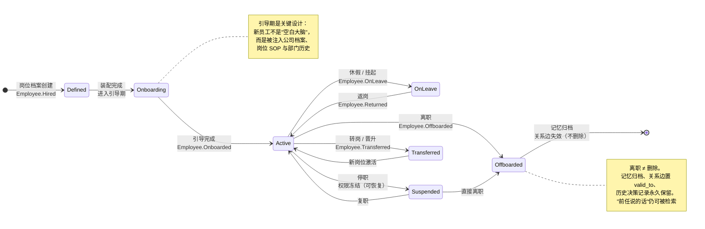
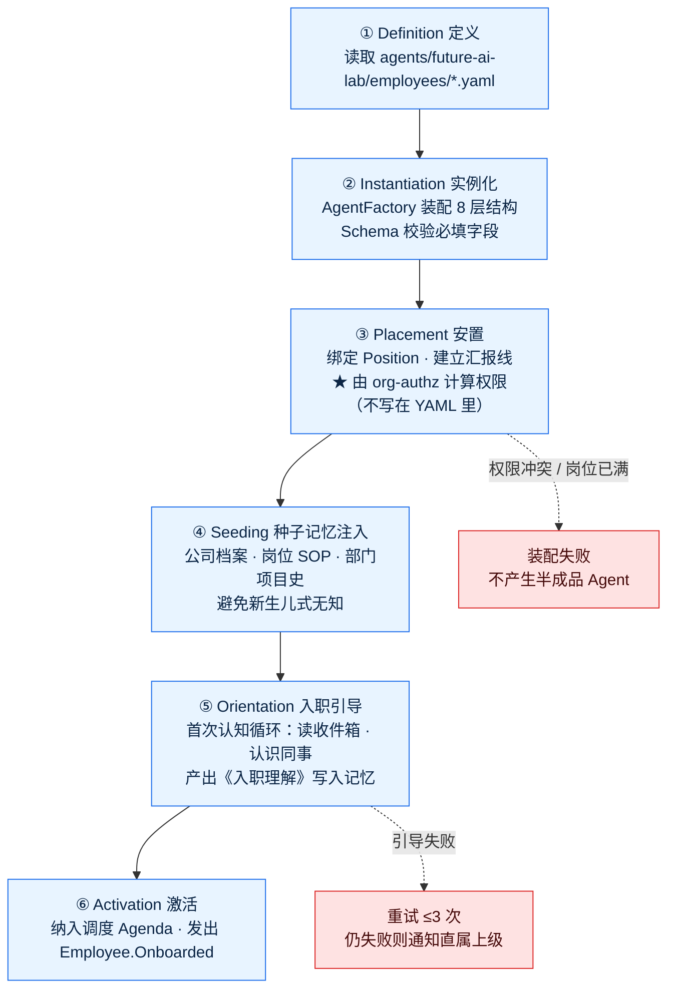
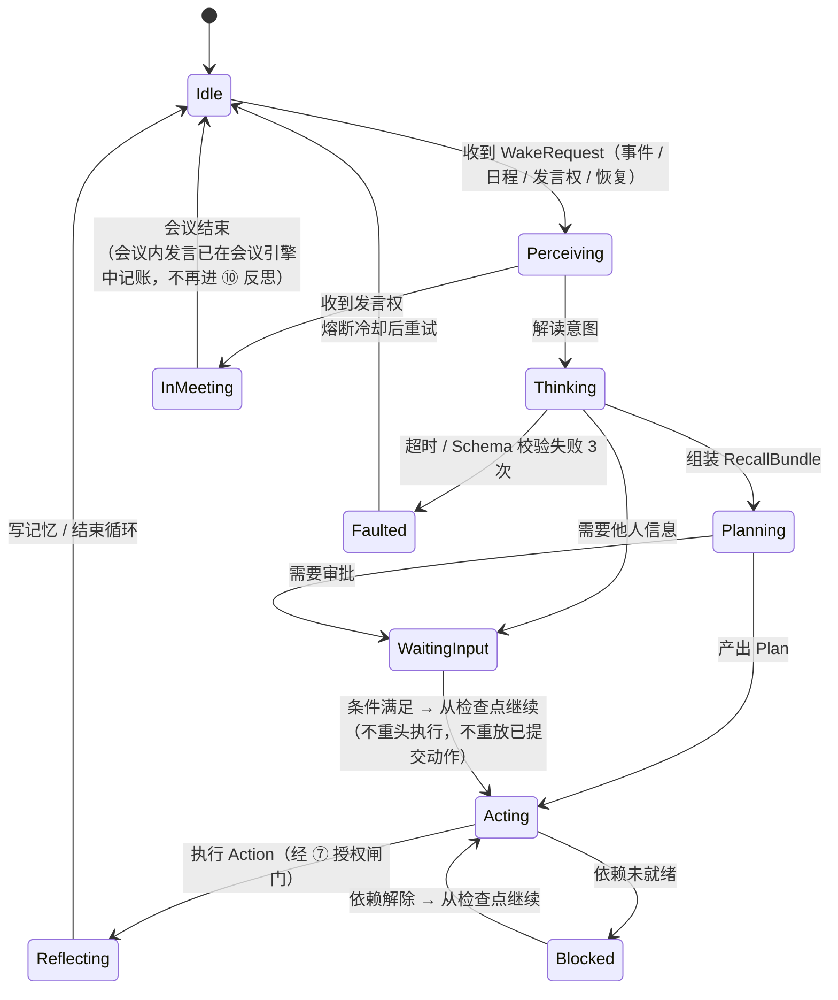
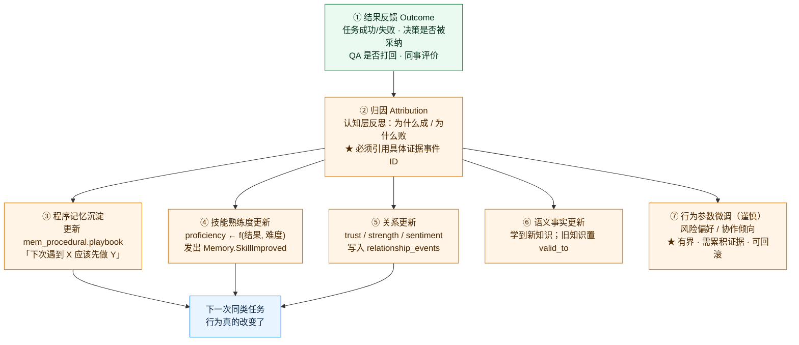
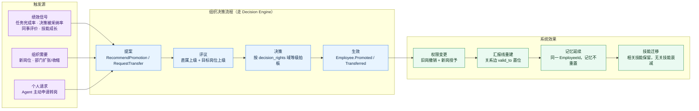

# Phase 4 · Agent 生命周期设计

> 核心命题：**AI 员工不是被调用的函数，而是存在于组织中的实体。**
> 本章定义它如何"出生 / 在岗 / 行动 / 学习 / 演化 / 离开"。

---

## 4.1 生命周期总览：两层状态模型

绝大多数多 Agent 系统只有一个模糊的"运行中"概念。MAOEH 明确区分**两个时间尺度完全不同的状态维度**：

| 维度 | 名称 | 变化频率 | 存储 | 举例 |
|------|------|---------|------|------|
| **慢变量** | `EmploymentStatus` 雇佣状态 | 月 / 周级 | `employees.status`（领域状态） | `onboarding` `active` `on_leave` `offboarded` |
| **快变量** | `PresenceState` 在岗状态 | 秒 / 分钟级 | `rm_employee_status`（读模型，从事件投影） | `idle` `thinking` `in_meeting` `blocked` |

**为什么要拆开？**
因为"这个员工还在公司吗"和"这个员工此刻在干什么"是两个完全不同的问题，
前者是**组织事实**（必须强一致、必须审计、必须能回答"当时"），后者是**运行观测**（可以最终一致、可以重建、可以丢）。
把它们塞进一张表，是后续所有并发与审计问题的根源。



**关键状态语义：**

| 状态 | 权限 | 可被派活 | 记忆 | 说明 |
|------|------|---------|------|------|
| `Defined` | 无 | ✗ | 无 | 岗位档案已存在，Agent 实例未装配 |
| `Onboarding` | 只读 + 自我介绍 | ✗ | 注入种子记忆 | 正在建立组织认知 |
| `Active` | 完整（按岗位） | ✓ | 正常读写 | 正常工作态 |
| `OnLeave` | 冻结（保留只读） | ✗ | 只读 | 任务自动**代理**给委托人 |
| `Suspended` | **全部冻结** | ✗ | 只读 | 停职（合规调查等），不可被唤醒 |
| `Transferred` | 旧岗撤销 + 新岗授予 | 过渡期 | 全部保留 | 权限是"换"不是"加" |
| `Offboarded` | 无 | ✗ | 归档（可检索） | 关系边 `valid_to` 置位 |

> **`OnLeave` 的代理机制是组织模型的价值体现。**
> 员工休假时，`workflow_steps` 里派给该岗位的任务不会卡死——
> `resolveByPosition()` 沿 `delegations` 找到代理人，写入 `acting_employee_id`。
> 这模拟了真实公司的"代管"，而不是让流程挂起等人。

---

## 4.2 Agent 初始化（从 YAML 到"活着的员工"）

### 4.2.1 六阶段装配流水线



**设计要点：**

1. **装配是原子的。** 六个阶段全部成功才产出 `Employee.Onboarded`；任一步失败则回滚，**绝不产生"半个 Agent"**（有身份无权限、有记忆无岗位这类状态是 bug 温床）。
2. **权限不在档案里。** YAML 只写"我是谁、我负责什么"，**权限完全由岗位推导**。这样调整组织权限时只需改一处，不必逐个改员工档案。
3. **种子记忆是必需的。** 一个刚入职的员工不是空白大脑——他知道公司做什么、自己的岗位 SOP、部门在搞什么项目。`Seeding` 阶段把这些作为 `mem_facts`（组织级共享知识）注入，避免 Agent 每天重新发现常识，也避免它编造公司信息。
4. **入职引导产出可观测物。** Agent 在 `Orientation` 阶段产出一份《入职理解》（写入 `documents`），这是人类观察者第一次能"看到 Agent 想什么"的窗口，也是检验人设是否生效的最快手段。

### 4.2.2 员工档案（YAML）— 数据而非代码

```yaml
# agents/future-ai-lab/employees/cto.yaml
employee_no: FAL-002
name: 林知远
kind: agent
position_key: cto                # ★ 岗位决定权限、汇报线、决策域
department_key: engineering

identity:
  background: |
    前分布式系统工程师，主导过两次大规模服务重构。
    相信"技术债是复利"，对过早优化有强烈反感。
  values: [工程严谨, 长期主义, 直接沟通]
  voice:
    tone: 冷静、简短、以数据说话
    habits: ["先说结论，再说理由", "引用具体数字"]
  risk_appetite: 0.35            # 0=极度保守, 1=激进

skills:                          # 声明能力，熟练度由系统从经验中学习
  - code: system_design
    initial_proficiency: 0.85
  - code: tech_review
    initial_proficiency: 0.8
  - code: team_management
    initial_proficiency: 0.6     # 新晋管理者，经验不足 → 会犯错、会学习

memory:
  strategy:
    reflection_trigger_importance: 150
    recall_top_k: 12
    weights: { recency: 0.35, importance: 0.25, relevance: 0.30, affinity: 0.10 }
  seeded_facts:
    - subject: company
      predicate: mission
      object: "构建可信赖的 AI 基础设施"
    - subject: engineering
      predicate: convention
      object: "所有改动必须有测试；线上事故 24h 内出复盘"

communication:
  default_channel_kind: group
  meeting_speak_budget: 6        # ★ 单次会议最多发言 6 次，防止霸场
  report_cadence: weekly
  escalation_style: direct       # 直接找 CEO，而非层层上报

# ★ Goal（目标）：组织指派的 + 我自己设定的
goals:
  assigned:                      # 由岗位目标或上级指派派生（走 goals 表）
    - key: q3_reliability
      statement: "把核心服务 P99 延迟压到 200ms 以内"
      horizon: quarter
      owner_kind: position
      success_metric: "P99 < 200ms 连续 14 天"
  self_directed:                 # Agent 自主设定，需上级可见（不隐藏）
    - statement: "把技术评审的平均轮次从 2.5 降到 1.5"
      rationale: "评审过长是当前交付周期的主要瓶颈"
      horizon: month

decision:
  vote_tendency: conservative_on_scope
  escalate_when: [预算超限, 跨部门冲突, 违反工程规范]
  delegation_style: 授人以渔
```

> **注意 YAML 里没有一行 prompt。**
> 这个人设会被 `agent-cognition` 翻译成提示词，但**档案本身是结构化数据**——
> 它可以被校验、被 diff、被版本化、被非工程师贡献。这正是 AGENTS.md
> 「Do not create agents only by writing prompts」的落地方式。

### 4.2.3 目标（Goal）在生命周期中的位置

目标是员工属性的一部分，但**它不是静态档案字段，而是有生命周期的组织对象**（表结构见 Phase 3 §3.2.2）。

| 阶段 | 目标的来源 |
|------|-----------|
| `Onboarding` | 从**岗位目标**与**部门目标**继承（`owner_kind` 沿 `parent_goal_id` 向下分解） |
| `Active` | 上级通过任务/工作流指派新目标（`origin = assigned`）；Agent 也可自设（`origin = self_directed`，**公开可见**） |
| 每次 `Deliberate` | 目标参与优先级判断："这件事对哪个目标有贡献？贡献度多少？" —— 这是 Agent **拒绝任务**的正当理由来源 |
| 目标达成 / 放弃 | 产出 `Goal.*` 事件，写入 `goal_contributions` 用于绩效聚合（Phase 7 §7.1） |
| 组织级目标变更 | 走 `org` 决策域审批，留 `Decision.*` 记录，不得由单个 Agent 私自修改 |

> **目标为什么必须进数据模型而不能只写在 Prompt 里？**
> 因为只有这样，才能回答"这个 Agent 过去 30 天在为哪个目标工作"、
> "哪个目标被全员忽略"、"拒绝任务是否与目标冲突有关"。
> 写进 Prompt 的目标，只能影响行为，无法被观察和分析——
> 那就又退化成"提示词角色扮演"了。

---

## 4.3 Agent 运行状态（Presence）



> **两处必须注意的语义（早期版本的歧义已修正）：**
>
> 1. **`WaitingInput` / `Blocked` 恢复后回到 `Acting`，而不是回到 `Perceiving`。**
>    这正是 §5.4.2「从检查点继续、跳过已提交动作」的状态机表达。
>    若回到 `Perceiving`，就会重跑一遍 LLM 调用，直接违反"等待 3 天的审批不重放"的承诺。
> 2. **`InMeeting` 结束后直接回 `Idle`。** 会议中的发言由 `meeting-engine` 记账并写记忆，
>    不再额外走一次 ⑩ 反思——否则每开一次会都会触发一轮额外的 LLM 调用，成本翻倍。
> 3. **不再画 `Idle --> Idle` 自环。** 所有唤醒统一表达为 `Idle --> Perceiving`，
>    避免"同一触发源有两条边"导致状态机测试无法写断言。

| PresenceState | 对调度器的含义 | 对观察者的含义 |
|---------------|--------------|--------------|
| `Idle` | 可被唤醒 | 在岗待命 |
| `Perceiving`/`Thinking`/`Planning`/`Acting` | **已被占用，不可重入** | 正在思考 / 正在行动 |
| `Reflecting` | 可被唤醒（低优先级） | 正在整理经验 |
| `WaitingInput` | **挂起，等待事件**（不消耗预算） | 等待回复 / 等待审批 |
| `Blocked` | 挂起 + 已通知主管 | 被卡住了（**会触发升级计时**） |
| `InMeeting` | 由会议引擎独占 | 正在开会 |
| `Faulted` | 熔断，冷却后可重试 | 出错了 |

> **`WaitingInput` 与 `Blocked` 的区别至关重要。**
> `WaitingInput` 是**正常等待**（等我同事回消息），`Blocked` 是**异常卡住**（依赖的编译产物没出来，也没人管）。
> 只有 `Blocked` 会启动 SLA 升级计时器。这个区分让"组织健康度"变成一个可计算指标，
> 而不是靠人肉观察。

---

## 4.4 Agent 如何行动（Action Space）

Agent 的行动空间是**封闭且受权限约束**的。LLM 只能从这个清单里选，不能自由发挥。

| # | 类别 | Action | 所需权限 | 产出事件 |
|---|------|--------|---------|---------|
| 1 | **沟通** | `SendMessage` / `Reply` / `Mention` | `comm.send` | `Communication.MessageSent` |
| 2 | | `Announce` | `comm.announce`（L4+） | `Communication.AnnouncementPublished` |
| 3 | | `SubmitReport` | `comm.report` | `Communication.ReportSubmitted` |
| 4 | **工作** | `AcceptTask` / `RejectTask` | `task.respond` | `Task.Accepted` / `Task.Rejected` |
| 5 | | `StartTask` / `ProgressReport` / `CompleteTask` | `task.execute` | `Task.Started` / `ProgressReported` / `Completed` |
| 6 | | `BlockTask` | `task.execute` | `Task.Blocked`（★ 触发升级计时） |
| 7 | **产出** | `ProduceArtifact` | `artifact.create` | `Document` + `Task.ProgressReported` |
| 8 | **决策** | `CreateProposal` | `decision.propose`（L1+） | `Decision.ProposalCreated` |
| 9 | | `ReviewProposal` | `decision.review` | `Decision.ReviewSubmitted` |
| 10 | | `CastVote` | `decision.vote` + 域等级 | `Decision.VoteCast` |
| 11 | | `FinalizeDecision` | `decision.finalize` + 域 `min_level` | `Decision.Finalized` |
| 12 | **审批** | `ApproveStep` / `RejectStep` | `workflow.approve` + `required_level` | `Workflow.ApprovalGranted` / `Denied` |
| 13 | | `DelegateApproval` | `workflow.delegate` | `Workflow.ApprovalDelegated` |
| 14 | **会议** | `RequestMeeting` | `meeting.request` | `Meeting.Scheduled` |
| 15 | | `Speak` | 持有发言权 | `Meeting.SpeechGiven` |
| 16 | **流程** | `RequestDeviation` | `workflow.deviate` | `Workflow.DeviationRequested` |
| 17 | **升级** | `Escalate` | `escalation.raise` | `Runtime.Escalated` |
| 18 | **人事** | `RecommendHire` / `RequestTransfer` / `RequestPromotion` | `hr.recommend` | `Employee.*`（需上级审批） |
| 19 | **资源** | `RequestBudget` | `resource.request` | `Workflow.ApprovalRequested` |
| 20 | **学习** | `ReadDocument` / `Reflect` / `PracticeSkill` | `knowledge.read` | `Memory.*` |
| 21 | **自调度** | `ScheduleSelf` / `SetReminder` / `DeferTask` | `runtime.self` | `System.*` |
| 22 | **工具** | `InvokeTool(toolId, args)` | `tool.invoke:<toolId>` | `Tool.Invoked` |
| 23 | **运行时** | `UpdatePresence` | `runtime.self` | `Runtime.PresenceChanged` |
| 24 | **派发** | `DispatchWork` | `work.dispatch` + 域等级 + 汇报子树范围 | `Task.Created` + `Task.Assigned` |

> **M1.4（ADR-014）增补**：上表新增 `DispatchWork`（第 24 行）——`shared-types` 的 `ACTIONS` 枚举 **42 → 43**（纯加法）。
> 派发粒度只有岗位（入参仅 `positionId`，不含 `employeeId`）；原子 create+assign 与 A1–A6 闸门在 `TaskService.dispatch()` 内部执行
> （见 `M1.4-collaborative-work-orchestration.md` §5.3/§5.5）。产出事件为**既有** `Task.Created` + `Task.Assigned`，不新增唤醒源。

**三条硬规则：**

1. **行动空间封闭。** 不在表里的动作，Agent 做不了——不是"提示词里没写"，而是 **Schema 枚举里没有**。这从根本上消除了"Agent 突然决定去删数据库"的可能性。
2. **每个行动都过授权闸门。** `ToolGateway.invoke()` / 内核命令入口统一调用 `AuthzService.can()`。拒绝时返回**可操作的升级建议**（`escalateTo: 'cto'`），而不是干巴巴的 `403`——这样 Agent 才能学会"找对人"。
3. **行动即事件。** 没有"悄悄做了一件事"的路径。这是可观测性的根基。

---

## 4.5 Agent 如何学习（Learning Loop）



### 4.5.1 技能成长模型

```ts
// 熟练度 proficiency ∈ [0, 1]
// 任务结果反馈后更新
const alpha = 0.15;   // 学习率（成功）
const beta  = 0.10;   // 惩罚率（失败）
const gamma = 0.02;   // 遗忘率（每 N 个模拟日未使用）

if (outcome === 'success') {
  // 越接近上限，进步越慢（边际递减）
  proficiency += alpha * (1 - proficiency) * difficultyFactor;
} else {
  proficiency -= beta * proficiency * difficultyFactor;
}

// 长期不使用会退化（真实世界也是如此）
if (daysSinceLastUse >= 10) proficiency *= (1 - gamma);
```

**为什么要建模遗忘？**
因为它让"员工长期做一件事会变强、转岗后旧技能会生疏"变成系统行为。
这带来两个真实效果：(1) 任务分配会根据 `proficiency` 做能力匹配，组织会自然形成专才与通才的分化；
(2) 一个 Agent 转岗后会主动寻求帮助——这正是组织协作的驱动力来源。

**技能数据同时驱动三件事：**

| 用途 | 说明 |
|------|------|
| 任务分配 | `assignee = argmax(proficiency × availability)` —— 组织自然分工 |
| 团队组建 | 会议/项目邀请倾向选择互补技能者 |
| 成长可视化 | 人类可看到"这个 AI 从 0.6 涨到 0.85"的曲线，这是"数字员工"最有说服力的展示 |

### 4.5.2 学习的边界（防止"越学越坏"）

| 风险 | 防线 |
|------|------|
| **幻觉式学习**（从错误前提学到错误结论） | `mem_facts` 必须带 `source_episode_ids`；置信度 < 0.5 的事实不参与决策推理 |
| **记忆投毒**（被诱导写入错误记忆） | 关键事实（组织级 `owner_employee_id IS NULL`）**不可由单个 Agent 改写**，需 2 个以上来源或人工确认 |
| **过度自信**（成功一次就以为自己擅长） | 熟练度增长有边际递减；`success_count < 3` 时不高影响任务分配 |
| **性格漂移**（偏离原始人设） | 行为参数微调幅度**每周期上限 ±2%**，且总偏移量限制在初始值 ±20% 以内 |
| **不可追溯** | 每次学习都写 `mem_write_log` + `Memory.SkillImproved` 事件，附证据事件 ID |

> **`mem_episodes` 与 `mem_facts` / `mem_reflections` 必须分表**（见 Phase 3 §3.5）。
> 原始经历不可篡改，LLM 概括可重新生成——这是对抗 Generative Agents 论文中
> 已实证的 **embellishment（虚构润色）** 失败模式的直接手段。

---

## 4.6 Agent 如何演化（组织层面的成长）

Agent 的生命周期不止于"在岗工作"，还包括组织地位的变迁。



**关键设计：晋升不重置记忆。**
`EmployeeId` 在整个生涯中不变，因此 Agent 可以说出
"我当工程师时踩过这个坑，所以现在作为 CTO 我要先做技术评审"——
**这是"经验积累"与"组织成长"在数据模型上的连接点**，也是本项目区别于
"每次任务重新实例化 Agent"的框架的根本差异。

**离职的处理：**

| 数据 | 处理 | 理由 |
|------|------|------|
| `employees.status` | `offboarded` | 组织事实 |
| `positions.status` | 回到 `open` | 坑还在，等人补 |
| 权限 | 全部撤销 | 安全底线 |
| `relationship` 边 | `valid_to` 置位（**不删除**） | 历史可查："当时谁和谁合作过" |
| `mem_*` | 归档，仍可被检索（低 `affinity` 权重） | "前任 CTO 留下的技术决策"依然有价值 |
| `decisions` | **永久保留** | 审计与组织记忆 |

---

## 4.7 生命周期事件表（完整）

| 阶段 | 事件 | 触发者 | 后果 |
|------|------|--------|------|
| 定义 | `Organization.PositionCreated` | CEO / 组织内核 | 岗位树新增节点 |
| 定义 | `Employee.Hired` | 决策流程 | `employees` 行创建，状态 `Defined` |
| 装配 | `Runtime.AgentInstantiated` | `AgentFactory` | 8 层结构就绪 |
| 装配 | `Relationship.Established` | 安置阶段 | 汇报线/协作边建立 |
| 引导 | `Memory.FactLearned`（种子） | Seeding | 公司/岗位/项目常识注入 |
| 引导 | `Employee.Onboarded` | Orientation 完成 | 状态 → `Active`，纳入 Agenda |
| 在岗 | `Runtime.CycleStarted` / `CycleFinished` | Scheduler | 每次认知循环 |
| 在岗 | `Memory.EpisodeWritten` | 认知循环 | 经历被记录 |
| 在岗 | `Memory.ReflectionCreated` | 反思任务 | 经验被提炼 |
| 在岗 | `Memory.SkillImproved` | 结果反馈 | 能力变化 |
| 在岗 | `Relationship.TrustChanged` | 反思/反馈 | 关系演化 |
| 异动 | `Employee.OnLeave` / `Returned` | 上级 / 本人 | 代理机制启动/停止 |
| 异动 | `Employee.RoleChanged` | 组织决策 | 权限重算 |
| 异动 | `Employee.Promoted` | 决策流程 | 权限等级提升 |
| 异动 | `Employee.Transferred` | 决策流程 | 汇报线重建 |
| 终止 | `Employee.Offboarded` | 决策流程 | 权限撤销，记忆归档 |
| 终止 | `Organization.PositionVacated` | 离职派生 | 派活自动转向代理 |

---

## 4.8 生命周期自检清单

- [ ] 每个 Agent 实例都能回答"我现在处于哪个雇佣状态、哪个在岗状态"
- [ ] 装配是原子的，不存在"有身份无权限"的半成品
- [ ] 权限来自岗位而非档案，改岗位即改权限
- [ ] 新员工有种子记忆，不会编造公司常识
- [ ] 行动空间封闭且每个动作都有对应权限点
- [ ] 每次学习都有 `mem_write_log` 与证据事件 ID
- [ ] 熟练度有增长、有衰减、有上限
- [ ] 晋升不重置 `EmployeeId` 与记忆
- [ ] 离职不删除关系边与决策记录，只置 `valid_to`
- [ ] 休假时任务能自动代理，流程不卡死

---

## 4.9 与 Agent Runtime 的接口

Phase 4 定义"Agent 是什么、能做什么"；Phase 5 定义"这些行为如何被调度、执行、恢复"。

```ts
// Agent 层对外只暴露"思考步骤"端口；Runtime 拥有循环骨架与执行权。
// ★ 注意：Agent 上**没有** runCycle —— 循环属于 Runtime（这是 C1 矛盾的权威裁决）
export interface AgentPorts {
  /** 装配：从档案 + 组织快照构建一个完整 Agent */
  build(employeeId: EmployeeId, snapshot: OrgSnapshot): Promise<Agent>;
  /** 初始化：完成 6 阶段装配流水线 */
  onboard(employeeId: EmployeeId): Promise<OnboardingResult>;

  // —— 以下五个是"纯步骤"，由 runtime-loop 按顺序编排 ——
  perceive(input: PerceptionInput, state: AgentState): Promise<Perception>;   // ③
  recall(p: Perception, state: AgentState): Promise<RecallBundle>;            // ④（策略；打分在 memory）
  deliberate(p: Perception, r: RecallBundle): Promise<Judgement>;             // ⑤
  plan(j: Judgement, state: AgentState, budget: CycleBudget): Promise<Plan>;  // ⑥
  reflect(outcome: Outcome, trace: CycleTrace): Promise<Reflection>;          // ⑩（文本；落库在 memory）

  /** 状态查询（只读，供调度器决策） */
  presence(employeeId: EmployeeId): Promise<PresenceState>;
  /** 生命周期迁移（受权限约束，由内核触发而非 Agent 自己） */
  transition(employeeId: EmployeeId, to: EmploymentStatus, reason: TransitionReason): Promise<void>;
}

/** Runtime 拥有循环骨架：Load / Authorize / Act / Observe / 检查点 / 预算 / 恢复 */
export interface AgentRuntime {
  runCycle(wake: WakeRequest): Promise<CycleResult>;
}
```

> **职责划线（权威裁决，取代早期版本的模糊表述）：**
>
> | 谁 | 拥有什么 |
> |----|---------|
> | `runtime-loop` | 循环的**骨架**：载入、编排五个思考步骤、**⑦ Authorize**、⑧ Act、⑨ Observe、检查点、预算护栏、恢复 |
> | `agent-cognition` | 通过 `AgentPorts` 提供**五个纯步骤**的内容（唯一允许出现 Prompt 的地方） |
> | `memory` | 记忆的**机制**（存储 / 打分 / 排序 / 落库 / 衰减）；反思的**调度**，但反思**文本**由 `agent-cognition` 生成 |
> | `tool-gateway` | **调用级**授权闸门 + 沙箱执行 |
>
> 这样一来，`02-modules.md` 里"`runtime-loop` 执行一次认知循环的 10 个阶段"与
> "Runtime 中不存在任何一句 Prompt"两条**同时成立**。
>
> **验收方式：** `packages/agent-*` 中搜索不到 `Authorize` / `checkpoint` / `budget` 相关代码；
> `packages/runtime-*` 中搜索不到任何 Prompt 字符串或 `llm-gateway` 的 Prompt 构造调用。

---

## 4.10 M1.3 已实现的 Agent 生命周期（Create / Read / Archive）

§4.1–§4.9 是**设计目标**（完整生命周期：招聘 → 引导 → 在岗 → 学习 → 演化 → 离职）。
M1.3 落地其中**人类操作者可以直接驱动**的一段：**创建 / 读取 / 归档**，且不新增任何包或状态机。

### 4.10.1 命令与事件

| 通路 | 名称 | 目标 | 说明 |
|------|------|------|------|
| 命令 | `Agent.Create` | `organization:<companyId>` | 操作者给出身份（`employeeId` / `name` / `positionId` / `employeeNo?`）、职责（`responsibilities[]`，必填 ≥1）、特质与参照模板；**M1.6** 起可附 `newPosition{departmentId,title,capabilities?,reportsToPositionId?}` 内联建岗（见 M1.6 §4） |
| 命令 | `Agent.Archive` | `agent:<employeeId>` | 关闭雇佣关系；**不删除任何数据** |
| 事件 | `Control.AgentCreated`（常量 `AGENT_CREATED`） | subject = 新员工 | payload 完整到「可据其重建该 Agent」：身份、岗位、职责、特质、认知档案、模板来源、`status: active`；**M1.6** 起附可选 `position{departmentId,title,capabilities[],reportsToPositionId}`（内联建岗的事实，回放据此重建岗位行） |
| 事件 | `Control.AgentArchived`（常量 `AGENT_ARCHIVED`） | subject = 该员工 | payload：`status: archived` + `employmentStatus: offboarded` |

> **为什么事件在 `Control` 聚合下？** 事件命名契约是 `<聚合根>.<过去式动词>`，聚合白名单见
> `event-system/taxonomy.ts`；`Control.*` 已是「人类控制动作的事实」聚合（ADR-013），而
> **新增一个 `Agent` 聚合等于新增一套事件命名空间**——M1.3 明确不引入新架构，因此沿用 `Control.*`。
> 需求文档里的名字 **`AGENT_CREATED` / `AGENT_ARCHIVED`** 作为常量原样导出。

### 4.10.2 两个状态维度：领域状态 vs 生命周期投影

| 层 | 值 | 存储 | 谁写 |
|----|----|------|------|
| 领域事实 | `employees.status`（`active` → `offboarded`） | `Organization`（内存态，M1.3 与 M1.0 一致，尚无 persistence） | 仅 Runtime（`Simulation.archiveAgent`） |
| 读模型 | `AgentSummary.lifecycle`：**`active` / `archived`** | 由 `employees.status` 投影（`agent-lifecycle.ts`） | Query（只读） |

**归档 = `offboarded`，而不是新增第五种「非在职」状态。** 领域已经用 `offboarded` 表达
「离职」（§4.6：离职 ≠ 删除，关系边置 `valid_to`，决策永久保留），因此 M1.3 复用该状态，
`lifecycle` 只是把领域词汇投影成「Agent 管理」页需要的两态视图。这样
`permission-system` / `task-system` / `workflow-engine` / `eligibility` 已有的
「不可执行员工」判定**自动生效**，无需在五个模块里各加一个状态。

### 4.10.3 关键规则（全部 fail-closed）

1. **装配原子性（§4.2.1 的运行时版本）**：`Agent.Create` 先校验岗位存在、ID/工号不重复、
   认知档案存在、模板可解析，**全部通过后才**注册身份 → 放入 `employees` → 实例化 8 层结构；
   任一步失败都不产生「半个 Agent」。**M1.6 扩展**：附带 `newPosition` 时先用纯函数构建岗位行
   （部门不存在 → `unknown_department`，id 撞车 → `duplicate_position`），岗位行先压入、
   之后任一步失败由 `refuse()` 补偿弹出——岗位与员工同一条原子性铁律（M1.6 §4）。
2. **职责必填**：没有 `responsibilities` 的创建请求被结构性拒绝（`INVALID_COMMAND`），
   对应 AGENTS.md「Do not create agents only by writing prompts」。
3. **有 running task 禁止归档**：归档前扫描该员工的**非终态任务**（`assigneeEmployeeId`
   或 `actingEmployeeId`），命中则 `CONFLICT` 并在 reason 里列出 taskId；
   `Task.Completed` / `Task.Cancelled` 是唯一的放行方式。**先有检查，后有副作用。**
4. **不能归档自己的操作身份**：操作者（如控制台使用的 `ceo-alex`）不能归档自己，
   否则后续命令会因「actor 非在职」全部被拒（`FORBIDDEN`）。
5. **归档之后不再派活**：归档会取消该员工**已入队**的唤醒；同时
   `task-system` 在按岗位解析受理人时跳过不可执行员工，任务留在岗位上「等人」而不是
   交给已归档的 Agent。
6. **可回放**：`recover()` 会按日志顺序重放 `Control.AgentCreated` / `Control.AgentArchived`
   重建花名册（A3：一切组织状态变更都是事件），因此「重启 = 重放」对 M1.3 的新事实同样成立。

### 4.10.4 调用链（唯一写路径）

```
控制台（apps/web）
  └─ POST /api/command  { commandType: 'Agent.Create' | 'Agent.Archive' }
       └─ apps/api  HTTP 边缘
            └─ ControlPlane.execute()     校验 → 授权（AuthzService.can + org 决策域）→ 派发
                 └─ ControlSimulationPort.createAgent / archiveAgent   （Runtime 端口）
                      └─ Simulation.createAgent / archiveAgent          （Runtime：身份/岗位/8 层）
                           └─ Organization.employees                   （组织事实变更）
                 ├─ EventStore.append([Control.AgentCreated|Archived])
                 └─ Audit.record({ actor, reason, verdict, eventIds })
```

**读取**同样走既有只读通路：`GET /api/agents`（列表）、`GET /api/agents/:id`（单个 Agent）、
`GET /api/snapshot`（组织图含新员工）。归档 Agent 仍然可读——归档是状态，不是删除。
