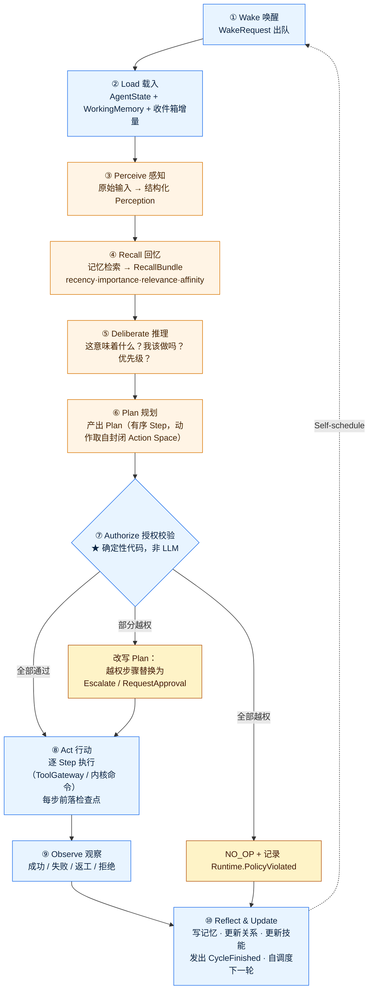
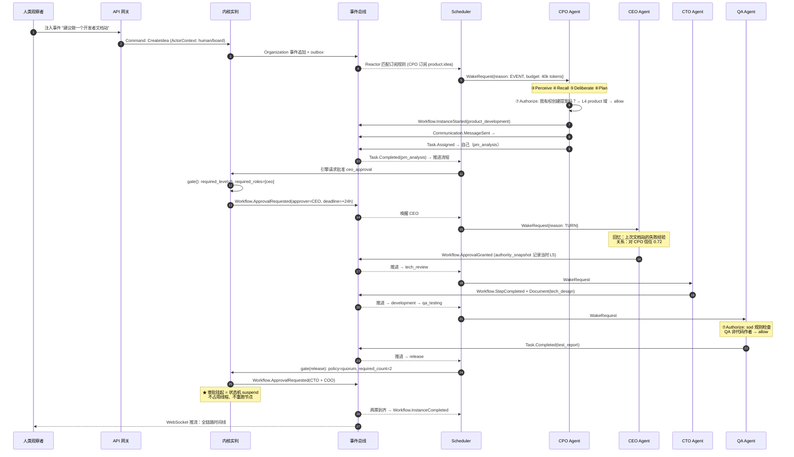
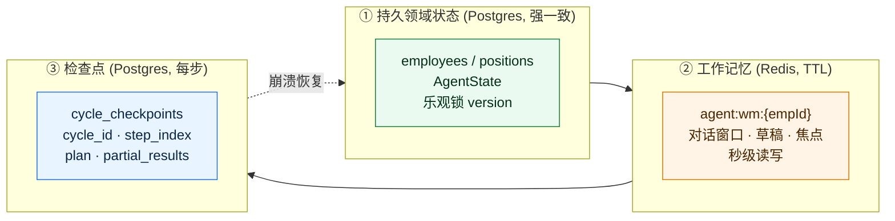
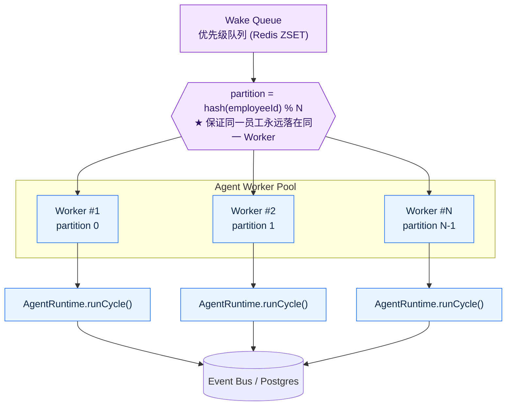
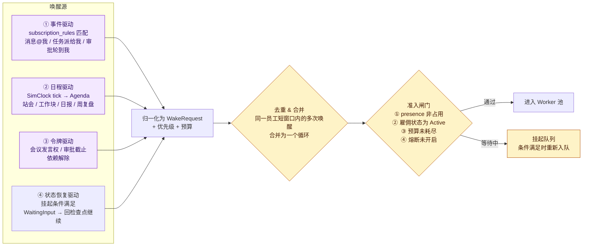
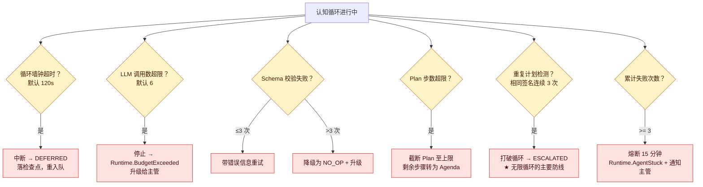

# Phase 5 · Runtime 运行流程

> 回答一个问题：**一个 AI 员工从"收到事件"到"更新状态"，中间到底发生了什么？**
>
> Runtime Layer 对应 `AGENTS.md` 的 **Execution / Scheduling / State management**，
> 与 Agent Layer 的 **Reasoning / Planning / Communication** 严格分离。

---

## 5.1 Runtime 的三个职责

| 职责 | 归属模块 | 特征 |
|------|---------|------|
| **Execution** —— 驱动一次认知循环，并在其中有明确的授权闸门 | `runtime-loop` | 确定性骨架 + 概率性内核 |
| **State Management** —— Agent 状态的持久化、版本、检查点、恢复 | `runtime-state` | 强一致、可恢复、幂等 |
| **Scheduling** —— 决定"谁、在什么时刻、因为什么被唤醒" | `runtime-scheduler` | 可暂停 / 快进 / 回放 |

**Runtime 中不存在任何一句 Prompt。** 这是 Runtime 能被当作普通后端服务压测的前提。

---

## 5.2 Runtime Loop：一次认知循环的 10 个阶段



### 阶段详解

| # | 阶段 | 谁执行 | 输入 | 输出 | 关键约束 |
|---|------|--------|------|------|---------|
| ① | **Wake** | Scheduler | — | `WakeRequest` | 含 `reason`、`priority`、`budget`；同一 Agent 同一时刻**只允许一个循环** |
| ② | **Load** | Runtime(确定性) | `employeeId` | `AgentState` + `WorkingMemory` | 按 `version` 乐观锁读取；加载失败 → `DEFERRED` 重入队 |
| ③ | **Perceive** | Agent(LLM) | 事件/消息/任务增量 | `Perception{ intent, urgency, refs, openQuestions }` | **只解读，不决策**；Schema 校验失败重试 ≤3 |
| ④ | **Recall** | Agent(策略) + Memory(机制) | `Perception` | `RecallBundle` | 检索是**确定性打分**；LLM 只参与 query 改写（可选） |
| ⑤ | **Deliberate** | Agent(LLM) | `Perception` + `RecallBundle` | `Judgement{ stance, priority, needsHelp, risks }` | 必须回答"这件事该不该我做"；可返回 `NO_OP` |
| ⑥ | **Plan** | Agent(LLM) | `Judgement` | `Plan{ steps: Step[] }` | 每个 Step 的 `action` 必须是 Action Space 枚举值；步数 ≤ `maxSteps` |
| ⑦ | **Authorize** | **Runtime(确定性)** | `Plan` + `ActorContext` | `AuthorizedPlan` | **★ 本项目的安全核心。零 LLM。** 逐条 `AuthzService.can()`，越权步骤被改写而非静默丢弃 |
| ⑧ | **Act** | Runtime + ToolGateway | `AuthorizedPlan` | `StepResult[]` | 每步前落检查点；每步带 `idempotencyKey`；失败即停并按策略重试 |
| ⑨ | **Observe** | Runtime | `StepResult[]` | `Outcome` | 拒绝与失败都是**一等结果**，不是异常 |
| ⑩ | **Reflect & Update** | Agent(LLM) + Memory(机制) | `Outcome` + 全过程 | 记忆写入 + 关系更新 + 技能更新 | 写 `mem_write_log`；发 `CycleFinished`；产出下一轮 `Agenda` |

> **管理岗的派发动作（M1.4 · ADR-014）**：⑥ Plan 产出的 `DispatchWork` 步骤，其效果**全部**经
> `Task.Created` / `Task.Assigned` 事件 + 既有订阅唤醒（`eligibleAgentsFor`，§5.6.3）生效——
> **不新增唤醒源、不存在 Agent→Agent 直接调用**（A5）；CEO 不能"命令"任何 Agent，只能派给岗位并由订阅规则唤醒执行者。

### 执行顺序：阶段间串行，阶段内可并行

这是此前没有写清、却直接决定性能目标和预算语义的一点：

```
阶段之间：**严格串行** —— ③→④→⑤→⑥ 每一阶段的输入是上一阶段的输出，无法并行。
阶段之内：**可以并行** —— 例如 ④ Recall 的向量检索 + 事实检索 + 关系快照查询；
                      ⑧ Act 中互不依赖的多个 Step（受 §5.5 的 maxSteps 与依赖图约束）。
```

**因此 LLM 调用数是确定的，不是"3–4 次"：**

| 阶段 | 是否调用 LLM |
|------|-------------|
| ③ Perceive | ✅ 1 次 |
| ④ Recall | ❌ 确定性打分（仅可选 1 次 query 改写） |
| ⑤ Deliberate | ✅ 1 次 |
| ⑥ Plan | ✅ 1 次 |
| ⑦ Authorize | ❌ 零 LLM |
| ⑧ Act | ❌（工具调用不产生 LLM 调用） |
| ⑨ Observe | ❌ |
| ⑩ Reflect | ✅ 1 次（可被 `IMPORTANCE_GATE` 跳过） |

> **`CycleBudget.maxLlmCalls` 是"本轮循环累计 LLM 调用上限"，默认 6**（4 个必需阶段 + 2 次重试余量），
> 而不是"每个阶段的上限"。§5.10 的 P50 < 8s 目标是按**串行 3–4 次调用、每次 1.5–2.5s** 推算的；
> 若开启 query 改写或反思，调用数升到 5 次，P50 目标需相应放宽或依赖语义缓存命中。

### 为什么第 ⑦ 步是整个系统的安全核心

这是 MAOEH 与"提示词自律"型框架的分水岭：

```
LLM 说：我要发布 v1.0        →  Plan: [{ action: 'ReleaseProduct', args: {...} }]
                                     ↓
              AuthzService.can(cto, 'workflow.approve', 'wf:product_dev#step:release')
                                     ↓
              ┌── allow ────────────→ 执行，发 Workflow.ApprovalGranted
              ├── NEEDS_APPROVAL ───→ 改写为 RequestApproval(escalateTo: 'ceo')
              └── NO_PERMISSION ────→ 改写为 Escalate(reason) + 记 Runtime.PolicyViolated
```

**LLM 的文本永远不会直接成为一个副作用。** 它必须先变成一个 `Intent`，
再被确定性代码翻译成一个**已授权**的 `Command`。
这同时实现了 Phase 1 的 A4 公理，也正面回应了 MAST 第一类失败（违反角色/任务规范）。

#### 授权闸门是**两级**的，缺一不可

这是文档早期版本里最容易读错的地方，必须明确分工：

| 级别 | 位置 | 检查什么 | 失败时的行为 |
|------|------|---------|-------------|
| **① Plan 级（步骤级）** | `runtime-loop` 的 ⑦ 阶段 | 这个**动作**在**这个抽象资源**上是否被允许？预算是否够？是否违反 SoD？ | **改写 Plan**：越权步骤 → `RequestApproval` / `Escalate` |
| **② 调用级（实例级）** | `tool-gateway` | 具体入参是否安全？目标资源实例是否在作用域内？频次是否超限？幂等键是否重复？ | **拒绝该次调用**，返回 `denied` + 原因，写 `tool_invocations` |

> 只做 ② 会让"越权步骤被改写为升级请求"没有落点（Plan 会直接执行到工具层才被拒）；
> 只做 ① 会让同一动作在被允许的资源类型上任意实例化（例如"可以提交代码"≠"可以提交到 main"）。
> **两级都必须实现**，且都调用同一个 `AuthzService`。

---

## 5.3 端到端时序：从人类一句话到产品发布



**这张图里有五个刻意的设计：**

1. **人类只是又一个事件源**，不是特殊路径。人类走的也是 `Command → 内核 → Event`。
2. **Agent 之间没有一次直接调用**（A5）。CPO 不知道 CTO 在哪，它只是发事件。
3. **唤醒由订阅规则决定**，不由发送方决定。CPO 无法"命令"CEO 干活——它只能提交审批请求。
4. **审批挂起是真正的挂起**（`WaitingInput` + 持久化状态），不占线程、不重跑节点——直接规避了 LangGraph `interrupt()` 的指数级重放陷阱。
5. **每一步都带 `authority_snapshot`**：24 小时后即便 CEO 权限变了，我们依然知道"当时他是以 L5 批的"。

---

## 5.4 状态管理（State Management）

### 5.4.1 三层状态



```ts
export interface AgentState {
  employeeId: EmployeeId;
  version: number;                 // ★ 乐观锁
  employment: EmploymentStatus;    // 慢变量
  presence: PresenceState;         // 快变量（唯一写入者：Runtime.PresenceChanged）
  currentCycleId: string | null;   // 非空 = 已被占用，不可重入
  suspendedAt: { stepIndex: number; awaitingEventType: string } | null;
  agenda: AgendaItem[];            // 自调度：我接下来打算做什么
  focus: { refType: string; refId: string } | null;
  budget: { simDay: number; tokensUsed: number; usdUsed: number; cyclesRun: number };
  // ★ 反思触发器：importance 累加器必须持久化，否则崩溃/重放会导致重复或漏触发反思
  reflection: { accumulator: number; lastReflectedAtSim: SimTime; episodesSinceReflect: number };
  // ★ 按 cycle 缓存的权限快照，避免对 Plan 的每一步都重算 effective()（见 §5.4.4）
  permissionSnapshot: { computedAt: SimTime; version: number } | null;
  // ★ 世界线：live 为真实历史；非快照运行时为分叉分支（Phase 7 才实现写侧分叉）
  branchId: string;                // 默认 'live'
  health: { consecutiveFailures: number; lastError?: string; circuitOpenUntil?: SimTime };
  updatedAtSim: SimTime;
}
```

**`reflection.accumulator` 的语义（必须实现为原子操作）：**

```
CycleFinished 时：  accumulator += Σ(本轮新写入 episode 的 importance)
反思触发时：        accumulator = 0, lastReflectedAtSim = now
每模拟日结束：      若 accumulator > 0 则强制反思并归零
```

> **属性测试（必写）：** "累加器在崩溃恢复与 replay 下要么**恰好触发一次**反思，要么不触发"
> ——不允许触发两次。这是把研究简报中"按 employeeId 维护 importanceAccumulator"落成可测约束。

### 5.4.2 检查点与恢复（幂等的关键）

```sql
CREATE TABLE cycle_checkpoints (
  cycle_id      uuid NOT NULL,
  step_index    smallint NOT NULL,
  employee_id   uuid NOT NULL,
  plan          jsonb NOT NULL,
  authorized_plan jsonb NOT NULL,
  step_results  jsonb NOT NULL DEFAULT '[]',
  idempotency_keys text[] NOT NULL DEFAULT '{}',
  created_at    timestamptz NOT NULL DEFAULT now(),
  PRIMARY KEY (cycle_id, step_index)
);

-- 已提交的副作用，用于恢复时跳过
CREATE TABLE committed_actions (
  idempotency_key text PRIMARY KEY,
  cycle_id      uuid NOT NULL,
  step_index    smallint NOT NULL,
  event_id      uuid NOT NULL,
  committed_at  timestamptz NOT NULL DEFAULT now()
);
```

**恢复算法（这是"审批必须幂等"的落地）：**

```
resume(cycleId):
  ck = loadLatestCheckpoint(cycleId)
  for step in ck.authorizedPlan.steps from ck.step_index:
      key = sha256(cycleId, step.index, step.action, step.args)
      if exists(committed_actions[key]):     # ★ 已执行过 → 跳过，不重跑
          appendStepResult(fromEvent(committed_actions[key].event_id))
          continue
      result = execute(step, idempotencyKey = key)   # 执行后才写 committed_actions
      saveCheckpoint(cycleId, step.index + 1, ...)
```

> **对比 LangGraph 的 `interrupt()`：恢复时整个节点从头重跑**，因此 `interrupt()` 之前的副作用会重复执行，
> 且在循环中会造成指数级重放。
> MAOEH 采用 **"检查点 + 幂等键 + 跳过已提交动作"**，因此：
> **一个等待 3 天的审批被唤醒时，不会重放前面任何一次 LLM 调用或工具调用。**
> 这既是成本问题，也是正确性问题。

### 5.4.3 并发控制

| 场景 | 机制 |
|------|------|
| 同一 Agent 的并发提交 | **单写者**：`runtime-scheduler` 保证同一 `employeeId` 同时只有一个循环；`version` 乐观锁兜底 |
| 不同 Agent 并发 | 允许，分区到不同 Worker；跨 Agent 无锁，靠事件解耦 |
| 状态提交冲突 | `UPDATE ... WHERE version = $expected`；影响行数 0 → 重新载入并重入队（有界重试） |
| 长等待（审批/回复） | **挂起**（`WaitingInput` + `suspendedAt`），释放 Worker，事件到达时恢复 |
| 会议中的并发发言 | 由 `meeting-engine` 用**发言权令牌**串行化 |

### 5.4.4 权限快照缓存（避免 O(步数 × 权限闭包)）

`effective()` 要合并角色权限、直接授予、委托、撤销，再逐条做 `resource_pattern` 匹配与 ABAC 条件求值。
而 ⑦ 阶段要对 `Plan` 的**每一步**调用一次 `can()`——单 Agent 每日 40 个 cycle × 8 步 = 320 次，
不去重会非常昂贵。

**规则：** Load 阶段（②）一次性计算 `effective()`，把结果版本号存进 `AgentState.permissionSnapshot`；
同一 cycle 内所有 `can()` 调用复用该快照。**任何权限变更事件（`Employee.RoleChanged` /
`PermissionGranted` / `DelegationCreated`）都会使快照失效。**

> `permissionSnapshot` **不是领域状态**——它只是本轮循环的性能缓存，
> 因此它**不参与 replay 一致性断言**，重放时重新计算即可（结果必须相同，因为事件流相同）。

---

## 5.5 执行模型：Actor + 分区



**为什么按 `employeeId` 分区？**
因为它把"同一员工的单写者保证"变成一个**路由性质**，而不是一个需要加锁的竞争问题。
无论部署 1 个还是 32 个 Worker，`hash(employeeId) % N` 都保证同一个 Agent 只被一个 Worker 处理 →
**代码里永远不需要分布式锁**。这是从 MVP 单机平滑扩展到多机的关键设计。

**执行预算（每轮循环的硬闸门）：**

```ts
interface CycleBudget {
  maxLlmCalls: number;       // 默认 6
  maxTokens: number;         // 默认 40_000
  maxWallMs: number;         // 默认 120_000
  maxPlanSteps: number;      // 默认 8
  maxToolCalls: number;      // 默认 10
}
```

超限行为：**不是静默失败，而是产出一个 `Runtime.BudgetExceeded` 事件并升级**。
这让"预算不足"变成一个组织可见的问题（"这个部门这个月的 AI 预算用完了"），而不是一个技术异常。

---

## 5.6 调度：SimClock 与三路唤醒

### 5.6.1 为什么需要模拟时钟

真实公司不只是"被事件推着走"，它有**节律**：早上站会、白天工作、晚上日报、周五复盘。
如果系统只响应事件，Agent 就退化成"事件处理器"——又回到了 workflow。

```ts
interface SimClock {
  simTime: SimTime;          // 模拟时间（分钟）
  mode: 'realtime' | 'accelerated' | 'step';
  speed: number;             // accelerated 下 1 真实秒 = N 模拟分钟
  tick(): Promise<void>;     // 推进一个 tick，触发 Agenda 与定时器
  pause(): void;
  seek(target: SimTime): Promise<void>;   // ★ 时间旅行（回放模式）
}
```

| 模式 | 用途 | 典型场景 |
|------|------|---------|
| `realtime` | 演示 / 与人协作 | 人类实时观察一家"活着的公司" |
| `accelerated` | 长周期仿真 | 用 30 分钟真实时间跑完 30 个模拟日，观察组织演化 |
| `step` | 调试 / 教学 | 手动推进一个 tick，逐步检查每个 Agent 的决策 |

### 5.6.2 三路唤醒源



**调度策略：**

| 机制 | 规则 |
|------|------|
| 优先级 | `TURN`(发言权) > `EVENT`(被@/被派活) > `AGENDA` > `RETRY` > `MANUAL` |
| 防饿死 | 等待时间每超过 N 个 tick，优先级 +1（aging） |
| 去重合并 | 同一员工在窗口内的多个低优先级唤醒合并为一次循环，减少 LLM 调用 |
| 并发闸 | 全局最大并发循环数 = Worker 数；每员工每模拟日至多 `maxCyclesPerDay`（默认 40） |
| 静默时段 | 模拟夜间（如 22:00–08:00）不触发 `AGENDA`，但 `EVENT` 仍可唤醒（模拟"半夜被叫起来"） |
| **挂起恢复** | `WaitingInput` / `Blocked` 的 Agent 会**自动生成一条临时订阅规则**：`awaitingEventType` 匹配时唤醒，并从 `suspendedAt.stepIndex` **继续执行**（不是从头重跑） |

### 5.6.3 订阅规则（Agent 如何被唤醒）

```sql
CREATE TABLE subscription_rules (
  id            uuid PRIMARY KEY,
  company_id    uuid NOT NULL,
  subscriber_kind text NOT NULL,   -- employee | position | department | role
  subscriber_id uuid,
  event_pattern text NOT NULL,     -- 'Task.Assigned' / 'Communication.Mentioned' / 'Workflow.*'
  filter        jsonb NOT NULL DEFAULT '{}',  -- {assigneeIsMe: true} / {mentionsMe: true}
  priority      smallint NOT NULL DEFAULT 5,
  enabled       boolean NOT NULL DEFAULT true
);
```

> **这是 A5 公理的落地机制。**
> Agent 之间没有调用图，只有**订阅关系**。
> 想改"谁能被什么唤醒"，改数据即可，不用改代码——
> 这也让组织重构（新设部门、改变汇报线）能自动改变信息流动方式。

**★ 挂起恢复必须由系统自动生成订阅，不能靠人工逐门配置：**

任何一个进入 `WaitingInput` / `Blocked` 的 Agent，调度器都会**自动插入一条临时订阅规则**：

```sql
-- 由 runtime-scheduler 在状态挂起时自动写入，恢复或超时后删除
INSERT INTO subscription_rules (subscriber_kind, subscriber_id, event_pattern, filter, priority)
VALUES ('employee', :employeeId,
        :awaitingEventType,                       -- 来自 AgentState.suspendedAt.awaitingEventType
        jsonb_build_object('resumeCycleId', :cycleId, 'suspendedAtStep', :stepIndex),
        9);                                           -- 最高优先级：恢复优先于常规唤醒
```

> **为什么这条规则是硬要求：** 若无此机制，"等待 CEO 审批"这类挂起必须**逐一为每个审批门手工配置**
> 接收者订阅 —— 漏配一处，Agent 就永远停在 `WaitingInput` 上**静默卡死**，
> 而这种卡死不会抛异常，只会表现为"流程走得特别慢"，极难排查。
> 自动生成 + `blocked` 超时升级（§5.7.1）是这条路径的双保险。

---

## 5.7 容错与护栏



### 5.7.1 卡死检测与组织性升级

这是本项目把"技术容错"翻译成"组织行为"的关键设计：

| 情形 | 技术判定 | 组织行为 |
|------|---------|---------|
| Agent 处于 `Blocked` 超 SLA | 状态 + 计时器 | 先自动向依赖方发催办消息；仍无果则 `Runtime.Escalated` 给直属上级 |
| Agent 处于 `WaitingInput` 超 SLA | 同上 | 提醒对方；超 2×SLA 则抄送双方主管 |
| 审批超时 | `approvals.deadline_sim` | **默认升级**（不是默认通过），按 `escalation` 链上移 |
| Agent 连续失败 3 次 | `consecutiveFailures` | 熔断 + 主管收到"我的下属卡住了"事件 |
| 部门整体阻塞率 > 阈值 | `rm_org_health` 投影 | 生成《组织健康度告警》，推给 COO |

> **"Agent 卡住了，主管会知道"** —— 这一条让多 Agent 系统从"一堆黑盒"变成"一个可管理的组织"。

### 5.7.2 重放模式（Replay Mode）

**必须区分三种被经常混为一谈的能力**（早期版本把它们写成了一件，这是错的）：

| 能力 | 需要什么 | 何时做 |
|------|---------|--------|
| **① 回放重建（Replay）** | 事件溯源 + 确定性投影 | **MVP（v0.1）** |
| **② 时间点查看（Temporal Query）** | 读侧快照 / 按 seq 截断投影 | **MVP（v0.1）** |
| **③ 反事实分叉（Counterfactual Branch，写侧）** | 分支标识 + 分叉点 + 快照 + 读模型并行投影 + `llm_calls` 分支隔离 | **Phase 7（v1.0）** |

**MVP 只承诺 ① 和 ②。** ③ 需要的额外结构（写侧分叉）在 Phase 5 不做，
仅在数据模型上预留 `branch_id`（`AgentState.branchId` 默认为 `'live'`）。
Phase 7 实现 ③ 时需要新增：

```sql
CREATE TABLE branches (
  id            uuid PRIMARY KEY,          -- 'live' 之外的分支
  company_id    uuid NOT NULL,
  label         text NOT NULL,
  forked_from_seq bigint NOT NULL,         -- 从哪条事件之后分叉
  forked_at_sim bigint NOT NULL,
  created_by    uuid NOT NULL,
  parent_branch_id uuid REFERENCES branches(id),
  status        text NOT NULL DEFAULT 'active'
);
-- 分叉后：org_events / org_events_replay / llm_calls / 读模型 全部按 branch_id 隔离
```

```ts
interface RuntimeMode {
  kind: 'live' | 'replay';
  replayUntil?: SimTime;
  branchId: string;      // 默认 'live'；③ 未实现前不允许写入非 live 分支
}
```

> ⚠️ **为什么不能"把 CEO 的批准事件当成没发生"：** 事件已 append，**不可删除也不可回退**。
> 反事实只能通过"新建一条分支，从分叉点重新演进"实现，而不能通过改写历史实现。
> 任何试图原地修改事件的设计都与 ADR-005 冲突。
> 因此 Phase 7 §7.11 的反事实实验图，**在 MVP 阶段只能演示"回放到第 3 天查看"**，
> 不能演示"改掉 CEO 批准"——这一点已在 Phase 6 §6.7 的演示脚本中标注。

| 在 `replay` 模式下 | 行为 |
|-------------------|------|
| LLM 调用 | **不发起真实请求**，从 `llm_calls` 表按 `(cycleId, promptHash)` 读取历史响应 |
| 外部工具调用 | **被拦截**，返回历史结果（带 `replayed: true` 标记） |
| 事件写入 | 只写入影子流 `org_events_replay`，不污染真相流 |
| 随机数 | 从检查点中恢复原种子 |

> `org_events_replay` 与 `org_events` **结构完全相同**，只是独立的表（同样的分区与 append-only 约束），
> 因此可以被当作真实事件流一样投影、查询与丢弃。
> 一条世界线 = 一个 `replay_session(id, company_id, branch_of_seq, created_by, label)` 加上它产出的 `org_events_replay` 集合。

**为什么这很重要？**
因为它让"组织仿真"具备了**真正的实验能力**：
回到第 30 天，改一个决策变量（比如"如果 CEO 当时否决了这个方案"），
然后让系统沿另一条分支跑下去，与真实历史做对照。
**没有重放模式，这个平台就只是一个昂贵的演示。**

为此，从第一天起就要求：
1. 每次 LLM 请求与响应**必须持久化**（`llm_calls` 表）。
2. 所有外部副作用**必须经过 Gateway**，以便在重放时被拦截。
3. 所有工具调用**必须幂等或带幂等键**。

---

## 5.8 MAST 失败模式 × 本项目防线

对照 MAST（Multi-Agent System Failure Taxonomy，**14 个失败模式 / 3 大类**）逐条建立防线。
该分类学基于 1642 条标注轨迹、覆盖 7 个 SOTA 开源 MAS 框架，标注者间一致性 **κ = 0.88**；
**这 7 个框架的任务失败率高达 41%–86.7%**。
**Magentic-One、Anthropic、Cognition 与 MAST 论文的共同结论是：这些失败靠"换更强的模型"解决不了，
需要的是结构性重新设计（structural MAS redesigns）。**

> 引用：MAST 论文 <https://arxiv.org/abs/2503.13657>（NeurIPS 2025 D&B Track）；
> 逐步说明见 [研究简报 §4.1](../research/research-brief.md)。

| 类别 | ID | 失败模式 | 本项目防线 |
|------|----|---------|-----------|
| **FC1 系统设计问题** | FM-1.1 | Disobey task specification（违反任务规范） | Action Space 是**封闭枚举** + Plan Schema 强校验；越权步骤被 `Authorize` 阶段改写 |
| | FM-1.2 | Disobey role specification（违反角色规范 / 越界抢他人职责） | 系统提示词**每次从数据库岗位定义重建**，不依赖对话历史自我描述累积（防 role drift）；越界动作在 ⑦ 被改写为升级请求 |
| | FM-1.3 | Step repetition（步骤重复、原地打转） | 相同 Plan 签名连续 3 次 → 打破循环并 `Runtime.AgentStuck` 升级 |
| | FM-1.4 | Loss of conversation history（对话历史丢失） | 状态持久化在 DB + 检查点，不依赖上下文窗口；长历史由 `mem_episodes` 摘要压缩 |
| | FM-1.5 | Unaware of stopping conditions（不知何时该停） | 每个 Plan 必须声明 `doneWhen`；引擎有 `maxSteps`、SLA、会议轮次上限三层硬终止 |
| **FC2 Agent 间失配** | FM-2.1 | Conversation reset（对话被意外清空） | 会话状态在 `channels` / `threads` 持久化，与 Agent 循环解耦 |
| | FM-2.2 | Fail to ask for clarification（该问清楚却不问） | `Deliberate` 阶段强制输出 `openQuestions`；非空时必须产出 `SendMessage` 而非猜测 |
| | FM-2.3 | Task derailment（任务跑偏） | 每个循环重新绑定 `focus` 与当前 `workflow_step`；偏离必须走 `RequestDeviation` 并被记录 |
| | FM-2.4 | Information withholding（信息隐瞒 / 不共享） | 汇报与提案落为 `documents`（不可私藏）；跨部门信息由订阅规则强制投递 |
| | FM-2.5 | Ignored other agent's input（忽略他人输入） | 唤醒时把**未处理的 @提及与派活**强制加入 `Perception`，不能选择性忽略。**`channel_members.muted` 只影响通知优先级与是否触发唤醒，不阻止 `Perception` 注入** —— 否则 muted 就成了"选择性忽略"的合法载体 |
| | FM-2.6 | Reasoning-action mismatch（说的和做的不一致） | `Plan` 的每一步必须能追溯到 `Judgement` 中的一条理由；理由缺失即 Schema 校验失败 |
| **FC3 任务验证** | FM-3.1 | Premature termination（未做完就收工） | **禁止自我宣布完成**：`CompleteTask` 只产出"提交验收"，通过与否由 `ApprovalGate` / 独立验证者判定 |
| | FM-3.2 | No or incomplete verification（没有验证或验证不完整） | 模板声明 `outputs` 与 `verification`；QA 步骤带 `sod: not_author_of`，作者不能自测 |
| | FM-3.3 | Incorrect verification（验证本身是错的） | 验证者必须给出**可复现的证据**（测试报告 / Schema 校验 / lint 结果），而非自然语言断言 |

**工程抓手：** MAST 论文以 `pip install agentdash` 形式发布了失败模式检测库。
本项目将其接入 CI 的**仿真测试**环节（Phase 6 §6.5 M5），对 30 天仿真轨迹做自动化失败模式扫描——
**把"多 Agent 失败模式"从论文概念变成流水线里的一个红灯。**

### 另外三条来自实证研究的工程结论

| 结论 | 证据 | 本项目的落实 |
|------|------|-------------|
| **成本与延迟爆炸** | 已核实：Agent 任务平均比普通对话多用约 **4×** token，**多 Agent 系统比对话多用约 15×**（Anthropic 多 Agent 研究系统工程复盘） | 每次循环有硬预算（§5.5）；会议有发言预算与轮次上限；`FakeLlm` 承担 CI，真实模型只在手动验证时用 |
| **错误按步复利** | 单步失败会把 Agent 推向完全不同的轨迹，产生不可预测结果 | 把路由、权限、预算、格式修复、终止判定全部从 LLM 拿走 → 确定性脚手架 |
| **协调开销随规模爆炸** | 早期版本出现过"为简单查询生成 50 个子 Agent""无止境地搜索不存在的来源""互相干扰" | 默认单 Agent 完成工作；仅在**上下文需真正隔离**时才开会议/协商 |
| **性能方差主要来自 token 用量** | 已核实：在 BrowseComp 上 **token 用量单独解释了 80% 的方差**，加上工具调用次数与模型选择共解释 **95%** | 预算与成本是一等公民（§5.9）；模型按阶段分级路由，而非一律用最强模型 |
| **上下文反复拷贝导致信息损失** | — | Agent 之间传**结构化产物**（`documents` + Schema），而不是转述自然语言 |
| **同步等待会造成全局阻塞** | 已核实：lead Agent 同步等待单个子 Agent 搜索时，整个系统会被阻塞 | 挂起而非阻塞（`WaitingInput` + 检查点，§5.4.2）；跨 Agent 无锁，事件解耦 |
| **有状态 Agent 的部署需渐进切流** | 已核实：Agent 是"高度有状态的 prompt / 工具 / 执行逻辑网络"，因此需要 rainbow deployment | 事件溯源 + 检查点意味着新版本可从事件流重建状态；`agent_runs` 保留旧版本轨迹用于对比 |

> 引用：Anthropic《Building multi-agent systems: when and how to use them》
> <https://www.anthropic.com/engineering/multi-agent-research-system> ·
> Cognition《Don't Build Multi-Agents》<https://cognition.com/blog/multi-agents-working>

**由此得到本项目最重要的一条工程纪律：**

> **多 Agent 是例外，单 Agent 是常态。**
> 每一次"再开一个 Agent"都必须能回答"这里的上下文是否**真的**需要隔离"。
> 否则就是花 15 倍 token 买来一堆新的失败模式。

---

## 5.9 成本模型：Token 即薪酬

这是"AI 公司"最有说服力的一个建模点：**LLM 成本 = 人力成本**。

```sql
CREATE TABLE llm_calls (
  id             bigserial PRIMARY KEY,
  company_id     uuid NOT NULL,
  employee_id    uuid NOT NULL,
  cycle_id       uuid NOT NULL,
  phase          text NOT NULL,   -- perceive|deliberate|plan|reflect
  provider       text NOT NULL,
  model          text NOT NULL,
  prompt_hash    text NOT NULL,   -- ★ 重放用
  tokens_in      int NOT NULL,
  tokens_out     int NOT NULL,
  usd            numeric NOT NULL,
  latency_ms     int NOT NULL,
  cache_hit      boolean NOT NULL DEFAULT false,
  request        jsonb NOT NULL,  -- ★ 重放必需
  response       jsonb NOT NULL,  -- ★ 重放必需
  created_at     timestamptz NOT NULL DEFAULT now()
);
```

| 组织概念 | 技术映射 |
|---------|---------|
| 员工薪酬 | 该 Agent 的累计 token 成本 |
| 部门预算 | 部门下所有 Agent 的成本上限（`departments.budget`） |
| 预算超支 | `Runtime.BudgetExceeded` → 升级到 COO/CEO 审批追加 |
| 降本增效 | 语义缓存命中率、模型分级路由（简单任务用便宜模型） |
| 人力成本报表 | `rm_cost_ledger` 投影驱动的《月度组织成本报告》 |

**模型分级路由（按岗位与阶段自动选择）：**

| 阶段 | 模型档位 | 理由 |
|------|---------|------|
| `perceive` / `reflect` | 便宜快速档 | 结构化抽取与总结，不需要强推理 |
| `deliberate` / `plan` | 强推理档 | 这是真正影响行为质量的环节 |
| C-level 岗位 | 全局上一档 | 决策影响面大，值得花更多 |

---

## 5.10 运行时性能与可靠性目标

| 指标 | MVP 目标 | 说明 |
|------|---------|------|
| 单次认知循环 P50 延迟 | < 8s | 含 3–4 次 LLM 调用 |
| 单次认知循环 P95 延迟 | < 45s | 超出即触发软告警 |
| 循环墙钟硬超时 | 120s | 超时 → DEFERRED + 检查点 |
| 支持并发 Agent 数 | 10（MVP）→ 200（扩展） | 按 `employeeId` 分区水平扩展 |
| 唤醒到开始执行 P95 | < 2s | 队列 + 调度延迟 |
| 崩溃恢复 | 从最近检查点继续，**不重放已提交动作** | 幂等键保证 |
| 事件投递 | 至少一次 + 消费幂等 | 事务性 outbox |
| 越权副作用 | **0**（硬要求） | 属性测试 + 仿真测试双重保障 |
| 可重放一致性 | `replay(0→now)` 重建读模型与当前一致 | CI 属性测试 |

---

## 5.11 Runtime 自检清单

- [ ] Runtime 代码中搜索不到任何 Prompt 字符串
- [ ] `Authorize` 阶段在任何执行路径之前，无法被跳过
- [ ] 每次副作用都有 `idempotencyKey`，恢复时能跳过已提交动作
- [ ] 审批等待是"状态挂起"，不是"阻塞线程"或"重跑节点"
- [ ] 同一 `employeeId` 在任意时刻最多一个循环在跑
- [ ] 循环预算（LLM 调用 / token / 墙钟 / 步数）全部有硬闸门
- [ ] 无限循环、卡死、连续失败都有对应的**组织性升级**，而非静默失败
- [ ] 每次 LLM 请求与响应都落库，`replay` 模式可复现
- [ ] SimClock 可暂停、快进、seek，且 `seek` 不破坏事件流
- [ ] 所有唤醒源都归一化为 `WakeRequest`，有统一的去重与准入闸门
