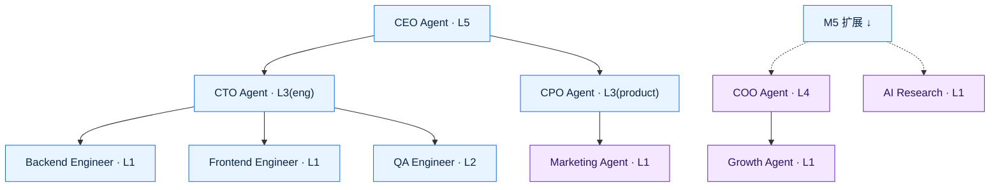
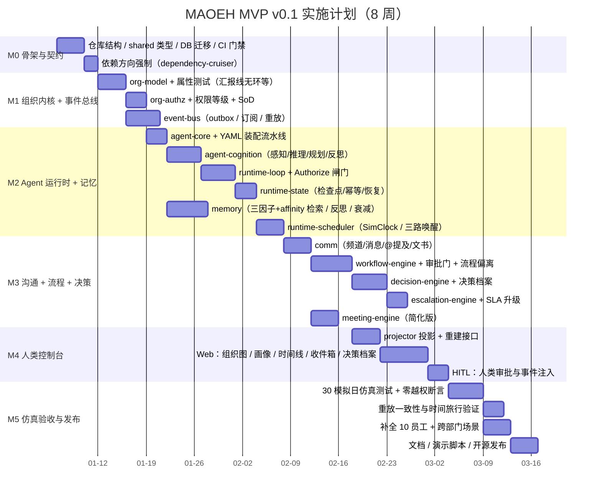
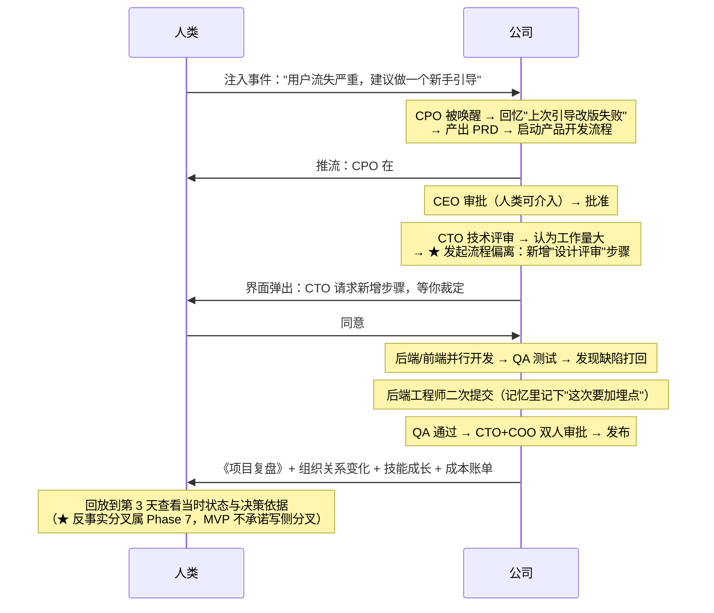

# Phase 6 · MVP 实现范围

> 本章回答：**第一个能跑、能演示、能开源发布的版本，到底做什么、不做什么。**
>
> 原则：**宁可窄而真，不要宽而假。**
> 一个只有 6 个员工、但真的拥有组织、权限、记忆与决策的公司，
> 远胜于一个有 50 个 Agent 但本质是 Pipeline 的演示。

---

## 6.1 MVP 的三条取舍原则

| 原则 | 含义 | 反面案例（必须避免） |
|------|------|-------------------|
| **① 深度优先于广度** | 6 个员工、1 条流程、1 个决策场景，但每一层都是真的 | 50 个员工、10 条流程，但全是提示词编排 |
| **② 确定性优先于智能** | 能写成代码的绝不交给 LLM（权限、路由、计票、SLA） | "让 LLM 判断这个人有没有权限" |
| **③ 可观测优先于性能** | 宁慢也要把每一件事落成事件 | 为了快而让 Agent 直接写数据库 |

---

## 6.2 范围内 / 范围外清单

### ✅ MVP 范围内（v0.1）

| 模块 | MVP 交付内容 |
|------|-------------|
| **组织层** | Company / Department / Position / Employee 四实体；汇报线；RBAC + 权限等级 L0–L5（**按域取值**）；决策权矩阵；职责分离（SoD）；代理（委托）；**目标（Goal）四级目标树** |
| **事件总线** | `org_events` append-only + 事务性 outbox + 进程内 dispatcher；订阅规则；消费幂等；**重放重建** |
| **Agent 层** | 8 层结构；YAML 档案驱动；6 阶段装配流水线；**封闭 Action Space**（22 个动作）；认知循环（感知/回忆/推理/规划/反思）；**技能熟练度的持久化与成长** |
| **任务** | 独立的 `tasks` 实体（可挂流程步骤，也可是流程外日常派活）；`submitted ≠ completed` 的验收分离；**拒绝 → 重派（≤1 次）→ 升级**的收敛闭环 |
| **Runtime** | 10 阶段认知循环；**Authorize 确定性授权闸门**；检查点 + 幂等键 + 恢复；按 `employeeId` 分区；SimClock（realtime + accelerated + step） |
| **记忆** | 工作记忆（Redis）；情景记忆 + 语义记忆 + 程序记忆（Postgres + pgvector）；四因子检索打分；importance 门控写入；阈值 150 触发反思；`mem_write_log` 全溯源 |
| **关系** | 双时态关系边；`trust` / `strength` 演化；`Relationship.*` 事件 |
| **通信** | 私聊 / 部门群聊 / 公告；消息线程；@提及触发定向唤醒；正式文书（汇报 / 提案 / 纪要） |
| **会议** | 议程 + 发言权轮转 + 发言预算 + 轮次上限 + 自动纪要（简化版，最多 4 人）；`meetings` / `meeting_participants` / `meeting_turns` 三表 |
| **工作流** | 1 个模板（产品开发 7 步 3 审批门）；任务派发给**岗位**；审批门（single / quorum）；SLA 计时；**流程偏离请求** |
| **决策** | 提案 → 评议 → 加权表决 → 决策档案（不可变 + 保留 dissent）；升级阶梯 |
| **升级** | 卡死检测、SLA 超时、连续失败熔断 → 组织性升级到主管 |
| **人类观测** | Web 控制台：组织架构图、员工画像（含记忆与成长曲线）、IM 时间线、审批收件箱、决策档案、事件时间线、成本账本 |
| **HITL** | 人类作为 `kind: human` 的组织成员，参与审批 / 评论 / 注入事件 |
| **成本治理** | `llm_calls` 全量记录；每 Agent / 每部门预算上限；超限升级 |
| **测试** | `FakeLlm` + 固定随机种子；组织不变量属性测试；**30 模拟日仿真测试**；零越权断言；重放一致性测试 |

> **任务书链路（M1.4 · ADR-014）**：任务书 `Work.SubmitBrief` → CEO 拆解 → `DispatchWork` 按岗位派发 → 订阅唤醒（`Task.Assigned` → `eligibleAgentsFor`，不新增唤醒源）。

### ❌ MVP 明确不做（写下来是为了防止范围蔓延）

| 不做 | 为什么现在不做 | 什么时候做 |
|------|--------------|-----------|
| 多公司 / 市场竞争 | 单公司已经足够验证核心架构；多公司是乘法复杂度 | Phase 7 §7.3 |
| 招聘 / 裁员 / 组织重组 | 需要完整人事决策链，MVP 用**预置员工 + 手动 seed** 足够 | Phase 7 §7.2 |
| 知识图谱（Neo4j） | 双时态关系表已覆盖 90% 需求；引入图库=引入分布式事务 | 记忆量或关系复杂度真的超限时 |
| Kafka / Redis Streams 作真相源 | Postgres-first 足够；过早分布式化是开源项目最常见的自毁 | 触发条件见 ADR-004 |
| 真实代码执行 / CI 集成 | 沙箱安全成本高，且不是架构验证的重点 | Phase 7 §7.7 |
| 图形界面拖拽搭建 Agent | YAML 已足够，且更易 diff 与评审 | Phase 7 §7.12 |
| 语音 / 多模态 | 与「组织仿真」核心命题无关 | 不做 |
| 细粒度情绪引擎（PAD / OCC 全量） | `sentiment` + `trust` 两个数值已能驱动可观测的关系演化 | Phase 7 §7.5 |
| 多租户 SaaS 化 | 单公司单实例足够开源使用 | Phase 7 §7.10 |
| 自定义模型微调 | 先用通用模型 + 岗位 Prompt 分层 | Phase 7 §7.8 |

---

## 6.3 MVP 的公司配置

**MVP 用 6 个员工跑通全链路，而不是一上来就 10 个。**

| 岗位 | MVP | 存在的理由 |
|------|-----|-----------|
| CEO Agent | ✅ | 唯一的 L5，审批门需要它；终裁角色不可省 |
| CTO Agent | ✅ | 技术评审 + L3 决策；提供权限等级差异 |
| CPO Agent | ✅ | 流程起点（Idea → PRD）；产品域决策 |
| Backend Engineer | ✅ | 流程执行主体；验证"派给岗位而非人" |
| Frontend Engineer | ✅ | 提供**并行任务**与**同岗多人**场景；验证资源竞争 |
| QA Engineer | ✅ | 验证 **SoD**（不能测自己写的代码）与**验证类失败模式** |

**M5 里程碑补全至 10 人**（增加 COO / AI Research / Marketing / Growth）：
这 4 个岗位存在的目的是引入**跨部门协作**（CPO→Marketing、COO→Growth 是跨部门汇报线）
与**资源竞争**（同一预算池），这些是"组织"而非"团队"的验证点。

---

## 6.4 技术栈选型

| 层 | 选择 | 理由 | 备选与取舍 |
|----|------|------|-----------|
| 语言 | **TypeScript (Node 22)** | 全栈同语言；组织/权限/事件模型需要强类型与 Schema 复用；Web 控制台是核心交付物 | Python 生态更强（LangGraph 等），但会导致前后端两套类型与两套模型定义。**若团队以 Python 为主，可把 `agent-cognition` 单独换成 Python 服务，通过 HTTP 契约调用——领域层不必改** |
| 仓库 | **pnpm workspaces monorepo** | 模块边界即目录边界，依赖方向可用工具强制 | Nx/Turborepo（MVP 不需要） |
| 数据库 | **PostgreSQL 16 + pgvector** | 事件、组织、记忆、队列、向量**同库同事务** → 无分布式事务（见 ADR-001） | 不用 Neo4j / Kafka / ClickHouse（MVP） |
| 缓存 / 工作记忆 | **Redis 7** | 工作记忆 TTL、唤醒优先队列、`LISTEN/NOTIFY` 之外的轻量唤醒 | 也可用 PG `SKIP LOCKED` 完全替代，但 Redis 对 ZSET 优先队列更合适 |
| ORM / Schema | **Drizzle ORM + Zod** | SQL-first、类型安全、迁移可读；Zod Schema 同时用于 API 校验与 LLM 结构化输出 | Prisma（迁移更友好但 SQL 控制力弱） |
| API | **Fastify + tRPC（或 OpenAPI）** | 快、Schema 驱动；tRPC 让前端类型直连 | NestJS（重，MVP 不需要） |
| 实时推流 | **WebSocket（事件流）** | 人类观察者要看到"正在发生" | SSE（更简单，但双向需求存在） |
| 前端 | **React + Vite + TanStack Query** | 组织架构图 / 时间线 / 收件箱都是数据密集型视图 | Next.js（MVP 单页应用足够） |
| 图可视化 | **React Flow（组织图）+ 自定义时间线** | 组织架构与事件链都是图结构 | D3（更灵活但开发成本高） |
| LLM 接入 | **自研 `llm-gateway`（OpenAI 兼容）** | 必须能：记录每次请求响应（重放）、预算记账、结构化输出强制、模型分级路由 | 直接用 Vercel AI SDK 可作为内部实现细节，但**网关契约必须自有** |
| 结构化输出 | **Zod → JSON Schema → provider tool/JSON mode** | 与权限、Action Space 枚举天然对齐 | — |
| 可观测 | **OpenTelemetry SDK + 自建 `llm_calls` 表 + Langfuse（可选）** | 自建表是重放的硬需求；OTel 保证不被厂商锁定 | 不直接用 Langfuse 当真相源（ADR-008） |
| 测试 | **Vitest + fast-check + Playwright** | 属性测试是组织不变量的最佳工具 | Jest（慢） |
| 本地运行 | **Docker Compose（PG + Redis）** | 一条命令起环境，开源友好 | — |

---

## 6.5 里程碑与交付物

### 每个里程碑的**可验收产出**

| 里程碑 | 交付物 | 验收方式（必须能演示） |
|--------|--------|---------------------|
| **M0** | 可编译的 monorepo、DB 迁移、CI 跑通 | `pnpm test` 全绿；`dependency-cruiser` 无违规依赖 |
| **M1** | 组织可被创建、权限可被查询、事件可被追加与重放 | 脚本：建 6 员工 → 查任意两人汇报路径 → 尝试越权操作被拒 → `replay(0→now)` 重建一致 |
| **M2** | **一个 Agent 能自己完成一次真实工作** | 脚本：给 Backend Engineer 派一个任务 → 它回忆、规划、通过授权、产出事件、写下记忆、更新技能 |
| **M3** | **一条产品开发流程能跑完** | 脚本：注入 Idea → CPO 出 PRD → CEO 审批 → CTO 技术评审 → 工程师开发 → QA 测试（**打回一次**）→ 发布 |
| **M4** | 人类能看懂并干预 | 浏览器：看到组织图、点开某员工看到他记得什么、审批一条提案、看到时间线更新 |
| **M5** | 组织能"活"30 天并演化 | 加速跑 30 模拟日 → 输出《组织日报》《关系演化图》《技能成长曲线》《成本账本》 |

---

## 6.6 验收标准（Definition of Done）

MVP 只有全部满足下列条件才可发布 v0.1。**其中第 1、2、5 条是不可妥协的架构底线。**

| # | 验收项 | 判定方法 |
|---|--------|---------|
| 1 | **无任务存活测试** | 清空所有 `tasks` / `workflow_instances` 后，系统仍能输出组织架构、员工在岗状态、日报与关系网 |
| 2 | **零越权副作用** | 仿真测试中，`Runtime.PolicyViolated` 之外不存在任何绕过 `AuthzService.can()` 的写操作；属性测试覆盖拒绝路径 |
| 3 | **无匿名 LLM 调用** | 静态检查：`llm-gateway` 的公开 API 必须接收 `ActorContext`；`agent-cognition` 之外不得出现 Prompt |
| 4 | **无 Agent 间直接调用** | `Agent` 类型上不存在指向另一个 Agent 的方法；代码中不存在跨 Agent 的同步 RPC |
| 5 | **可重放一致** | `replay(0→now)` 重建的读模型与在线状态逐字段一致（属性测试） |
| 6 | **工作流可偏离** | Agent 能对流程发起 `RequestDeviation`，且被记录并裁定，而非被静默忽略 |
| 7 | **记忆可追溯** | 任意一条长期记忆都能回溯到 `source_event_id`，界面上可点击跳转 |
| 8 | **人在环路有效** | 人类拒绝一次审批后，流程真的改变走向（而非仅记录） |
| 9 | **组织性升级生效** | 人为让某 Agent 卡住 → 其主管收到升级事件 → 组织健康度指标变化 |
| 10 | **成本可核算** | 能按 Agent / 部门 / 时间区间输出 token 与金额报表 |
| 11 | **30 天仿真不崩** | 固定种子下跑 30 模拟日，无未捕获异常、无死循环、无越权 |
| 12 | **新人零成本加入** | 新增一个 AI 员工只需新增一个 YAML 文件，不改任何 TypeScript |

---

## 6.7 黄金演示路径（Golden Path）

这是开源项目 README 顶部那个 GIF 应该展示的内容，**也是最好的架构验证**：

**这条路径一次性验证了：** 事件驱动、Agent 自主性、记忆影响决策、组织权限、流程可偏离、
人在环路、失败与返工、关系演化、成本核算、以及**时间旅行**。

---

## 6.8 MVP 风险与缓解

| 风险 | 影响 | 缓解 |
|------|------|------|
| **LLM 输出不稳定导致循环卡死** | 高 | 所有 LLM 输出走 Schema 校验 + ≤3 次重试 + 降级为 `NO_OP`；重复计划检测 |
| **成本失控**（30 天仿真烧钱） | 高 | `FakeLlm` 跑 CI；真实模型只在手动验证时用；每轮硬预算；语义缓存 |
| **范围蔓延**（想做的太多） | 高 | §6.2 的"不做清单"写入仓库，PR 违反即拒 |
| **架构退化回 workflow** | 高 | §6.6 验收清单第 1/2/5 条 + Phase 1 §1.8 反退化检查清单 |
| **记忆检索质量差导致 Agent 行为随机** | 中 | 先复刻 Generative Agents 的成熟参数（recency 0.995^Δt、importance 阈值 150），再调 |
| **模型能力不足以支撑"像员工一样"** | 中 | 用**确定性脚手架兜底**（权限、路由、终止），把 LLM 的职责压缩到"判断"本身 |
| **类型/模块边界被侵蚀** | 中 | CI 强制 `dependency-cruiser` + ESLint 分层规则 |
| **开源贡献者难以参与** | 中 | `agents/*.yaml` 与 `workflows/*.yaml` 是数据，贡献门槛极低 |

---

## 6.9 工作量估算

以 **1 名熟悉 TypeScript 与 LLM 应用的全职工程师** 为基准（2 人可压至 5–6 周）：

| 里程碑 | 估算 | 说明 |
|--------|------|------|
| M0 | 4–6 人日 | 结构 + 契约 |
| M1 | 10–12 人日 | 组织内核与事件总线是地基，不能赶 |
| M2 | 18–22 人日 | **最大头**：Agent 运行时 + 记忆 |
| M3 | 16–20 人日 | 沟通 + 流程 + 决策 |
| M4 | 12–15 人日 | 控制台（可先用简易版） |
| M5 | 10–12 人日 | 仿真验收 + 文档 |
| **合计** | **70–87 人日（≈ 8 周）** | |

**可压缩项（若必须提前出 Demo）：** M4 的控制台先做只读时间线（省 8 人日）；
会议引擎与流程偏离可后置（省 6 人日）。**不可压缩项：** M1 的组织内核与 M2 的授权闸门。

---

## 6.10 MVP 一句话总结

> **交付一家"能活的 6 人 AI 公司"**：
> 它有组织架构、有岗位权限、有长期记忆、有关系演化；
> 它能自己跑完一次产品开发（含审批、评审、测试打回与发布）；
> 人类能看见它、干预它、甚至把时间倒回去改变它的过去。
> **而这一切的底层不是一串 Prompt，是一个事件驱动的组织内核。**
