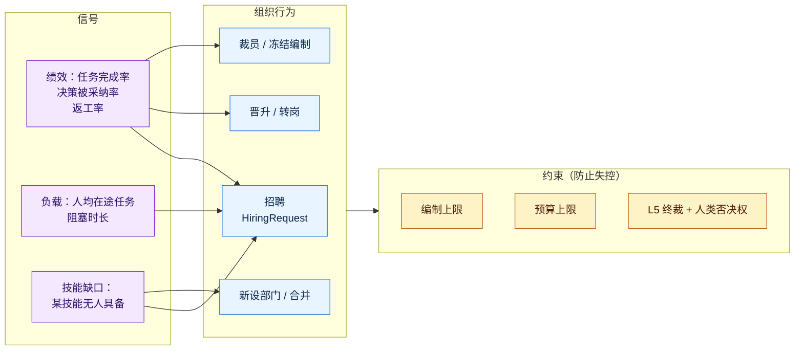
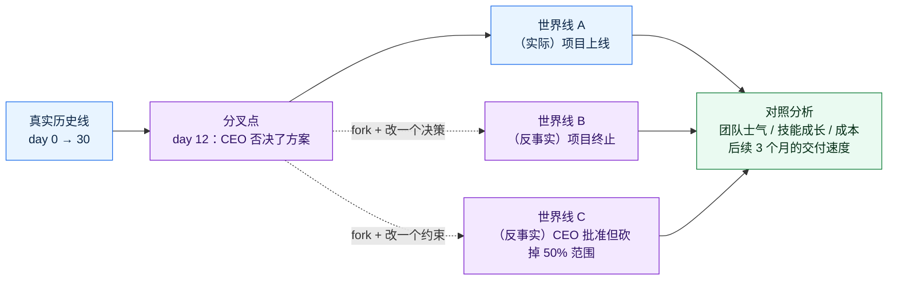
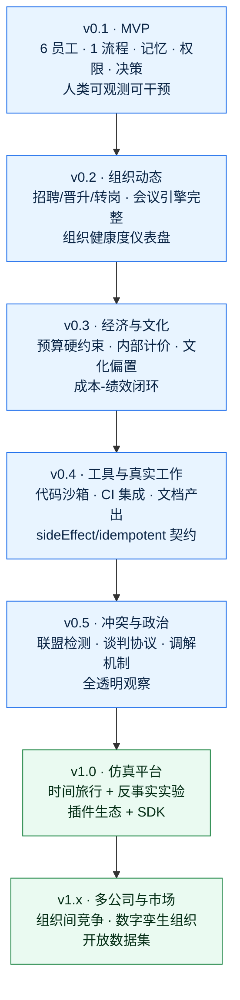

# Phase 7 · 未来扩展方向

> 扩展原则：**所有扩展都必须是"新增数据 + 新增事件 + 新增订阅"，而不是"重写内核"。**
> 如果某个未来特性需要推翻 Phase 1–5 的模型，那说明它是另一个产品，不是本项目的路线图。

---

## 7.0 扩展性自检：架构留了哪些口子

| 未来能力 | 现在预留的接口 | 需要新增什么 |
|---------|--------------|-------------|
| 招聘 / 裁员 / 重组 | `positions.status`、`EMPLOYMENT_RECORD`、`Employee.*` 事件 | 人事决策的 Action 与审批门 |
| 多公司 / 市场 | 所有表带 `company_id`；事件按 `company_id` 分区 | 跨公司事件契约 + 市场环境 Agent |
| 组织文化 | `org-policy` + 制度表 | 规范的隐式影响机制（见 §7.4） |
| 政治与联盟 | `TRUSTS` / `CONFLICTS_WITH` 关系边 + 私聊频道 | 联盟检测 + 谈判协议 |
| 经济系统 | `llm_calls` 成本账本 + `departments.budget` | 内部计价、预算交易、绩效-薪酬映射 |
| 真实工具 | `ToolRegistry` + Tool Gateway 沙箱 | 具体工具实现 + 更严的沙箱 |
| 模型分层 / 微调 | `llm-gateway` 的 `tier` 路由 | 角色专用模型、蒸馏管线 |
| 人类深度参与 | `employees.kind = 'human'` | 人类体验优化（通知、移动端） |
| 规模化 | `hash(employeeId)` 分区 | 分区重平衡 + 事件总线升级（ADR-004） |
| 研究能力（反事实） | `replay` 模式 + `llm_calls` 全量记录 | 分支管理 UI + 实验对比分析 |

---

## 7.1 组织演化：让公司真的会长大

MVP 的公司是**静态配置**的。第一个大扩展是让组织本身成为**被 Agent 行为改变的对象**。



**关键设计：组织变革必须是"决策"，不是"自动行为"。**
招聘一个 Agent 需要走完整的决策链（提案 → 评议 → CEO 终裁 → 生效），
因为**"组织如何改变自己"恰恰是最能暴露 Agent 是否理解组织的地方**。
如果让系统自动扩编，就退化成了资源调度器。

| 能力 | 事件 | 难点 | 设计要点 |
|------|------|------|---------|
| 招聘 | `Employee.Hired` → 6 阶段装配 | 新 Agent 如何"融入"已有关系网 | 指定 mentor；注入团队记忆；前 N 天限制权限（观察期） |
| 晋升 | `Employee.Promoted` | 绩效如何量化才不荒谬 | 用**多信号**（上级评价 + 同级认可 + 客观交付 + 决策采纳率），避免单一指标 |
| 转岗 | `Employee.Transferred` | 旧关系边失效、新关系建立 | 双时态边天然支持；保留旧关系可查 |
| 重组 | `Organization.ReorgApplied` | 汇报线大规模变更的原子性 | 整批变更在**单事务**内应用并产出一条 `ReorgApplied` 事件 |
| 裁员 | `Employee.Offboarded` | 情感与伦理表达 | 记忆归档、关系 `valid_to`；保留决策者记录 |

---

## 7.2 组织文化：从"制度"到"默契"

MVP 里 `org-policy` 是**显式规则**（预算、SLA、红线）。真正的公司还有**隐式规范**。

**设计思路（不引入玄学）：**

```
文化 = 一组带权重的、作用于"行为分布"的隐性偏置

每个 Agent 从组织记忆中学习规范：
  观察 → 什么行为被表扬 / 被批评 → 更新文化的个人内化权重 → 影响决策倾向

组织文化表：
  org_culture(id, company_id, dimension, weight, evidence_event_ids[], updated_at)
  dimension: 风险容忍 / 决策速度 / 会议文化 / 文档文化 / 冲突直率度 …

作用点：不写进权限，而写进 Cognition 的"倾向偏置"，
        且只能在 ⑥Deliberate 阶段软化倾向，不能在 ⑦Authorize 阶段硬改规则。
```

> **文化与制度的边界必须清楚：制度是硬约束（代码），文化是软偏置（Prompt 中的倾向）。**
> 一旦让"文化"绕过硬约束，系统就会失去可预测性。

---

## 7.3 多公司与市场仿真

单公司验证的是**内部组织**；多公司验证的是**组织间竞争**。

| 新增概念 | 说明 |
|---------|------|
| `Market` 市场环境 | 一个特殊的系统 Agent，发布市场事件（需求变化、竞品动作、融资环境） |
| 跨公司事件 | 只能看到对方**公开**行为（发布会、招聘、定价），看不到内部事件 → 信息不对称是真实的 |
| 竞争行为 | 挖人、抢先发布、价格战 |
| 生态关系 | 合作、供应商、客户 |

**工程要点：** 所有表已有 `company_id`，事件流按公司隔离，因此多公司是**配置与契约问题**，不是重构问题。但需要新增：
跨公司事件总线（或统一总线 + 可见性过滤）、公司间消息契约、市场时钟同步。

**这是本项目最有研究价值的扩展方向**：可以回答"什么样的组织结构在什么市场环境下胜出"。

---

## 7.4 学习与技能市场

MVP 的技能成长是**个体学习**（§4.5）。扩展方向是**组织学习**：

| 层次 | 机制 |
|------|------|
| 个体 | 已有：熟练度增长、程序记忆沉淀 |
| 团队 | 复盘中把有效套路固化为**部门级 SOP**（组织级 `mem_facts` / 程序记忆），新成员直接继承 |
| 组织 | 跨部门最佳实践传播：A 部门的做法被 B 部门订阅后采纳，产生 `ProcedureAdopted` 事件 |
| 技能市场 | 内部"求助/协作"市场：Agent 发出求助 → 有能力的 Agent 响应 → 事后互评更新 `trust` 与熟练度 |

**这是"组织成长"最强的可观测信号**：一个 30 天前经常返工的团队，
30 天后同类任务一次通过率上升——而且你能在事件流里指出"是哪一次复盘导致的"。

---

## 7.5 冲突、政治与协商

真实组织里最有趣也最难建模的部分。**扩展时必须保持"可解释"，不能变成黑箱。**

| 现象 | 数据基础 | 新增机制 |
|------|---------|---------|
| 意见冲突 | `proposal_reviews` 的 `oppose` + `dissent` | 冲突检测：同一议题上持续对立 → 触发调解会议 |
| 关系恶化 | `CONFLICTS_WITH` 边 + `trust` 下降 | 冲突升级路径与调解人机制 |
| 联盟 | 私聊频道 + 投票相关性分析 | 联盟检测（**只观测、不驱动**），用于解释"为什么这个提案通过了" |
| 资源争夺 | 同一预算池的并发请求 | 谈判协议：出价、让步、打包交易（logrolling） |
| 信息政治 | 谁能看到什么事件（`channel.visibility`） | 信息不对称建模 + "越级汇报"场景 |

> **伦理边界：** 这个模块的目的是**理解组织动力学**，不是生产操纵策略。
> 建议在实现时明确写入 README：所有政治行为建模限于仿真与教学，且必须对观察者完全透明（无隐藏状态）。

---

## 7.6 经济系统：Token 即薪酬的深化

MVP 已有成本账本（§5.9），扩展为完整经济：

| 层次 | 机制 |
|------|------|
| 成本 | 每个 Agent 的 token/金额消耗（已有） |
| 预算 | 部门月度预算；超支需 COO/CEO 审批追加（已有雏形） |
| 计价 | 内部转移计价：工程部门为产品部门做的开发"计入成本" |
| 绩效 | 成本产出比（交付物价值 / 消耗）→ 影响晋升与编制 |
| 约束 | 预算耗尽时 Agent **真的会停止工作**，而不是静默降级 → 产生真实的资源压力与优先级冲突 |

**这是让"组织稀缺性"变得真实的关键。**
没有预算约束的仿真公司里，Agent 永远可以无限思考——那不是公司，是乌托邦。

---

## 7.7 工具体系：从"说"到"做"

MVP 的 Agent 主要产出**文本与决策**。真正的科技公司要**干活**。

| 阶段 | 工具 | 工程挑战 |
|------|------|---------|
| T1 | 文档产出（Markdown / 规格 / 报告） | 已具备 |
| T2 | 代码仓库操作（读、提交、分支、PR） | 沙箱、凭据隔离、幂等 |
| T3 | 代码执行与测试（容器内沙箱） | **安全是最大挑战**：无网络、只读文件系统、资源限额、超时强杀 |
| T4 | CI/CD 集成（构建、部署到仿真环境） | 重放模式必须拦截所有真实副作用 |
| T5 | 外部数据（市场、用户反馈） | 外部查询结果必须被记录，否则重放不一致 |

**架构要求（已在 Tool Gateway 预留）：**

```ts
interface ToolDefinition<A, R> {
  id: string;                    // 'repo.commit'
  schema: ZodSchema<A>;          // 入参契约
  permission: string;            // 'tool.invoke:repo.commit'
  sideEffect: boolean;           // ★ true 则在 replay 模式下被拦截
  idempotent: boolean;           // ★ false 则强制要求幂等键
  sandbox: SandboxPolicy;        // 网络/文件/资源/超时
  execute(args: A, ctx: ExecCtx): Promise<R>;
}
```

> **`sideEffect` 与 `idempotent` 必须在工具定义里显式声明。**
> 这是"从第一天就按可重放设计"的具体落实——后期补是最贵的重构。

---

## 7.8 模型层演进

| 方向 | 说明 |
|------|------|
| 分级路由 | 已有雏形：按阶段与岗位选档位（§5.9） |
| 角色专用适配 | 用各岗位的历史决策数据做 LoRA / Prompt 蒸馏，让"CTO 的语气"稳定 |
| 本地模型 | 用本地小模型承担 `perceive` / `reflect` 等轻量阶段，降低成本 |
| 缓存 | 语义缓存：相似的 Perception 直接命中历史 Plan（省成本，但要防"经验主义错误"） |
| 校准 | 记录 LLM 的置信度与实际正确率，给低置信度的 Agent 输出加校验层 |

**一个必须警惕的陷阱：** 缓存与蒸馏都会让 Agent 行为**趋于一致**，
从而削弱"不同岗位有不同判断"这一核心价值。任何提效手段都必须保留**行为多样性指标**（如同一议题的评议分歧度）。

---

## 7.9 人类深度参与

MVP 里人类是"董事会观察者"。扩展方向：

| 模式 | 说明 |
|------|------|
| 人类作为员工 | `kind: human` 已在数据模型支持；人类占据一个岗位，与 Agent 同级协作 |
| 人类作为上级 | 人类审批 Agent 的提案，Agent 定期向其汇报 |
| 人类扮演测试者 | 注入外部冲击（市场变化、竞品动作、客户投诉），观察组织如何响应 |
| 多人类组织 | 多个观察者 + 分工（有人管财务、有人管产品） |
| 教学模式 | 学生扮演新员工，与 AI 同事协作，观察组织运作 |

**工程需求：** 通知机制（邮件/IM）、移动端、待办聚合、"我需要你决定的 3 件事"摘要。

---

## 7.10 规模化与运维

| 维度 | MVP | 扩展目标 | 手段 |
|------|-----|---------|------|
| Agent 数 | 10 | 200+ | `hash(employeeId)` 分区 + 多 Worker 容器 |
| 事件量 | 万级/天 | 千万级/天 | 事件表分区 + 归档 + 快照（避免全量重放） |
| 记忆量 | 10⁴ | 10⁷ | pgvector → Qdrant；冷热分层 |
| 运行时 | 自建 PG-first | 跨天/跨周挂起 | 触发条件满足后迁移到 **Restate**（Virtual Object 与"每 Agent 是有状态实体"天然同构）或 **Temporal**（Approval pattern 成熟） |
| 多租户 | 单公司 | SaaS | 行级安全 + 每公司事件流 |
| 消息总线 | 进程内 + outbox | 多节点 | Redis Streams / NATS JetStream（**仍以 PG 为真相源**） |

**升级触发器（写入 ADR-004，不是"以后再说"）：**
1. 需要跨天/跨周的挂起 → Restate / Temporal
2. 单流程 > 200 步且自建重试逻辑开始出错 → Restate / Temporal
3. 需要工作流版本管理与确定性重放调试 → Temporal
4. 单机事件写入成为瓶颈（> 5k events/s） → 消息总线升级

---

## 7.11 研究能力：反事实与组织设计

这是本项目**最有学术价值**的扩展，也是"仿真"二字的最终兑现。



**能回答的问题：**
- 如果当时换一个决策，组织会怎样？
- 哪种组织结构在什么负载下表现最好？
- 汇报链深度如何影响决策速度与信息失真？
- 一个"高信任"团队与一个"高竞争"团队，长期交付差异有多大？

**这套能力可以支持真实的组织设计实验**——这是把"AI 公司"从演示变成研究工具的分水岭。

---

## 7.12 工程化与生态

| 方向 | 说明 |
|------|------|
| 插件系统 | 第三方贡献岗位档案、流程模板、工具、记忆策略 |
| Agent 市场 | 社区分享"我写的 CTO Agent"，可被直接加载 |
| SDK | `@maoeh/sdk`：在外部程序里创建公司、注入事件、订阅事件流 |
| 可视化搭建 | 低代码组织设计器（拖拽建部门、连线设汇报） |
| 部署形态 | Docker Compose（默认）/ Helm Chart / 一键云部署 |
| 开放数据 | 导出仿真数据集，供组织行为研究 |
| 与真实 HRIS 集成 | 从真实组织架构导入岗位树 → **数字孪生组织** |

---

## 7.13 路线图总览



| 版本 | 主题 | 核心新增 | 架构风险 |
|------|------|---------|---------|
| **v0.1** | 活着的公司 | 组织内核 + Agent 运行时 + 记忆 + 决策 + 观测 | 范围蔓延；LLM 稳定性 |
| **v0.2** | 会长大的公司 | 人事生命周期、组织变革决策 | 组织变革的原子性 |
| **v0.3** | 有压力的公司 | 预算硬约束、内部计价、文化 | 经济模型过度复杂化 |
| **v0.4** | 会干活的公司 | 工具沙箱、代码执行、CI | **安全**（沙箱逃逸）、重放一致性 |
| **v0.5** | 有人的公司 | 冲突、联盟、谈判、调解 | 伦理边界与可解释性 |
| **v1.0** | 可实验的平台 | 时间旅行、反事实、插件、SDK | 分支管理与存储成本 |
| **v1.x** | 有市场的生态 | 多公司、竞争、数字孪生 | 跨公司契约与一致性 |

---

## 7.14 永远不做的（项目红线）

为了守住"AI 组织仿真平台"这个定位，以下方向**即使有人提也不做**：

| 不做 | 理由 |
|------|------|
| 变成通用工作流编排引擎（对标 n8n / Zapier） | 那会把"组织"降格成"流程图"，正是本项目要反对的 |
| 变成通用 Chatbot 框架 | 与核心命题无关 |
| 提供绕过权限的"开发者后门"写操作 | 会摧毁 A4 公理与全部审计价值 |
| 让 LLM 直接产生副作用（不加授权闸门） | 同上 |
| 用隐藏状态（观察者看不到的 Agent 私有目标）驱动行为 | 违反 AGENTS.md 的 Human Observation 原则 |
| 自动扩编 / 自动优化组织结构 | 组织变革必须是"被决策的"，否则退化为调度器 |

> **最后一条尤其重要。**
> 一个会自己优化自己的组织结构、不需要任何人拍板的系统，
> 就不再是"公司仿真"，而是一个优化器——它可能很高效，但**不再能回答"组织是如何运作的"**。
> 本项目的价值在于**理解**，不在于**最优**。
