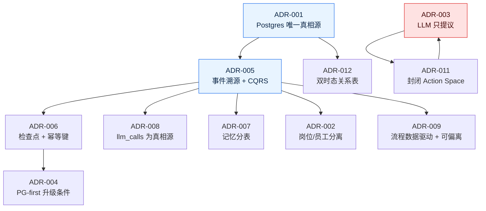

# 附录 A · 架构决策记录（ADR）

> 格式遵循 [MADR](https://adr.github.io/madr/) 精简版。
> **每条 ADR 都必须有"复审触发条件"** —— 决策不是教条，但推翻它必须付出说明成本。

| ID | 决策 | 状态 |
|----|------|------|
| [ADR-001](#adr-001) | Postgres 作为唯一真相源，MVP 不引入多存储 | ✅ 已接受 |
| [ADR-002](#adr-002) | 岗位（Position）与员工（Employee）分离 | ✅ 已接受 |
| [ADR-003](#adr-003) | LLM 只能提议，内核才能执行（Authorize 闸门） | ✅ 已接受 |
| [ADR-004](#adr-004) | 运行时 Postgres-first，并预设 Temporal/Restate 升级条件 | ✅ 已接受 |
| [ADR-005](#adr-005) | 事件溯源 + CQRS 作为主干结构 | ✅ 已接受 |
| [ADR-006](#adr-006) | 审批挂起用「检查点 + 幂等键」，不用「重跑节点」 | ✅ 已接受 |
| [ADR-007](#adr-007) | 记忆分表：原始经历 / LLM 概括 物理隔离 | ✅ 已接受 |
| [ADR-008](#adr-008) | 可观测以自建 `llm_calls` 为真相源，OTel 仅作采集层 | ✅ 已接受 |
| [ADR-009](#adr-009) | 工作流模板数据驱动 + 允许 Agent 发起流程偏离 | ✅ 已接受 |
| [ADR-010](#adr-010) | TypeScript monorepo 为主，Python 作为认知层逃生通道 | ✅ 已接受 |
| [ADR-011](#adr-011) | Agent 行动空间是封闭枚举 | ✅ 已接受 |
| [ADR-012](#adr-012) | 关系记忆用双时态表，MVP 不引入图数据库 | ✅ 已接受 |
| [ADR-013](#adr-013) | 新增 `organization-control` 包作为 M1.0 控制面（Application 层，L6 · Control） | ✅ 已接受 |
| [ADR-014](#adr-014) | 协同工作：任务书 → CEO 拆解 → 按岗位派发（DispatchWork，42→43） | ✅ 已接受 |
| [ADR-015](#adr-015) | 编排画布「实例级一次性改派」（per-instance override，diff 后整体提交） | ✅ 已接受 |
| [ADR-016](#adr-016) | 草稿确认态：capability 生成的 workflow 待人确认后才执行（console 默认、headless 可选退回即时执行） | ✅ 已接受 |

---

## ADR-001

### Postgres 作为唯一真相源，MVP 不引入多存储

**状态**：已接受

**背景**
系统需要同时承载：事件日志、组织与身份数据、Agent 状态、记忆（含向量检索）、作业队列、读模型。
直觉方案是"各用各的最佳工具"：Kafka 做事件、Neo4j 做关系、Qdrant 做向量、Redis 做队列。

**决策**
MVP 阶段，**上述全部数据存放于同一个 PostgreSQL 实例**（pgvector 扩展提供向量检索）。
Redis **仅**用于工作记忆与唤醒优先队列这两类可丢失数据。

**理由**
1. **记忆写入 + 状态变更 + 事件落库必须是同一个事务。** 跨存储意味着分布式事务或最终一致妥协——这是开源 MVP 最常见的自毁路径。
2. 组织仿真的数据量在 MVP 阶段（10 个 Agent、30 天）**远未到达任何单库瓶颈**。
3. 向量检索可以用 SQL 与关系过滤 JOIN（例如"只检索同一部门的记忆"），这在独立向量库里反而更难写。
4. 少一个中间件 = 少一个 `docker-compose` 服务 = 更高的开源采纳率。

**后果**
- ✅ 无分布式事务；重放与一致性测试容易写
- ✅ 本地环境只需 PG + Redis
- ⚠️ 需要自律：给队列与向量检索预留升级路径（见 ADR-004）
- ⚠️ 事件表必须分区，否则长期运行会膨胀

**备选方案**
| 方案 | 为何不选 |
|------|---------|
| Kafka 作事件总线 | 运维成本与 MVP 规模严重不匹配；且 PG 表本身已能提供有序、可重放的日志 |
| Neo4j 作关系存储 | 双时态关系用一张表 + 时间点过滤即可覆盖 90% 需求（见 ADR-012） |
| Redis Streams 作工作流状态 | 无版本化状态、无等待外部信号的语义；持久化失败会静默丢状态 |

**复审触发条件**：单机事件写入 > 5k events/s；记忆条数 > 10⁷；需要跨节点消费组。

---

## ADR-002

### 岗位（Position）与员工（Employee）分离

**状态**：已接受

**背景**
最初的自然建模是"一个 Agent 就是一个员工，员工记录里写他的部门和上级"。

**决策**
**岗位是组织架构上的一个节点，员工是占据该节点的人。** 两者是独立实体，通过 `employees.position_id` 关联。
权限等级、决策域、职责范围挂在**岗位**上，不挂在员工上。

**理由**
1. **人员流动不应破坏流程。** 人走了坑还在，任务派发给**岗位**，由 `resolveByPosition()` 解析到在岗者。
2. **权限随岗位。** 换人即换权限，无需逐个改员工档案；这天然满足"当时谁有权"的审计需求。
3. **变更影响面可控。** 组织重构 = 改岗位树，不涉及人头数据。
4. **支持岗位空缺、一岗多人（headcount）、休假代理。**

**后果**
- ✅ 流程模板引用 `position_key` 而非具体人 → 模板稳定
- ✅ 员工离职后工作流不崩，自动转向代理人
- ⚠️ 引入一层间接性，查询当前负责人需要 JOIN
- ⚠️ 需要在读模型里物化"当前在岗者"以避免频繁 JOIN

**备选方案**
| 方案 | 为何不选 |
|------|---------|
| 员工表内嵌部门与上级 | 人员一变动就要改流程上下文；无法表达岗位空缺与一岗多人 |
| 只用角色字符串（如 CrewAI 的 role） | 角色无法承载编制、权限等级、决策域与汇报线 |

**复审触发条件**：出现"临时项目组"这类无正式岗位的组织形态时，需要引入"虚拟岗位"概念。

---

## ADR-003

### LLM 只能提议，内核才能执行（Authorize 闸门）

**状态**：已接受

**背景**
大多数 Agent 框架让 LLM 直接产出工具调用并执行。这在"组织仿真"里不可接受——
一个 AI 员工不应该能凭一句话给自己发预算或批准自己的提案。

**决策**
认知循环的第 ⑦ 步 `Authorize` 是**确定性代码，零 LLM**。
LLM 产出的 `Plan` 中每一步都必须通过 `AuthzService.can(actor, action, resource, ctx)`，
其中 `ctx` 携带决策域、需要的角色与金额（见 Phase 3 §3.4.4 的权威签名）。
未通过的步骤**被改写成**升级/审批请求，而不是静默丢弃。

**理由**
1. 这是"AI 员工"与"提示词角色扮演"的分水岭。研究（MAST）明确指出，
   违反角色规范这类失败**靠更强的模型解决不了**。
2. 权限判定是安全属性，必须可穷举测试、默认拒绝、deny 优先。
3. 把越权步骤改写成升级请求，让 Agent **能学会找对人**，而不是撞墙。

**后果**
- ✅ 越权副作用在架构上不可能发生（可写属性测试）
- ✅ 权限逻辑可被 100% 单元测试覆盖
- ⚠️ Action Space 与权限点必须同步维护（见 ADR-011）
- ⚠️ 需要给拒绝路径设计"可操作的升级建议"，否则 Agent 会反复重试同一个被拒动作

**备选方案**
| 方案 | 为何不选 |
|------|---------|
| 提示词里写"你没有权限做 X" | 提示词不是安全边界；模型可被诱导绕过 |
| 事后审计（先执行再检查） | 副作用已发生，审计只能追责不能阻止 |

**复审触发条件**：无。这是项目红线。

---

## ADR-004

### 运行时 Postgres-first，并预设 Temporal/Restate 升级条件

**状态**：已接受

**背景**
Agent 需要长期运行、崩溃恢复、跨天等待审批。成熟方案是 Temporal / Restate；
但它们分别带来"四服务 + 外部 DB"和"新运行时概念"的成本。

**决策**
MVP 采用 Postgres-first：
`org_events`（append-only）+ `event_outbox`（事务性）+ 作业队列（`SELECT … FOR UPDATE SKIP LOCKED` 或 pg-boss）+ `LISTEN/NOTIFY` **仅作唤醒信号**。

**把升级触发条件写进 ADR（而不是"以后再说"）：**
1. 需要跨天/跨周的挂起
2. 单流程 > 200 步且自建重试逻辑开始出错
3. 需要工作流版本管理与确定性重放调试

任一条满足 → 迁移。届时**优先评估 Restate**（Virtual Object 提供每实体独立状态与并发控制，
与"每个数字员工是有状态的长期实体"天然同构），若更看重生态成熟度与现成 Approval pattern 则选 **Temporal**。

**理由**
1. `LISTEN/NOTIFY` **不能当真相源**：通知不持久、载荷有上限、仅在提交后投递。它只做唤醒。
2. Redis Streams **不是工作流状态机**：无版本化状态、无等待外部信号语义。
3. MVP 的复杂度预算应该花在"组织模型"上，而不是"分布式运行时"上。

**后果**
- ✅ 部署极简，`docker compose up` 即可
- ✅ 领域逻辑不依赖任何工作流引擎（升级时领域层不变）
- ⚠️ 需要自己实现重试、超时、幂等、挂起恢复——因此 Runtime 层的测试要求很高
- ⚠️ 必须把 `AgentRuntime` 与持久化细节解耦，否则迁移成本高

**备选方案**
| 方案 | 为何不选 |
|------|---------|
| 直接用 Temporal | MVP 阶段运维过重；需要额外学一套确定性编程约束 |
| 直接用 Restate | 概念契合但生态较新；作为升级首选而非起点 |
| 不用持久化运行时（内存态） | 无法跨天等待审批，无法崩溃恢复，直接违背核心需求 |

**复审触发条件**：上述 1/2/3 任一成立。

---

## ADR-005

### 事件溯源 + CQRS 作为主干结构

**状态**：已接受

**背景**
需求同时要求：可解释、可审计、可回放、Agent 间不直接调用（A5）。

**决策**
所有组织状态变更都是 `append(OrgEvent)`。
写侧（命令 → 内核裁决 → 事件）与读侧（事件 → 投影 → 查询）严格分离。
读模型可随时 `DROP` 并从 0 重建。

**理由**
1. **可解释性只能靠因果链。** 每个事件带 `causation_id` / `correlation_id`，
   界面上任何状态都能一键跳到导致它的事件链。
2. **A5 公理需要事件才成立。** Agent 之间没有 RPC，只有事件与订阅。
3. **时间旅行与反事实实验**（Phase 7 §7.11）只能在事件溯源上实现。
4. 审计与合规（记录保存义务）天然满足。

**后果**
- ✅ 可回放、可审计、可时间旅行
- ✅ 读写可独立扩展
- ⚠️ 事件 Schema 演进需要纪律：**只增字段，不改已有字段语义**
- ⚠️ 必须防止"在投影里偷写状态"——重建接口就是这条纪律的守门人
- ⚠️ 需要快照机制以避免长期运行后全量重放过慢

**备选方案**
| 方案 | 为何不选 |
|------|---------|
| 传统 CRUD + 审计日志表 | 审计表是二手信息；无法保证与状态一致；无法回放 |
| 只存状态快照 | 丢失过程，无法回答"为什么变成这样" |

**复审触发条件**：无。这是项目核心。

---

## ADR-006

### 审批挂起用「检查点 + 幂等键」，不用「重跑节点」

**状态**：已接受

**背景**
LangGraph 的 `interrupt()` 语义是：恢复时**整个节点从头重跑**。
其官方文档明确警告：`while True` + `interrupt()` 循环会导致每次恢复重放之前所有迭代，
形成**指数级重复执行**；且多个 `interrupt()` 按索引严格匹配，不可条件跳过或重排序。

对于需要"等待 CEO 审批 3 天"的组织仿真，这个语义是灾难性的。

**决策**
MAOEH 自研的挂起/恢复采用：
1. 循环执行到需要等待时，**持久化检查点**（`cycle_checkpoints`）并把 `AgentState.presence` 置为 `WaitingInput`，**释放 Worker**；
2. 每次副作用执行**前**计算 `idempotencyKey = sha256(cycleId, stepIndex, action, args)`；
3. 执行**后**写 `committed_actions(idempotencyKey, eventId)`；
4. 恢复时**从检查点继续，并跳过所有已在 `committed_actions` 中的步骤**；
5. 事件到达时由调度器恢复循环。

**理由**
1. **等待 3 天不应重放 3 天前的 LLM 调用。** 那是成本与正确性的双重灾难。
2. 幂等键同时满足重放模式（ADR-008）与工具调用安全的要求。
3. 副作用放在"提交后记录"，因此**任何重复执行都可被检测并跳过**。

**后果**
- ✅ 恢复代价与已执行步数无关（O(1) 查询 + 跳过）
- ✅ 天然支持重放模式与崩溃恢复
- ⚠️ 每个 Action 都必须能提供稳定的幂等键 → 要求 Action 参数可规范化序列化
- ⚠️ `committed_actions` 需要清理策略（按 cycle 完成时间归档）

**备选方案**
| 方案 | 为何不选 |
|------|---------|
| 直接用 LangGraph `interrupt()` | 重放语义与成本不可接受；且它是库不是平台，缺组织/权限/审批原语 |
| 阻塞线程等待审批 | 3 天等待会占死 Worker，成本不可接受 |
| 不持久化，重启即丢 | 违背核心需求 |

**复审触发条件**：若迁移到 Temporal，其确定性重放已内建此语义，本决策自然收敛。

---

## ADR-007

### 记忆分表：原始经历 / LLM 概括 物理隔离

**状态**：已接受

**背景**
Generative Agents 论文自身的失败分析指出，其最常见错误之一是
**embellishment——凭空"润色"记忆**。对一个需要产出"决策记录"的系统，这是致命的：
它会**伪造决策依据**。

**决策**
长期记忆物理分为：
- `mem_episodes`：来自事件的**原始经历**，带 `source_event_id`，**不可篡改**
- `mem_facts` / `mem_reflections`：**LLM 生成**的概括与洞察，可重新生成，**必须带 `source_episode_ids[]`**
- `mem_write_log`：每次写入的原因、策略、来源事件

检索结果（`RecallBundle`）向 LLM **明示二者区别**。

**理由**
1. 概括可以是错的，原始经历不能。混在一起就无法判断"这是真发生过，还是模型脑补的"。
2. 可追溯性（AGENTS.md 的 Memory Rules：*updates must be explicit and traceable*）要求每个记忆都能回答"我在哪条事件上学到的"。
3. 概括可重新生成 → 换更强的模型时，可以只重算概括层，保留事实层。

**后果**
- ✅ 决策依据可验证；记忆可审计
- ✅ 概括层可升级而不动事实层
- ⚠️ 两张表都要向量索引，检索需要合并排序
- ⚠️ `facts` 需要 `valid_to` / `superseded_by` 处理知识过时

**备选方案**
| 方案 | 为何不选 |
|------|---------|
| 单表存所有记忆 | 无法区分事实与概括；embellishment 不可检测 |
| 只存 LLM 摘要 | 丢失原始证据，审计与重放都做不了 |

**复审触发条件**：无。

---

## ADR-008

### 可观测以自建 `llm_calls` 为真相源，OTel 仅作采集层

**状态**：已接受

**背景**
OpenTelemetry GenAI 语义约定是目前的标准方向，但**整体仍处于 development / 实验性阶段**，
属性可能变更。追踪平台（Langfuse / Phoenix）各有取舍。

**决策**
1. **自建 `llm_calls` 表为真相源**，完整保存 request / response / tokens / cost / latency / `prompt_hash`。
2. 用 **OTel SDK** 按 GenAI 语义约定采集 span，导出到自托管 Langfuse（+ 可选 Phoenix / Tempo）。
3. **不把 Langfuse 当真相源**——它只是可视化与评测层。

**理由**
1. **重放模式要求每次 LLM 请求响应都可复现**（ADR-005 / ADR-006）。这是自建表的硬需求，追踪平台不提供回读契约。
2. 实验性规范不适合作为长期存储 schema；自存规范化副本可避免规范变更导致的数据迁移。
3. 成本治理（§5.9）需要结构化查询与聚合，SQL 比追踪查询语言更直接。

**后果**
- ✅ 重放可行；成本报表可行；不被厂商锁定
- ⚠️ 需要自己维护 `llm_calls` 的存储与清理（按日分区，90 天后聚合）
- ⚠️ 双写需要保证一致性（以 DB 写入为准，OTel 失败不影响主流程）

**备选方案**
| 方案 | 为何不选 |
|------|---------|
| 只用 Langfuse 存 tracking | 无法保证回读契约；规范演进风险 |
| 只用 OTel Collector 落地 | 缺结构化成本查询能力 |
| 什么都不存 | 无法重放、无法核算成本 |

**复审触发条件**：GenAI 语义约定进入 stable。

---

## ADR-009

### 工作流模板数据驱动 + 允许 Agent 发起流程偏离

**状态**：已接受

**背景**
AGENTS.md 要求 *"Do not hide workflows inside agent prompts"*，
同时本项目坚持 *"Workflow 不是核心，是组织运行产生的结果"*。
这两条存在张力：流程要有结构，但结构不能僵化。

**决策**
1. 流程模板是**数据**（`workflows/*.yaml`），不是代码；引擎通用。
2. 引擎只负责"下一步可以是什么、需要谁的签字"，**不做内容判断**。
3. Agent 可以发起 `RequestDeviation`（加步 / 跳步 / 退回 / 改派 / 加签），
   由权威方裁定并记录为事件，**而不是静默忽略**。

**理由**
1. 数据驱动让流程可版本化、可 diff、可被非工程师贡献。
2. 允许偏离是"组织"与"管道"的区别：真实公司里工程师会争取加一次设计评审。
3. 偏离被记录 + 被裁定 → 既灵活又可控；静默忽略则会让 Agent 学会"绕过流程"。

**后果**
- ✅ 新增流程不改代码
- ✅ 流程演化可观测（`Workflow.DeviationRequested/Decided`）
- ⚠️ 引擎需要实现"变更后状态机仍合法"的校验
- ⚠️ 模板版本化与实例的 `template_version` 绑定必须严谨

**备选方案**
| 方案 | 为何不选 |
|------|---------|
| 流程硬编码在代码里 | 新增流程要改代码；违反"流程是数据" |
| 流程写在 Agent 的 Prompt 里 | 直接违反 AGENTS.md 的 Workflow Rules；不可审计 |
| 不允许偏离 | 退化为僵化管道，Agent 只能用"拖延/敷衍"表达反对 |

**复审触发条件**：偏离请求频繁导致流程失控时，需引入更细的偏离审批等级。

---

## ADR-010

### TypeScript monorepo 为主，Python 作为认知层逃生通道

**状态**：已接受

**背景**
AI 生态以 Python 为主（LangGraph、多数评测工具）；但本项目有很重的 Web 控制台与事件驱动服务。

**决策**
主体采用 **TypeScript + pnpm workspaces monorepo**。
**但明确保留逃生通道**：`agent-cognition` 可以替换为一个 Python 服务，
通过 HTTP 契约（输入 `Perception` + `RecallBundle`，输出 `Plan`）对接，**领域层完全不需要改**。

**理由**
1. 全栈同语言 → Zod Schema 在前后端与 LLM 结构化输出之间复用，减少契约漂移。
2. 组织/权限/事件模型是强类型受益最大的部分。
3. 逃生通道保证"团队以 Python 为主"时项目仍然可行——这只是一个边界，不是一个赌注。

**后果**
- ✅ 类型安全贯穿；单仓库降低协作成本
- ✅ 认知层可独立替换/用 Python 重写
- ⚠️ 认知层如果拆出去，会有序列化与延迟开销
- ⚠️ 必须严守 Runtime 与 Agent 的边界（§2.3），否则逃生通道失效

**备选方案**
| 方案 | 为何不选 |
|------|---------|
| 纯 Python | 前端与实时推流需另一套语言；类型在跨层契约上更弱 |
| 纯 TypeScript，不留通道 | 堵死了 Python 生态的模型与评测工具 |

**复审触发条件**：认知层需要大量 Python 专有库（如特定训练/评测框架）时，正式拆出服务。

---

## ADR-011

### Agent 行动空间是封闭枚举

**状态**：已接受

**背景**
如果让 LLM 自由生成工具调用，行为空间是无限的——"Agent 突然决定删数据库"在架构上无法排除。

**决策**
Action Space 是**闭集**（Phase 4 §4.4，22 个动作）。
`Plan` 中每一步的 `action` 必须是该枚举的成员，否则 Schema 校验失败。
每个动作绑定一个权限点（`permission`）。

**理由**
1. **可枚举即安全。** 权限校验、审计、可观测性都建立在此之上。
2. 闭集让"Agent 能力边界"成为可文档化、可测试的对象。
3. 与 ADR-003 配合，形成"L3 生成 → L4 校验 → 执行"的完整链路。

**后果**
- ✅ 安全性可证明；权限点与动作一一对应
- ⚠️ 新增能力必须同时更新：枚举、权限点、Schema、提示词描述、测试
- ⚠️ 需要通过 CI 检查"枚举中的每个动作都有对应权限点"

**备选方案**
| 方案 | 为何不选 |
|------|---------|
| 自由函数调用 | 无法穷举权限；无法审计；行为不可预测 |
| 按岗位定义不同枚举 | 枚举爆炸；权限逻辑会散落到岗位定义中 |

**复审触发条件**：动作数超过 ~50 时，需要改为"动作族 + 参数 Schema"的两级结构。

---

## ADR-012

### 关系记忆用双时态表，MVP 不引入图数据库

**状态**：已接受

**背景**
组织仿真的核心记忆是**关系**（汇报、信任、协作、冲突），且必须能回答"当时"。

**决策**
用单表 `relationship`（+ `relationship_event` 追加表）实现**双时态**：
`valid_from/valid_to` 表示**业务时间**（"当时他是我的上级吗"），
`recorded_at/superseded_at` 表示**记录时间**（"我们什么时候知道的"）。
新事实到来时**使旧边失效而非删除**。MVP 不引入 Neo4j。

**表结构以 [Phase 3 §3.3](../architecture/03-data-model.md) 为权威契约**，字段集为：
`from_employee_id, to_employee_id, kind, strength, trust, sentiment, interaction_count, evidence, valid_from, valid_to, recorded_at, superseded_at`。
（本 ADR 早期草案中出现的 `relationship_edges(...)` 命名与 `confidence` 字段**已作废**，以 Phase 3 为准。）

**关系边的唯一写主（避免"记忆系统"这种模糊归属）：**

| 关系种类 | 写主 |
|---------|------|
| `REPORTS_TO` | 组织内核（派生只读，主副本是 `positions.reports_to_position_id`） |
| `DOTTED_TO` / `MENTOR` | 组织内核（HR 事件派生） |
| `COLLABORATOR` / `TRUSTS` | `agent-cognition` 产出 → `memory` 落库（经 ⑩ Reflect） |
| `CONFLICTS_WITH` | `escalation-engine`（唯一写主） |

**理由**
1. 双时态边正是 Zep/Graphiti 类时间感知图谱的核心价值，但用一张表 + 时间点过滤即可覆盖 90% 需求。
2. 关系查询（"谁向谁汇报"、"我和谁合作过"）在关系表上是简单 JOIN，不需要图查询语言。
3. 避免引入第二个存储（ADR-001）。

**后果**
- ✅ 可回答"第 30 天时 CTO 对 CPO 的信任度"
- ✅ 关系演化轨迹可被可视化
- ⚠️ 多跳查询（"找出与我有三度信任关联的人"）在 SQL 中需要递归 CTE，不如图库优雅
- ⚠️ 关系边会随时间累积，需要归档策略

**备选方案**
| 方案 | 为何不选 |
|------|---------|
| Neo4j / Graphiti | 引入第二存储与分布式事务；MVP 收益不足 |
| 只存当前关系（无历史） | 无法回答"当时"，摧毁审计与时间旅行能力 |

**复审触发条件**：出现大量多跳关系查询（>3 跳）且性能不可接受时。

---

---

## ADR-013

### 新增 `organization-control` 包作为 M1.0 控制面（Application 层，L6 · Control）

**状态**：已接受（2026 M1.0）

**背景**

M0.1–M0.9 完成后，系统已能自主运行（SimClock → Scheduler → Runtime → Cognition → Workflow/Task → Communication → Reactors → EventStore → Recovery）。M1.0 要解决的问题不再是"AI 公司如何运行"，而是**"人如何控制、观察、干预这家已经能自主运行的公司"**。

按 BASELINE §17，新增包必须先走 Architecture Change：先 ADR，后文档，最后代码。

核心矛盾：控制面必须**同时**驱动
- L5 Orchestration（`workflow-engine` / `task-system` 的领域操作），
- L4 Runtime（`runtime-scheduler` 的 pause/resume/seek、`runtime-state` 的版本与状态读取），
- L2 Domain（`identity-system` / `permission-system` / `authority-engine` 的授权链），
- L1 Infrastructure（`event-store` 唯一写入口、`audit-system`）。

而既有禁止边 F7（L5 编排 → `llm-gateway`）之外，`dependency-graph.md` §2 的层间矩阵**不允许 L5 → L4**，也**不允许 L4 → L5**。因此控制面无论归入 L5 还是 L4，都会立即触发双向禁止。

**决策**

1. 新增 **`packages/organization-control`**，层归属 **Application（L6 · Control）** —— 这是 `packages/*` 中唯一的 L6 包。
2. 它**只向下依赖**（L5/L4/L3 中的 L2/L1），并接受一条新增的机器可验证禁令 **`control-plane-pure`**：
   不得 import `llm-gateway`、`agent-cognition`、`agent-runtime`、`persistence`（F6/F7/F12 的延伸 + 不做第二套 Runtime/持久化直连）。
3. 控制面**不 import `apps/kernel`**：它通过注入端口 `ControlSimulationPort` 驱动仿真，
   由 `apps/kernel` 作为 composition root 装配（保持 F1「`packages/*` 永不依赖 `apps/*`」）。
4. `shared-types` 的 `ACTIONS` 追加 5 个控制动作（`ControlSimulation` / `ControlAgent` / `ControlWorkflow` / `ControlTask` / `InjectOrganizationInput`），
   `event-system` 的 `EVENT_AGGREGATES` 追加 `'Control'` 聚合。二者均为**加法式**变更，不修改任何既有成员语义。
5. 人类操作者**建模为占据真实 `Position` 的 `Employee(kind:'human')`**，因此
   `AuthzService.can()` 与 `validateActorLegitimacy()` 的既有签名与校验逻辑**一行不改**即可为人类授权。
6. `apps/api`（M1.1 的 HTTP 边缘）的 Allowed 列表增加 `organization-control` 与 `audit-system`。

**理由**

1. **控制面不是第二套 Runtime。** 它的全部副作用都经由既有领域操作
   （`TaskService.*` / `WorkflowEngine.*` / `Scheduler.*` / `EventStore.append`），自己不含状态机。
2. **层归属必须由"它能驱动什么"决定，而不是由名字决定。** 驱动 L5 与 L4 的能力组合，在既有分层里只有 L6 表达得出来。
3. **不放宽任何既有禁止边。** ADR-013 只**增加**一条禁令与一个包，F1–F13 一字未改；
   这比给 L5 开一条"L5 → L4"的例外更保守——后者会让所有编排包都获得驱动 Runtime 的能力。
4. **复用而非重写。** 授权、状态机、事件注册、唯一写入口全部复用；
   唯一新增的领域概念是"控制命令"本身与"人工审计记录"。

**后果**

- ✅ 人类拥有了正式的、可审计的控制入口；控制命令本身成为**确定性输入**（同一批命令 + 同一 seed → 同一事件流）。
- ✅ 控制面可独立单测（端口注入），无需启动仿真进程。
- ✅ `Control.*` 事件进入既有 Taxonomy，可被 observe / replay / audit 复用。
- ⚠️ `packages/*` 中首次出现 L6 包：后续若再新增 L6 包，必须单独论证（不得以此为惯例）。
- ⚠️ `apps/kernel` 的 `Simulation` 接口新增了 `organization` / `identity` / `authz` / `isAgentPaused` / `pausedAgentIds` / `restorePausedAgents` 等**只读与既有语义**成员（未新增可变状态字段，`simulation.status = …` 仍不可写）。
- ⚠️ `Task` 与 `WorkflowInstance` **没有聚合版本号**（`WorkflowInstance.version` 是流程定义版本）。
  控制面的 `expectedVersion` 对这两个聚合退化为**事件计数**代理；对 `Agent` 使用 `AgentState.version`（既有 `VERSION_CONFLICT` 语义）。

**备选方案**

| 方案 | 为何不选 |
| --- | --- |
| 把控制面放进 `apps/api` | `apps/api` 的 registry 条款**禁止 `persistence`/`event-store` 直连**，而控制命令处理必须经事件写入与审计；且领域逻辑放在应用边缘无法单测、无法被 M1.1 之外的宿主复用 |
| 把控制面做成 L5 编排包 | L5 → L4 被矩阵禁止，控制面将无法驱动 `runtime-scheduler`（pause/seek）与读取 `AgentState` 版本 |
| 把控制面做成 L4 Runtime 包 | L4 → L5 被矩阵禁止，控制面将无法调用 `workflow-engine`/`task-system`（F7 的同层延伸） |
| 放宽矩阵，给 L5 开 "L5 → L4" 例外 | 影响面过大：所有编排包都会获得驱动 Runtime 的能力，架构回退风险远高于新增一个包 |
| 让控制面直接持有并修改 `Simulation`/`AgentState` 对象 | 违反 M1.0 第一原则与 A3（唯一状态变更入口是 `event-store.append`），且会摧毁可回放性 |

**复审触发条件**：出现第二个 L6 包；控制面开始需要自身状态机；或 M1.1 之后人类控制路径与新引入的 `persistence` 事务边界发生冲突。

---

## ADR-014

### 协同工作以「任务书 → CEO 拆解 → 按岗位派发」为唯一 Agent 侧编排入口

**状态**：已接受（CURRENT，2026 · M1.4）

**背景**

M1.0–M1.3 让公司能自主运行、能被人控制与观察。但"人类如何把一件事交给这家公司"仍停在
`Agent.Instruct` 的自由文本上：CEO 收到一段字符串，却没有把工作**拆开**并**派出去**的动作
（M1.4 §3 D1/D3），而"建单+派岗"的能力被封闭在 `workflow-engine` 内部（D2）。
同时控制台存在一条"人类直接指挥单个 agent"的路径（D4），它与"组织先于任务"的项目公理相冲突。

**决策**

1. 人类对工作只有**一个**写入口：`Work.SubmitBrief` → `Control.WorkBriefed`。
2. `ACTIONS` 追加 **一个**动作 `DispatchWork`（42 → 43），入参只含**岗位**，不含员工；
   其效果是既有的 `Task.Created` + `Task.Assigned`。
3. `TaskService` 新增 `dispatch()`：原子组合 create+assign，并在**领域内部**执行
   `AuthzService.can(actor, 'DispatchWork', position:<id>)`、汇报子树范围与越级校验。
   `create`/`assign` 保持为内部命令（M1.4 §5.5 A8 静态断言）。
4. 不新增唤醒源：沿用 `Task.Assigned` → `eligibleAgentsFor`（`eligibility.ts:152`）。
5. 任务书的可追溯性用 `correlationId` 归组，**不新增计划事件**；Plan 的持久化延后到 `agent_runs`（M2）。
6. `Agent.Instruct` 保留但降级为**排障**能力，不再作为人类派活入口。

**理由**

1. **与项目公理一致**：组织先于任务；Agent 独立且可追溯；工作流不藏在 prompt 里。
2. **复用而非重写**：不加包、不加聚合、不加唤醒源、不改权限模型；新增的领域概念只有"任务书"。
3. **fail-closed**：把闸门放在领域内部的 `dispatch()`，而不是指望每个调用方记得校验（M1.4 §3 D5 的教训）。
4. **可观测**：任务书 → 拆解 → 状态可通过既有 `correlationId` 与既有事件还原。

**后果**

- ✅ 人类与组织的权责边界变清楚：人类裁定，组织执行。
- ✅ CEO 首次拥有真实的"管理"动作，而不是只会发消息。
- ⚠️ `ACTIONS` 与 `Control` 聚合再次扩容：此后新增动作必须单独论证"为什么不能复用"。
- ⚠️ 一次任务书会放大成本（N 个 agent cycle）→ 依赖配额与既有预算。
- ⚠️ 拆解质量取决于模型；确定性护栏只保证"不越界"，不保证"拆得好"。

**备选方案**

| 方案 | 为何不选 |
|------|---------|
| 保持 `Agent.Instruct` 自由文本，让 CEO 用消息协调 | 工作无主、不可验收、不可观测；且必然引入 Agent 间 RPC |
| 只允许 CEO 启动流程模板（不加 `DispatchWork`） | 流程外日常派活在 Agent 侧无处安放，而 `tasks.workflow_step_id` 可空正是为此设计的 |
| 人类直接建单派给 agent（扩大控制面） | 与项目公理冲突；且单 agent 无法完成任务本身（需要多岗位协同） |
| 新增 `WorkPlan` 实体与事件 | 收益（可读的计划）真实但可延后；先用 `correlationId` 归组可避免一个早期就冻结的 schema |

**复审触发条件**：单份任务书配额（默认 8）或 A1–A6 闸门成为组织吞吐的常态瓶颈；出现跨任务书/部门粒度编排（M1.4 §2.2 明确排除）成为普遍需求；或 `ACTIONS` 触及 ADR-011 的 ~50 上限需改两级结构时。

---

## ADR-015

### 编排画布「实例级一次性改派」：per-instance override + 先 diff 后整体提交

**状态**：已接受（CURRENT，2026 · M1.8）

**背景**

M1.6 让 CEO 依据 capability 目标**生成**流程定义并启动实例，分配在 `enterStep` 时
按 live organization 解析。人类看见的只是「能力 → 席位」的解析结果，没有一个**安全
的干预点**：既不能让人绕过权限模型乱抓派，也不能让人趁激活前调整执行人 ——
`WorkflowDefinition` 模板对全部实例生效，pin 座位会重注入按座路由（M1.6 明确反对）。

**决策**

1. override 只存实例：`Workflow.StepAssignmentOverridden` 事件 → fold 进
   `context.assignmentOverrides`；激活时解析顺序 definition.employee → override
   （员工存在且可执行）→ capability/position 回落。definition 与其他实例不受影响。
2. 一次 `Workflow.InstanceAssignmentOverride` 携带 N 条 override，**全过或全拒**
   （fail-closed）；只允许未进入的 `task` step；approval step 不在范围。
3. 二次确认 = 先 diff 后整体提交：弹窗展示变更摘要、硬校验（员工存在 / 雇佣状态 /
   `requiredRoles` 命中 position id|key|roleCode / `requiredAuthority` domain×level）、
   影响范围文案（仅本实例）、可选理由。内核再校验一遍，UI 校验只是体验层。
4. 审计：engine 落 `Workflow.StepAssignmentOverridden`（workflow 聚合，可回放），
   control 层另落 `Control.WorkflowInstanceAssignmentOverridden`（Control 聚合，
   谁 / 何时 / 为什么）。
5. SoD 仍由既有 gate 与审批路径运行时强制；画布只做提示性警告，不做假硬闸门。
6. 前端画布不引图库，SVG 分层布局手写（definition 的 stages 天然有序，节点少）。

**理由**

1. 与 M1.6「capability 解析优先于座位 pin」的纪律一致：override 是**实例的局部修正**，
   不是模板的修改；生成质量的系统性缺陷应改 capability 映射，而不是让每个实例各自 pin。
2. 事件溯源天然支持：override 可回放、可审计、`expectedVersion` 防并发；不新增存储、
   不新增聚合语义。
3. 原子批量避免半途失败的脏状态（UI 只能防手误，内核才是边界，ADR-014 同款纪律）。
4. LLM 零参与（ADR-003）；人类决定权与组织确定性执行的边界不变。

**后果**

- ✅ 画布成为「生成 → 审视 → 确认 → 执行」闭环里人类的那一环，而不是拖拽玩具。
- ✅ 现有使用零变更：纯新事件、纯新命令、可选的控制面端口方法；`docs/architecture/M1.8-assignment-override-canvas.md` 记录完整契约。
- ⚠️ 实例在激活之间员工可被归档：回落 capability 解析处理（override 保留但不生效），
   不阻断流程。
- ⚠️ 两个聚合各落一个事件，审计与运行时投影各自消费，别混合。
- ⚠️ 不要借此「顺手」做激活中改派；那是 task 级 reassign 语义，需单独论证。

**复审触发条件**：override 频率成为度量生成质量的信号；SoD 需要静态判定；需激活中
改派；override 需要跨实例共享（此时应升格为 capability 映射配置）。

详细规格见 [M1.8-assignment-override-canvas.md](M1.8-assignment-override-canvas.md)。

---

## ADR-016

### 草稿确认态：capability 生成的 workflow 先停在「待你确认」，确认后才执行

**状态**：已接受（CURRENT，2026 · M1.9）

**背景**

ADR-015 给了「实例级一次性改派」，但落到执行仍然是**即时的**：CEO 的 plan 里 `workflow.start({capabilities})` 在同一轮次里创建实例、入场第一步、随即苏醒执行者 —— 在 mock 模式下全部动作几秒内完成，人类根本没机会看画布、改席位、点确认。实例级 override 的窗口在时间上是"宽度为零"，画布事实上成了装饰品。

**决策**

1. 生成型 workflow（start(capabilities)）以 **draft** 创建：`context.draft = true`，实例入库但不创建任何 task、不入场任何步骤。定义与 capability plan 已冻结为可 replay 的事实。
2. `Workflow.ConfirmStart` 命令 → engine `confirm()`：history 丢掉 draft marker（`Workflow.DraftConfirmed` 事件），进入入口阶段，之后全程既有语义（含 M1.8 在岗确认前的 override 生效）。
   审批步骤的解析在读侧投影里按 `requiredRoles`（position id/key/roleCode）解析在岗者，不再显示「未解析」。
3. **控制台**（api composition）对 capability 生成的 workflow 一律 draft（`requirePlanConfirmation = true`），无人确认则组织不执行 —— 这是"人类是最终执行闸门"的直接落地（ADR-003 的组织级对应物）。
4. **无头内核 / 测试基线**默认 `requirePlanConfirmation = false`（`ComposedRuntimeOptions`、`StartApiServerOptions` 可显式开启），保持既有验收语义不变。
5. 恢复（replay）安全：draft marker 是 context 字段，DraftConfirmed 事件显式删掉它；重启后 draft 仍然是 draft，确认仍然等待人类。
6. 画布在 draft 下所有 task 步骤都可改派（全部未入场），确认按钮与既有 override 流组合（先 override、后 confirm，同一提交里完成）；完成后实例正常推进。

**理由**

1. 用户原话的顺序："安排好了之后 → 投影到画布 → 交换Agent位置 → 让用户二次确认"。这要求 draft 存在且可调整，并以确认为执行闸门。
2. 其他形式解决不了：实例先入场再暂停不行（入口 step 已在创建时处理，override 不可用）；console 端 hold 不行（缺可观测 draft 投影与确认语义）。
3. draft 是显式、可 replay、可审计的状态机态，不是隐式控制面标记；两种落地路径（console / 无头）只差一个 composition 开关。

**后果**

- ✅ 画布真的成为「安排 → 投影 → 改派 → 二次确认 → 执行」的闭环；组织在任何生成的计划上都等人点头。
- ✅ 无头/测试基线零行为变更；HTTP 验收套件经 opt-out 保持原有事实。
- ⚠️ 每次任务书确认多一次点击 —— 这是有意的税，和审批闸门同源。
- ⚠️ 若人类关掉了确认（composition 开关关掉），生成仍然立即执行，但那是显式的退路，不是隐式默认。
- ⚠️ 「确认后立即补交计划外步骤」不属于本 ADR —— 任何能力定义层的修改都需要单独论证。

**复审触发条件**：confirms 成为常态瓶颈（多数 draft 无人调整）；无头场景多到需要 mini console 而非 composition 开关；draft 需要附带选项（比如"按默认确认 + 自动暂停"）——那时再讨论多态确认。

---

## 决策间依赖关系

> **ADR-003（LLM 只提议）是唯一标红的"项目红线"决策——其余决策在特定条件下都可被复审推翻，
> 只有这一条推翻即意味着本项目不再是"AI 组织仿真平台"。**
