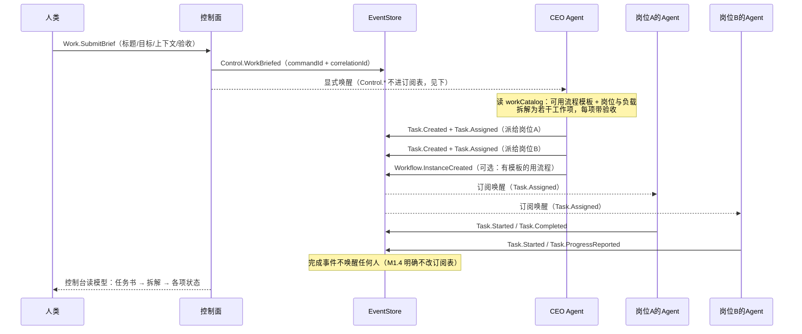

# M1.4 · 协同工作编排设计（任务书 → CEO → 协同）

> **地位**：M1.4 的**设计契约**（Status: CURRENT，接受日期 2026-10-05）。
> 上游权威：`ARCHITECTURE-BASELINE.md`（§6a 控制面、§17 变更流程）→ `package-registry.md`（包边界）
> → `dependency-graph.md`（依赖方向）→ `04-agent-lifecycle.md` §4.4（封闭 Action Space）。
> 冲突时以上游为准；本文件只记录**M1.4 的裁定与最小新增**。
>
> **接受记录**：本文已被确认接受，**ADR-014** 已按 §10 草案写入 `08-adr.md`（状态：已接受），
> §7 所列 `ARCHITECTURE-BASELINE.md` / `package-registry.md` / Phase 文档与索引已同步更新。
> 后续实现遵循 BASELINE §17 顺序：文档同批或紧随其后才更新实现代码。

---

## 1. 一句话

**人类只交任务书；CEO 把任务书拆成"协同计划"，按岗位派发，由订阅规则唤醒所需 Agent。**

人类不再逐条派活，也不再指定"哪个员工干"。人类能做的是**下任务书**与**裁定**（审批、减范围、加编队、升级）。

---

## 2. 目标与非目标

### 2.1 目标

| # | 目标 | 可验收表现 |
|---|------|-----------|
| G1 | 人类对"工作"只有**一个**写入口：任务书 | 控制面新增 `Work.SubmitBrief`；不存在"人类直接建单派给某个 agent"的一等公民路径 |
| G2 | CEO 具备"拆解 → 选编队 → 派岗 → 定验收"的行动能力 | 一份任务书在**一个 cycle 内**产出 ≥2 个工作项，派给 ≥2 个不同岗位 |
| G3 | 派发粒度是**岗位**，不是 agent | Agent 侧新动作的入参只有 `positionId`，没有 `employeeId` |
| G4 | 全链可观测 | 任务书 → 拆解出的每个工作项 → 各自状态，在控制台一屏可读，且可按 `correlationId` 回溯 |

### 2.2 非目标（写下来是为了防止范围蔓延）

| 不做 | 为什么 |
|------|--------|
| CEO 直接 RPC 指挥某个 agent | 违反"唤醒由订阅规则决定，不由发送方决定"（`05-runtime.md:186`）；会立刻退化成 Agent 间直接调用（`06-mvp-scope.md` §6.6 验收第 4 条） |
| 新的编排引擎 / 新包 | 建单+派岗的能力 `workflow-engine` 与 `task-system` 已具备，M1.4 只做**接线** |
| 部门粒度的批量派发 | 部门不是领域概念上的"工作承担者"，岗位才是；部门=多岗位批量属 UI 便利 |
| 招聘 / 组织重组 / 多公司 | 属 Phase 7 |
| 计划（Plan）的独立持久化事件 | 见 §5.4：先用 `correlationId` 归组，`agent_runs` 落地后再补 |
| 删除 `Agent.Instruct` | 保留为**排障**能力（§5.7），只是移出工作流程入口 |
| 任务书达成后的"CEO 自动回执" | `Task.Completed` 目前**不唤醒**任何订阅者（`eligibility.ts:41-45`、`:170-175` 只覆盖 `Blocked/Rejected/Failed`）。M1.4 用**读模型**让人类看见达成度；「完成即唤醒派发者」需要新增订阅规则，留给后续里程碑单独论证 |

---

## 3. 现状缺口（全部为代码事实，附定位）

| # | 缺口 | 证据 | 后果 |
|---|------|------|------|
| D1 | **CEO 没有"派活"动作** | `ACTIONS` 42 个动作里没有任何 create/assign/dispatch（`shared-types/src/index.ts:88-131`）；内核绑定表只有 `workflow.start`（`apps/kernel/src/simulation/plan-executor.ts:16-31`、`:238`） | CEO 只能"启动一条流程"或"发消息"，无法把一份任务书拆成 N 个工作项 |
| D2 | **建单+派岗只有编排层够得到** | 该能力实现于 `workflow-engine` 内部（`workflow-engine/src/workflow-engine.ts:402-428`） | Agent 侧无从复用；流程外日常派活在 Agent 侧无处安放 |
| D3 | **CEO 看不到"有哪些协同工作可选"** | `CognitionContext` 只有 `inputEvent + organization`（`agent-cognition/src/context/build-context.ts:108-118`）；系统提示词无任何管理岗职责（`agent-cognition/src/prompts/system.ts:18-42`） | CEO 只能猜 `workflowId`；"自己指挥"退化为随机行为 |
| D4 | **存在"人类直接指挥单个 agent"的入口** | Agents 页 Brief 与 Start Work 共用 `Agent.Instruct`（`apps/web/src/pages/Agents.tsx`；`Overview.tsx:63`） | 语义混用：一条是交任务书（合规），一条是绕过组织（不合规） |
| D5 | **任务创建无授权闸门** | `task-service.ts:196-204` 的 `authorize()` 只被实例命令调用；`create`/`assign` 仅 `validateActor` | 一旦把 create/assign 暴露给 Agent，等于开出一条无闸门的组织写入口 |

**已经对的部分（不要重做）：**

| 入口 | 命令 | 粒度 | 判定 |
|------|------|------|------|
| 人类交任务书 → CEO | `Agent.Instruct`（`Overview.tsx:63`） | 单 agent，但收件人是 CEO 本人 | ✅ 主路径正确，待升级为结构化事实 |
| 人类建单 | `Organization.InjectTask`（`Tasks.tsx:38`） | **岗位** | ✅ 粒度正确 |
| 人类改派 | `Task.Reassign`（`Tasks.tsx:42`） | **岗位** | ✅ 粒度正确 |
| 派岗 → 唤醒执行者 | `Task.Assigned` → `eligibleAgentsFor`（`apps/kernel/src/simulation/eligibility.ts:152-168`） | — | ✅ **机制现成，不加新唤醒源** |

> **这条最重要**：M1.4 不需要新的唤醒机制。`Task.Assigned` 已经把 `assigneeEmployeeId` 送进 `EVENT` 唤醒队列；
> 派岗即唤醒是既有事实，设计不得重复造。

---

## 4. 权威原则（本次要写进基线的裁定）

| # | 原则 | 反面（禁止） |
|---|------|-------------|
| **P1** | **人类对"工作"只有一个写入口：任务书。** 人类不产出任务、不指定执行者。 | 控制台出现"把任务派给 Alice"的一等公民按钮 |
| **P2** | **CEO 的产出是协同计划，不是一句话。** 计划 = 若干工作项，每项绑定一个岗位、带可验收产出。 | CEO 回一条"好的我安排一下"就结束 |
| **P3** | **派活的粒度是岗位，永远不是人。** 人走了坑还在（`03-data-model.md:34`）。 | 按 employeeId 派活；按 Agent 名指派 |
| **P4** | **人类的干预是裁定与约束**：审批、改范围、增删编队、改派岗位、卡点升级。 | 人类逐条替 CEO 排班 |
| **P5** | **指令靠订阅规则生效，不靠发送方。** CEO 派岗后由 `Task.Assigned` 订阅唤醒执行者；CEO 不能"命令"任何人。 | 新增 Agent 间同步 RPC / 直接唤醒调用 |

---

## 5. 设计

### 5.1 三个新概念（其余全部复用）

| 概念 | 是什么 | 载体 |
|------|--------|------|
| **WorkBrief（任务书）** | 人类交办的结构化事实：标题 / 目标 / 上下文 / 验收 / 优先级 / 期限 | 命令 `Work.SubmitBrief` → 事件 `Control.WorkBriefed`（复用 `Control` 聚合，同 M1.3 先例） |
| **WorkPlan（协同计划）** | CEO 的拆解产物：一组工作项，每项绑定一个岗位并带验收标准 | **不新增实体**：由 CEO 的 plan steps 表达，其效果 = 若干 `Task.Created`/`Task.Assigned`/`Workflow.InstanceCreated` |
| **Dispatch（派发）** | 把一项工作交给一个**岗位** | Agent 侧新动作 `DispatchWork` → 既有事件 `Task.Created` + `Task.Assigned` |

### 5.2 时序（目标形态）



**关键点：图中没有任何一条 Agent 到 Agent 的箭头。** CEO 的"指挥"全部通过事件的订阅关系生效。

> **两处必须说清的机制细节：**
> 1. `Control.*` 事件**不参与订阅唤醒**（`eligibility.ts:146-148` 的 `NON_WAKEUP_PREFIXES`）。
>    任务书送达 CEO 靠控制面**显式唤醒**——与 `Agent.Instruct` 完全相同的既有路径
>    （`organization-control/src/service.ts:641` → `simulation.wakeAgent(...)`）。
>    这不是新机制，是既有机制的复用。
> 2. 任务**完成**不唤醒派发者（`Task.Completed` 无人订阅）。因此"CEO 汇总回执"
>    在 M1.4 **不做**：达成度由控制面读模型呈现给人类，见 §2.2 与 §5.4。

### 5.3 新增动作：`DispatchWork`（最小集，只加一个）

| Action | 所需权限 | 入参 | 产出事件 |
|--------|---------|------|---------|
| `DispatchWork` | `work.dispatch` + 目标岗位所在决策域等级 + **汇报子树范围** | `{ positionId, title, goal, detail?, requiredSkills?, verification?, priority?, dueAtSim?, maxAttempts? }` | `Task.Created` + `Task.Assigned` |

绑定：`PLAN_ACTION_BINDINGS.DispatchWork = 'tasks.dispatch'`（`apps/kernel/src/simulation/plan-executor.ts:16`）。

**为什么是"一个动作"而不是"建单 + 派单"两个：**

| 方案 | 为何不选 |
|------|---------|
| `CreateTask` + `AssignTask` 两步 | 允许存在"已创建未分派"的中间态 = 无主的工作；且等于把改派权交给任意 Agent（互相甩活） |
| 只用 `CreateProposal`（= `workflow.start`） | 强制每份任务书都必须套模板；而流程外日常派活是 `tasks` 表的既有语义（`03-data-model.md:976`：`workflow_step_id` 可空） |
| 让 CEO 发消息请人"自己认领" | 工作无主、不可验收，且违反 P5（把唤醒变成协商） |
| 批量动作 `DispatchPlan(items[])` | N 个工作项藏进一个事件：难观察、难部分重试、难审计。逐步执行天然可组合 |

**为什么建单+派岗必须原子：** `DispatchWork` 的语义是"这件事**交给**这个岗位"，不是"建一条记录"。
因此 `TaskService.dispatch()` 内部组合 `create` + `assign`，对外只暴露一个可授权、可失败的入口。

### 5.4 可观测性：用 `correlationId` 归组，不新增计划事件

一份任务书的 `correlationId` 沿认知循环传播（`plan-executor.ts` 使用 `context.correlationId`），
因此 CEO 派出的每个任务都天然带同一个 `correlationId`。

```text
Control.WorkBriefed(correlationId=X)
   ├── Task.Created / Task.Assigned  (correlationId=X, createdById=CEO)
   ├── Task.Created / Task.Assigned  (correlationId=X)
   └── Workflow.InstanceCreated      (correlationId=X)
```

→ 控制面的读模型按 `X` 聚合即得"任务书 → 拆解 → 各项状态"，**不需要新事件、不需要新表**。

> **显式延后**：CEO 的 Plan 本身（它的推理与取舍理由）目前不落独立事实。
> 当 `agent_runs`（M2）落地后，再把 Plan 持久化，并让任务书面板显示"CEO 当时为什么这么拆"。
> 在此之前不假装有这份能力。

### 5.5 授权与护栏（fail-closed，全部为硬要求）

D5 已确认 `tasks.create`/`assign` 无授权闸门，因此**闸门必须建在新入口上**：

| # | 护栏 | 实现位置 | 失败表现 |
|---|------|---------|---------|
| A1 | `AuthzService.can(actor, 'DispatchWork', resourceRef('position:<id>'), { requiredRoles })` 必须 allow | `task-system` 的 `dispatch()` **内部**（不是调用方） | `task_permission_failed` → cycle 记录拒绝 |
| A2 | 只能派给**自己汇报子树内**的岗位（CEO=L5 全公司） | `organization-model` 的汇报线遍历（已有 `createOrgGraph`） | `out_of_scope` |
| A3 | 不得**向上**派活：拒绝 `levelFor(targetPosition, domain) > levelFor(actor, domain)` | `authority-engine` | `insufficient_authority` |
| A4 | 单份任务书派发上限（默认 8 项） | `dispatch()` 内按 `correlationId` 统计（见下） | `dispatch_quota_exceeded` |
| A5 | 工作项必须有可验收产出（`verification.requiredOutputKeys` 非空） | `task-system` 既有校验 `task-service.ts:340` | `invalid_input` |
| A6 | 同一任务书内不得重复派发同一 `(positionId, title)` | `dispatch()` 内按 `correlationId` 扫描 | 幂等旁路，不产生第二条任务 |
| A7 | 每次派发消耗 `budget.tryTask()` | 内核绑定层（预算器在 `deps.budget`） | `budget_exceeded` |
| A8 | `tasks.create`/`assign` 仍为**内部命令**：只允许内核绑定与 `workflow-engine` 调用 | 架构断言测试 | CI 失败 |

**允许派给自己**（CEO 把终裁类工作留给自己是合法的），但受 A6 约束不得成环。

> **A4/A6 的实现方式（无新状态）**：`Task.correlationId` 来自 `commandCorrelationId(actor)`
> （`task-service.ts:272`），而内核绑定用 `employeeActor(context.actorContext)` 构造 actor，
> 其 `correlationId` 就是任务书的 `correlationId`。因此配额与去重都可以**无状态**地
> 从任务存储按 `correlationId` 统计（`:170-176` 的 `actor.correlationId` 非空校验已保证该键可用），
> 重启后由事件重放依然成立——不需要在 `PlanExecutionContext`（`agent-runtime/src/cycle.ts:54`）
> 里新增 cycle 计数器，也不需要改 Runtime 的签名。

### 5.6 Agent 侧上下文：让 CEO 知道自己有什么牌（D3）

新增一个**纯数据**视图，由 `apps/kernel` 装配后注入，`agent-cognition` 不新增任何包依赖：

```ts
// agent-cognition/src/context/cognition-context.ts（新增字段，纯数据）
interface WorkCatalogView {
  readonly workflows: readonly {
    readonly workflowId: string;
    readonly title: string;
    readonly goal: string;
    readonly stepCount: number;
    readonly approvalGateCount: number;
  }[];
  readonly positions: readonly {
    readonly positionId: string;
    readonly title: string;
    readonly departmentId: string | null;
    readonly authorityLevel: number;
    readonly openTaskCount: number;   // 负载：用于"该派给谁"
  }[];
  readonly inFlightWorkflows: number;
}
```

- 装配点：`apps/kernel/src/simulation/simulation.ts` 已有 `definitionStore`（`:258`）与 `organization`/`tasks`，直接组装。
- **禁止**：`agent-cognition` import `workflow-engine`（保持 `agent-no-io` 与分层；视图是纯数据，不是领域对象）。

**提示词变更（`prompts/system.ts`）**：只对**持有 `work.dispatch` 权限的岗位**注入一段管理岗职责：

```text
Your duties as a manager:
- A work brief is a commitment, not a reply. Turn it into a plan.
- Every work item must name one position and one verifiable output.
- You cannot command anyone. Dispatch to a position and let the organization wake them.
- If the brief cannot be met, say so with reasons instead of dispatching noise.
```

> 这段只讲**职责与产出格式**，不讲流程步骤——遵守"不要把工作流藏在 prompt 里"。

### 5.7 控制面与 UI：入口收敛（D4）

| 页面 | 现状 | M1.4 |
|------|------|------|
| Overview · Start Work | 把标题/目标/上下文拼成一个字符串做 `Agent.Instruct` | 改为提交**任务书**：`Work.SubmitBrief`（标题/目标/上下文/验收/优先级/期限）→ `Control.WorkBriefed`；下方新增「任务书详情」：拆解结果与各项状态 |
| Tasks · 建单 | 派给单个**岗位** | 保留（人类的越权通道）。要求填 `reason`，并明示"这是一条直接派活，不经过 CEO 的拆解" |
| Tasks · 改派 | 岗位 | 保留 |
| Agents · Brief | 单 agent 直接指令，与 Start Work 混用 | **降级为排障**：移出工作流程入口，改到 agent 记录页的高级区，命名「诊断指令」，UI 明示"只唤醒一次、不产生组织工作" |
| 新 · 任务书列表 | — | 任务书卡片：标题 / 提交人 / 拆解项 / 达成度 / 阻塞项（读模型由 §5.4 的分组得到） |

### 5.8 事件、命令与审计

| 类型 | 名称 | 归属 | 说明 |
|------|------|------|------|
| 命令 | `Work.SubmitBrief` | `organization-control` | 人类唯一工作入口；`reason` 必填；`commandId` 幂等 |
| 事件 | `Control.WorkBriefed` | `event-system` `Control` 聚合 | **纯加法**，沿用 M1.3 的 `Control.AgentCreated` 先例，不新增聚合 |
| 事件 | `Task.Created` / `Task.Assigned` | `task-system` | 既有事件，`createdById = CEO`，`correlationId = 任务书` |
| 动作 | `DispatchWork` | `shared-types` `ACTIONS` | 纯加法（42 → 43） |

审计：一条 `Work.SubmitBrief` = 一条 audit 行（actor / reason / verdict / eventIds）；
每次 `DispatchWork` 拒绝也留痕（`Control.CommandRejected` 对命令，cycle 失败记录对动作）。

### 5.9 落点清单（实现时的写集）

| 层 | 文件 | 变更 |
|----|------|------|
| L0 | `packages/shared-types/src/index.ts` | `ACTIONS` + `'DispatchWork'` |
| L5 | `packages/task-system/src/task-service.ts` / `task-types.ts` | 新增 `dispatch()`（create+assign 组合 + A1–A6 闸门） |
| L6 | `packages/organization-control/src/{types,events,validation,service,query}.ts` | `Work.SubmitBrief` + `Control.WorkBriefed` + 任务书读模型 |
| App | `apps/kernel/src/simulation/plan-executor.ts` | 绑定 `DispatchWork` → `tasks.dispatch`；A7 预算计量 |
| App | `apps/kernel/src/simulation/simulation.ts` | 装配 `WorkCatalogView` |
| L3 | `packages/agent-cognition/src/context/*`、`prompts/system.ts` | `workCatalog` + 管理岗职责段 |
| L6/UI | `apps/api`、`apps/web/src/pages/{Overview,Tasks,Agents}.tsx` | 任务书入口 + 详情 + 语义收敛 + i18n（en/zh 双份） |

**不新增包、不新增聚合、不新增唤醒源、不改权限模型。**

### 5.10 验收（必须能演示）

| # | 验收项 | 判定方法 |
|---|--------|---------|
| 1 | 一份任务书 → ≥2 个工作项 → ≥2 个**不同岗位** | 集成测试断言 `Task.Assigned` 的岗位集合大小 ≥2 |
| 2 | 被派岗位的 Agent **真的被唤醒并推进** | tick 级断言：派发后 1–2 tick 内出现该 agent 的 turn |
| 3 | 人类可见拆解 | 控制台一屏：任务书 → 各项 → 状态（E2E 截图） |
| 4 | 越级派活被拒 | 工程师派给 CTO → 拒绝 + 审计行 |
| 5 | 无验收产出的工作项被拒 | `invalid_input`，且不产生 `Task.Created` |
| 6 | 超配额被拒 | 第 9 项被拒，前 8 项成功 |
| 7 | 重启后任务书与拆解关系仍在 | 复用 file event store，replay 后读模型一致 |
| 8 | 零越权 | 静态断言：Agent 侧不存在绕过 `can()` 的 create/assign 路径（A8） |
| 9 | 反退化 | 断言 Agent 侧不存在 Agent→Agent 调用；CEO 的派发全部经事件 |

### 5.11 风险与缓解

| 风险 | 缓解 |
|------|------|
| LLM 拆解质量差（派错岗位 / 拆太碎） | 确定性兜底：A2/A3 范围与越级校验、A4 配额、A5 验收必填；失败降级为可见的拒绝而非静默 |
| 成本放大（1 份任务书 → N 个 agent cycle） | 沿用每轮硬预算 + `budget.tryTask()`；配额默认 8 |
| 退化成"CEO 一句话派活"的新管道 | 验收第 1/2/9 条 + §4 的 P1–P5 |
| `Control.*` 命名被滥用 | 约束：`Control.*` 只承载**人类命令的事实**；Agent 产生的行为必须走领域聚合（`Task.*`/`Workflow.*`） |

### 5.12 实施切片（3 步，每步独立可验证）

| 切片 | 内容 | 完成判据 |
|------|------|---------|
| **S1 领域与契约** | `ACTIONS` + `DispatchWork`；`TaskService.dispatch()` 与 A1–A6 闸门；单测 | `pnpm test` 绿；向上派活/无验收/越范围/超配额全部被拒 |
| **S2 Runtime 与认知** | 内核绑定 + A7 预算；`WorkCatalogView` 装配；管理岗提示词；集成测试 | 验收 1、2、8 通过 |
| **S3 控制面与 UI** | `Work.SubmitBrief` + `Control.WorkBriefed` + 读模型；Overview 任务书面板；Tasks/Agents 语义收敛；E2E | 验收 3、4、7、9 通过 |

---

## 6. 需要裁决的开放问题

| # | 问题 | 建议 | 影响 |
|---|------|------|------|
| Q1 | 单份任务书的派发配额默认值 | **8** | 太小会切碎工作，太大会烧预算 |
| Q2 | `DispatchWork` 是否支持派给"部门" | **否**（部门=多岗位批量属 UI 便利，不是领域概念） | 若要，需给岗位集合定义派发语义 |
| Q3 | 任务书的"验收"是必填还是可空 | **必填**（否则派出的工作不可验收，违背 `submitted ≠ completed`） | 人类要多写一点，但换来可验收 |
| Q4 | 人类在 Tasks 页直派岗位是否强制 `reason` | **强制** | 与 `Work.SubmitBrief` 的 reason 要求一致 |
| Q5 | CEO 是否允许把工作项派给自己 | **允许**（终裁类工作无处安放），受 A6 约束 | — |

---

## 7. 与既有文档的关系（确认后需要更新的位置）

| 文档 | 需要的变更 |
|------|-----------|
| `ARCHITECTURE-BASELINE.md` | §6a 增补"人类唯一工作入口=任务书"；§6（权限）登记 `work.dispatch` |
| `08-adr.md` | 新增 **ADR-014**（本文 §10 草案） |
| `package-registry.md` | `task-system` 公共 API 增补 `dispatch()`；`organization-control` 增补命令与事件 |
| `dependency-graph.md` | **无变更**（不新增依赖边） |
| `04-agent-lifecycle.md` §4.4 | Action Space 表新增 `DispatchWork` 行（43 项） |
| `05-runtime.md` | 认知循环的"计划"一节补充：管理岗的派发动作与订阅唤醒的关系 |
| `06-mvp-scope.md` | 任务/工作流条目补充"任务书 → 协同计划"的链路 |
| `docs/architecture/README.md` | 登记本文件（Status: PROPOSED → CURRENT） |

---

## 8. 反退化检查（M1.4 结束后须跑）

- [x] Agent 侧行动空间封闭：`DispatchWork` 是唯一新增，没有"自由发挥"入口
- [x] 不存在 Agent→Agent 直接调用（CEO 的指挥全部经事件）
- [x] 不存在绕过 `AuthzService.can()` 的组织写路径（A8 断言）
- [x] 派发粒度不含 `employeeId`
- [x] 人类不能"只指派一个 agent 完成工作"——控制台不存在这样的入口
- [x] 每一条派发都能回溯到任务书的 `correlationId`

---

## 9. 一句话总结

> **M1.4 不是"给人类加一个派活按钮"，而是把"派活"从人类手里收回给组织：**
> 人类交任务书，CEO 拆解成协同计划，按岗位派发，订阅规则唤醒执行者；
> 人类的位置在**裁定与约束**，不在排班。

---

## 10. ADR-014（已按本草案写入 `08-adr.md`）

### 协同工作以"任务书 → CEO 拆解 → 按岗位派发"为唯一 Agent 侧编排入口

**状态**：已接受（ACCEPTED，2026-10-05 · M1.4；正式正文见 `08-adr.md` · ADR-014）

**背景**

M1.0–M1.3 让公司能自主运行、能被人控制与观察。但"人类如何把一件事交给这家公司"仍停在
`Agent.Instruct` 的自由文本上：CEO 收到一段字符串，却没有把工作**拆开**并**派出去**的动作
（§3 D1/D3），而"建单+派岗"的能力被封闭在 `workflow-engine` 内部（D2）。
同时控制台存在一条"人类直接指挥单个 agent"的路径（D4），它与"组织先于任务"的项目公理相冲突。

**决策**

1. 人类对工作只有**一个**写入口：`Work.SubmitBrief` → `Control.WorkBriefed`。
2. `ACTIONS` 追加 **一个**动作 `DispatchWork`（42 → 43），入参只含**岗位**，不含员工；
   其效果是既有的 `Task.Created` + `Task.Assigned`。
3. `TaskService` 新增 `dispatch()`：原子组合 create+assign，并在**领域内部**执行
   `AuthzService.can(actor, 'DispatchWork', position:<id>)`、汇报子树范围与越级校验。
   `create`/`assign` 保持为内部命令（A8 静态断言）。
4. 不新增唤醒源：沿用 `Task.Assigned` → `eligibleAgentsFor`（`eligibility.ts:152`）。
5. 任务书的可追溯性用 `correlationId` 归组，**不新增计划事件**；Plan 的持久化延后到 `agent_runs`（M2）。
6. `Agent.Instruct` 保留但降级为**排障**能力，不再作为人类派活入口。

**理由**

1. **与项目公理一致**：组织先于任务；Agent 独立且可追溯；工作流不藏在 prompt 里。
2. **复用而非重写**：不加包、不加聚合、不加唤醒源、不改权限模型；新增的领域概念只有"任务书"。
3. **fail-closed**：把闸门放在领域内部的 `dispatch()`，而不是指望每个调用方记得校验（D5 的教训）。
4. **可观测**：任务书 → 拆解 → 状态可通过既有 `correlationId` 与既有事件还原。

**后果**

- ✅ 人类与组织的权责边界变清楚：人类裁定，组织执行。
- ✅ CEO 首次拥有真实的"管理"动作，而不是只会发消息。
- ⚠️ `ACTIONS` 与 `Control` 聚合再次扩容：此后新增动作必须单独论证"为什么不能复用"。
- ⚠️ 一次任务书会放大成本（N 个 agent cycle）→ 依赖配额与既有预算。
- ⚠️ 拆解质量取决于模型；确定性护栏只保证"不越界"，不保证"拆得好"。

**备选方案**

| 方案 | 为何不选 |
|------|---------|
| 保持 `Agent.Instruct` 自由文本，让 CEO 用消息协调 | 工作无主、不可验收、不可观测；且必然引入 Agent 间 RPC |
| 只允许 CEO 启动流程模板（不加 `DispatchWork`） | 流程外日常派活在 Agent 侧无处安放，而 `tasks.workflow_step_id` 可空正是为此设计的 |
| 人类直接建单派给 agent（扩大控制面） | 与项目公理冲突；且单 agent 无法完成任务本身（需要多岗位协同） |
| 新增 `WorkPlan` 实体与事件 | 收益（可读的计划）真实但可延后；先用 `correlationId` 归组可避免一个早期就冻结的 schema |
