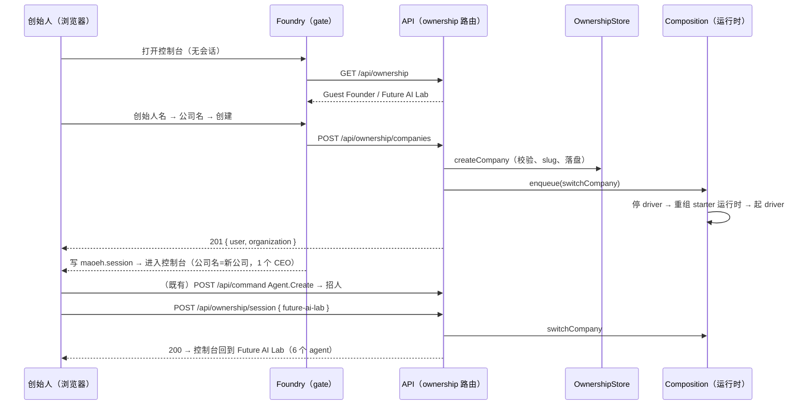

# M1.5 · Identity & AI Company Ownership（身份与 AI 公司所有权）

> 状态：**CURRENT**（实现契约，代码已落地）
> 从属：`ARCHITECTURE-BASELINE.md`（最上位）、`package-registry.md`、`dependency-graph.md`、`M1.0-organization-control-plane.md`
> 一句话：**User（Founder）owns Organization（AI Company） employs Agents** —— 平台从此有了「主人」与「我的公司」，控制台的入口从"直接进控制台"变成 **Create Your AI Company**。

---

## 1. 目标与非目标

### 1.1 目标

1. 建立唯一的所有权关系：`User → OwnedOrganization（Company）→ Agents`。
2. 控制台首页提供 **创建我的 AI 公司** 流程：`Founder → Company Name → 创建 → 自动生成 CEO Agent`。
3. 公司名、公司 id、创始人是**运行时状态**，控制台各处（侧栏、顶栏、页面标题）动态显示，不再硬编码。
4. 每家公司拥有**自己的事件日志、自己的员工花名册、自己的通讯频道**，切换公司即切换运行时。
5. 默认安装自带 `Guest Founder` + `Future AI Lab`，保证"登录"在任何人创建公司之前就已有目的地。

### 1.2 非目标（写下来是为了防止范围蔓延）

- **不做账号体系**：无密码、无 OAuth、无令牌、无会话过期。`SignIn` = 激活某家公司，不是认证。
- **不做权限模型**：授权仍完全由 M1.0 的岗位 authority 承担（`controlPolicyForPosition`），本里程碑不新增任何 RBAC。
- **不做多租户隔离**：一个进程、一个活跃运行时；公司之间靠事件日志与花名册隔离，不是靠进程/数据库隔离。
- **不改 migrations**：`0001_init.sql` 保持 0 字节（冻结），所有权记录是文件态（见 §3.2）。
- **不新增包**：领域类型落在既有的 `organization-model` / `shared-types`，避免 `package-registry.md`（FROZEN）变更。

---

## 2. 概念模型

| 概念 | 类型 | 位置 | 说明 |
| --- | --- | --- | --- |
| 创始人（Founder） | `User { id, name }` | `organization-model/ownership/user.ts` | 只有名字，没有凭证 |
| AI 公司（Organization） | `OwnedOrganization { id, name, ownerId, seed }` | `organization-model/ownership/owned-organization.ts` | `Organization ≡ Company`，**`organizationId ≡ companyId`**，不引入第二个词 |
| 雇员（Agent） | 既有 `Employee` / `AgentSummary` | `organization-control` | 只在读投影上新增 `organizationId` |
| 创始人 id | `UserId = Brand<string, 'UserId'>` | `shared-types` | 与 `CompanyId`/`EmployeeId` 同一 brand 手法 |
| 公司 id | `CompanyId` | 既有 | 同时是事件日志目录名 |

关系：`User 1 —* OwnedOrganization 1 —* Employee`；`Company.ownerId?: UserId` 是既有 `Company` 上的**增量字段**（`undefined` 只可能出现在从未被 M1.5 装配过的来源上，实际运行时一律有值）。

`seed` 是公司**从哪里来**的标记：

- `'lab'` —— 预置的 `Future AI Lab`（M0–M1 种子组织，6 名员工），历史事件日志路径不变。
- `'starter'` —— 创始人新建的公司：同一套种子的组织架构图 + **只保留根岗位（CEO）的花名册**。

---

## 3. 落点（谁拥有什么）

### 3.1 领域类型

```text
packages/organization-model/src/ownership/
  user.ts              User { id, name }
  owned-organization.ts  CompanySeed = 'lab' | 'starter'; OwnedOrganization; OwnershipState
  slug.ts              slugifyId(value, fallback); uniqueId(base, taken)
packages/organization-model/src/company/company.ts   → + ownerId?: UserId
packages/shared-types/src/index.ts                  → + UserId
```

`slugifyId` 的规则是**为磁盘设计的**：公司 id 会成为事件日志目录名与每条事件的 `companyId` 片段，必须在任何平台可移植、非空 —— 中文/emoji 公司名一个 ASCII 都产不出，因此回退到 `fallback`（`星河实验室 → company`）。`uniqueId` 给出 `acme → acme-2 → acme-3`，撞名不覆盖已有公司。

### 3.2 所有权存储（`apps/api/src/ownership-store.ts`）

**文件态，不是表。** 记录与事件日志遵守同一条铁律：状态目录必须在**仓库之外**（`pnpm install` / `git clean` / 删除工作区不得把创始人从自己公司里开除）。

```text
<stateDir>/companies.json          # stateDir = %LOCALAPPDATA%\maoeh | $XDG_STATE_HOME/maoeh | ~/.local/state/maoeh
{
  "version": 1,
  "users": [{ "id": "user-guest-founder", "name": "Guest Founder" }],
  "organizations": [{ "id": "future-ai-lab", "name": "Future AI Lab", "ownerId": "user-guest-founder", "seed": "lab" }],
  "activeOrganizationId": "future-ai-lab"
}
```

- **路径解析与事件日志同构**（`resolveOwnershipStorePath`）：显式 `eventLogPath`（测试 / e2e / CI）= "这次运行是隔离的"，所有权记录随之隔离为内存态；否则看 `MAOEH_OWNERSHIP`（路径 / `off` / `memory` / 空 = 内存态）；否则落 `<stateDir>/companies.json`。因此一个测试永远写不到开发者的 `companies.json`。
- 写入是**原子的**（写 `*.tmp` 再 `rename`）；文件损坏时回退到默认记录，而不是让控制台起不来。
- `ensureDefaults()` 幂等：空记录播种 `Guest Founder` + `Future AI Lab`。

校验与拒绝码（API 一律回 `422` + 机器可读码，**不回散文**，控制台本地化）：

| 场景 | code |
| --- | --- |
| 创始人名为空 | `founder_name_required` |
| 创始人名 > 100 | `founder_name_too_long` |
| 公司名为空 | `company_name_required` |
| 公司名 > 120 | `company_name_too_long` |
| 登录到不存在的公司 / 公司没有主人 | `unknown_organization` |

### 3.3 API 契约（`apps/api/src/api-adapter.ts`）

| 方法 | 路径 | 成功 | 载荷 | 失败 |
| --- | --- | --- | --- | --- |
| GET | `/api/ownership` | 200 | `{ users, organizations, activeOrganizationId }` | 501 `ownership_unavailable` |
| POST | `/api/ownership/companies` | **201** | `{ user, organization }`（并已切换到该公司） | 422 `{ error: <code>, message }` |
| POST | `/api/ownership/session` | **200** | `{ user, organization }`（并已切换） | 422 / 501 |

这三条路由是控制台的**唯一**入口：首页读、创建、登录，都在这里完成，控制台不直接触碰存储。

### 3.4 组合根与公司切换（`apps/api/src/composition.ts`）

**每家公司一份事件日志**，规则（`resolveCompanyEventLogPath`）：

1. 显式 `eventLogPath`（测试/CI）优先 → `null` 表示**整个运行**是内存态（每家公司都内存态）。
2. 否则看 `MAOEH_EVENT_LOG`（`off`/`memory`/空 = 内存态；否则取其目录）。
3. 否则默认目录。
4. `seed === 'lab'` 拿到该路径本身（历史行为不变，未来实验室日志仍是 `<stateDir>/future-ai-lab/events.jsonl`）；**其他公司拿 `<该目录>/<organizationId>/events.jsonl`** —— 于是同一个 override 下各公司互不串味，新建公司也不会写进真实状态目录。

**新建公司的种子组织**（`toStarterOrganization` + `definitionReaderFor`）：

- 组织架构图（部门、岗位树、决策域）**整套保留**，这样 CEO 一上任就能用现有的 `Agent.Create` 招人；
- 花名册只留根岗位（`reportsToPositionId === null` → 只有 `ceo`）；
- agent definitions 按幸存员工过滤（定义文件名 = 员工 id），否则 `agent-definition` 契约会因"定义没有对应员工"而加载失败。

**切换 = 换运行时**：`switchCompany()` 停 tick driver → 重新 `createComposedRuntime` → 重启 driver；请求经 `gate` 串行化，任何一次 `GET /api/snapshot` 都不可能读到"一半旧公司、一半新公司"。`describeRuntime()` 会打出 `company: <名> — event log: <路径>（recovered N events, M employees）`，让"我的 agent 去哪了"可以用一行日志回答。

### 3.5 控制台入口（`apps/web`）

- `pages/Foundry.tsx` —— 首页 gate：左侧深色 hero（**创建我的 AI 公司** / **Sign in**），右侧两步表单（`01 Founder → 02 Company name`），创建成功即进入控制台。
- `ownership.ts` —— API 客户端 + 会话：`CompanySession { userId, organizationId, founderName }` 存在 `localStorage['maoeh.session']`，**只是"这个标签页开着哪家公司"，不是凭证**。
- `App.tsx` —— 无会话 ⇒ 只渲染 gate；有会话 ⇒ 启动时用 `POST /api/ownership/session` 向服务端确认（公司还在、运行时切过去），确认失败即丢弃会话回到 gate。侧栏显示公司名 + 创始人名，底部提供**切换公司**（回到 gate）。
- 文案全部走 i18n：`foundry.*` 双语（`en-US` / `zh-CN`），由 `tests/unit/web/i18n.test.ts` 强制键集一致、占位符一致、zh 必须是中文。

### 3.6 读模型新增字段（增量，不破坏 M1.2-C 契约）

| 投影 | 新增 | 来源 |
| --- | --- | --- |
| `snapshot.company` | `ownerId: string \| null` | `organization.company.ownerId` |
| `agents[]` / `AgentSummary` | `organizationId: string` | `employee.companyId` |
| `tasks[]` / `TaskSummary` | `organizationId: string` | `task.companyId` |

**不新增** `companyId`/`founderId` 等同义字段：`organizationId ≡ companyId`，多一个字段就多一处可能不一致的真相。

---

## 4. 时序：建司与切换



---

## 5. 测试与验证

| 测试 | 覆盖 |
| --- | --- |
| `tests/unit/api/ownership-store.test.ts` | 默认播种、建司、创始人复用与不合并、校验码、slug/撞名/非 ASCII、登录与拒绝、文件往返与损坏回退、内存态 |
| `tests/unit/api/event-log-path.test.ts` | 所有权记录的存放位置：默认在仓库外、`MAOEH_OWNERSHIP` 覆盖与内存态、显式 `eventLogPath` 隔离 |
| `tests/integration/ownership-company.test.ts` | 真 HTTP：默认所有权 → 建司 201 → snapshot 换名换 id、只 1 个 CEO、`organizationId` 一致 → 既有控制面招人 → 两次登录切换 → 各公司各自日志文件 → 422 错误码 → 拒绝后运行时留在原公司 |
| `tests/unit/web/i18n.test.ts` | `foundry.*` 双语键集/占位符/中文约束（既有断言自动生效） |
| `tests/e2e/gate.mjs` | 四个既有脚本共用的过 gate 步骤（Sign in → 选公司），新档案先进控制台再断言 |
| `tests/e2e/create-company-smoke.mjs` | 真浏览器跑通标题流程：gate → Founder → Company Name → 创建 → 控制台显示新公司名与创始人 → API 校验 1 个 CEO → Switch company 回到 gate |
| 既有回归 | `pnpm typecheck` / `pnpm lint` / `pnpm test`（含 architecture 边界与依赖巡航）全绿；`pnpm test:e2e`（操作闭环）全绿 |

> **开发运行注意**：`turbo.json` 的 `dev` 任务现在 `dependsOn: ["^build"]`，`@maoeh/api` 的 dev 脚本是 `node --watch dist/index.js`。原因：gate 页面由 vite 即时从源码提供，而 API 跑的是 `dist`——重建后若旧进程还占着端口，新前端就会对旧后端打出 `404 /api/ownership/companies`（`GET /api/snapshot` 却仍然 200，因为旧路由还在）。先 build 再起、重建即重启，这类"新 UI 打旧 API"的假故障就不会出现。

---

## 6. 已知限制（不为 M1.5 伪造）

1. **一次只运行一家公司**：没有多运行时；切换是串行的（`gate`），不是并行。
2. **内存态切换不保留**：`eventLogPath: null` / `MAOEH_EVENT_LOG=off` 下，切走再切回 = 该公司回到种子（与 M1.3 既有语义一致，日志即耐久边界）。
3. **登录不是认证**：知道公司 id 就能进；这是 M1.5 明确的范围外，权限仍由岗位 authority 承担。
4. **一个活跃公司 = 一个 tick driver**：不存在"两家公司同时推进"。
5. **`company.ownerId` 为 `null`** 只在从未经过 M1.5 装配的来源上出现；控制台需容忍 `null`（读投影已按 `null` 输出）。

---

## 7. 与既有文档的关系

- `03-data-model.md` 新增 **§3.13 所有权与归属（M1.5）**：所有权记录的字段与文件形态；SQL DDL 仍冻结，无新表。
- `package-registry.md` / `dependency-graph.md` **不变**（不新增包；`ownership/*` 是 `organization-model` 内部模块，未新增对外依赖边）。
- `M1.0-organization-control-plane.md` **不变**：`Agent.Create` 等命令与授权模型原样复用，M1.5 只决定"谁的公司在跑"。
- 本文件冲突时的裁决顺序：`ARCHITECTURE-BASELINE.md` > registry / dependency-graph > 本文件 > 代码。
