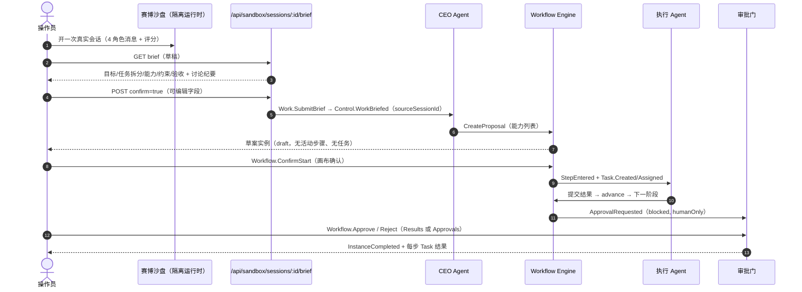

# M2 · 主业务闭环打通（阶段报告）

- 完成时间：2026-11-14 22:10–22:35（Asia/Shanghai）
- 工作分支：`feat/m2-workflow-closed-loop`（从 `checkpoint/2026-11-14-night` / `5ae0235` 新建）
- 代码提交：`41c3cbd`（主实现）+ `e6ae536`（暂停按钮只在 running/paused 时出现）
- 文档提交：`67cfa1a`（本报告与审计基线）
- 审计依据：[WORKFLOW_PRODUCT_AUDIT.md](WORKFLOW_PRODUCT_AUDIT.md)
- 范围：只做 P0-1…P0-4；不接社交平台发布、不扩多媒体、不重构稳定模块、不改数据库、不动正式演示数据

---

## 0. 结果速览

| 项 | 状态 | 真实证据 |
|---|---|---|
| P0-1 沙盘 → 结构化任务书（预览/编辑/确认/防重复） | ✅ 完成 | 新 HTTP 端点 + 沙盘页面表单；6 条路由测试 + 6 条纯函数测试 + 1 条全链路 HTTP 测试 |
| P0-2 Results 就地审批（真实命令、真实状态） | ✅ 完成 | 复用 `Workflow.Approve/Reject`；3 条投影测试 + 全链路测试中的非法/越权/重复审批断言 |
| P0-3 画布真实依赖 | ✅ 完成 | `WorkflowView.transitions` + 画布按转换建边；17 条画布测试（含回环/阶段目标/回退） |
| P0-4 暂停可见 + 暂停期间完成事件的复现与修复 | ✅ 完成（有红/绿证据） | 修复前 `expected 'running' to be 'completed'`；修复后 2/2 通过 |
| 全链路 | ✅ 打通 | 沙盘会话 → 任务书 → CEO 草案 → 人工确认 → 执行 → 审批 → 完成，真实 HTTP（隔离运行时） |
| 全量测试 | ⚠️ 1 个已知 flake | 1286 条中 1285 通过；失败项 `preview-runtime-http` 单跑 2/2 通过 |

---

## 1. 修改文件与接口

### 1.1 后端

| 文件 | 变更 |
|---|---|
| `apps/api/src/sandbox-brief.ts`（新） | 会话 → 结构化草稿的纯函数；字段规范化；`Work.SubmitBrief` 命令构造；不写事件、不调模型 |
| `apps/api/src/api-adapter.ts` | 新增 `GET/POST /api/sandbox/sessions/:id/brief`；归属/有效性/重复/确认校验；命令执行与错误映射 |
| `apps/api/src/sandbox-session.ts` | 会话写入 `companyId`（旧会话可缺，缺则拒绝转换）；重建时带回 |
| `apps/api/src/sandbox-page.ts` | 新增「转为任务书」：草稿表单、可编辑字段、上下文预览、显式确认、已转换提示 |
| `apps/api/src/composition.ts` | `sandboxStateDir` 选项（隔离 e2e）；`api.companyId` 暴露当前公司 |
| `packages/organization-control/src/types.ts` | `WorkBriefSpec.sourceSessionId?`、`WorkBriefView.sourceSessionId`、`WorkflowTransitionView`、`WorkflowView.transitions?` |
| `packages/organization-control/src/events.ts` | `Control.WorkBriefed` 可选 `sourceSessionId`（≤120） |
| `packages/organization-control/src/validation.ts` | `sourceSessionId` 边界校验 |
| `packages/organization-control/src/service.ts` | 任务书事件带 provenance；`pausedWorkflowIds` 由真实 manual block 推导 |
| `packages/organization-control/src/query.ts` | `paused` 真实推导；`getWorkflow` 投影全部 stage transitions；任务书视图带来源会话 |
| `packages/workflow-engine/src/workflow-engine.ts` | `resume()` 对暂停期间已终态的活动步骤做结算（复用 `settleSubmitted/Failed/Cancelled`） |

### 1.2 前端

| 文件 | 变更 |
|---|---|
| `apps/web/src/result-approval.ts`（新） | 开放审批门的纯投影：步骤、理由、票数、已交付任务 |
| `apps/web/src/components/ResultApproval.tsx`（新） | Results 内验收面板：展示交付结果、意见输入、通过/驳回；调用真实命令，显示后端拒绝 |
| `apps/web/src/pages/Results.tsx` | 在交付页插入验收面板（只加一行，见 §5.2） |
| `apps/web/src/assignment-canvas.ts` | 解析 `transitions/paused`；有转换按转换建边，无转换才回退相邻链；回环单独画 |
| `apps/web/src/pages/WorkflowCanvas.tsx` | 边增加 `feedback`/`data-condition`；显示暂停 chip |
| `apps/web/src/pages/Workflows.tsx` | 暂停/恢复按钮、暂停状态徽章、说明「只停止推进」 |
| `apps/web/src/commands.ts` | `workflowPause` / `workflowResume` |
| `apps/web/src/results.css`、`canvas.css` | 验收面板与回环边样式 |
| `apps/web/src/i18n/locales/{zh-CN,en-US}.json` | 新增结果审批、暂停/恢复、画布暂停文案（双语一致） |

### 1.3 测试

| 文件 | 覆盖 |
|---|---|
| `tests/unit/api/sandbox-brief.test.ts`（新，6） | 从真实消息/评分派生字段；无评分告警；字段边界；上下文；命令构造 |
| `tests/integration/sandbox-brief-http.test.ts`（新，6） | GET 不写、无 confirm 拒绝、编辑后提交、重复 409、未知/旧/跨公司/过短、命令拒绝 |
| `tests/integration/workflow-closed-loop-http.test.ts`（新，1） | 真实 HTTP 全链路 + 越权/非法/重复审批 + 任务结果 + 任务书关联 |
| `tests/unit/workflow-engine/pause-resume-reconcile.test.ts`（新，2） | 暂停期间提交 → 恢复结算；无终态任务时行为不变 |
| `tests/unit/web/results-approval.test.ts`（新，3） | 开门投影、非开门不动作、任务裁剪 |
| `tests/unit/web/assignment-canvas.test.ts`（+3） | 真实转换建边、回环、阶段目标、fail 无悬空、无转换回退、paused 解析 |
| `tests/unit/organization-control/observation-query.test.ts`（+1） | transitions 投影、manual blocked → paused true、resume 后 false、`pausedWorkflowIds` 一致 |
| `tests/integration/sandbox-http.test.ts`（+断言） | 沙盘页面包含 `/brief`、`briefConfirm`、`confirm` |

> 新增/扩展测试 22 条；未删除、未放宽任何既有断言。

---

## 2. 数据流与状态流转



关键状态：

- **草稿**：`Workflow.InstanceStarted` 带 `context.draft=true`，`activeStepIds=[]`，没有任务；确认前不执行。
- **确认**：`Workflow.DraftConfirmed` → 进入入口阶段 → `StepEntered` → 任务创建/指派。
- **审批**：生成式交付门 `humanOnly=true`；人类命令才能通过；Agent 的投票会被 `human_approval_required` 拒绝。
- **暂停**：`Workflow.InstanceBlocked(kind=manual)`；`paused` 只对这种阻塞为 true；审批阻塞不算暂停。
- **恢复**：`Workflow.InstanceResumed` 之后，对活动步骤做一次任务状态结算（见 §5.4）。

---

## 3. 接口契约

### 3.1 `GET /api/sandbox/sessions/:id/brief`

只读。返回：

```ts
{
  draft: {
    sessionId: string;
    source: { sessionId; topic; rounds; turns; total: number | null; verdict: string | null };
    title: string;
    goal: string;                 // 人类目标（提交时追加「所需能力」）
    requirements: string[];        // 任务拆分
    capabilities: string[];        // 所需能力（来自会话文本的能力分析）
    constraints: string[];
    acceptanceCriteria: string[];
    verificationKeys: string[];
    notes: string;
    context: string;               // 提交上下文的预览
    warnings: string[];            // 无评分等
  };
  submitted: { briefId: string; commandId: string } | null;
}
```

### 3.2 `POST /api/sandbox/sessions/:id/brief`

必须 `confirm: true`。可编辑字段与上同名；省略的 `requirements/constraints/acceptanceCriteria/verificationKeys` 回退到草稿，`capabilities` 为空时也回退。

- `201`：`{ draft, submitted: { briefId, commandId }, replayed }`
- `400`：`confirmation_required` / `invalid_brief`
- `403`：命令被权限拒绝
- `404`：`unknown_session`
- `409`：`already_converted` / `sandbox_session_legacy` / `sandbox_session_other_company` / `command_refused`
- `422`：`sandbox_session_not_ready`（少于 2 条发言）

### 3.3 读模型增量（向后兼容）

- `WorkBriefSpec.sourceSessionId?: string | null`；`Control.WorkBriefed` 事件同名字段（可选，≤120）。
- `WorkBriefView.sourceSessionId: string | null`。
- `WorkflowView.transitions?: WorkflowTransitionView[]`：

```ts
{ transitionId, fromStepId,
  when: { kind: 'always' | 'task_status' | 'approval_decision'; status?; decision? },
  to: { kind: 'step' | 'stage' | 'complete' | 'fail'; stepId?; stageId?; reason? } }
```

- `WorkflowSummary.paused` = `status==='blocked' && blockedReason.kind==='manual'`；`ControlState.pausedWorkflowIds` 同源派生（不再恒空）。

---

## 4. 真实运行证据

### 4.1 全链路（隔离 HTTP 服务，mock LLM）

`tests/integration/workflow-closed-loop-http.test.ts`：临时目录内的独立事件日志 + 独立沙盘目录，`startApiServer` 真实端口，`fetch` 真实 HTTP。

断言（全部通过，约 0.4–0.5s）：

1. `/api/llm` 为 `mock`；
2. `POST /api/sandbox/session` 返回真实会话（≥2 条发言、带 `companyId`）；
3. `GET .../brief` 草稿包含 `implementation` 与验收标准，且 GET 不写事件、不执行命令；
4. `POST .../brief {confirm:true}` 返回 `brief-1`；再次 POST 为 `409 already_converted`；
5. 草案工作流出现：`draft=true`、`activeStepIds=[]`、所有步骤 `pending`、`transitions` 非空；
6. `Workflow.ConfirmStart` 被接受；随后执行到审批门：
   - `status=blocked`、`approval.status=open`；
   - 每个交付步骤的 `Task` 为 `completed` 且 `result` 非空；
7. 非法/越权/重复审批：
   - 审批阻塞时 `Workflow.Resume` → `INVALID_STATE`；
   - 工程师投票 → `rejected`（`OUT_OF_SCOPE` 等），门仍 `open`；
   - 人类通过 → `accepted`；
   - 再次通过 → `rejected INVALID_STATE`；
8. 完成后 `status=completed`、`approval.status=granted`、所有步骤 `done`、`paused=false`；
9. `/api/work-briefs` 中 `brief-1.sourceSessionId === sessionId`，且 items 非空。

### 4.2 任务书与评分来源

- 草稿的标题/目标/任务拆分/约束/验收标准来自会话自身的 `topic`、四条 `Communication.MessageSent`、`scores.dimensions/total/verdict`；没有第二次模型调用。
- 上下文保留 `msg-1…` 引用，便于人工对照。
- 无评分时 `warnings` 明确写「未产生可解析评分」，不编造分数。

### 4.3 前端

- 沙盘页面：`briefDraft` → 表单 → `briefConfirm`；`confirm` 才 POST；已转换显示已有 `briefId`，不重复提交。
- Results：只在 `approval.status==='open'` 时渲染面板；按钮是 `Workflow.Approve/Reject` 的真实命令；拒绝原因写入 `reason`。
- 画布：有 `transitions` 时按定义建边（`task:completed`、`approval:denied` 等 `data-condition`；回环虚线）；无转换才回退相邻链。
- Workflows：manual blocked 显示「已暂停」和「恢复推进」；审批阻塞不显示为暂停。

---

## 5. 测试结果与失败记录

### 5.1 门禁

| 命令 | 结果 |
|---|---|
| `pnpm typecheck` | 53/53 successful，exit 0 |
| `pnpm lint` | exit 0 |
| `pnpm architecture:check` | 10 files / 55 tests 通过，depcruise 0 违规 |
| `pnpm exec turbo run build --force` | 33/33 successful，0 cached（29.2s） |
| `pnpm test` | **179 files / 1286 tests：1285 通过，1 失败，exit 1** |
| 失败项单跑 | `tests/integration/preview-runtime-http.test.ts`：2/2 通过（1.5s） |

失败项是审计基线中已记录的已知 flake：全量并行时真实预览子进程 60s 内未启动；单跑 1.4s。两次失败/通过之间未改任何断言或代码，**本阶段没有为制造绿色修改测试**。

### 5.2 暂停缺陷：先复现，后修复

按要求先复现再改：

1. 写回归测试 `pause-resume-reconcile.test.ts`，期望「暂停期间提交 → 恢复后完成」；
2. 暂存引擎修复（`git stash push -- packages/workflow-engine/src/workflow-engine.ts`）后运行，**失败**：

```
× settles a task that was submitted while the workflow was paused
AssertionError: expected 'running' to be 'completed'
Tests 1 failed | 1 passed
```

3. 恢复修复后运行，**通过**：`2 passed`。

这证明缺陷真实存在，且修复点（`resume()` 结算活动步骤）有效；不是事后编造。

### 5.3 为什么不是改 reactor

- 复现点在引擎边界：reactor 对 blocked 实例的 `advance` 被拒后不重试，任务事件被丢弃。
- 修复放在 `resume()`：恢复时读取活动步骤的 task 终态，复用既有 `settleSubmitted/Failed/Cancelled` 完成同样的验证、重试与转换选择。
- 事件仍会被 reactor 丢弃；但**恢复后状态收敛**。未恢复的实例保持 blocked（符合「暂停」语义）。
- 残留：若推进失败不是由 pause 引起，仍没有对账；该风险写入 §7。

---

## 6. 与并行会话改动的隔离

- 开工时工作区已有 19 个 M + 若干未跟踪文件（含 `RoleAvatar`、`Tasks` 头像、网络/招聘样式改动），不属于本阶段。
- 本阶段提交 `41c3cbd` **只包含本阶段文件**；`Results.tsx`、`WorkflowCanvas.tsx`、`canvas.css` 三个共享文件用「HEAD + 本阶段 hunk」的暂存方式提交，**没有把并行改动带进提交**。
- 工作区里并行会话的改动保持原样、未覆盖、未回滚、未清理。
- 本阶段审计与报告已随本分支提交（`docs/competition/`），不在工作区残留未提交文档。

---

## 7. 尚未完成的能力

| 能力 | 状态 | 说明 |
|---|---|---|
| Studio 入口 / 持久化 / 审核留痕 | 未做 | 仍无 Results→Studio 链接；审核仍是浏览器布尔值；P1 |
| 统一审批收件箱 | 部分 | 工作流门与任务 review request 仍是两种记录；任务 review 无生产消费者 |
| 并行 fan-out/join | 未做 | 引擎一次只进入一个步骤；仍串行 |
| 真实平台发布 | 未做 | 无适配器/凭据/回执；不声称 |
| 图片/音视频 | 未做 | 只有文本 provider |
| 沙盘旧会话转换 | 拒绝 | 无 `companyId` 的旧会话返回 `sandbox_session_legacy`，需重跑新会话 |
| 自定义公司没有 ceo 席位 | 受限 | 转换命令沿用控制台的操作员身份 `ceo-alex / ceo`；没有该席位的公司会在授权处被拒（`command_refused`） |
| 浏览器自动化 | 未做 | 前端测试为纯投影/页面契约；全链路为真实 HTTP，不是浏览器点击 |
| mock 模式下的任务书文案 | 受限 | mock 的沙盘发言是认知 JSON，e2e 草稿目标会包含 JSON 片段；live 模式为自然语言 |
| 非 pause 的 advance 失败对账 | 未做 | reactor 失败仍只计数；本阶段只修 resume 路径 |
| 失败/驳回的暂停结算 | 有损 | task 只保留 `rejected`，恢复时按 rejected 分支处理（不区分原 `Task.Failed`） |

**运行状态**：演示 API/控制台进程未重启，仍是旧构建；新端点与新读模型要在重新构建并重启后生效。本阶段只做了隔离服务和测试，未触碰 `%LOCALAPPDATA%\maoeh` 下的演示公司/会话。

---

## 8. 回滚方式

- 代码回滚点：`checkpoint/2026-11-14-night`（HEAD `5ae0235`，tag 同名）。
- 本阶段提交：`41c3cbd`（主实现）、`e6ae536`（暂停按钮守卫）、`67cfa1a`（报告/审计基线）。
- 推荐回滚：
  ```bash
  git switch checkpoint/2026-11-14-night
  # 或在新分支上只回滚本阶段
  git revert 41c3cbd
  ```
- 本阶段无数据库迁移、无正式演示数据写入、无破坏性 schema 变更；`WorkflowView.transitions`、`WorkBriefView.sourceSessionId` 均为可选增量，旧客户端不受影响。
- 并行会话的未提交改动不在本阶段提交内，回滚本阶段不会删除它们；但切换分支前请自行保存。

---

## 9. 下一步（等待指令，不自行开始）

建议顺序：

1. **P1 Studio 交接**：Results/Deliverables「推广」→ `/api/studio?taskId=` 预填；再做资产持久化与审核事件。
2. **P1 统一审批**：把 task review 接上真实消费者，Results 面板与 Approvals 共用同一投影。
3. **P1 画布草案重编排**：`Workflow.ReplanDraft` + 定义版本 + 回放，才叫「改执行计划」。
4. **P2 协作剧场 / 并行**：先补 `correlationId` 过滤与 fan-out 原语，再谈「多 Agent 并行」。

---

## 10. 证据索引

```
代码提交         41c3cbd
新端点           GET/POST /api/sandbox/sessions/:id/brief
全链路测试       tests/integration/workflow-closed-loop-http.test.ts
暂停红/绿        tests/unit/workflow-engine/pause-resume-reconcile.test.ts
画布转换测试     tests/unit/web/assignment-canvas.test.ts（+3）
审批投影测试     tests/unit/web/results-approval.test.ts
读模型测试       tests/unit/organization-control/observation-query.test.ts（+1）
```
