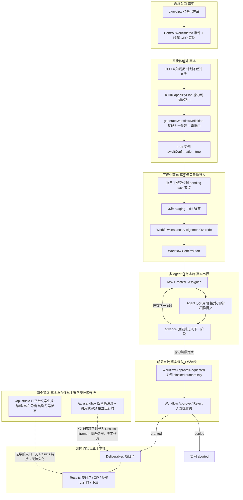

# MAOEH 工作流产品审计（第一阶段 · 只读）

- 审计时间：2026-11-14 21:22–21:45（Asia/Shanghai）
- 代码基线：分支 `checkpoint/2026-11-14-night`，HEAD `5ae0235`（tag `checkpoint-2026-11-14-night`）；工作区含 28 项未提交改动（本文档新增前），本审计按**工作区当前源码**判定
- 运行基线：API `http://localhost:3001`（`mode=live, provider=deepseek, model=deepseek-flash`）、控制台 `http://localhost:5173` 均在运行
- 审计方式：读源码 + 读运行中的**只读 GET** 接口 + 读既有测试文件；**未修改任何代码、未改数据库、未 POST 任何命令、未启动任何会话或 tick**
- 判定口径：
  - **已实现**：有真实生产执行路径，且能在事件日志/接口里读到结果
  - **部分实现**：有真实代码，但缺一个必要环节（入口、消费方、持久化或语义保证）
  - **未实现**：没有生产代码路径，或只有演示外壳
- 证据等级：**[E1]** 源码可复核；**[E2]** 运行中只读接口/进程；**[E3]** 既有测试文件（本轮未执行）；**[I]** 由源码路径推演、未实跑（会明确标注）

> 本文不把静态画布当可执行工作流，不把沙盘会话当方案生成，不声称任何真实平台发布能力。

---

## 0. 结论速览（六问六答）

| # | 问题 | 结论 | 状态 |
|---|---|---|---|
| 1 | 七个模块能否支撑「需求沙盘 → 编排 → 画布 → 确认 → 实施 → 审批 → 推广 → 发布」 | 主链路**只有中段是真实闭环**：任务书 → 能力编排 → 画布改派/确认 → 串行任务实施 → 工作流审批门 → 交付页。**沙盘与 Studio 是两个孤岛**，与主链路无数据连接；Communications 无时间线；交付止于本地预览/下载 | 部分实现 |
| 2 | Workflow 是否已有真实节点、依赖、状态、暂停恢复、失败处理 | 节点/转换/状态/审批/失败分支/恢复**都有真实实现**；暂停/恢复**后端有、UI 无**，且暂停期间完成事件会被丢弃（见 §5.2）；推进失败只计聚合数、无事实事件 | 部分实现 |
| 3 | 是否已有可复用画布；拖动/改依赖/改 Agent 能否改后端执行计划 | 有可复用画布（`WorkflowCanvas` + `assignment-canvas`），但节点位置与连线是**前端投影**：不能拖节点、不能改依赖或增删节点；**只有「Agent 分配」真正改后端执行计划**（未进入步骤的 per-instance override） | 部分实现 |
| 4 | 沙盘生成的方案能否转成真实可执行任务/工作流 | **不能**。沙盘是独立运行时里的消息会话 + 引用式评分，不产出任务书、能力计划、任务或工作流；也没有转换接口 | 未实现（转换环节） |
| 5 | 任务完成能否进入统一审批，再传给 Studio | 审批**只有工作流审批门一条真实路径**（生成式交付门 `humanOnly`；模板门可由持有角色/权威的 Agent 决策）；任务级 review 有 domain 能力但**无生产调用方**；结果页只能跳转审批；Studio 与 Results/Deliverables **零连接** | 部分实现 |
| 6 | Studio 的多平台生成/编辑/审核/导出与真实发布的差距 | 生成是真的（每平台一次 LLM 调用），但**无持久化、无事件、无图片/音视频、无平台凭据与接口、无排期/合规/回传**；审核只是浏览器内存里的一个布尔值；导出只有 JSON/Markdown | 部分实现 |

一句话：**MAOEH 已经有一条可审计的「任务书 → 能力工作流 → 人类确认 → 串行执行 → 人类审批 → 交付」主干，但还不是「多 Agent 协同工作流可视化系统」——缺的是「沙盘进主干」「画布改计划」「成果进 Studio」「真实发布」四个连接件。**

---

## 1. 审计方法与边界

### 1.1 看过的真实源码

| 层 | 位置 |
|---|---|
| 工作流引擎 | `packages/workflow-engine/src/`（types / engine / fold / generation / transition / verification / validation / stores） |
| 任务系统 | `packages/task-system/src/`（types / service / fold / store） |
| 控制面 | `packages/organization-control/src/`（types / service / query / events / authorization） |
| 内核 | `apps/kernel/src/`（simulation / run-tick / plan-executor / control plane） |
| HTTP 与组合根 | `apps/api/src/`（api-adapter / composition / sandbox-session / content-studio / preview-runtime） |
| 控制台 | `apps/web/src/`（App / commands / assignment-canvas / pages / 各页 projection） |
| 模板 | `workflows/*/workflow.yaml` |

### 1.2 运行中的只读读数（2026-11-14 21:2x）

| 读数 | 值 |
|---|---|
| `GET /api/workflows` | 15 个实例，全部 `completed`，均带审批门（`approval.status=granted`）；生成式实例 2–6 步 |
| `GET /api/tasks` | 38 个任务：32 completed / 6 cancelled |
| `GET /api/work-briefs` | 18 份任务书；例如 `brief-3` 有 4 个 items（全部 completed） |
| `GET /api/approvals` | `{"pending":[]}`（控制面升级待办为空） |
| `GET /api/sandbox/sessions` | 2 个沙盘会话，各 4 条发言，评分 78 / 80 |
| `GET /api/llm` | `callCount=0, provider=deepseek, mode=live, model=deepseek-flash` |

证据性质：**[E2]**。这些读数只用于确认「结构存在、链路曾被真实跑通」，不代表本轮重新验收。

### 1.3 明确没做的事

- 没有 POST `/api/command`、没有 tick、没有开沙盘会话、没有触发内容生成；
- 没有修改任何源码、测试、数据库或事件日志；
- 没有执行 `pnpm test`（避免与运行中的演示公司争抢资源，也避免任何写操作）；既有测试只作为**覆盖面证据 [E3]** 引用。

### 1.4 已发现的文档漂移（不影响运行，但会误导后续开发）

| 文档说法 | 实际 |
|---|---|
| `docs/architecture/M1.8-assignment-override-canvas.md:71` 称新增 `GET /api/workflows/:instanceId/canvas` | **没有这个端点**。画布读的是 `GET /api/workflows`（返回全部实例的完整 `WorkflowView`，含 `steps`）〔`apps/api/src/api-adapter.ts:385`〕 |
| 同文件 §6 称确认弹窗逐条展示硬校验并禁用按钮 | 弹窗只显示 SoD 提示；硬校验由内核拒绝后回显〔`apps/web/src/pages/WorkflowCanvas.tsx:1097-1137`，`packages/workflow-engine/src/workflow-engine.ts:2203-2351`〕 |
| `docs/competition/FINAL_STATUS.md` 称「协作剧场缺时间线」 | 属实，且现在仍然缺 |

---

## 2. 当前真实产品流程图（as-is）

### 2.1 主链路（真实闭环）



### 2.2 逐步证据（流程图对应代码）

| 步骤 | 真实实现 | 证据 |
|---|---|---|
| 任务书 → 唤醒 CEO | `Work.SubmitBrief` 落 `Control.WorkBriefed` 并 `wakeAgent` | `packages/organization-control/src/service.ts:762-797` **[E1]** |
| CEO 生成能力计划 → 启动工作流 | plan executor 的 `workflow.start`，能力路径 + `awaitConfirmation` | `apps/kernel/src/simulation/plan-executor.ts:440-470` **[E1]** |
| 能力 → 岗位 → 定义 | `buildCapabilityPlan` / `generateWorkflowDefinition`（阶段线性 + 审批门） | `packages/workflow-engine/src/workflow-generation.ts:232-298` **[E1]** |
| 草案等待确认 | `beginInstance` 只写 `InstanceStarted`（带 `draft` 标记），不进入入口阶段 | `packages/workflow-engine/src/workflow-engine.ts:844-870` **[E1]** |
| 画布改派 → 确认 | `Workflow.InstanceAssignmentOverride` → `Workflow.ConfirmStart` | `apps/web/src/pages/WorkflowCanvas.tsx:496-549`；`packages/workflow-engine/src/workflow-engine.ts:2203-2380, 2388-2464` **[E1]** |
| 任务创建/指派 | `enterStep` 调 `TaskService.create` + `assign`；override 优先 | `packages/workflow-engine/src/workflow-engine.ts:529-608` **[E1]** |
| 执行 → 推进 | 任务事件 → `workflow.advance`；验证通过走 completed 转换 | `apps/kernel/src/simulation/run-tick.ts:367-390`；`packages/workflow-engine/src/workflow-engine.ts:1036-1124` **[E1]** |
| 审批门 | `ApprovalRequested` → `blocked`；人类 `humanOnly` 校验 | `packages/workflow-engine/src/workflow-engine.ts:630-651, 1554-1563` **[E1]** |
| 交付页 | 交付包 / ZIP / 预览运行时 / 旅程 | `apps/web/src/components/DeliveryPackage.tsx`；`apps/api/src/preview-runtime.ts:1-30` **[E1]** |
| 沙盘孤岛 | 独立组合运行时 + 独立日志 | `apps/api/src/composition.ts:547-577`；`apps/api/src/sandbox-session.ts:27-32` **[E1]** |
| Studio 孤岛 | API 自带页面 + 浏览器内状态 | `apps/api/src/content-studio-page.ts:105-273`；`apps/web/src/App.tsx:46-52`（无 Studio 导航） **[E1]** |

### 2.3 真实断点（图上用虚线表示的四处）

1. **沙盘 → 任务书/工作流**：`SandboxService` 只有 `start/list/get`，不写任务、不写工作流、不产出结构化方案〔`apps/api/src/sandbox-session.ts:115-119`〕。
2. **结果页 → 审批**：Results 只给「去 Approvals」按钮，审批上下文（交付物）被留在另一个页面〔`apps/web/src/pages/Results.tsx:771-775`〕。
3. **审批完成 → Studio**：没有任何链接、参数或事件把交付物交给内容工坊。
4. **Studio → 发布**：没有发布接口，也没有平台适配器。

---

## 3. 目标产品流程图（to-be）

```mermaid
flowchart LR
  subgraph S1 [1 需求沙盘]
    N1["议题 + 约束 + 角色 提案/质询/答辩/评审"]
    N1b["方案 v1 结构化：范围/验收/风险"]
  end

  subgraph S2 [2 智能体编排]
    N2["能力分解 + 岗位路由 复用 CEO 计划与 capability plan"]
    N2b["执行计划 v1 阶段/步骤/依赖/审批门"]
  end

  subgraph S3 [3 可视化画布调整]
    N3["节点/依赖/Agent 分配可编辑 改的是执行计划不是像素"]
  end

  subgraph S4 [4 用户确认]
    N4["版本化计划 + diff + 硬校验 确认后冻结版本"]
  end

  subgraph S5 [5 多 Agent 任务实施]
    N5["并行/串行 + 状态/暂停/失败恢复 每个动作是事件"]
  end

  subgraph S6 [6 成果审批]
    N6["交付物 + 证据 + 审批记录 人类最终闸门"]
  end

  subgraph S7 [7 一鱼多吃推广]
    N7["源素材 到 多平台内容 生成/编辑/审核/版本"]
  end

  subgraph S8 [8 发布与交付]
    N8["平台适配器 / 导出包 / 回执 未接通就不假装"]
  end

  N1 --> N1b --> N2 --> N2b --> N3 --> N4 --> N5 --> N6 --> N7 --> N8
```



### 3.1 目标阶段 ↔ 现状对照

| 目标阶段 | 现状 | 差距性质 | 改造类型 |
|---|---|---|---|
| 1 需求沙盘 | 真实对抗质询，但只是「会话 + 评分」 | 缺方案产物、缺下游 | 新增转换（纯增量） |
| 2 智能体编排 | 真实（能力计划 → 定义 → draft） | 基本够用 | 复用 |
| 3 画布调整 | 只能改「谁来执行 pending 步骤」 | 不能改依赖/顺序/增删节点 | 部分新增（定义版本 + 命令） |
| 4 用户确认 | 真实（ConfirmStart + override） | 缺硬校验展示、缺版本冻结语义 | 小改 |
| 5 多 Agent 实施 | 真实但**严格串行**；暂停不安全 | 无并行 fan-out/join；暂停会丢完成事件 | 中改（引擎原语 + 对账） |
| 6 成果审批 | 工作流审批门真实（生成式门 `humanOnly`） | 审批与交付物不在同一屏；任务级 review 无调用方 | 小改（UI）+ 中改（review 消费方） |
| 7 一鱼多吃 | 生成真实；审核是客户端布尔值 | 无入口、无持久化、无版本 | 增量 + 领域设计 |
| 8 发布与交付 | 本地预览/下载真实；发布**不存在** | 无平台适配器/凭据/合规 | 不造（先定义边界） |

---

## 4. 七个模块逐项审计

### 4.1 Cyber Sandbox（赛博沙盘）

**已实现**

- 四个角色按真实岗位能力选座（提案/质询/答辩/评审），姓名、岗位、职责来自真实组织〔`apps/api/src/sandbox-session.ts:213-249`〕。
- 每条发言经 `CommunicationService` 授权、成员校验，写真实 `Communication.MessageSent` 并投递〔`:465-518`〕。
- 评审返回 JSON，每个维度带 `messageId`，解析器校验该 id 必须存在于本次会话，否则标 null〔`:384-411`〕。
- 会话跑在独立组合运行时 + 独立事件日志，不写演示公司日志〔`apps/api/src/composition.ts:547-577`〕。
- 会话索引 + 事件重建，可回看：`GET /api/sandbox/sessions[/:id]`〔`apps/api/src/api-adapter.ts:250-266`〕。

**部分实现 / 未实现**

| 缺口 | 证据 | 影响 |
|---|---|---|
| 不产出结构化方案（无范围/验收/风险/能力需求字段） | `SandboxSession` 只有 `topic/rounds/roles/turns/scores`〔`:65-80`〕 | 无法进入编排 |
| 不创建任务/工作流/任务书 | 服务只有 `start/list/get`〔`:115-119`〕 | 流程断在第一步 |
| 评分解析失败只返回 null，无重试 | `parseScores` 失败 → `scores: null`〔`:550-593`〕 | 低质量会话无显式失败记录 |
| 无并发队列；失败尝试会留下空频道 | 与 `FINAL_STATUS.md §6` 一致 | 运营体验 |
| 与 Results 的关系是**标题正则**，不是领域关联 | `apps/web/src/sandbox.ts:16-23`；`apps/web/src/pages/Results.tsx:501` | 换个标题就丢入口 |

### 4.2 Agent（组织中的 AI 员工）

**已实现**

- 身份、岗位、职责、能力、认知画像、权限、记忆策略是实体，不是提示词〔`packages/agent-definition`、`apps/kernel/src/simulation/simulation.ts:744-800`〕。
- 认知周期：唤醒 → 上下文 → 决策 → 计划（≤8 步）→ 执行 → 领域事件 → 状态回写；每个周期有 `Runtime.CycleStarted/Finished` 与 `correlationId/causationId`。
- 授权是 `action × resource × 权威等级` 的真实判定，拒绝写日志〔`packages/permission-system/src/authz-service.ts`、`packages/authority-engine`〕。
- 协作请求与消息是真实事件，收件人会被唤醒〔`packages/agent-communication`〕。

**部分实现**

- 认知画像同构（文档自述 7 个 Agent 均为 `exec-strategic`），"多角色"差异主要来自岗位与权限，不是推理风格。
- **同一任务只由单一 assignee 执行**；"多 Agent 协作"目前是消息协作（请求/回复/采纳），不是任务共执行或计划共编。

### 4.3 Task

**已实现**

- 9 状态机 + 每状态合法命令表〔`packages/task-system/src/task-types.ts:10-63`〕。
- 指派（员工/岗位；控制面另支持按能力匹配）、重派、取消、删除、阻塞/解阻、汇报/提交/完成/拒绝。
- 结果契约 `TaskResult{summary,data,artifacts}`、确定性/评审两类验证〔`:85-160`〕。
- 任务与工作流步骤双向关联：`workflowInstanceId/workflowStepId`。

**部分实现 / 未实现**

| 缺口 | 证据 | 影响 |
|---|---|---|
| 任务级 review 有 domain 能力，但**没有生产调用方**；控制面 `Task.RequestReview` 只发 `Control.TaskReviewRequested`，不执行 review，也不产生评审结论 | `TaskService.review` 只在测试里被调用〔`packages/task-system/src/task-service.ts:1214`〕；命令只 emit〔`packages/organization-control/src/service.ts:1229-1241`〕；真正执行 review 还要求 `verification.kind === 'review'`〔`task-service.ts:1216-1222`〕，而生成式步骤 `verification: null` | 「成果审批」名义上有两条路，实际只有工作流审批门一条；按钮看似成功，任务 `reviews` 仍为空 |
| 任务之间没有依赖图 | `Task` 无 `dependsOn`；顺序只存在于工作流转换 | 跨工作流编排靠人 |
| 无并行执行语义 | 一个任务一个 assignee | 多 Agent 并行实施不支持 |

### 4.4 Workflow

**已实现**

- 定义：`WorkflowDefinition{stages, steps, transitions, entry/terminal, cyclePolicy}`；步骤类型 `task/approval/review/meeting/automated`〔`packages/workflow-engine/src/workflow-types.ts:24-130`〕。
- 依赖：显式 `transitions`（`always` / `task_status(completed|rejected|failed)` / `approval_decision`），目标可为 step/stage/complete/fail；`cyclePolicy` 控制是否允许环（模板 `product-development` 用 `allow` 支持评审驳回回环）〔`:93-118`〕。
- 状态：实例 `running|blocked|completed|aborted`；步骤 `pending|active|done|rejected|skipped`；审批 `open|granted|denied`；`activeStepIds` 与 `stepStates` 由事件折叠〔`:11-38, 132-185`；`workflow-fold.ts:112-184`〕。
- 审批：`single|quorum|all`；权限 + 权威 + 角色；生成式交付门 `humanOnly`〔`workflow-generation.ts:205-220`；`workflow-engine.ts:1554-1563`〕。
- 失败：拒绝转换 / 自动重派（`attempt <= maxAttempts`）/ 中止；任务 failed/cancelled 均落到 abort〔`workflow-engine.ts:1133-1263`〕。
- 改派：per-instance、批量原子、只允许未进入的 task step；override 在 `enterStep` 消费〔`:2203-2380, 529-608`〕。
- 草案：`awaitConfirmation` + `confirm()`〔`:844-870, 2388-2464`〕。
- 恢复：重启从 `Workflow.*` 事件重放实例，并从 `context.capabilityPlan` 重建生成式定义〔`apps/kernel/src/simulation/simulation.ts:1018-1033`〕。

**部分实现 / 未实现**

| 缺口 | 证据 | 影响 |
|---|---|---|
| **暂停语义不安全**：暂停只阻止推进，不暂停任务；暂停期间任务完成事件被 reactor 丢弃，resume 不会补推进 | `wait` 只发 `InstanceBlocked`〔`workflow-engine.ts:1936-2016`〕；`advance` 在 blocked 时返回 `instance_blocked`〔`:1324-1333`〕；reactor 失败只计数、不重试〔`run-tick.ts:380-389`〕 | 恢复后实例可能永远停在 active 步骤（该步任务已 completed）〔I，见 §5.2 推演〕 |
| 暂停在 UI 和读模型里不可见 | 控制面有 `Workflow.Pause/Resume`〔`types.ts:53-58`；`service.ts:817-845`〕，但前端**没有命令构造器**；`paused` 字段由恒为空的 `pausedWorkflowIds` 计算〔`service.ts:143`；`query.ts:496`〕 | 运维无法从界面暂停单个工作流 |
| 无并行分支（fan-out/join） | `followTarget` 一次只进入一个步骤（stage 取 `steps[0]`）〔`workflow-engine.ts:723-745`〕；生成器每阶段一步 | 「多 Agent 协同」在引擎层面仍是串行交接 |
| 推进失败无事实事件、无对账 | reactor `failures += 1`，不写 `Workflow.*` 失败事实〔`run-tick.ts:386-389`〕；读模型只有 tick 级 `partial_failure`〔`:1013-1019`〕 | 「为什么停在 active」无法从日志回答 |
| 画布看到的依赖不是定义里的依赖 | 见 §4.8 | 展示与执行不一致 |

### 4.5 Communications

**已实现**

- `Communication.ChannelOpened / MessageSent / CollaborationRequested` 是真实事件；成员校验、授权、投递记录齐全。
- 页面按事件流读消息、频道、协作请求〔`apps/web/src/pages/Communications.tsx`〕。
- 消息可唤醒收件人，并进入同一 `correlationId` 因果链。

**未实现**

- 没有「协作剧场」时间线：不按 `correlationId` 聚合「任务交接 + 关键决策 + 完成」〔`docs/competition/FINAL_STATUS.md §6` 仍列为未实现〕。
- 没有「这个任务经过了谁、交接了几次」的任务视角视图。
- `/api/events` 只支持 `prefix` 与 `limit`，不支持 `correlationId` 过滤〔`apps/api/src/api-adapter.ts:391`〕。

### 4.6 Results（交付中心）

**已实现**

- 七块信息：谁交付、发生了什么、产物、整包产品、角色、旅程、下一步〔`apps/web/src/pages/Results.tsx:35-50`〕。
- 交付包：每步文件、ZIP 下载、游戏/文档/3D 槽位〔`components/DeliveryPackage.tsx`；`zip.ts`〕。
- 真实预览运行时：复制到隔离目录、起子进程、动态端口、真 URL〔`apps/api/src/preview-runtime.ts:1-30`〕。
- 角色贡献与旅程来自事件/任务记录，不编造〔`results.ts`〕。

**部分实现**

| 缺口 | 证据 |
|---|---|
| 审批必须跳转，成果与决策不在同一屏 | `Results.tsx:771-775`（阻塞任务去审批）、`Results.tsx:791`（开门时去审批） |
| 没有「提交验收/请求修改」动作；任务级 review 只发请求事件、不产生结论 | 见 §4.3 |
| 没有到 Studio 的交接 | 前端无 `/api/studio` 链接；`/api/content/generate` 只在 API 侧与验证脚本里出现 |
| 「发布」不存在，只有本地预览与下载 | `Results.tsx` 交付动作：查看代码/演示/下载 |

### 4.7 Studio（一鱼多吃内容工坊）

**已实现**

- 四平台各自一份格式契约 + 一次真实调用；响应带 `provenance/provider/model/calls`〔`apps/api/src/content-studio.ts:25-69, 158-215`〕。
- 页面显示 `LLM · provider/model · N 次调用`，mock 标 `模板`〔`content-studio-page.ts:116-126`〕。
- 编辑（textarea）、审核（客户端布尔）、导出 JSON/Markdown〔`apps/api/src/content-studio-page.ts:159-268`〕。

**未实现**

| 缺口 | 证据 | 影响 |
|---|---|---|
| 无持久化：刷新即丢，无事件、无审计 | `state` 只在页面闭包里〔`apps/api/src/content-studio-page.ts:107`〕；服务层 `generate` 不写事件〔`apps/api/src/content-studio.ts:19-23`〕 | 「审核」不是事实 |
| 无控制台入口 | `App.tsx:46-52` 无 Studio；Results/Deliverables 无链接；只有验证脚本直接访问 | 产品里到不了 |
| 无图片/音频/视频 | 只有文本 provider | 与 FINAL_STATUS 一致 |
| 无平台发布能力 | 无 OAuth/凭据/发布 API/合规检查/回传 | 不能声称已发布 |
| 审核/导出与工作流审批无关系 | 客户端布尔 + `download()` | 无法作为交付验收材料 |

> 注意：仓库里还能搜到「发布」字样，但那属于**被交付的样例页面**——`apps/api/src/scaffold-deliverables.ts:11-19` 生成的内容看板在浏览器内模拟「审核 → 发布」，没有网络、没有平台、没有回执。它是"交付物长什么样"的占位，不是 MAOEH 的发布能力，不能在评审材料里混用。

### 4.8 编排画布（WorkflowCanvas）

**可复用资产**

- `assignment-canvas.ts`：解析 `/api/workflows` → 实例/步骤/审批；按阶段分组、固定布局、SVG 路径、色调、可编辑判定。
- `WorkflowCanvas.tsx`：左侧花名册（员工 + 空位，按部门分组）、中间可平移/缩放画布、右侧检查器、拖放 → 审批门 → staging → diff 弹窗 → 提交；SoD 提示；草案确认；工作流审批门。
- `canvas.css` / `roles.css`：成套深色视觉，可直接复用。

**它真正能改什么**

| 操作 | 是否改后端执行计划 | 证据 |
|---|---|---|
| 把员工拖到 `pending` 的 task 步骤 | **是**：`Workflow.InstanceAssignmentOverride` → 下次 `enterStep` 用该员工 | `WorkflowCanvas.tsx:496-526`；`workflow-engine.ts:2203-2380` |
| 拖空位（vacant seat） | 不直接改：要求先选一个真实员工再 staging | `WorkflowCanvas.tsx:914-948` |
| 确认草案 | **是**：进入入口阶段，开始执行 | `workflow-engine.ts:2388-2464` |
| 点击节点/平移/缩放 | 否：纯选择与视图 | `WorkflowCanvas.tsx:460-494` |
| 拖动节点位置 | **不存在**：位置由数组下标计算 | `assignment-canvas.ts:457-473` |
| 改依赖/连线/顺序/增删节点 | **不存在**：没有命令、没有定义编辑接口 | `CONTROL_COMMAND_TYPES` 无相关命令〔`organization-control/src/types.ts:40-69`〕 |
| 暂停/取消工作流 | UI 不提供（后端有命令） | `apps/web/src/commands.ts` 无 `Workflow.Pause/Resume/Cancel` |

**关键失真**：画布的边不是定义里的 `transitions`，而是「相邻步骤一条线」〔`assignment-canvas.ts:475-490`〕。因此：

- 模板 `product-development` 的「技术评审拒绝 → 回到技术设计」回环〔`workflows/product-development/workflow.yaml:88-95`〕在画布上**看不到**；
- 任何分支/失败路径都被画成直线；
- 生成式工作流是线性的，画布碰巧"看起来对"，但这是巧合，不是投影正确。

> 文档本身已在 `docs/architecture/M2.2-project-workspace-navigation.md:145` 把「definition exposes transitions → real DAG editor」列为**未来触发条件**，与本审计一致：现在不是 DAG 编辑器。

---

## 5. 六个重点检查项（详细回答）

### 5.1 七个模块对目标流程的支撑矩阵

| 目标阶段 | Cyber Sandbox | Agent | Task | Workflow | Communications | Results | Studio | 画布 |
|---|---|---|---|---|---|---|---|---|
| 需求沙盘 | ✅ 会话真实 | ✅ 角色真实 | — | — | ✅ 发言是事件 | ⚠️ 仅 iframe 嵌入 | — | — |
| 智能体编排 | — | ✅ CEO 计划 | — | ✅ 能力→定义 | — | — | — | ✅ 草案可见 |
| 画布调整 | — | ✅ 花名册 | — | ✅ 改派/确认 | — | — | — | ⚠️ 仅改派 |
| 用户确认 | — | — | — | ✅ ConfirmStart | — | — | — | ✅ diff 弹窗 |
| 任务实施 | — | ✅ 串行 | ✅ 状态机 | ✅ 推进 | ✅ 消息 | — | — | ⚠️ 只读进度 |
| 成果审批 | — | — | ⚠️ review 无调用方 | ✅ 审批门 | — | ⚠️ 需跳转 | — | ✅ 门也在画布 |
| 一鱼多吃 | — | — | — | — | — | ❌ 无交接 | ⚠️ 能生成不能持久 | — |
| 发布交付 | — | — | — | — | — | ⚠️ 本地预览/下载 | ❌ 无发布 | — |

### 5.2 Workflow 的节点、依赖、状态、暂停恢复、失败处理

- **真实节点**：有。`.task/.approval/.review/.meeting/.automated` 五类步骤，带验收契约（`acceptanceCriteria/requiredArtifacts/verification/maxAttempts`）〔`workflow-types.ts:59-91`〕。
- **真实依赖**：有。`transitions` 是真值来源，引擎按它选下一跳；模板里有分支与回环〔`workflow-engine.ts:672-685, 1062-1113`〕。**但画布不读它**（§4.8）。
- **真实执行状态**：有。步骤状态 + 实例状态 + 审批状态 + `activeStepIds` 全部由事件折叠，可回放〔`workflow-fold.ts:316-397`〕。
- **暂停/恢复**：
  - 后端：`wait()` 发 `Workflow.InstanceBlocked(kind=manual)`；`resume()` 发 `Workflow.InstanceResumed`；均有权限校验（`RequestDeviation` / `ApproveStep`）〔`workflow-engine.ts:1936-2103`〕。
  - 控制面：`Workflow.Pause/Resume` 已实现并有单测〔`service.ts:817-845`；`tests/unit/organization-control/intervention.test.ts:273-301`〕。
  - UI：**没有**。
  - 读模型：`paused` 恒为 false〔`query.ts:496` + `service.ts:143`〕。
  - **语义缺陷（推演，未实跑）**：暂停期间任务照常执行；任务完成事件到达 reactor 时，`advance` 因 `instance_blocked` 拒绝，reactor 只 `failures += 1`，不重试、不落事实；`resume` 只改状态，不补推进。结果：实例 `running`，活动步骤 `active`，其任务已 `completed`，**永久卡住**〔I〕。
  - 即使没有暂停，「推进失败」也没有对账机制（同一 reactor 路径）〔I〕。
- **失败处理**：
  - 有：`rejected` 分支 / 自动重派（≤ `maxAttempts`）/ `fail` 目标 / 任务 cancelled → abort / 删除级联 / 预算上限。
  - 缺：推进失败事实、重试队列、死信、人工「重放该事件」入口。

### 5.3 画布可复用性与「改后端计划」的真实边界

- **可复用**：布局/解析/拖放/审批门/staging/diff/SoD/审批决策/多语言/深色样式，全部可复用（见 §6）。
- **能改计划**：只有「未进入步骤的执行人」与「草案确认」。这两件事确实是后端的真实语义（事件 + 引擎消费）。
- **不能改计划**：节点顺序、依赖、增删节点、审批人（审批人由 `requiredRoles` 与权威决定，不可改派）、已进入步骤。
- 结论：**当前画布是「执行计划的人选视图 + 草案确认器」，不是「执行计划编辑器」**。要做成后者，需要新的领域命令与事件（§9.3 B1）。

### 5.4 需求沙盘 → 真实任务/工作流

- 沙盘会话对象里没有：能力列表、阶段、验收键、任务书、工作流实例 ID。
- 沙盘运行在**独立运行时**，其任务/工作流/事件都不会进入主公司〔`composition.ts:554-577`〕。
- 唯一"连接"是 Results 页按标题正则显示 iframe〔`sandbox.ts:16`〕。
- 因此：**未实现**。最小可行连接见 §9.2 A1（会话 → 任务书 → 走现有主编排链路），而不是重写沙盘。

### 5.5 任务完成 → 统一审批 → Studio

- **任务完成**：`Task.Completed`；若属于工作流，reactor 调 `advance`；若不属于，独立结算（`verification` 过即完成）。
- **统一审批**：
  - 真实路径 1：工作流审批门（`Workflow.ApprovalRequested` → `Workflow.Approve/Reject`），生成式交付 `humanOnly`。
  - 真实路径 2（仅记录请求）：`Task.RequestReview` → `Control.TaskReviewRequested`，**没有 review 执行者**。
  - 页面：Approvals 把「工作流门」和「控制面升级待办」放在同一页，但它们是两种记录，不是统一模型〔`apps/web/src/pages/Approvals.tsx:23-31, 86-88`〕。
- **传给 Studio**：**没有**。无链接、无参数、无事件、无持久化。Studio 也不是控制台页面。

结论：**部分实现**（审批有，统一与交接都没有）。

### 5.6 Studio 与真实平台发布的差距

| 真实发布需要 | 现状 | 差距 |
|---|---|---|
| 账号授权（OAuth/Token） | 无 | 全缺 |
| 平台发布 API / 开放平台接入 | 无 | 全缺 |
| 媒体资产（图/音/视频） | 只有文本 | 全缺 |
| 平台规范校验（尺寸/时长/敏感词/标题长度） | 只有生成提示词里的软约束 | 无硬校验 |
| 排期/定时发布 | 无 | 全缺 |
| 审核留痕（谁批的、批的哪一版） | 浏览器布尔值 | 无事实、无版本 |
| 发布回执/链接/数据回收 | 无 | 全缺 |
| 失败与重试/撤回 | 无 | 全缺 |

结论：**Studio 是「生成 + 本地导出」工具，不是发布系统**。任何「已发布」文案都不成立。

---

## 6. 现有功能复用清单（不要重复造）

| 能力 | 现有实现 | 复用方式 | 不要做的事 |
|---|---|---|---|
| 需求进入组织 | `Work.SubmitBrief` + `Control.WorkBriefed` + 唤醒 | 沙盘转任务书直接复用它 | 不要新造「需求单」实体 |
| 能力分解 + 岗位路由 | `buildCapabilityPlan` / `resolveCapabilityAssignments` | 编排阶段原样复用 | 不要在 UI 里重算路由 |
| 工作流定义/执行 | `workflow-engine`（转换、审批、失败、重试、恢复） | 所有流程都走它 | 不要为画布新写执行器 |
| 草案确认 | `awaitConfirmation` + `Workflow.ConfirmStart` | 用户确认阶段原样复用 | 不要另做「发布计划」状态机 |
| 改派 | `Workflow.InstanceAssignmentOverride`（原子、审计、事件） | 画布「改 Agent」原样复用 | 不要直接改定义或任务表 |
| 审批 | 工作流审批门（`humanOnly`、quorum、权威/角色） | 成果审批原样复用 | 不要新造第二套审批表 |
| 任务状态机 | `TaskService` + `ALLOWED_TASK_COMMANDS` | 任务实施/重派（评审需先补消费方） | 不要在 UI 里硬编码状态 |
| 读模型 | `ControlQuery.getWorkflow(s)`（steps/draft/overrides/approval） | 画布/审批/交付都读它 | 不要为页面另开投影表 |
| 事件审计 | `Control.*` + `Workflow.*` + audit trail | 每个新动作都发命令/事件 | 不要只写数据库 |
| 交付包 | `DeliveryPackage` + `zip.ts` | 交付/交付验收材料 | 不要重做打包 |
| 预览运行时 | `preview-runtime` + `preview-plan` | 「能跑」的交付证明 | 不要用截图冒充 |
| 沙盘会话 | `SandboxService`（真实消息 + 评分） | 作为「需求沙盘」前端/评审引擎 | 不要重写一份多角色会话 |
| 内容生成 | `content-studio` + LLM gateway（provenance/计数） | 推广阶段原样复用 | 不要在前端拼模板冒充生成 |
| 画布视觉/交互 | `assignment-canvas` + `canvas.css` | 所有图编辑复用 | 不要另起一套 DnD |
| 审批页 | `Approvals`（门 + 升级 + 历史） | 统一收件箱的基础 | 不要重建页面 |
| i18n / 反馈 / 轮询 | `i18n`、`control.setFeedback`、2.5s 轮询 | 新入口必须接入 | 不要写死中文或新开轮询 |

---

## 7. 缺失能力与优先级

> 优先级定义：**P0** = 不做则目标流程不成立；**P1** = 做了才配叫「可视化协同工作流」；**P2** = 体验/规模；**P3** = 需要外部条件，明确不造。

| ID | 缺失能力 | 现状 | 影响 | 优先级 | 依赖 |
|---|---|---|---|---|---|
| G1 | 沙盘会话 → 任务书 | 无 | 流程第一步断 | **P0** | G0（方案字段） |
| G0 | 沙盘产出结构化方案（范围/验收/风险/能力建议） | 只有评分 | G1 无输入 | **P0** | 无 |
| G2 | 结果页就地审批（成果 + 决策同屏） | 需跳转 | 审批与交付脱节 | **P0** | 无（复用命令） |
| G3 | 画布显示真实转换（分支/回环） | 相邻连线 | 展示与执行不一致 | **P0** | 读模型加字段 |
| G4 | 暂停在 UI/读模型可见 | 恒 false / 无按钮 | 运维不可见 | **P0** | 读模型修正 |
| G5 | 暂停/恢复语义安全（完成事件对账） | 可能永久卡住 | 数据正确性 | **P1** | G4 |
| G6 | 画布改依赖/顺序/增删节点（真改执行计划） | 不存在 | 不是「可调整画布」 | **P1** | 新命令+事件+定义版本 |
| G7 | Studio 入口 + 交付物预填 | 无 | 推广阶段断 | **P1** | 无 |
| G8 | Studio 资产持久化 + 审核留痕 | 浏览器内存 | 不可审计 | **P1** | 领域设计（新聚合或文档） |
| G9 | 统一审批收件箱（工作流门/任务 review/升级） | 两种记录同页不同模型 | 「统一」名不副实 | **P1** | G2、任务 review 消费方 |
| G10 | 并行 fan-out/join（多 Agent 同时实施） | 串行 | 「协同」弱 | **P2** | 引擎新原语 + 画布 |
| G11 | 协作剧场时间线 | 无 | 过程不可讲 | **P2** | `/api/events` 过滤 |
| G12 | 沙盘并发队列/失败记录/重试 | 无 | 稳定性 | **P2** | 无 |
| G13 | 图片/音视频生成 | 无 | 内容形态 | **P2** | 多模态 provider |
| G14 | 真实平台发布 | 无 | 最后一步 | **P3** | 平台资质/凭据/合规 |
| G15 | 发布数据回收 | 无 | 运营闭环 | **P3** | G14 |

**不放进 P0/P1 的理由**：G6 会改「执行计划」这一核心契约，必须先定版本与审计语义，不能在画布上做一个只改像素的假编辑器；G14 在没有真实平台接入前做按钮就是虚构能力。

---

## 8. 前后端关键文件、API、数据结构

### 8.1 前端

| 文件 | 职责 | 与本流程的关系 |
|---|---|---|
| `apps/web/src/App.tsx` | 导航、页面路由、轮询、控制面 | 无 Studio 入口；`Canvas` 在「工作」组〔`:46-52`〕 |
| `apps/web/src/commands.ts` | 所有控制命令的构造 | 有改派/确认/审批/删除；**无** `Workflow.Pause/Resume/Cancel` |
| `apps/web/src/control.ts` | 命令执行、反馈、hold | 审批后 `releaseHold` |
| `apps/web/src/assignment-canvas.ts` | 画布解析/布局/边/色调 | 边=相邻；位置=下标 |
| `apps/web/src/pages/WorkflowCanvas.tsx` | 画布 UI、DnD、审批门、diff | 改派 + 确认的真入口 |
| `apps/web/src/pages/Overview.tsx` | 任务书表单 + 提交结果卡 | 主链路入口 |
| `apps/web/src/pages/Deliverables.tsx` | 项目卡（按工作流聚合） | 交付入口 |
| `apps/web/src/pages/Results.tsx` | 交付中心（包/预览/下载/旅程） | 成果所在页；无就地审批 |
| `apps/web/src/pages/Approvals.tsx` | 工作流门 + 升级 + 历史 | 审批所在页 |
| `apps/web/src/pages/Communications.tsx` | 消息/频道/协作请求表 | 无时间线 |
| `apps/web/src/components/DeliveryPackage.tsx` | 交付包 + ZIP | 交付 |
| `apps/web/src/sandbox.ts` | 标题正则判定沙盘场景 | 伪关联 |
| `apps/web/src/i18n/locales/{zh-CN,en-US}.json` | 文案 | 新入口必须双语 |

### 8.2 后端

| 文件 | 职责 | 关键点 |
|---|---|---|
| `packages/workflow-engine/src/workflow-engine.ts` | 启动/推进/审批/暂停/恢复/改派/确认/门禁 | 所有执行语义的唯一真源 |
| `packages/workflow-engine/src/workflow-generation.ts` | 能力计划 → 定义 | 线性阶段 + 审批门 + 契约 |
| `packages/workflow-engine/src/workflow-fold.ts` | 事件 → 实例 | 状态、审批、override、draft |
| `packages/workflow-engine/src/workflow-types.ts` | 定义/实例/步骤/审批类型 | 数据契约 |
| `packages/task-system/src/task-service.ts` | 任务状态机与评审 | `review` 无生产调用方 |
| `packages/organization-control/src/service.ts` | 命令执行/审计/投影 | 暂停/恢复/请求评审 |
| `packages/organization-control/src/query.ts` | 读模型 | `steps` 投影；`paused` 恒 false |
| `packages/organization-control/src/types.ts` | 命令/视图联合类型 | 命令全集 |
| `apps/kernel/src/simulation/run-tick.ts` | reactor：任务事件 → 推进 | 失败只计数 |
| `apps/kernel/src/simulation/plan-executor.ts` | 计划动作 → 领域操作 | `workflow.start` |
| `apps/api/src/api-adapter.ts` | HTTP 路由 | 见 §8.3 |
| `apps/api/src/composition.ts` | 运行时组装、沙盘隔离、内容服务 | 沙盘独立日志 |
| `apps/api/src/sandbox-session.ts` | 沙盘会话 | 无方案产物 |
| `apps/api/src/content-studio.ts` | 多平台生成 | 无持久化 |
| `apps/api/src/content-studio-page.ts` | Studio 页面 | 浏览器状态 |
| `apps/api/src/preview-runtime.ts` | 交付物真实运行 | 进程/端口/隔离 |

### 8.3 HTTP API（当前真实存在的路由）

| 方法 | 路径 | 用途 | 关键返回 |
|---|---|---|---|
| GET | `/api/snapshot` | 组织快照 | departments/positions/employees/agents/workflows/tasks/events/audits |
| GET | `/api/workflows` | 全部实例（含 `steps`、`draft`、`assignmentOverrides`、`approval`） | `WorkflowView[]` |
| GET | `/api/tasks`、`/api/tasks/:id` | 任务列表/记录（含 result） | `TaskSummary[]` / `TaskView` |
| GET | `/api/work-briefs`、`/api/work-briefs/:id` | 任务书 + items | `{briefs}` / `WorkBriefView` |
| GET | `/api/approvals` | 控制面升级待办（`NEEDS_APPROVAL`） | `{pending}` |
| GET | `/api/events?prefix=&limit=&includeDeleted=` | 事件流 | `EventView[]` |
| GET | `/api/communications?limit=` | `Communication.*` 事件 | `EventView[]` |
| GET | `/api/llm` | 模型模式/计数 | `{mode,provider,model,callCount}` |
| GET | `/api/runtime` | 控制状态 | `ControlState` |
| POST | `/api/command` | 唯一命令入口 | `ControlOutcome` |
| POST | `/api/tick` | 手动推进一拍 | tick 结果 |
| GET | `/api/preview/:taskId` | 预览状态 | `PreviewStatus` |
| POST | `/api/preview/:taskId/start`、`/stop` | 起/停预览 | `PreviewStatus` |
| GET | `/api/studio` | 内容工坊页面 | HTML |
| POST | `/api/content/generate` | 四平台生成 | `ContentStudioResult` |
| GET | `/api/sandbox` | 沙盘页面 | HTML |
| POST | `/api/sandbox/session` | 开一次会话 | `SandboxSession` |
| GET | `/api/sandbox/sessions`、`/api/sandbox/sessions/:id` | 会话列表/回看 | `{sessions}` / `SandboxSession` |
| POST | `/api/translate` | 交付页翻译 | `{text}` |
| POST | `/api/ownership/companies`、`/api/ownership/session` | 公司创建/切换 | 所有权状态 |

**不存在的路由（不要按文档假设）**：`GET /api/workflows/:instanceId/canvas`；任何 `publish` / `studio` 持久化 / `sandbox → brief` 路由。

### 8.4 数据结构（本流程真正用到的）

```ts
// 定义（真源：packages/workflow-engine/src/workflow-types.ts）
WorkflowDefinition { workflowId, version, name, cyclePolicy, entryStageId, terminalStageIds, stages[] }
WorkflowStage { stageId, name, steps[], transitions[] }
WorkflowStep {
  stepId, name, kind: 'task'|'approval'|'review'|'meeting'|'automated',
  assignment: {kind:'employee'|'position'|'capability'|'unassigned'},
  capability?, acceptanceCriteria?, requiredArtifacts?,
  verification: {kind:'deterministic'|'review', requiredOutputKeys[]} | null,
  maxAttempts, requiredAuthority, requiredRoles, approvalPolicy, requiredCount, humanOnly?
}
WorkflowTransition { transitionId, fromStepId, when, to }

// 实例（事件折叠）
WorkflowInstance {
  instanceId, companyId, workflowId, version, title, goal,
  status: 'running'|'blocked'|'completed'|'aborted',
  currentStageId, activeStepIds[], stepStates{stepId: {status, taskId, ...}},
  context{ draft?, assignmentOverrides?, capabilityPlan? }, outputs{},
  correlationId, blockedReason, approval, processedEventIds[]
}

// 画布读模型（query.ts 投影，注意：无 transitions）
WorkflowCanvasStepView {
  stepId, stageId, stageName, name, description, kind, status, taskId,
  assigneeEmployeeId, assigneePositionId, capability, assignment,
  requiredRoles[], requiredAuthority, overridden
}

// 任务
Task { taskId, title, goal, detail, workflowInstanceId, workflowStepId,
  assignment{positionId, assigneeEmployeeId, ...}, status, attempt, maxAttempts,
  verification, result{summary,data,artifacts}, reviews[], capability, ... }

// 内容工坊
ContentStudioResult { provenance:'live'|'mock', provider, model, source, assets[{platform,name,kind,text}], calls }

// 沙盘
SandboxSession { sessionId, channelId, topic, rounds, roles[], turns[{messageId, role, employeeId, body}],
  scores{dimensions[{name,score,evidence,citedMessageId}],total,verdict,rationale} | null,
  provenance, provider, model, startedAt, finishedAt, durationMs }
```

**事件（流程视角）**

```
Control.WorkBriefed              任务书进入组织
Workflow.InstanceStarted         实例创建（draft 时带 draft 标记）
Workflow.StepEntered             步骤激活（创建并指派任务）
Workflow.StepCompleted / Rejected
Workflow.ApprovalRequested / Granted / Denied
Workflow.InstanceBlocked / Resumed
Workflow.InstanceCompleted / Aborted / Deleted
Workflow.DraftConfirmed
Workflow.StepAssignmentOverridden
Task.Created/Assigned/Accepted/Started/ProgressReported/Completed/Rejected/Failed/Cancelled
Communication.ChannelOpened / MessageSent / CollaborationRequested
```

---

## 9. 最小改造方案

### 9.1 原则

1. **只加连接件，不重写引擎**：workspace 里稳定的包（workflow/task/control）保持契约不变，新增字段必须可选、向后兼容。
2. **每个新动作必须是命令 + 事件**，不直接改表、不写前端状态充当事实。
3. **画布只承诺它能改的东西**：能改执行人的地方标注「改派」，不能改的地方不要做拖拽假象。
4. **不虚构发布**：先定义适配器边界，没有真实平台就不加「发布」按钮。
5. **先补事实，再补 UI**：读模型不真实（paused、transitions、审批上下文），页面做得再漂亮也是假的。

### 9.2 阶段 A（P0，最小可演示闭环）

#### A1 · 沙盘会话 → 任务书

- 新增纯函数 `sandboxBriefOf(session)`：把 `topic` → `title`，`rounds + 维度 + rationale` → `goal/context`，`verificationKeys` 至少含 `acceptance-criteria`；不编造未出现的结论。
- 新增 `POST /api/sandbox/sessions/:id/brief`：服务端按 console 的同一 envelope 构造控制命令（`actor=ceo-alex, kind:'human'`，`reason` 写明来源 session），目标席位取主运行时 `ceo` 岗位的当前任职者（与 Overview 一致），执行 `Work.SubmitBrief`，返回 `{commandId, briefId}`。**不复制沙盘运行时**，只读它的会话。
- 沙盘页面（`sandbox-page.ts`）在会话完成后显示「转为任务书」，成功后就地展示 commandId 与「去 Overview 看分解」。
- 影响文件：`apps/api/src/sandbox-session.ts`（或新 `sandbox-brief.ts`）、`apps/api/src/api-adapter.ts`、`apps/api/src/sandbox-page.ts`、`apps/api/src/composition.ts`（注入主控制面）。
- 边界：不做「自动确认计划」；CEO 仍需按现有链路分解，人类仍需在画布确认。

#### A2 · 结果页就地审批

- Results 页读 `/api/workflows`（已轮询）里的 `approval`；开门时渲染「验收」卡：交付物摘要 + `granted/required` + 通过/驳回（复用 `workflowDecision` + `releaseHold`）。
- 不加后端命令、不加事件；驳回理由进入现有 `reason`。
- 影响文件：`apps/web/src/pages/Results.tsx`、i18n、可选抽 `ApprovalCard` 组件。

#### A3 · 画布显示真实转换

- `WorkflowView` 增加**可选** `transitions: {fromStepId, when, to}[]`：从定义的全部 stage 收集（过渡本身挂在 stage 上，不在 step 上），按实例 `workflowId` 投影；缺定义时不返回该字段。
- `assignment-canvas.buildAssignmentGraph` 优先按 transitions 建边（支持 `stage/step/complete/fail` 目标；未知目标忽略并记一条 `unresolved`），无 transitions 时回退到相邻链（保持兼容）。
- 边样式区分条件（`completed / rejected / approval`）与回环（按目标步骤在定义中的顺序判断；现有 `crossesStage` 只表示跨阶段，不足以表示回环）。
- 影响文件：`packages/organization-control/src/types.ts`、`query.ts`、`apps/web/src/assignment-canvas.ts`、`WorkflowCanvas.tsx`、`canvas.css`、相关测试。

#### A4 · 暂停可见（不改语义）

- `paused` 从实例状态推导：`status==='blocked' && blockedReason.kind==='manual'`；删除恒空的 `pausedWorkflowIds` 依赖（保留字段兼容）。
- 画布/Workflows 卡片显示「已暂停（仅停止推进）」。
- 影响文件：`packages/organization-control/src/query.ts`、`apps/web/src/pages/Workflows.tsx`、`WorkflowCanvas.tsx`、i18n。

### 9.3 阶段 B（P1，需设计评审）

#### B1 · 草案重编排（真正改执行计划）

- 新控制命令 `Workflow.ReplanDraft`：只允许 `draft` 实例；输入 `plan: [{capability}]`（顺序即执行顺序；执行人仍走既有 override，不在此命令里改）；校验能力存在、无重复、数量上限；生成新定义（同 workflowId，`version+1`），写 `Workflow.DraftReplanned`（含 diff 与旧计划），在 `Workflow.DraftConfirmed` 之前始终可重排。
- 引擎：`replanDraft()` 只改 draft 的定义存储与实例版本；不改事件历史；**恢复必须从最新的 `DraftReplanned` 计划重建定义**，否则重启会退回原始 `capabilityPlan`（现有 `simulation.ts:1018-1033` 只在定义缺失时重建）。
- 画布：拖拽排序 + 增删阶段（仅线性）；提交走「diff → 确认」。
- 明确**不做**：任意 DAG 分支编辑、已确认实例改结构、审批人改派。
- 影响文件：`workflow-types/events/fold/engine/generation`、`organization-control`（命令/事件/审计）、`query`（transitions/planVersion）、前端画布、测试。

#### B2 · 暂停/恢复对账

- `resume()` 后增加一次 `reconcile(instanceId)`：扫描 active 步骤对应的任务，若任务已是终态（`completed/rejected/failed/cancelled`）而步骤仍 `active`，从事件存储按 `taskId` 取**原始终态事件**（保留 eventId），再调用 `advance` 重放。
- 幂等要求：重复 reconcile 不产生第二条 `Workflow.StepCompleted`；已推进的步骤不再命中 active 集合。
- 若不做，UI 只允许在「无 active task」时暂停，并在文案里写明限制。
- 影响文件：`workflow-engine.ts`、`run-tick.ts`、`control/service.ts`、新测试。

#### B3 · Studio 入口与持久化（分两步）

1. **入口 + 预填（小）**：Results/Deliverables 的「推广」按钮打开 `/api/studio?taskId=...`；页面读 `taskId` 拉 `/api/tasks/:id` 的 `result.summary + artifacts` 填入源素材；若交付是整条工作流，则按 `workflowInstanceId` 汇总各步摘要（一次请求 `/api/workflows` + 各步 `/api/tasks/:id`）。
2. **持久化 + 审核留痕（中）**：新增内容资产事件（建议新 `Content.*` 聚合，不要把内存 `DocumentStore` 当持久化），记录 `generated/edited/approved/exported` 与 `taskId/workflowInstanceId`；Studio 的「审核」改为发命令，读模型再渲染。
- 不在第一步就把「审核」说成已留痕。

### 9.4 阶段 C（P2/P3，不在本轮）

- 并行 fan-out/join：需要「一个阶段进入多个步骤」「join 条件」两种原语 + 画布表达；在此之前不要用「多 Agent 并行」做宣传。
- 协作剧场：`/api/events?correlationId=` + Communications 时间线。
- 图片/音视频：先接真实 provider，再上 UI。
- 真实发布：定义 `PublishTarget` 端口（`publish/dryRun/status`）+ 凭据管理 + 合规校验 + 回执事件；没有真实平台时 UI 只显示「导出/交付」。

---

## 10. 测试与验收标准

### 10.1 通用门禁（每个阶段都必须过）

- `pnpm typecheck` / `pnpm lint` / `pnpm architecture:check` / `pnpm test` 全绿；
- 不删除、不放宽既有断言；新增字段必须可选并保持旧响应兼容；
- 事件契约测试：新事件注册 zod schema，回放可通过；
- 权限测试：新命令必须有「允许 / 拒绝 / 越权」三类断言；
- 回放测试：删投影、重放日志，读模型与在线一致。

### 10.2 分项验收

| 项 | 测试文件（建议） | 必须断言 |
|---|---|---|
| A1 沙盘→任务书 | `tests/unit/api/sandbox-brief.test.ts`、`tests/integration/sandbox-brief-http.test.ts` | 纯函数不编造字段；未知 session → 404；成功 → 主日志新增一条 `Control.WorkBriefed`、返回 commandId；CEO 被唤醒（wakeup 记录）；沙盘日志不被写入 |
| A2 结果页审批 | `tests/unit/web/results-page.test.ts`（扩展） | 有开门 → 渲染验收卡与计数；无门 → 不渲染；按钮构造 `Workflow.Approve/Reject` 且带 reason；失败回显 |
| A3 真实转换 | `tests/unit/workflow-engine/...`（定义投影）、`tests/unit/web/assignment-canvas.test.ts` | 定义有 3 条转换（含回环/失败）→ 边集合与定义一致；无 transitions → 回退相邻链；`complete/fail` 目标不生成悬空节点；回环边有标记 |
| A4 暂停可见 | `tests/unit/organization-control/observation-query.test.ts` | manual blocked → `paused=true`；approval blocked → false；running → false；恢复后 false |
| B1 草案重编排 | `tests/unit/workflow-engine/replan-draft.test.ts`、`tests/integration/workflow-replan-http.test.ts`、`tests/unit/organization-control/...` | 非 draft → 拒绝；空计划/未知能力/能力无对应可执行岗位 → 拒绝且零事件；成功 → 新版本 + 新事件 + 顺序生效；确认后不可重排；回放一致；旧实例不受影响 |
| B2 暂停对账 | `tests/integration/workflow-pause-reconcile.test.ts` | 暂停 → 任务完成 → 恢复 → 自动推进到下一步；不重复推进（幂等）；不产生第二条完成事件；approval blocked 不被 resume 误解 |
| B3 Studio 入口 | `tests/unit/web/studio-handoff.test.ts`、`tests/integration/content-studio-http.test.ts` | URL 含 taskId 时预填源素材；无 taskId 时行为不变；生成结果 provenance 不变；导出仍可用 |
| B3b 持久化 | 新增 | 生成/编辑/审核/导出各一条事件；刷新后读回；越权不能审核；与 task/workflow 的关联可查 |

### 10.3 产品级验收（DoD）

- **A 阶段完成**：从「沙盘会话」点一次「转为任务书」，能在 Overview 看到分解、在 Canvas 看到 draft、确认后真的执行，直到审批门；全程不手工填表。
- **B 阶段完成**：在画布上重排阶段（仅 draft）后确认，实例的 `Workflow.StepEntered` 顺序与画布一致；暂停 → 任务完成 → 恢复后能继续，不出现「任务完成但步骤永远 active」。
- **C 阶段完成**：并行/发布只有在真实实现后才能写进材料；在此之前，文档与演示统一口径为「串行执行 + 本地交付」。

---

## 11. 明确不声称的能力（对外口径）

1. 不把 Cyber Sandbox 说成「需求沙盘方案生成」——它现在是**对抗质询会话**。
2. 不把画布说成「可拖拽 DAG 编辑器」——它现在是**执行人视图 + 草案确认器**。
3. 不声称「任务完成即进入审批」——审批是工作流配置的门，不是任务完成自动触发。
4. 不声称「统一审批」已完成——工作流门与任务 review request 是两种记录。
5. 不声称 Studio 有审核留痕——审核是浏览器布尔值。
6. 不声称任何真实平台发布——没有接口、没有凭据、没有回执。
7. 不声称多 Agent 并行实施——引擎目前一次只进入一个步骤。

---

## 12. 审计后状态

- 本轮只新增本文档；**未修改任何代码、测试、数据库、事件日志**，未启动任何新业务流程；checkpoint 分支与 tag 保持不变（`5ae0235` / `checkpoint-2026-11-14-night`）。
- 审计开始时工作区有 28 项未提交改动；审计过程中另有 `apps/web/src/hiring-views.tsx`、`apps/web/src/hiring.css`、`apps/web/src/pages/Tasks.tsx`、`apps/web/src/phase4.css` 与临时脚本 `.tmp-roles-shots.mjs` 出现改动——**不是本审计所为**（疑似并行会话/工具在编辑），本审计既未回滚也未触碰。核心引擎文件（`packages/workflow-engine`、`packages/task-system`、`packages/organization-control`、`apps/kernel`）在本轮前后一致。
- 运行中的 API 与控制台未被重启；只做了只读 GET。
- **审计到此停止，等待下一步指令**。建议下一步从 §9.2 A1（沙盘 → 任务书）或 A3（真实转换投影）开始，两者都是纯增量、可独立验收。
